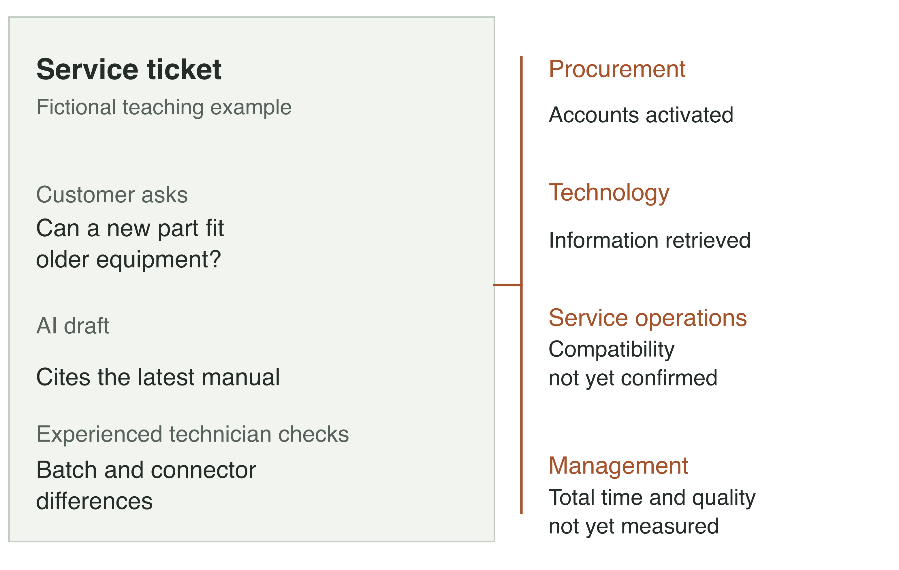
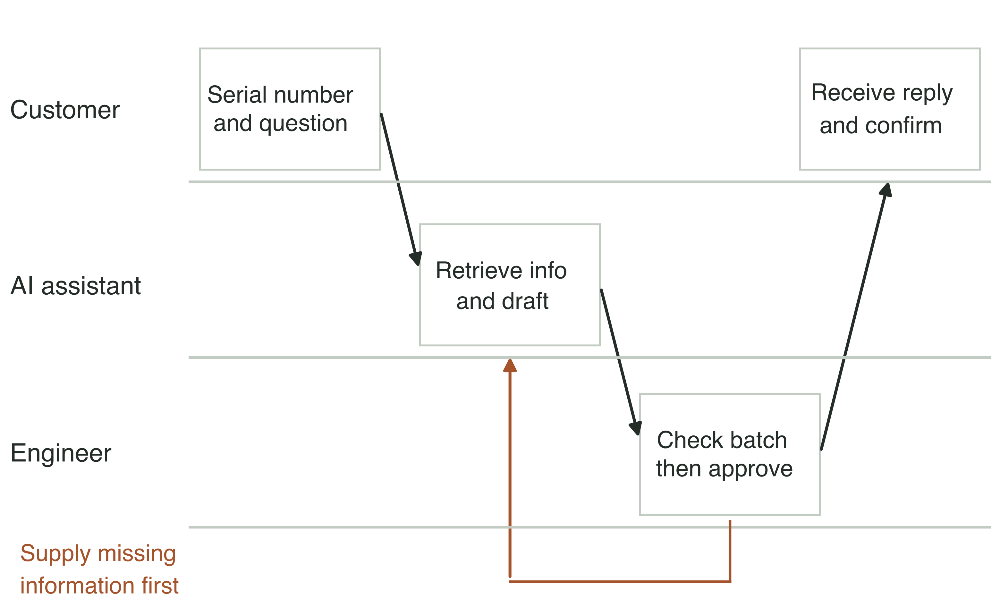
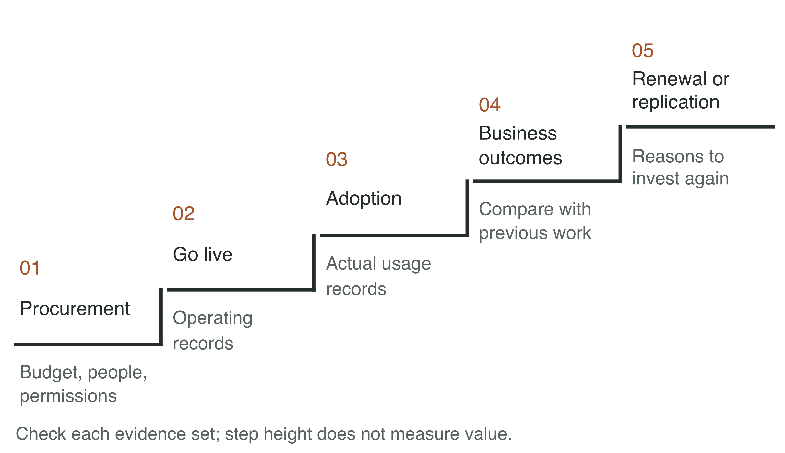
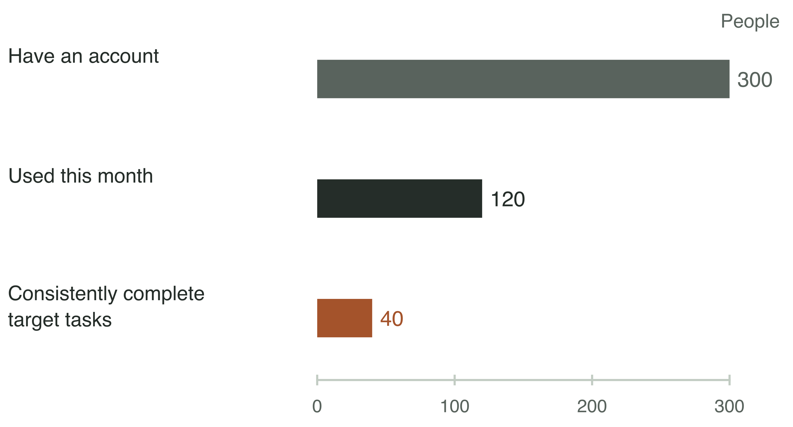
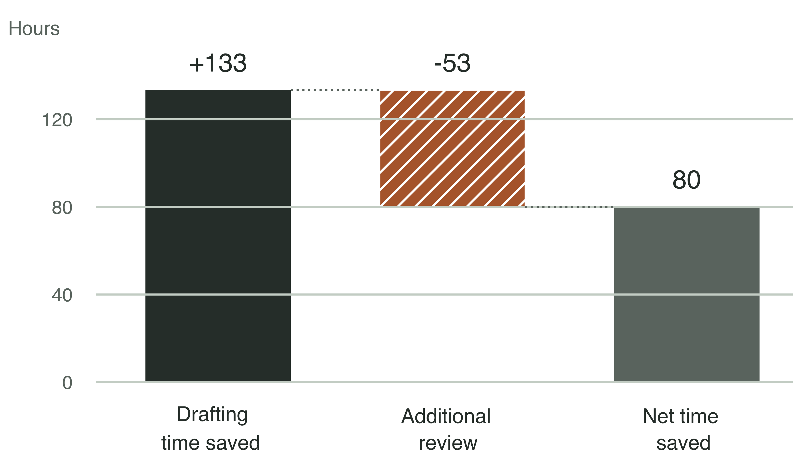

# Chapter 1 Strong AI models: why are businesses still waiting for results?

## Why does the engineer still make a phone call after AI answers?

A service engineer at an industrial equipment company receives a customer question: can a new replacement part be fitted to an older model? He asks the AI assistant his team has just started trying. The system quickly produces an answer, lists the conditions for compatibility, and cites the product manual. After reading it, the engineer still picks up the phone to call an experienced technician.

The technician points out that one batch of older equipment has a different connector from the new model. The AI cited the latest manual. The manual itself is correct, but it may not apply to the customer's equipment. Before answering, the engineer must check the equipment's serial number and production batch.

This is a fictional service scenario, used to examine problems a business may encounter when introducing AI. The company has bought user accounts, connected a knowledge base, and can demonstrate question answering. Yet to establish whether the customer's equipment can take the new part, someone still has to call the experienced technician.

As a business owner, you might suspect that the model is not capable enough, or that employees do not know how to use it. In this example, however, the system found genuine documentation and the engineer used the tool. What is missing is a crucial rule: which replacement parts each equipment batch can use. Employees used to resolve such questions by calling the technician. To have AI help make the judgment, the company first needs to document those rules.

Figure 1-1 | Procurement, technology, service operations, and business management ask different questions about the same ticket. Fictional teaching example created by the author.

Until the batch is confirmed, the engineer must still ask the technician to check. Fitting the wrong part could lead to rework or even damage the equipment. To judge whether AI helps, look at how both people's work changes. If the engineer no longer has to search through every manual and the technician only needs to confirm the batch, the tool may save time. If the technician still has to investigate from the beginning and correct the AI's answer, the work may take longer than before.

Human review does not, by itself, mean that AI has no value. An AI answer does not mean that the task is complete, either. The customer needs to know whether the part will work with their equipment, and the company is responsible for its response. Assess the investment from the customer's initial question through to confirmation of the response. Account for the time spent by both the engineer and the technician, and check whether rework has increased.

Before investing more in AI, I suggest watching one such task from beginning to end. It often takes an examination of the actual process to distinguish a model problem from missing information or a lack of decision authority. Otherwise, the next investment may only improve the demonstration while employees continue making the same phone calls.

## Should the next investment go into a stronger model or better rules?

Consider the company's service project again. The technical team wants a stronger model, while the service manager wants to document the batch and replacement-part rules for older equipment first. Both require money or staff time. Which should the business owner support first?

Start with a few tickets whose correct resolutions are already known, and compare two conditions. In one, let the system retrieve information and answer as it normally would. In the other, give it the equipment batch, applicable manual, and approval rules that service staff have confirmed, then see how the answer changes. Keep the model, question wording, and other conditions as consistent as possible so you can assess whether supplying the missing information helps. This is a starting point for diagnosis. A few tickets cannot establish that the whole system is reliable.

If the system repeatedly answers incorrectly even with complete information, investigate whether it understands the constraints and whether the task exceeds its capabilities. If it answers correctly when supplied with complete information but makes mistakes in normal use, first check whether it retrieves the right information and distinguishes where it applies. These results can narrow the investigation, but they do not establish that there is only one cause. Whether or not the model changes, the service department must first confirm which rules apply to which equipment batches.

Table 1-1 | Three problems in the same replacement-part ticket require different responses. Teaching example created by the author.

| What you observe | What to check first | Why wider use should wait |
|---|---|---|
| The batch and rules are provided, but the system still applies the wrong conditions | Whether the system understands the constraints and whether the task exceeds its capabilities | It can still answer incorrectly with complete information |
| The system finds a manual but cannot tell which version applies | Who confirms the batch rules and how the system finds applicable information | Adding more manuals may not resolve confusion between versions |
| The recommendation is usable, but nobody can approve the replacement | Who has approval authority and where the request should go | The engineer still cannot give the customer a definite answer |

Once the problem is clear, the team can organize the next step. If batch rules are missing, ask the experienced technician and service manager to document the rules for one common equipment type, then have someone with approval authority confirm them. People should continue handling batches whose rules remain unclear. The system should identify the missing information so the engineer knows what to ask, rather than having the technician investigate everything from scratch each time.

Documenting rules also has a cost. Experienced staff must make time for it, and someone must update the rules when products change. The old approach of making calls and asking colleagues also consumed time, although the company may never have recorded that cost separately. To put the rules into the system, the company must assign responsibility for maintaining them. If no one is available yet, the system can only handle tasks for which reliable information already exists.

Figure 1-2 | An example service workflow. AI retrieves information and drafts a response; the engineer checks it and approves it within their authority. Missing information is supplied first. The example assumes the engineer has the necessary approval authority; otherwise, the task must go to someone who does. Fictional teaching example created by the author.

Under this division of work, the engineer remains responsible for the response but may spend less time finding and organizing information. To test whether this arrangement works, a pilot must compare total time from receipt of the ticket to the response, response quality, and the situations that still require the experienced technician. The fact that AI generates an answer in seconds does not reveal these changes.

The comparison may also show that a category of tasks is not yet suitable for AI. Narrow the scope and try again once the problems have been addressed. Understanding which work the system cannot currently do gives the business owner a better basis for the next investment than simply buying more accounts.

## How far has the project actually progressed?

The procurement lead says the accounts have been bought, the technical lead says the system is connected, and the service manager says tickets are still difficult to resolve. They assess the same project differently because they are looking at different things. The business owner needs to distinguish these forms of progress to identify what is still missing.

This book distinguishes procurement, going live, adoption, business outcomes, and renewal or replication. I call these the five decision gates: a framework I use to assess project progress.[1] Success at an earlier gate does not answer the questions raised by a later one. For tools built in-house, procurement also covers whether the budget is available, people are assigned, and the necessary usage permissions have been obtained.

Figure 1-3 | Each stage requires its own evidence. Author's analytical framework. The height of the steps indicates the order of discussion, not the project's value.

Procurement addresses resources. Going live concerns whether the tool works in the actual work environment: can employees sign in, what information can they access, and who handles errors? Running successfully on a demonstration computer does not establish that these issues are resolved.

Adoption means that employees start using the tool in their everyday work. One engineer signs in every day but still handles every ticket by phone. Another uses the system to find information and asks the experienced technician to deal with only a few exceptions. Their login counts may be the same, but only the second pattern shows AI participating in ticket handling.

Then examine business outcomes. Has response quality declined? How much faster is the complete ticket process? How much time do the new maintenance and review tasks take? Until these questions have been answered, the team can accurately report that the system is live and people are using it, but should not rush to claim that the company has earned a return.

Once outcomes are established, consider continuing, extending use to more people, or replicating the system in another department. Success in one department may depend on complete information, suitable tasks, and someone maintaining the system. Moving it elsewhere does not guarantee the same conditions. Nor does every pilot need to run indefinitely. If a pilot was designed for a time-limited task, closing it when the task ends is normal.

Public project records need the same distinctions. The US Federal Emergency Management Agency (FEMA) ran a pilot called PARC to explore using generative AI to help local governments prepare hazard mitigation plans.[2] In January 2025, its parent department announced that three generative AI pilots, including FEMA's, had been completed. A later US Government Accountability Office (GAO) report states that, in February 2026, officials reported that PARC had been retired and was no longer in use.[3][4] The available material does not explain why it was retired, so it does not establish that the project failed. Equally, completion of a pilot does not demonstrate continued use afterward.

These distinctions let a business owner assess a project in more detail than simply calling it a success or failure. If the service assistant can retrieve information, acknowledge that progress. If it has not reduced the burden of handling tickets, keep investigating. Recognizing what works is compatible with asking what remains unresolved.

## What gives employees confidence to use AI in real work?

Between going live and employees being willing to use the system lies a practical question: who bears the consequences when it is wrong? Telling the service engineer that the model performs well is not enough to make them comfortable answering a customer. They need to know which answers they can use and which require further checks.

Morgan Stanley's public materials describe how it tested an AI assistant. A 2023 company report says the internal assistant was used to retrieve research, product, and process information.[5] A later case study published by OpenAI describes the approach in more detail. Financial advisors and prompt engineers rated AI summaries for accuracy and coherence, and the team adjusted the system in response. After launch, the team also ran daily regression tests using a set of sample questions to check that previously reliable answers remained reliable.[6]

Business staff have much more to do here than attend a demonstration. They need to identify omissions in summaries and content that cannot be used in real work so that the technical team can make changes. Repeating the original questions after a change helps prevent one fix from reintroducing another problem.

This is also why a business department cannot leave all judgment to the supplier. A supplier can build the system, but people who understand the business must judge whether an answer is suitable for the company's work. For the replacement-part ticket, if the equipment batch is unknown, the system should clearly say, "Please provide the batch information first. We cannot yet determine whether the part can be replaced." That tells the engineer what still needs checking, rather than presenting an apparently complete recommendation.

Table 1-2 | Situations to test in a service assistant. These tests were designed by the author; they are not Morgan Stanley's test questions.

| Task given to the system | What to check |
|---|---|
| The equipment batch is known and the applicable rules are complete | Whether it finds the correct evidence and produces a response that applies to this equipment |
| Both old and new manuals are available | Whether it distinguishes their scope instead of simply choosing the newer manual |
| The serial number or batch is missing | Whether it identifies the missing information and asks for it before making a judgment |
| Previously handled tickets are tested again after a rule change | Whether it applies the new rule and still answers previously resolved questions correctly |

The first round of testing can cover one category of tasks rather than the entire service operation. Within that category, however, include both straightforward tickets with complete information and difficult cases such as unknown batches or conflicting manuals. Repeatedly demonstrating easy questions does not show how the system behaves when problems arise.

An engineer who repeatedly points out missing documentation for a batch may have encountered an unresolved problem rather than being unwilling to change their habits. The team should show them what happens next: have the missing rules been added, can the questions it previously answered incorrectly now be answered correctly, and who should they ask when the system still cannot decide? Training can teach people how to operate the tool. Continued use also depends on resolving these concerns in actual work.

The same OpenAI case study reports that more than 98% of Morgan Stanley's advisor teams use the internal assistant.[6] The unit counted is advisor teams, not individual employees or all tasks. This vendor case study alone cannot establish how much of the high adoption rate resulted from the testing described above. Other businesses can learn from the testing approach, but must assess its usefulness on their own tasks.

## Where does the time saved actually go?

Suppose employees have started using the service assistant. At a project meeting, someone reports, "We have given each of 300 employees an account." After asking further questions, the business owner learns that 120 used it during the month, and 40 regularly used it to handle replacement-part tickets. The following calculation uses these fictional figures.

Figure 1-4 | Each of 300 employees has an account; 120 used the tool during the month; 40 regularly used it for the target tickets. The horizontal axis starts at zero and all three counts use the same scale. Teaching data created by the author.

All three figures may be accurate, but they answer different questions: how many people have access, how many tried the tool, and how many use it to do the work. The gap between 300 and 40 does not, on its own, show that employees are uncooperative. Some had no such tickets that month. Some tried the tool and found that it created rework. Others found it useful but rarely had the task. Investigate the reasons before deciding whether to make the tool easier to access, fix its functions, or reduce unused accounts.

Now consider the 40 regular users. Suppose each handles 20 tickets during the month, for 800 tickets in total. Using AI to draft a response saves 10 minutes per ticket compared with the previous approach, or approximately 133 hours overall. But checking and editing add 4 minutes per ticket, or approximately 53 hours. The net saving across these tickets is 80 hours.

The calculation is 40 × 20 × (10 - 4) ÷ 60 = 80 hours. The additional 4 minutes are easy to overlook: the project report records faster drafting but leaves out the engineer's checking time.

Figure 1-5 | Approximately 133 hours saved in drafting, less approximately 53 hours of additional review, leaves 80 hours saved. Labels are rounded to whole hours; the calculation uses unrounded values. Author's illustrative calculation. Unit: hours.

This calculation has several conditions. The compared tasks must be of similar difficulty, response quality must not decline, time spent on other steps must remain unchanged, and the additional checking and editing must all be included in those 4 minutes. If an error prompts another customer call, add the rework time. If the system fails and a person has to take over, those tickets must remain in the calculation. Work already included in the 53 hours must not be deducted again.

Why might the finance team still see no reduction in expenditure? Saving 80 hours does not automatically reduce payroll by the cost of 80 hours. What matters next is what employees can do with the time released.

If there is a backlog, employees may use the time to handle more tickets and shorten customer waits. But if the saved minutes are scattered throughout the day and the next task must wait for someone else's approval, little additional work may get done. The company's benefit depends partly on whether those 80 hours can be put to another use. Multiplying hours by the average wage does not reveal that difference.

Table 1-3 | Look for results where the saved time is used. Author's teaching analysis; no benefits are assumed to have been realized.

| Where the time is used | How to assess the result |
|---|---|
| Clearing the ticket backlog | Whether the backlog and customer waits fall, and whether rework increases |
| Taking on work previously planned for outsourcing | How quality, completed volume, and actual outsourcing expenditure change for comparable tasks |
| Spending more time with customers or reducing employee workload | Whether service experience or workload improves, without directly converting it into cash |
| The saved time is too fragmented to use yet | Whether scheduling, combining tasks, or changing handovers can make it usable |

Keeping the system running also costs money. Who updates information when new parts are released, handles reports of errors, and takes over when the system is unavailable? These activities may sit outside the handling time for the 800 tickets, but still require people. A decision about continued use must also account for maintenance, software licenses, integration, and training.

I would therefore neither recommend wider use solely because the project saved 80 hours nor dismiss it because total payroll stayed the same. If the time is actually used to clear the backlog and the additional operating costs are acceptable, there is a reason to continue. If time savings come with more errors, address quality first. If the experienced technician performs extra checks that nobody times, recalculate the 80 hours before using the figure to make a decision.

The business owner first needs to specify what the investment should improve: lower expenditure, more tickets completed, fewer errors, or a lighter employee workload. Different goals require different measures. When comparing work before and after AI, however, task scope and calculation methods must remain consistent. Chapter 12 examines how to verify business outcomes in more detail. For now, distinguish how much time was saved, where it was used, and what additional costs arose. This helps avoid treating saved hours as profit.

## Bring a real service ticket to the next project meeting

Return to the service project at the start of this chapter. The 80 hours were only an illustration. The company has not yet measured its own results: the batch rules for older equipment are incomplete, and there is no ongoing record of how employees handle tickets or how much total time they spend. Another smooth demonstration will still not tell the company whether to roll the tool out to everyone.

I suggest starting with one category of replacement-part tickets for which there is real demand and a business lead willing to participate. Organize the information, identify who can approve decisions, and track the handling process. Include both straightforward tickets and cases likely to cause errors, such as an unknown equipment batch.

The project lead can use the following table to bring together what each department knows.

Table 1-4 | What this service company needs to resolve next. Fictional completed example created by the author.

| Stage to examine | What is known now | Who does what next |
|---|---|---|
| Procurement | Accounts have been activated | The project lead checks how many accounts are needed |
| Go live | Question answering can be tested, but the rules for older equipment are incomplete | The service manager confirms the rules; the technical lead makes the system select information by batch |
| Adoption | It is unclear which tickets people regularly handle with the tool | Engineers record the handling process and why they ask for help |
| Business outcomes | The complete ticket process has not yet been compared | The business lead compares quality, total time, and additional work |
| Further investment | There is not yet enough evidence to support wider use | The business owner arranges corrections and decides the scope after review |

Assign each unresolved issue to someone who will investigate it. Before the meeting ends, agree who will confirm the rules for older equipment and when they will report back, and who will record tickets over what period. At the next review, check what has been established and where work remains blocked. If nobody has authority to confirm a rule, the business owner must assign that decision authority. The technical team cannot resolve an authorization problem by changing the wording of an answer.

The review may lead to different decisions. If errors persist after the rules are complete, narrow the system's scope or keep the tasks with people. If quality is maintained and total time falls but employees struggle to find the tool, connect it to their usual work interface. If existing tickets are handled well but there is no additional demand, more accounts may be unnecessary. The problem found should determine the next action.

Use the accompanying worksheet, "Five questions about the actual status of an AI project." Bring a real ticket and specify the next action, the person responsible, and when progress will be reviewed.

Someone needs to connect the business and technical work involved in confirming batch rules, putting them into the system, and checking the results. A forward deployed engineer (FDE) is one role that can take on this work. The next chapter traces the origins of the role and examines how engineers' work changes when they enter the business environment.

## Notes and sources

[1] The five decision gates are an analytical framework developed by the author from the research. They distinguish whether resources are in place, the system works, employees use it, work changes, and further investment is justified. Projects may pause, narrow their scope, or end; they do not have to keep expanding. The service company, replacement-part tickets, test designs, and working-time figures are teaching examples, not records of a real client project.

[2] US Department of Homeland Security (DHS), Federal Emergency Management Agency AI Use Cases, PARC entry (DHS-254). This chapter uses the entry to describe the project's purpose and its archived status of "Retired." That status does not establish the reason for retirement or the exact date use ended. https://www.dhs.gov/ai/use-case-inventory/fema

[3] DHS, annual accomplishments announcement dated January 17, 2025, section on generative AI pilots. The announcement covers three pilots and does not separately state what PARC achieved. https://www.dhs.gov/archive/news/2025/01/17/dhs-strengthened-and-innovated-leveraged-new-partnerships-and-invested-workforce

[4] GAO, Artificial Intelligence Acquisitions: Agencies Should Collect and Apply Lessons Learned to Improve Future Procurements, GAO-26-107859, April 13, 2026, printed page 34 (PDF page 38), Table 4. February 2026 is the month in which officials reported the retired status; it does not establish that the system stopped being used that month. https://files.gao.gov/reports/GAO-26-107859/index.html

[5] Morgan Stanley Wealth Management, Insights & Outcomes, Volume 6, 2023, printed pages 36-37 (PDF page 19). This chapter uses the report to describe the Assistant's role in internal information retrieval. https://www.morganstanley.com/cs/pdf/FOR-Insights-and-Outcomes-VOL6-layout-ebook-digital.pdf

[6] OpenAI, Morgan Stanley uses AI evals to shape the future of financial services, checked September 17, 2026. The evaluation and testing practices appear in the sections "Building a foundation" and "Strengthening trust." The figure of more than 98% refers to advisor teams. This is a vendor case study. It does not provide underlying data that would allow independent verification of the adoption rate, nor does it fully explain the measurement period or the relationship between evaluation practices and financial results. https://openai.com/index/morgan-stanley/
