# Chapter 2 Where FDEs came from: bringing engineers into the business environment

## Why is there still rework when the requirements are clear?

The customer nodded at the end of the sales demonstration. Both sides signed off after the requirements review. Yet when the system finally reached its users, new problems appeared one after another: a report did not explain how refunds should be counted; an approval process could not follow its usual route for a special customer; the same name in several systems referred to different things. The project team felt the customer kept changing the requirements. Business staff felt the system had never understood their work.

This is a fictional delivery scenario. Both sides may have taken their responsibilities seriously: presales staff assessed the product's fit, implementation staff completed the agreed configuration, and the business lead continued handling the business. But when a task passes to the next group, often only the instruction survives. The reasons behind it, the conditions requiring an exception, and who should decide are left unexplained.

A requirements document can say “report revenue by store,” but the team still has to determine to which store a refund should be attributed and how to handle orders while a store is closed. Experienced employees know what to do in everyday work, yet may not realize they need to explain these details when writing requirements. Engineers who hear requirements through several intermediaries may receive a succession of change tickets without recognizing that they arise from the same unresolved question.

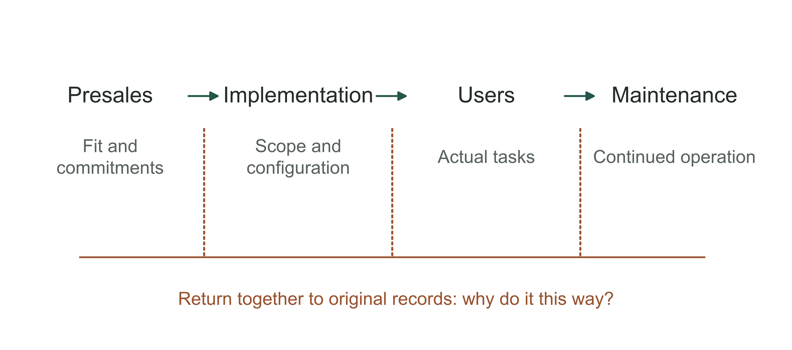

Figure 2-1 | How handovers lose the reasons behind a problem. Handover breakdown diagram created by the author. Each participant may complete their own part; dashed lines identify where people need to check actual records together. They do not imply that conventional roles necessarily fail.

The forward deployed engineer (FDE) approach brings engineers who can build and change systems into direct contact with users. They see actual problems, change the system, and bring their findings to the product team for discussion. This book retains the abbreviation FDE because being on site tells us where someone is, but not what they are authorized to change or responsible for delivering.

This arrangement also has a cost. An engineer working at a customer site has less time to develop the general product. A succession of requests from one customer may fill their schedule. The business owner must weigh how much engineering time is worth investing to reduce repeated explanations and identify problems earlier. Can the work help the next project, or must it be repeated for every new customer?

The following history focuses on two questions: how engineers in the field understand problems and change systems, and how that work helps the product and team. Job titles provide clues; specific responsibilities reveal how a company works.

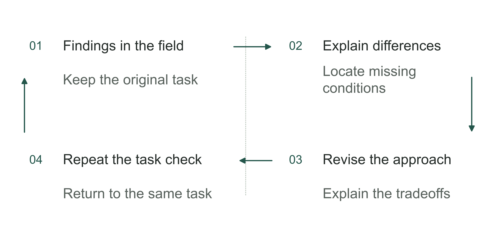

Figure 2-2 | When rework appears, revisit the original requirement. Author's analytical tool: check the original problem rather than simply asking the next group to patch the system.

## Start the history of the name with records we can verify

Among the public materials verified for this book, data analytics software company Palantir is the earliest company confirmed to have formally used the FDE title. A careers directory preserved by the Internet Archive on March 31, 2009, already lists a Forward Deployed Engineer position for Australia.[1] The name was therefore in public recruiting use by the date of that snapshot. The snapshot date is neither the date the position was created nor the date the term was coined.

A Palantir filing disclosed by the US Department of Labor in the same year also uses the full FDE job title.[2] Recruitment records and formal filings complement each other. Neither establishes the role's creation date or total employee count.

A 2010 conference program uses the FDE title in the biographies of several named individuals and also lists other engineering and analytical roles.[3] This shows that FDE appeared beyond a single job advertisement. The original document is identified in the chapter notes.

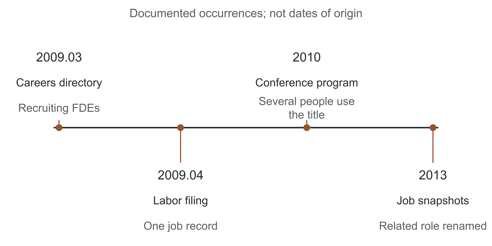

Figure 2-3 | Early public records of the FDE title. Historical entries drawn from recruiting snapshots, Department of Labor data, and original conference materials.[1][2][3][4] Entries are equally spaced for readability, not to represent elapsed time. A documented occurrence is not a date of origin.

In two recruiting snapshots from 2013, the same listing changes from Embedded Analyst to Deployment Strategist, with continuity in the responsibilities and an ongoing emphasis on working with FDEs.[4] This suggests that field deployment already involved different responsibilities. It does not establish that the whole company changed titles at the same time.

These records show that one role did not perform all field work. Some people built systems; others worked with business staff to define problems and help users adopt them. The two sides needed to work together. Businesses can learn from this division of work, but a long history does not establish that hiring people with the same title will produce the same results.

For a business leader, the history shows that FDEs existed before the large language model boom. Putting complex software to work for customers has long required engineers to resolve problems in the field. AI can handle more tasks, but still needs reliable information, clear processes, and access permissions. Without those conditions, even a strong model can get stuck in the same places.

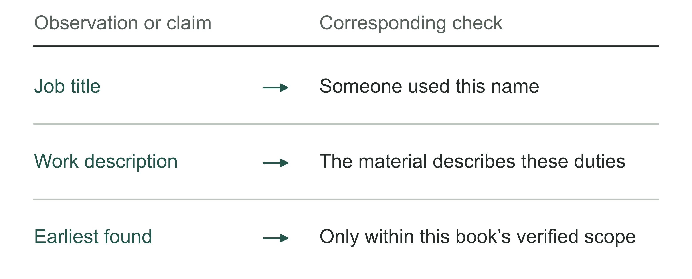

Figure 2-4 | How to read historical records. Author's analytical tool: a name, a working method, and a claim about origins require different strengths of evidence.

## The working method belongs to more than one job title

Palantir was not alone in sending engineers to work alongside customers. In a retrospective written years later, early Aster Data engineering leader Chris Neumann described sending core engineers to customer sites from late 2008, where extended work together helped them understand problems.[5] This participant's recollection shows that other businesses tried similar approaches. It is not contemporaneous evidence that they formally used the FDE title at the time.

The distinction matters. A company may have product engineers work with users without creating a role called FDE. A job advertised as FDE may mainly involve presales validation and technical support. By 2014, a historical MemSQL job posting used the FDE title for responsibilities spanning proof of concept work, customer support, relationship management, and product feedback.[6] Once the name spread beyond one company, the combination of work could change.

A business owner need not begin by asking who is the most authentic. It is more useful to ask a prospective team about a specific problem likely to arise: if the customer says a result is wrong, can you see the original work records? Can you check directly with the people doing the work? Can you change the system? Is there a clear feedback route when the core product needs improvement? After a change, who confirms that it has entered everyday work?

Table 2-1 | Distinguish names, mechanisms, and results when reading historical material. Author's synthesis, not a simple ranking of the materials' value.

| Material you encounter | What it can establish | What it cannot yet establish |
|---|---|---|
| Early recruiting records and formal filings | The title was in use at the time | Who invented the name; the total team size |
| A participant's retrospective years later | How the participant explains their experience | Contemporaneous corroboration of every detail |
| The same title in different companies' job postings | The name spread and responsibilities overlap | Identical working methods or economic outcomes |

Understanding these approaches can also help a company choose an arrangement that fits. A midsize manufacturer may not need to copy a large software company's staffing structure. Two existing engineers and a business lead with time to participate may be enough to reduce requirements being passed through intermediaries. If the problem is already clear, the company may simply need dependable implementation services. Adding an exploratory team could increase costs.

Professional services and implementation teams can also understand the business, help employees use tools, and send findings back to the product team. The comparison concerns how responsibilities and authority are organized, not which roles should disappear. Different team structures can perform the same work.

Table 2-2 | Differences to preserve when comparing working methods. Author's checklist.

| Dimension | Question to check |
|---|---|
| Contact with real work | Can the team access original tasks and users? |
| Authority to make changes | Can it change configuration or code, or only make recommendations? |
| Feedback route | How do findings from the field influence product changes? |

## What actually changes when engineers work in the field?

Return to the kind of project described at the start. Suppose a delivery company wants to reduce the time spent handling orders with exceptions. This is the chapter's fictional teaching example. The requirements document says “send an automatic alert when an address anomaly is detected.” Only when an engineer first sits beside a dispatcher do they see that an alert does not finish the job. The dispatcher still checks whether this is a long-standing customer, whether the address is a new building number inside a business park, and whether the driver can confirm it first. Only then do they decide whether to ask customer service to contact the customer again.

Not all these judgments necessarily merit automation. The engineer first needs to establish which follow stable rules, which rely on temporary information, and which require someone with authority to decide. Replacing an alert with an AI-generated explanation may leave the dispatcher making exactly the same checks, with an extra paragraph to read.

Following the dispatcher through a task reduces guesswork. The engineer can see where a record comes from, where it stalls, and who supplies information, and can ask why the dispatcher avoids a particular button. For example, clicking it overwrites existing notes that are needed at shift handover. Looking only at click rates could easily suggest that employees do not know how to use it.

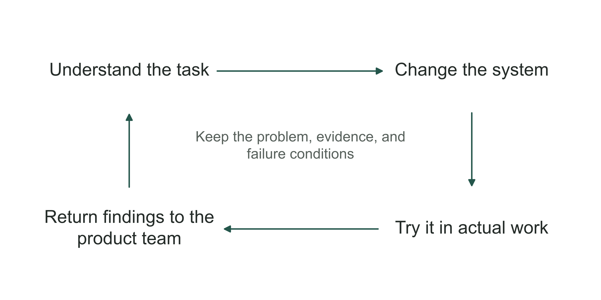

Figure 2-5 | From findings in the field to product improvement. Author's synthesis of the improvement process. Each change is validated on actual tasks. What returns to the product should be an explainable common problem, not an arbitrary copy of customers' raw data.

The engineer can then define the problem more accurately: keep the dispatcher's existing notes, automatically fill in address information already available, and return only the uncertain parts to a person. This version may look like a smaller feature, but it is closer to the actual task. Whether to continue still depends on observing total handling time, errors, and human takeover. “People in the field like it” cannot substitute for results.

Working in the field also changes the order of engineering decisions. The team may originally have planned to connect every mapping and customer system, then train a complex model. After seeing the task, it may find that the longest wait comes from nobody taking ownership of the exception queue. Establishing an assignment rule first may then help more than increasing model capability. Testing this hypothesis on the spot can reduce investment in building things in the wrong order.

Working together does not require sitting in the same office every day. Following a ticket remotely, joining a shift handover, or reviewing authorized operating records can also help an engineer understand the work. What matters is seeing the specific process and being able to question actual users. Days spent traveling cannot stand in for business understanding.

Understanding the work does not grant unrestricted access to customer data. Investigating order exceptions may not require copying the entire customer database; a problem can first be reproduced in a test environment. The team should agree the access scope with the customer. If de-identified samples or a controlled environment suffice, wider access is unnecessary.

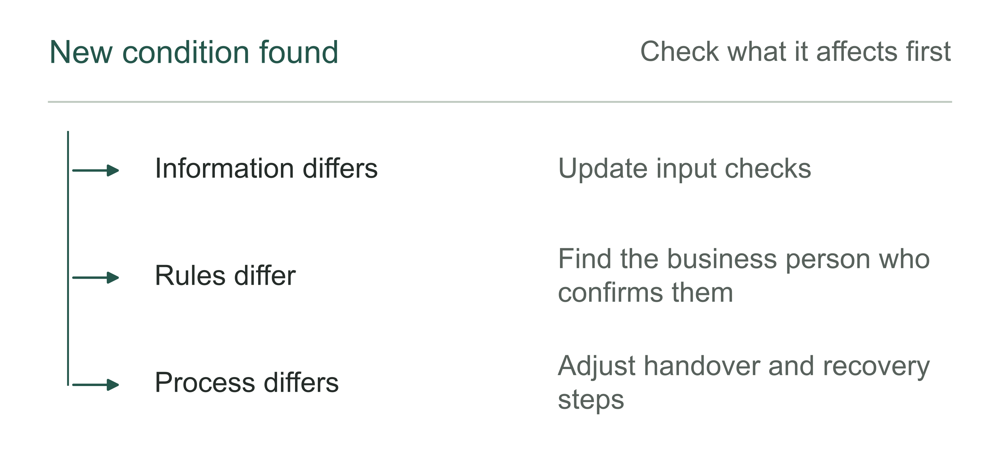

Figure 2-6 | What do differences in the field change? Author's analytical tool: use the kind of difference to identify where a change belongs, rather than attributing every problem to the model.

## Connecting two sides also means being pulled by both

The FDE is easily portrayed as an all-purpose expert: able to code, understand the business, communicate, and get the business owner to make decisions. That combination has value. But if all responsibilities rest with one person, the project may lose continuity when they leave.

Palantir's historical materials consistently include roles working alongside FDEs. The 2013 recruiting record cited above connects business deployment with FDE collaboration. A Deployment Strategist posting preserved for this book likewise emphasizes understanding important problems, data, and users, encouraging use and training, and working with engineering roles.[4][7] The lesson is that field deployment needs complementary responsibilities. Every individual need not perform all of them to the same depth.

In the delivery-company example, the business lead should decide which exceptions must be escalated, and the engineer should make the system follow those rules. The product lead judges which requirements belong in general capabilities; operations staff handle problems after launch. An FDE can bring these parties together, but should not quietly make all the customer's business decisions for them.

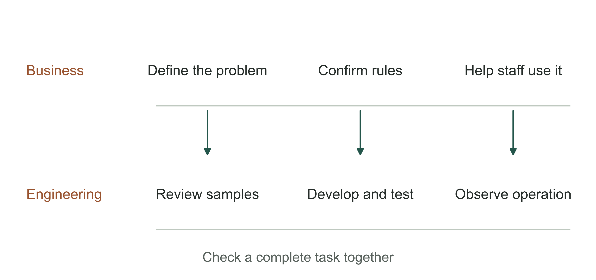

Figure 2-7 | Two strands of work in field deployment. Author's illustration of responsibilities, not a reproduction of Palantir's organization chart. The business strand defines the problem and conditions for adoption; the engineering strand changes and tests the system. Both participate in acceptance using actual tasks.

Some teams stay on site for a long time, yet the company accumulates little experience. Engineers keep receiving change tickets and business staff keep making requests, but nobody decides which requirements can wait. The product team intervenes only in serious failures. The backlog grows, while people still cannot explain the main problem.

The business owner can sit in on an ordinary change meeting: what problem will this change solve, which existing rules will it affect, and why do it now? “The customer requested it” is not enough. If every issue must wait for the owner personally to decide, examine what decision authority the team has actually received.

The team should also let engineers say that something should wait. Automatically rewriting an anomalous address may seem convenient, but without a check it could write an incorrect address back to the main system. Start with a recommendation that a person reviews. Consider automatic writeback only after the verification method proves reliable.

When assigning a field team, specify three things together: which actual tasks it can access, which systems it can change, and which business matters it cannot decide on its own. Broad responsibilities without specific arrangements for access, releases, and escalation still leave engineers passing messages.

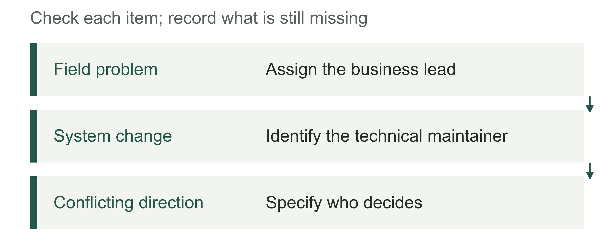

Figure 2-8 | What support do these dual responsibilities require? Author's analytical tool: the person connecting both sides needs organizational support and cannot hold all approval authority.

## How can custom work leave something reusable?

Field work attracts criticism because it can look like a labor-intensive business. Every customer needs people, and every project has special requirements. Must staffing grow in step with revenue? “Our engineers are highly efficient” does not answer the question. The company must establish whether repetitive work actually falls.

In the delivery example, a customer's list of anomalous addresses is highly specific to that customer. Capabilities such as identifying missing information, generating items for confirmation, preserving human edits, and recording approvers may be common across customers. Both emerge from field work, but enter the product differently. Copying the customer's list into the next project is inappropriate and does not demonstrate reusable capability. A configurable component for the confirmation process may reduce repeated development later.

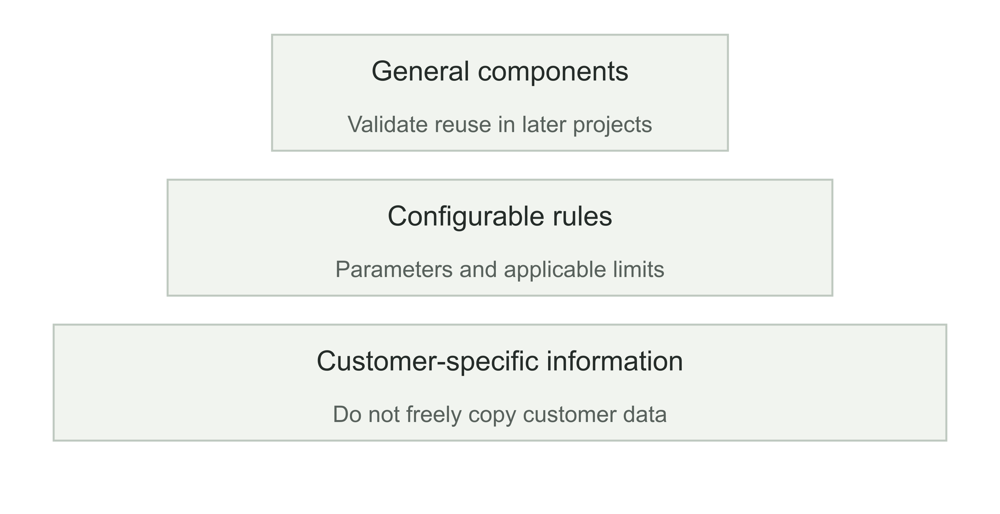

Figure 2-9 | Which field outputs can feed back into the product? Author's layers of reuse. From bottom to top: customer-specific outputs, configurable rules, and general components. Later projects must validate reuse at the higher levels; naming something reusable does not make it so.

Methods for checking missing data, including exception samples in tests, and writing results back after human takeover may also help later projects. Record their purposes, limitations, and failures first, then let the product team decide which deserve to become shared components. Chapter 14 explains how to test whether another colleague can actually use them.

Not every requirement deserves to become a product feature. A complex request unique to one customer can make a product harder to maintain if forced into a general configuration. Conversely, if several customers repeatedly encounter the same problem and the team still copies scripts separately for each, field investment is being wasted. The product lead and deployment team should regularly discuss which differences to retain and which repetitions to eliminate.

Begin the project review with two lists: outputs that may be used later, and work that must still be done customer by customer. Authorization, data verification, and adoption arrangements belong on the second list and must remain in future budgets.

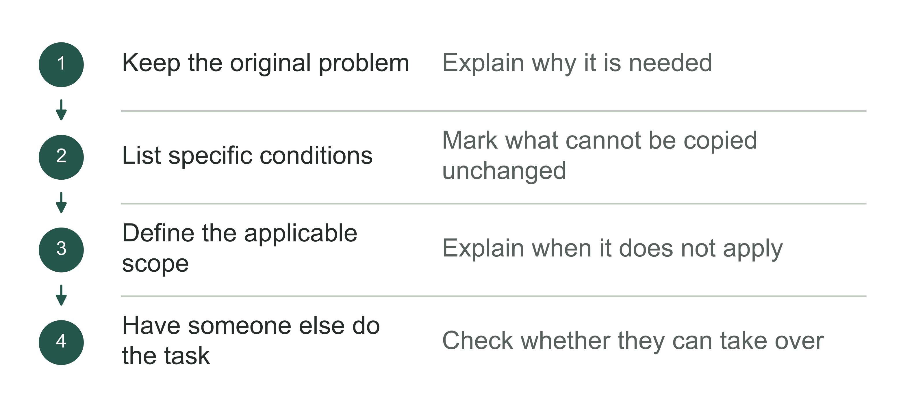

Figure 2-10 | How to confirm that custom outputs can serve the next project. Author's analytical tool: documentation is an intermediate step. The person taking over must also try completing a task.

## What if a customer request conflicts with product direction?

Even a clear customer request can pose a problem for the field team if the product team believes it does not belong in the general product. Continue with the fictional delivery company: a major customer wants a set of approval fields used only by that customer added to the exception page. Sales sees this as a condition of renewal. The field engineer knows it can be built quickly. The product team worries about maintaining two different workflows indefinitely. Each sees different costs.

Having the most senior person decide does not replace the explanation needed. First establish whether the customer really wants a special page or simply needs certain approval information preserved; whether the existing configuration can meet the need; and, if development is necessary, who will handle future upgrades and testing. Separating the requested form from the business purpose may reveal a less costly solution.

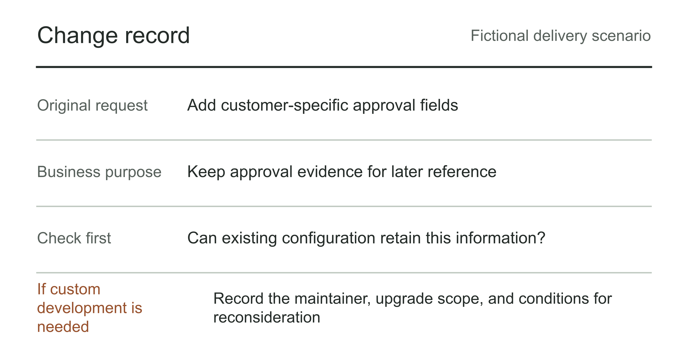

Figure 2-11 | A change record that explains the tradeoffs. Author's fictional change request. Business purpose, choice of approach, maintainer, and conditions for reconsideration appear on the same page. This records a discussion; it does not imply that a real customer has confirmed the approach.

If existing configuration can preserve the approval information, show the customer how to configure it. There is no need to write a second set of code just to demonstrate engineering capability. If the requirement is truly specific to that customer, a separate implementation is possible, with its maintenance scope and exit arrangements explained. There is a stronger case for adding it to the product only if other customers have similar needs and the team can explain the conditions under which the feature is generalizable.

The review should not focus solely on whether an output entered the general product. Custom development for one customer may have a clear commercial rationale. Adding a feature to the general product may make it more complicated for others. Check whether the original problem was solved, ongoing maintenance is affordable, and other users bear unnecessary inconvenience.

Field engineers need a route to discuss these tradeoffs with the team. Rewarding only signed contracts and new features encourages people to agree to every request and avoid saying what should wait. Pursuing only product uniformity may ignore real differences between customers. The company needs to specify who decides, in which meeting, with both development and maintenance costs made clear.

The change record should preserve why the team chose configuration, a dedicated implementation, or the general product, and which changed conditions would require reconsideration.

Some field work also needs to be stopped deliberately. If several rounds of checking show that the customer cannot supply essential information, or that the actual benefit is insufficient to support continued development, the team should propose a pause. Engineering time already spent is not sufficient reason to spend more. Recording confirmed limitations, outputs worth retaining, and restart conditions has more value than adding features to hide a project that has lost direction.

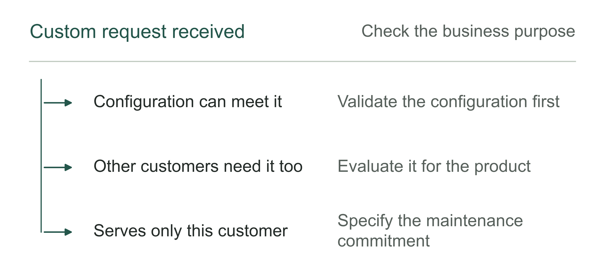

Figure 2-12 | How customer requests affect product decisions. Author's analytical tool: each route needs a recorded reason and conditions for reconsideration.

## Account for the time and money spent in the field

For the customer, payments to the field team are only part of the investment. Business staff spend time in interviews, preparing samples, and handling exceptions. Key departmental staff working with the project for weeks do less of their other work. Whether this investment is worthwhile depends on whether the team is progressively clarifying the problem and whether actual tasks improve.

For the provider, a deployment may include investigating the problem, customer-specific development, shared feature development, and operating support. A single total called “service fees” makes it difficult to see where time went and which work helps the next delivery. The following allocation by activity is for investment analysis only. It does not address how expenses or assets are recognized in accounting.

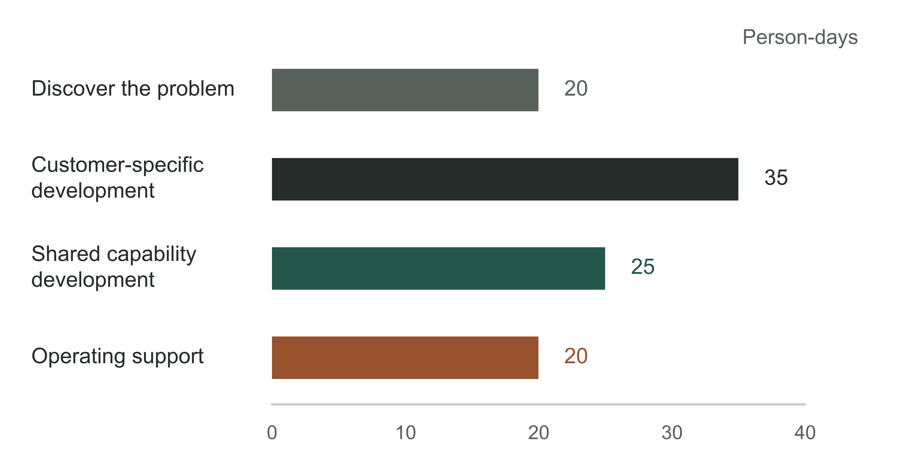

Figure 2-13 | How to separate the work invested in a deployment. Fictional illustrative calculation: 100 person-days of work over one month, allocated to discovery (20), customer-specific development (35), shared capability development (25), and operating support (20). These figures illustrate categories, not an industry benchmark. Developing shared capabilities does not establish that reuse benefits have been realized.

The 25 person-days show only how much time was spent developing shared features. Judging that investment requires staff costs, contract revenue, the support period, and the work actually avoided in later projects. Check especially whether work fell or was merely transferred to the customer or support staff. Chapter 15 considers how these investments affect the economics of the delivery business.

For the technical lead, categorizing the investment helps explain work the customer cannot see. Completing tests and upgrade paths may add no features that month but may reduce rework in the next deployment. Later records must support that rationale: which defects fell, and what was reused in which projects? Not all internal housekeeping should be called platform development.

When comparing two delivery proposals, include the provider's work, the customer's required participation, and support after launch. A lower price may require more customer staff. Fewer days on site may simply leave problems until after launch. Compare total investment within the same task scope, rather than only the engineer's daily rate.

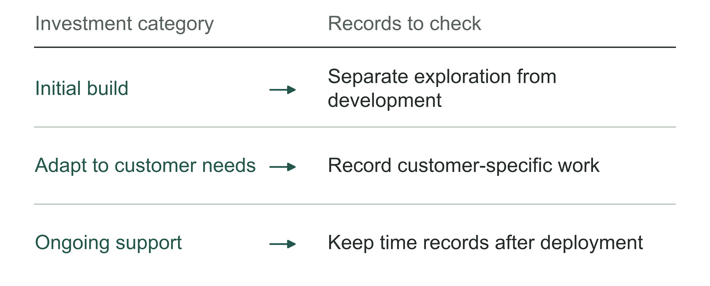

Figure 2-14 | Which records reveal deployment investment? Author's analytical tool: one quote cannot substitute for a complete record of investment.

## How can a business owner tell what they are buying?

Suppose two providers both offer FDE services. Company A promises two senior engineers on site and monthly time reports. Company B promises to follow one category of actual tasks first, then deliver a working process, exception records, and maintenance instructions. These promises alone do not settle the choice. A may have a mature delivery method; B may simply write good proposals.

Ask both for the same kind of evidence: one past or planned change showing how a business problem became a system modification, who approved launch, how use was observed, and how the work passed to the next maintainer. Materials involving customer privacy can be de-identified. For a project that has not happened, request a delivery design that can be reviewed. A case study does not guarantee that its results transfer to your company without conditions.

Table 2-3 | Delivery checklist designed by the author. Examine what outputs contain, rather than simply checking that documents with the right names exist.

| What the team should do | Inspectable outputs it should leave | What to address first if missing |
|---|---|---|
| Understand the problem and narrow the scope | Actual tasks, constraints, and items deliberately left out | Involve the business lead in verification |
| Change the system and confirm it works | Change records, tests, and release instructions | Specify the environment, authority, and review |
| Achieve actual employee use, with someone responsible for maintenance | Usage, exception, and maintenance handover records | Assign takeover responsibility and review arrangements |

The same table also tests the customer. If no business lead can define scope, no administrator can provide the necessary permissions, and nobody will take over operations, even excellent engineers may remain trapped in temporary coordination. Buying delivery capability does not outsource every internal responsibility along with it.

Ask about exit arrangements too. A system dependent on the original engineer's memory may look delivered but still depend on that individual. At a minimum, the next maintainer should know where the data comes from, why rules were written that way, which exceptions cannot be automated, and when to restore the old process. The departure date is not the completion criterion. What matters is whether the recipient can keep working.

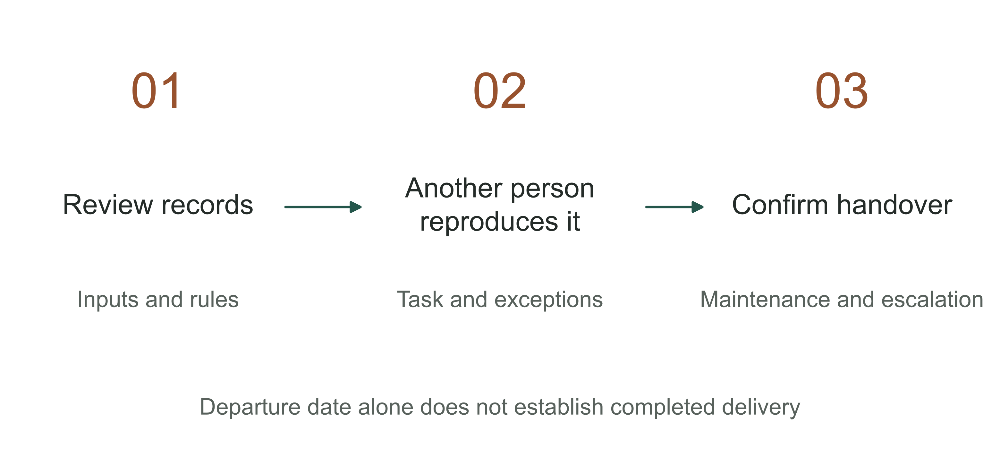

Figure 2-15 | Enable the next maintainer to take over. Author's handover checklist path. Another maintainer uses the records to reproduce a task, handle an exception, and check the escalation contact. This organizes a check; it does not imply that any real project has completed the exercise.

Table 2-4 | Handover exercise after the field team leaves. Author's checklist.

| Exercise | How to confirm a successful handover |
|---|---|
| Rebuild the same environment | Find the version, dependencies, and configuration instructions |
| Complete a task | The recipient completes it independently and records the result |
| Handle an exception | Restore operation by following the steps and locate the responsible person |

The chapter's blank checklist can be used with providers or when forming an internal team. Select one project and specify its tasks and required outputs. “Have the recipient handle an order exception using the instructions” is easier to verify than “empower the business.”

The history of FDEs helps a company decide whether engineers should engage with business problems earlier, what authority they need, and how feedback and handover should work. The next chapter distinguishes several categories that are easily confused: an FDE in a job posting is a person, software with the same name is a product, and a digital role concerns how the company assigns work. The distinctions affect whether a company should hire, procure, or reorganize responsibilities.

## Notes and sources

[1] Palantir careers directory, Internet Archive snapshot dated March 31, 2009. See the International section. “Earliest” refers to the materials verified for this book, not a claim of worldwide invention. https://web.archive.org/web/20090331102704id_/http://www.palantirtech.com/careers/positions

[2] US Department of Labor, FY2009 H-1B data, case I-09093-4887487. A filing is not an employee census. https://www.dol.gov/sites/dolgov/files/ETA/oflc/pdfs/H-1B_Case_Data_FY2009.xlsx

[3] Palantir, GovCon 6 Program Guide, 2010. The company's original document is preserved in a public archive and is used here to verify job titles. https://www.wikileaks.org/hbgary-emails//fileid/7654/2783

[4] Two snapshots of the same Palantir job listing. They do not establish a company-wide date for a title change. https://web.archive.org/web/20130116134716id_/http://www.palantir.com/careers/OpenPosDetail?id=a0m80000000gtfMAAQ ; https://web.archive.org/web/20130219045039id_/http://www.palantir.com/careers/OpenPosDetail?id=a0m80000000gtfMAAQ

[5] Chris Neumann, retrospective on his work at Aster Data, July 15, 2026. A first-person recollection years later, not contemporaneous evidence of naming. https://chrisneumann.com/archives/what-is-a-forward-deployed-engineer

[6] MemSQL FDE recruiting page, snapshot dated September 21, 2014. Used only to discuss responsibilities and the spread of the title. https://web.archive.org/web/20140921060337id_/http://boards.greenhouse.io/memsql/jobs/16862

[7] Palantir, Deployment Strategist job posting. Roles can change as recruitment needs change. This chapter describes responsibilities from the preserved page, not an industry-wide standard. https://jobs.lever.co/palantir/e0ab8226-b928-4e3a-bf87-08fe7b1ea595

The delivery company and the 100 person-days in this chapter are fictional teaching examples. The diagrams and business judgments are the author's synthesis, not interviewees' statements, real customer results, or industry statistics.
