# Chapter 3 Who brings AI into a business: FDEs, agents, and digital roles

## The same name may describe different things for sale

A business owner preparing to launch an AI project receives three proposals. The first recommends hiring an FDE. The second demonstrates software called AI FDE. The third offers to deliver ten digital employees. All three discuss understanding the business, using tools, and delivering results. Without identifying what is being offered, the discussion quickly becomes a price comparison: the annual cost of an engineer, the cost of a software account, and the cost of a digital employee.

This is a fictional procurement scenario. The proposals use similar language but may be selling a person's services, software, and an arrangement for doing work, respectively. Even on the same price sheet, their unit prices cannot be compared directly.

This book discusses the three separately. A human FDE is an engineer responsible for investigating problems, developing systems, and delivering them. A software agent processes tasks and calls tools within a specified environment. A digital role is an arrangement for doing work that must specify tasks, authority, inputs and outputs, who reviews the work, and who takes over exceptions. “Digital employee” sometimes refers to the software executor within that arrangement and sometimes is simply a product name. Procurement still requires asking exactly what will be delivered.

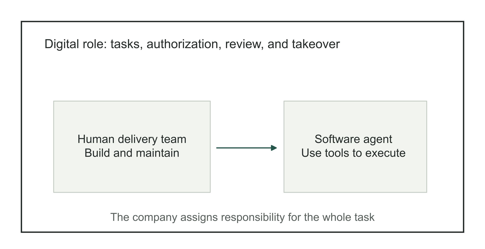

Figure 3-1 | The relationship between people, agents, and digital roles. Author's diagram for distinguishing the categories involved. A human team builds and maintains software; the company decides which work the software undertakes and who is responsible. A digital role may use several tools or rely entirely on rule-based automation.

Consider financial reconciliation: read statements, match records, identify differences, then notify finance staff for review. An agent can perform some of these steps. Completion still depends on whether statements arrive on time, who handles exceptions, and how results are written back to the accounting system. Buying software that can call tools addresses only part of the work.

Likewise, hiring a highly capable FDE does not automatically grant them authority from every department. They can build a reconciliation process, but their technical position alone does not authorize them to decide which differences can be written off. Identifying what is involved lets the business owner discuss capability, authority, price, and acceptance separately.

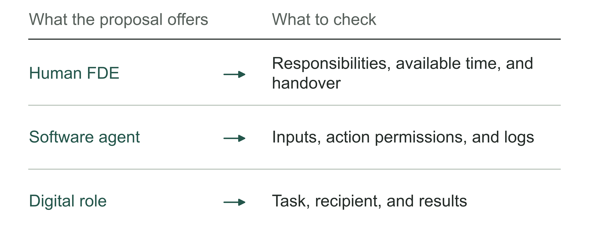

Figure 3-2 | What you buy determines which commitments to check. Author's analytical tool: identify the object first, then compare prices and effects.

## Who must a human FDE work with?

Changing a reconciliation process requires someone to explain differences, someone to build the matching process, and someone to organize its use. Job titles need not correspond to these activities one for one. A forward deployed software engineer (FDSE) typically emphasizes system development. A Deployment Strategist emphasizes understanding business problems, interpreting data, and helping users use the system. An Applied AI Engineer may emphasize turning model capabilities into applications. Companies recombine these responsibilities. A generic industry job chart cannot replace a specific job description.

Palantir's Deployment Strategist recruiting material explicitly mentions working with FDEs.[1] Business and engineering staff need to deliver together. Before copying job titles, a company can ask what is currently missing: someone to clarify the problem, someone to connect the solution to the system, or someone to organize use after launch?

Continue with the fictional reconciliation task. A business lead understands the types of differences but cannot write data interfaces. The engineer can build matching logic but does not know why the same transaction may be recorded on different days. They must define the handling rules together and obtain approval from someone with authority. Different people may lead the work, but the rules must be jointly confirmed.

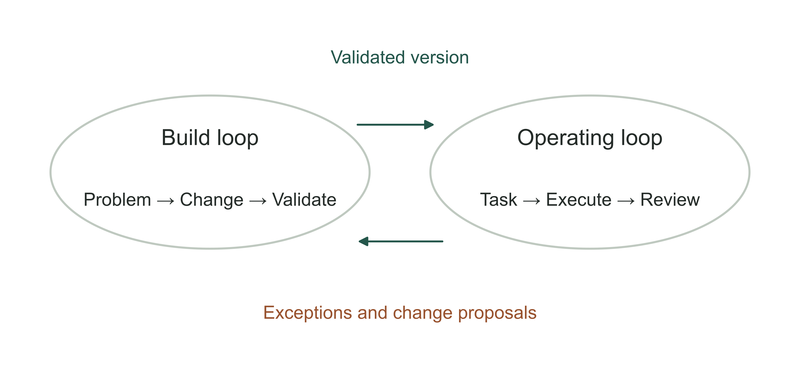

Figure 3-3 | Building the system and operating it day to day. Author's diagram of two loops. The build loop changes the system; the operating loop handles tasks. Operational exceptions enter the change list, and revised versions are checked again. Business rules cannot be changed directly without review.

Assessing a human FDE requires more than counting code written. They may find that some differences are easier for people to handle, or that the existing system suffices if input information is standardized. These judgments reduce development work but may allow the project to enter use earlier.

Asking an engineer to be responsible for results does not mean requiring them to guarantee every business outcome. Customer staff participation, the reliability of source data, and approval of business rules all affect delivery. List these conditions individually and specify who will resolve them. Chapter 6 examines responsibility in detail. For now, do not let a job title conceal the specific work.

When interviewing a candidate or choosing a service team, the business owner can ask for the story of a real change: how the problem was found, who disagreed, and how the result was eventually validated. Confidential details can be replaced by a de-identified account of the process. Such an account reveals experience handling engineering and business disagreements more clearly than a list of familiar models.

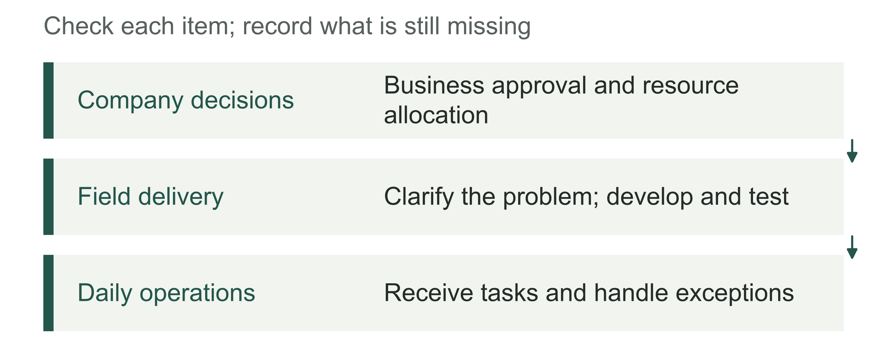

Figure 3-4 | The responsibilities of human FDEs and the company. Author's checklist: participating across departments does not confer all of the company's decision authority.

## Palantir's AI FDE is a specific software product

Palantir's official documentation defines AI FDE as an interactive agent for working with its Foundry data and application platform through conversation. Given a user's request and context, it can call platform tools for data transformations, code, and ontology operations. Here, an ontology is a model organizing business objects, relationships, and executable actions. The documentation also says that operations respect the user's existing permissions and present modifications through branches or code review proposals. Changes can therefore be checked in a separate version before a decision to merge them.[2] This describes the product as of the chapter's verification date. Available capabilities depend on the customer's environment and feature configuration.

AI FDE here means software. It does not justify dividing the entire human FDE profession into traditional and AI versions. “AI FDE” in a job advertisement may also mean a person delivering AI applications in the field. Check the context: is the company hiring someone or selling software? Is it describing a delivery team or showing a product interface?

The product illustrates how software can take over some engineering operations: generate transformation code, examine execution results, then revise the code in response to errors. Being able to execute those steps does not establish an understanding of why the company needs the work. Both must be checked separately.

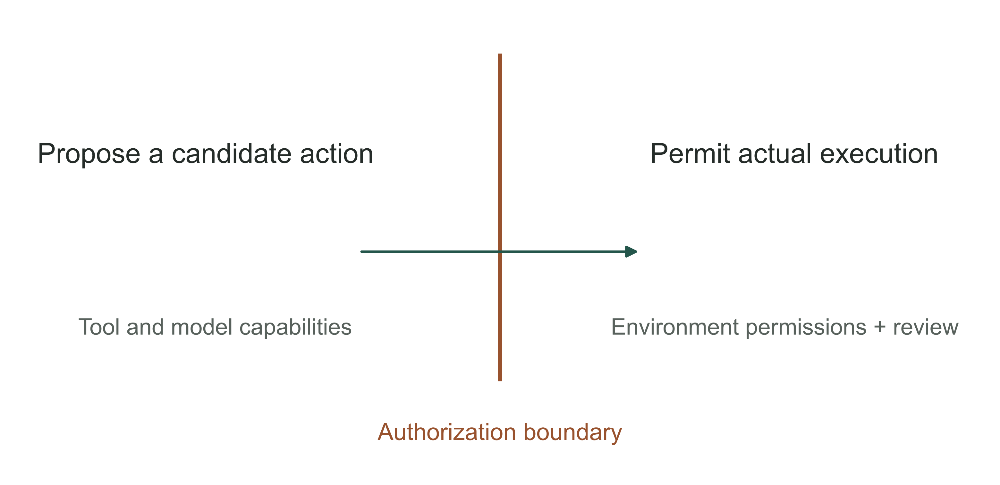

Figure 3-5 | Capability and authorization are separate boundaries. Author's illustration of an authorization boundary, not a Palantir interface or a complete security architecture. Generating an action does not establish permission to execute it. Actual execution still depends on environment permissions and the company's review requirements.

In the reconciliation example, software can generate code to match records from two systems. Once the code runs, samples must still be checked to establish whether matching follows business rules. Whether the differences can be cleared automatically through offsetting entries requires checking approval authority. A “complete” indicator in the interface cannot replace these judgments.

A company buying such a tool should also understand its scope. An agent proficient on a particular platform does not necessarily understand or directly modify all the company's systems. Connections across platforms, identities and permissions, data meanings, and exception handling require specific design. Treat it as one possible engineering tool for a human team, then test which work it reduces on your own tasks.

To assess whether the software is worth buying, compare delivery tasks within the same scope: which operations does it reduce, and how much review and rework does it add? Product documentation can identify where to start testing. Benefits still require the company's own task records.

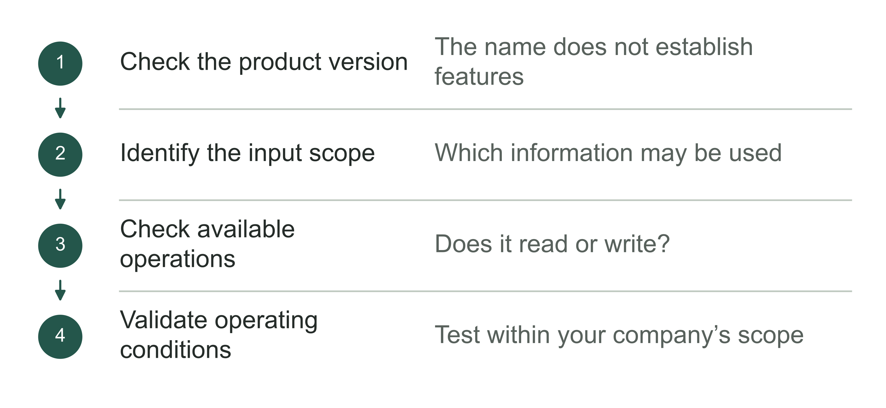

Figure 3-6 | What to check before buying software. Author's analytical tool: advertised capabilities need confirmation in a specific version and environment.

## Trace a task to define the boundary of a digital role

“Digital employee” can suggest that software fills an entire human job. A more reliable approach follows a task and asks when it begins, what information it needs, what it may do, who receives the result, and when it must stop. This reveals which parts the software performs and which work remains.

Page 116 of the 2026 Hunan Province AI Supply Capability List, issued by the Hunan Provincial Department of Industry and Information Technology (湖南省工信厅), includes a digital employee offering from Bank of China, Hunan Branch. It describes processes for data collection, analysis, judgment, filling gaps, reporting, and alerts, and states that operations center staff still check and correct exceptional information.[3] The description makes the human work outside the automatic process visible.

The list also reports more than 200 digital employees developed to date and projected annual efficiency gains equivalent to the work of 23 people. This is the submitting organization's estimate, not evidence that 23 employees' workload has already been saved. The material does not provide exception rates, complete human labor time, or a net savings formula sufficient for independent verification. Inclusion in a government list does not mean these effects have been independently audited.[3]

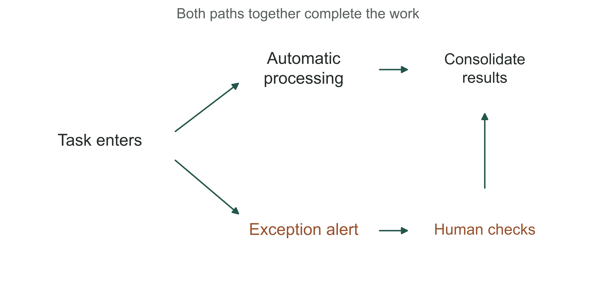

Figure 3-7 | How routine tasks and exceptions take different paths. Drawn from the responsibilities described in the Bank of China Hunan submission, with specific business fields omitted.[3] Automatic processing and human exception checks together constitute the work. The split does not represent actual proportions, and arrow widths do not encode quantities.

In this example, a task may still be waiting for a person after the automatic process issues an alert. Counting only successful software runs misses the remaining work. The company must check whether someone receives the exception, handles it on time, and allows the process to continue after corrections.

A digital role need not use generative models throughout. Clearly specified data entry and transfer can use process automation; unstructured information may require recognition or language models; important judgments can remain with people. The mix of technologies should serve the task. An AI product name is no reason to turn every step into model inference.

Include human review in the same workflow when drawing the role's boundary. Otherwise, developers may deliver only the automatic part while business leaders believe the whole task is covered. Discuss the exception queue's owner, handling deadline, and recovery conditions alongside the normal path.

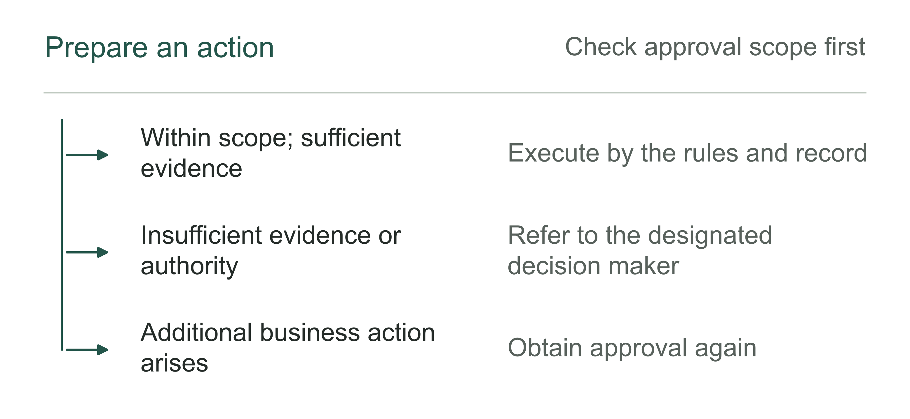

Figure 3-8 | Has a digital role crossed its task boundary? Author's analytical tool: generating an answer does not automatically establish authority to execute an action.

## How procurement documents turn “employees” into inspectable work

A 2025 procurement of robotic process automation (RPA) digital employee services by the Wuzhou Social Insurance Administration Center (梧州市社会保险事业管理中心) offers another way to examine the distinction. RPA is software technology that performs repetitive operations according to preset rules. “Robotic” in its name does not necessarily imply generative AI. The award notice lists renminbi (RMB) 608,000 as the award amount. The competitive consultation documents specify business processes, software configuration, authorization, human takeover, and operating observation requirements.[4][5] The notice establishes a procurement award; the documents establish what the procuring entity required. Neither substitutes for actual operating records.

The three designer configurations and eight agent configurations are quantities of software, not three developers and eight business employees. Nor do the five categories of business process represent the complete responsibilities of five people. Confusing tools, instances, processes, and personnel makes calculations of unit cost and people replaced wrong from the denominator onward.

Table 3-1 | Author's comparison of counting units. Wuzhou configurations come from the procurement documents; the explanatory rules support the distinctions in this chapter.[5]

| Unit being counted | Questions it can answer | What it should not directly convert into |
|---|---|---|
| Designer or agent software, or licenses | Which operating resources were purchased | Actual active tasks or employee numbers |
| Processes and completed task volume | Which work is covered and how much is processed | Complete jobs requiring no human involvement |
| Human review and takeover hours | How much human participation the system still needs | Positions that can be eliminated or net cash savings |

The documents also require business administrators to configure authorization scope, and operators to be able to check data in the original business systems and pause or take over processes.[5] Acceptance should test whether these operations work, permissions are correct, and operating records are retained. Checking for a digital employee icon in the interface is insufficient.

A takeover requirement on paper does not mean takeover is effective. If nobody checks alerts in daily operations, or if the recipient cannot establish which steps have already executed, work may still be impossible to restore promptly. Acceptance can include a representative exception exercise: stop a task at an agreed point, have the recipient identify completed actions, then restore operation using the records. Whether this works requires actual validation.

The Wuzhou materials lack a public final acceptance report, measured success rates, takeover rates, and hours saved. This book therefore uses them as a procurement design example. They serve a different purpose from the Bank of China Hunan list: Wuzhou provides detailed procurement constraints, while the list describes the submitting organization's way of operating. Moving one example's controls into the other would combine separate evidence into an apparently complete success story.

## Who takes over when something goes wrong?

Continue with the fictional reconciliation task. The system judges that two records with identical amounts and nearby dates refer to the same transaction. Human review finds that they actually belong to different customers. The response requires more than telling the model to be more careful next time. First establish which actions have already occurred.

If the system has only generated a recommendation, withdraw the candidate result. If it has written a reconciliation status, correct that status and retain the record. If a downstream payment or customer notification has already been triggered, involve the responsible people to address the consequences. Different permissions carry different recovery costs. Do not wait until after launch to discover that the system retained no action records.

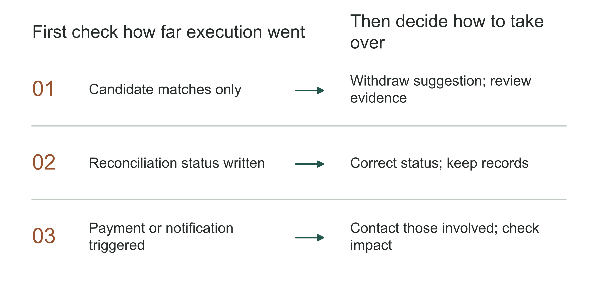

Figure 3-9 | Different execution states require different takeover actions. Author's fictional comparison. The same error requires different responses when it remains a recommendation, has changed a status, or has triggered downstream action. The diagram does not assign legal liability or prescribe an industry-wide operating procedure.

The delivery team must now work with the business lead. Software cannot decide which losses the company should bear or what commitments it should make to whom. Assigning one AI lead is insufficient. The business owner should know who initiates business remedies, technical recovery, and external communication. Specific arrangements must fit the company's existing responsibilities. This chapter's diagram does not assign legal liability.

The mistaken match clarifies the distinction between people, software, and digital roles. The human FDE investigates why matching failed to check customer identifiers and corrects the system. Software uses authorized data to propose matches again. The complete reconciliation task also includes sending conflicts to finance for confirmation and recording how they were resolved. More software instances cannot perform those responsibilities by themselves.

The human work remaining after software takes over some tasks may become harder. Someone who once entered records one at a time may now specialize in complex exceptions, each requiring more effort. Even if total hours fall, check whether the exception handler has enough capacity and needs training. Software record counts do not reveal these changes.

Compare like tasks over the same measurement period and include every human step. More software instances do not establish greater benefits. Record separately where saved time goes, whether outsourcing or overtime falls, and whether more work is completed. Do not directly convert hours into cash benefits.

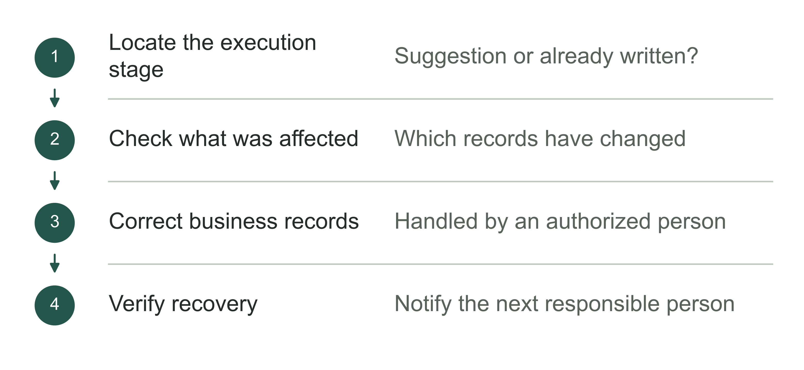

Figure 3-10 | Before taking over, check what the system has already done. Author's analytical tool: after software stops, confirm whether business operations have recovered.

## How do you prevent more assistants from interfering with each other?

Suppose the fictional company launches a reconciliation assistant, then adds assistants for follow-ups, reports, and document verification. Each completes part of a task in a demonstration. In the same work chain, however, they may share customer IDs, settlement status, and contacts. A changed field can affect several software executors. As numbers grow, management must look beyond each assistant's prompt.

First identify what they share. If they read the same rule table, an update must ensure each obtains the same effective version. Otherwise, the same transaction may receive different treatment. If several assistants can notify customers, prevent duplicate messages about the same issue. Testing each assistant separately cannot replace testing the connected process.

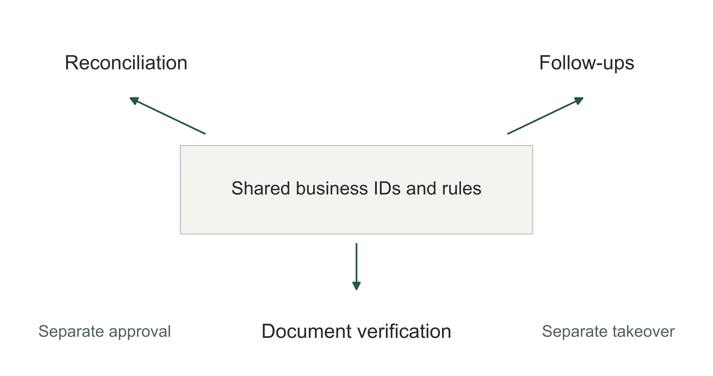

Figure 3-11 | Shared dependencies across digital roles. Author's fictional diagram of multiple roles. Three tasks share business identifiers and rules, with their own approval and takeover arrangements. Connections represent dependencies, not actual call frequency.

Rule versions, task IDs, and change records must have traceable sources so the team can establish which assistant acted under which rules. Chapter 9 explains how data fields relate to approval records; Chapter 10 discusses recovery and validation after an error.

If two assistants send follow-ups to each other, first specify who owns the same issue and what counts as completion. Technical staff can then prevent duplicate execution. Otherwise, software may keep sending reminders while nobody handles the issue.

FDEs, platform engineers, security staff, and business teams can share this work. New tools do not immediately require an entire new set of departments. Shared rules and everyday handling must, however, be assigned within existing responsibilities. In a small team, one person can hold several roles; as tasks increase, separate them according to the actual workload.

Before adding digital roles, the business owner can ask: “If a shared interface breaks today, which tasks stop, who receives the message, and how does the original work continue?” This reveals readiness for wider use more clearly than a longer list of assistants.

Before copying software to another department, reconfirm the information, rules, and approvers. A reconciliation assistant working in one department may not work as usual with a different statement format or approval requirements. The next chapter examines pilot selection. Defining the task scope first makes it easier to compare which conditions change later.

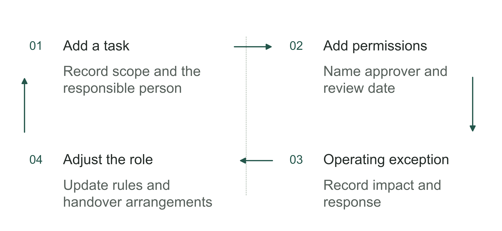

Figure 3-12 | Reconfirm responsibility as roles are added. Author's analytical tool: every expansion requires an updated record of who is responsible for what.

## Specify the people, software, and work arrangements in each proposal

Faced with the three opening proposals, the business owner can first ask for separate descriptions: who develops the system and helps employees use it, which software runs, and which part of the work it undertakes. A complete service may include all three, but should still describe them separately before discussing how many people it replaces.

For example, a reconciliation proposal should specify that the service team delivers interfaces and test records; software reads the agreed data and proposes candidate matches; finance approves the treatment of differences; and operations staff handle failures. Check the service scope, software permissions, and work arrangements separately to identify what the quote leaves out.

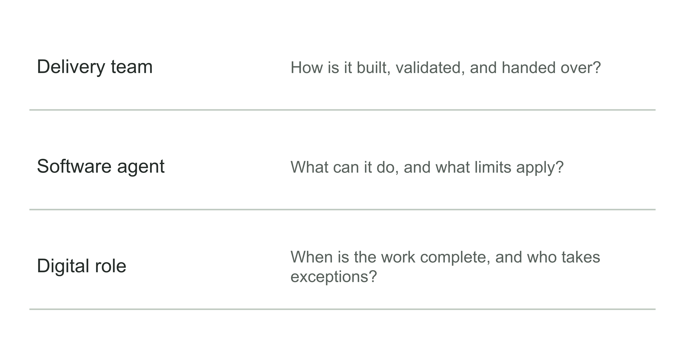

Figure 3-13 | Three categories call for three sets of acceptance questions. Example of the author's identification tool. A delivery team, software, and a digital role each require different checks. The questions initiate verification; use the blank worksheet at the chapter's end for a complete record.

The distinction also clarifies prices. Software licenses, ongoing deployment services, and business services that include human review need different staff and incur different ongoing costs. Calling an offering a digital employee does not make delivery and service costs disappear.

The distinction matters equally in system design. “Have the agent complete reconciliation” does not specify authority. “Propose matches, then write back through the agreed interface after finance approval” tells engineers which interfaces to build, which situations to test, and what to restore after an error. Future expansion of permissions should also be validated first, with approval recorded.

Table 3-2 | Check for mixed categories in a procurement proposal. Author's checklist.

| Proposal wording | Details still needed |
|---|---|
| “Provide one FDE” | Is this staff time or a software license, and what work does it cover? |
| “Add one role” | What are its tasks, authority, recipient, and work outputs? |
| “Complete the business process automatically” | Which actions run automatically and which still require human approval? |

A company can test the combination on a bounded piece of work first. Discuss wider use if software actually reduces delivery operations and review and operating support remain manageable. If takeover responsibilities are unclear, more software instances will merely add tasks waiting to be handled.

Clarifying the delivery team, software, and work responsibilities enables selection of the first task. The first AI project need not cover the most roles or use the most agents. It must answer a specific question: once the work is done, what evidence justifies continuing the investment?

## Notes and sources

[1] Palantir, Deployment Strategist. Used to explain how two roles work together, not as an industry-wide job standard. https://jobs.lever.co/palantir/e0ab8226-b928-4e3a-bf87-08fe7b1ea595

[2] Palantir, AI FDE Overview, rechecked September 6, 2026. See the definition, operating mechanisms, permissions, and branching descriptions. Features may change; no delivery outcomes are inferred from this documentation. https://www.palantir.com/docs/foundry/ai-fde/overview

[3] Hunan Provincial Department of Industry and Information Technology, 2026 Hunan Province AI Supply Capability List, PDF page 116, entry 429. Figures and operating descriptions come from submission materials. Projected efficiency has not been confirmed by an independent audit. https://gxt.hunan.gov.cn/gxt/xhtml/pdfjs/web/images/pdf_rgzn02.pdf

[4] China Government Procurement Network (中国政府采购网), award notice for Wuzhou social insurance RPA digital employee services, May 20, 2025. The award amount is not actual payment or benefits already realized. https://www.ccgp.gov.cn/cggg/dfgg/cjgg/202505/t20250520_24621872.htm

[5] Wuzhou Social Insurance Administration Center, competitive consultation documents for the same project. See the procurement requirements on configuration, authorization, operating monitoring, and takeover. This book has not obtained the actual acceptance report. https://oss-gxhlw.unicloudgov.com/guangxi-gov-open-doc/1023FP/undefined/450406/10007282919/20255/d3a6b151-9124-4e3a-b81d-c02860bb0557.doc

The reconciliation task, procurement scenario, and three-object tools are the author's teaching designs. Public materials for the Chinese examples do not disclose a formal FDE team. This chapter discusses similar responsibilities without establishing that such positions exist in those organizations.
