# Chapter 4 Choose the problem first: where to begin your first AI project

## Five departments, five top priorities

A regional chain is preparing for its first AI project. Operations wants a store question-answering assistant; finance wants to check promotional settlements; procurement wants automatic replenishment; marketing proposes generating campaign content; and the business owner wants to query business data at any time. Every idea can be demonstrated, and every department can describe its own difficulties.

This chain is a fictional teaching example, not Shuyi or an actual client of the author. It has plenty of ideas. What it lacks is a way to compare them. If the decision depends on who presents best in the meeting, the first approval may go to the smoothest demonstration or the proposal with the most supporters, while the problem most in need of attention moves down the list.

The owner can ask each department to bring a recent work record: a settlement statement that remains unresolved, a policy question that required repeated confirmation, or a dataset that once led someone to the wrong conclusion. First examine how the work was handled, then discuss where AI might help. “Improve financial efficiency” gives little basis for estimating the investment. A specific document reveals the information and people involved.

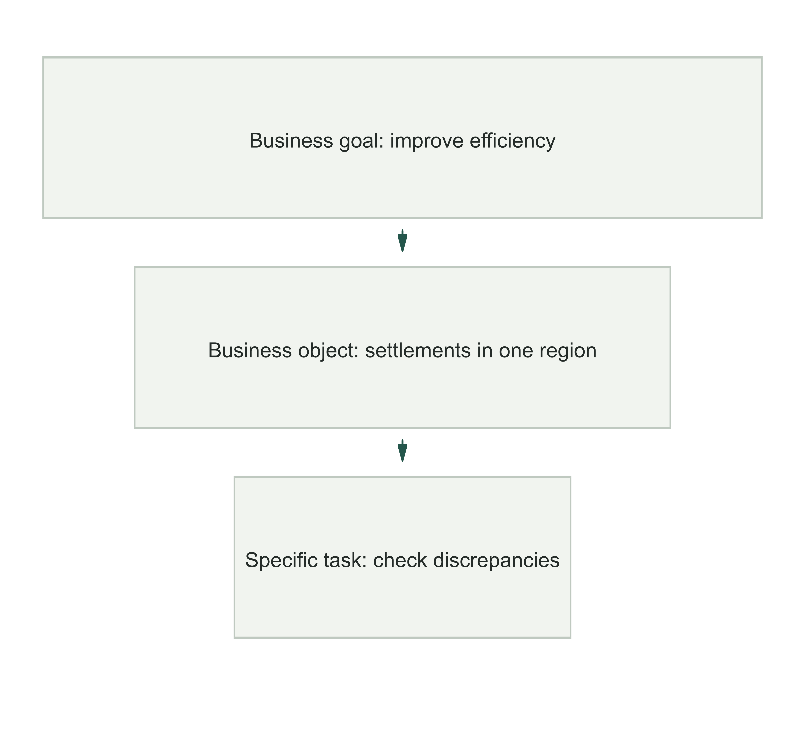

Figure 4-1 | Narrowing a broad ambition to an observable task. Task-scope illustration by the author. The fictional company narrows “improve business efficiency” to particular people, objects, and actions. Narrowing establishes a boundary for observation; it does not mean that a smaller problem is always better.

The first project should also help the company learn to judge whether AI is useful. If the scope is too broad, changes may have many causes, making it difficult to identify what needs fixing. If the task is too slight, the project may produce only a demonstration without testing real data and coordination problems. A suitable starting point combines work worth improving with records that can reveal what changed.

Selection can proceed in two rounds. First check whether the necessary data, authorization, and takeover arrangements are available. Once those conditions are met, compare value, technical feasibility, risk controllability, data readiness, and organizational cooperation. This sequence prevents a project with attractive potential returns but no practical way to start from taking first place.

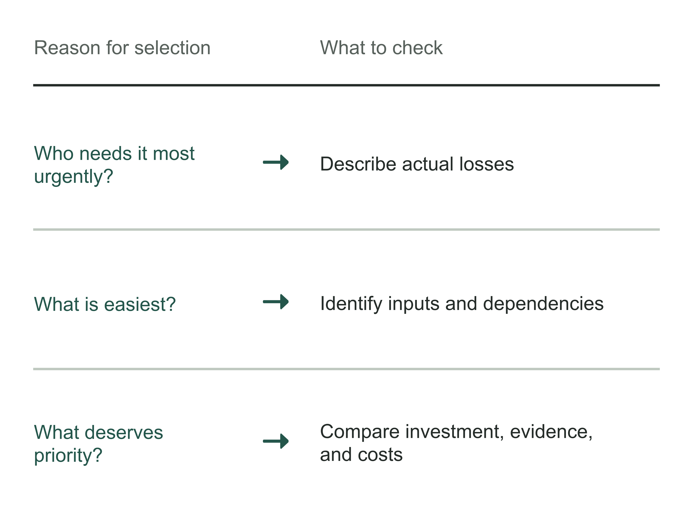

Figure 4-2 | Comparing the priority of five projects. The author's analytical tool: urgency, ease, and importance are three different questions.

## Shuyi first clarified what “store” meant

The Shuyi Shaoxiancao (书亦烧仙草) Data Agent submission included in a case collection published by the China Chain Store & Franchise Association contains a detail that a technical architecture diagram could easily obscure: different departments meant different things by “store count.” External announcements focused on signed stores, operations on stores placing orders, and franchise development and store construction on newly opened stores.[1] The departments were not necessarily calculating incorrectly. They were answering different questions.

If the owner asks a software agent, “How many stores do we have?”, even a correctly retrieved database number may fail to answer the intended question. When assessing expansion, the gap between signing and opening matters. When planning the supply chain, actual ordering and operating status may matter more. Natural-language querying does not establish agreement on these statistical definitions.

According to the submission, the project began with store operations, where management practices were relatively mature, metric definitions clearer, and data quality better. With stores as the central business object, it coordinated finance, franchise development, store construction, and the supply chain. Agreement on definitions and their online publication took one and a half months; the overall project lasted four and a half months.[1] These durations come from the company's submission, not a standard timetable for every Data Agent project.

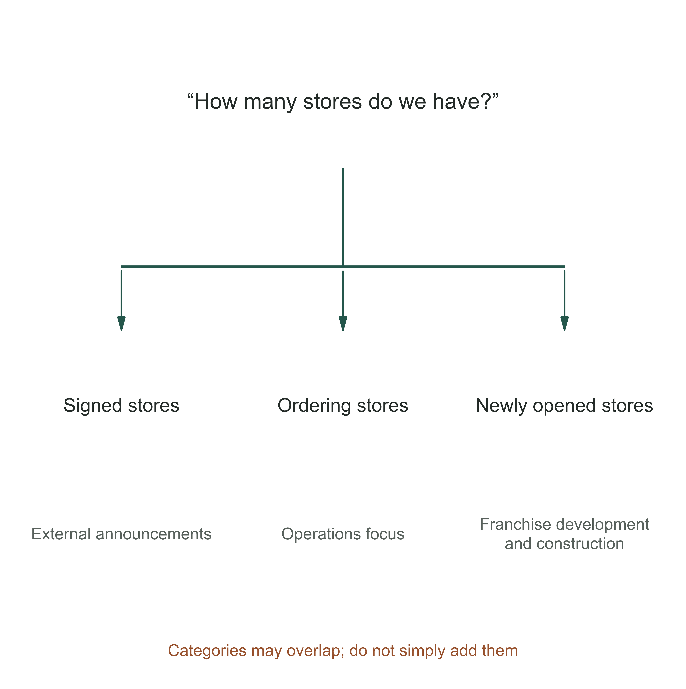

Figure 4-3 | One store question requires different definitions. Conceptual branches based on the Shuyi submission.[1] Store categories may overlap and cannot simply be added together. The company must confirm how each is counted.

Earlier material offers another clue. In a presentation by Shuyi CIO Wang Shifei published by the provider Digitforce, the team described identifying more than 600 metrics, discussing them with senior management, and initially focusing on more than 200 metrics across the main areas of business operations. Business departments participated in development, with disagreements referred to a metrics committee for collective decisions.[2] This presentation is not an independent audit, but it describes scope reduction and organizational decision-making in concrete terms.

The two sources describe aligning metric definitions and narrowing project scope, respectively. They cannot be combined into a before-and-after account of a single project. The useful lesson for project selection is to identify the business object to investigate, then bring together the people who can explain it and decide how to measure it. That establishes which data and departmental cooperation the work requires.

The association's material also reports a 60% reduction in annual operations and maintenance costs and anticipates nearly 10 million renminbi (RMB) in economic benefits.[1] Expected benefits are not realized cash, and the cost change lacks working records sufficient for independent recalculation. This case is used here primarily because it describes problem selection and delivery publicly. This chapter does not use its financial figures to establish a return on the method.

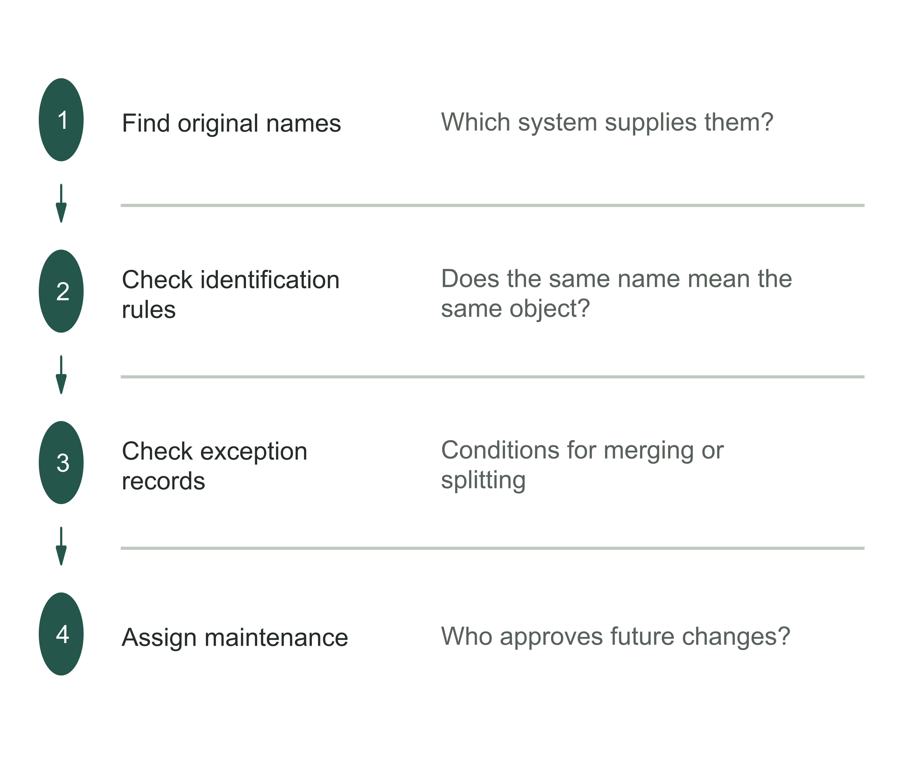

Figure 4-4 | What to check before aligning a business object. The author's analytical tool: unclear statistical definitions affect subsequent reports and judgments.

## Starting with one problem may involve several systems

Shuyi's approach can prompt two opposite misreadings. One is that company-wide data governance must be completed before any AI work begins. The other is that a small use case requires no attention to data or organizational issues. Both are oversimplifications.

Choosing the problem clearly tells the team which data to organize first. For store operations, it can align relevant metrics without organizing every dataset in the company at the same time. Yet information held by finance, franchise development, or the supply chain may still be necessary. A limited scope can involve several departments. For each source, confirm why it is needed and who will provide it.

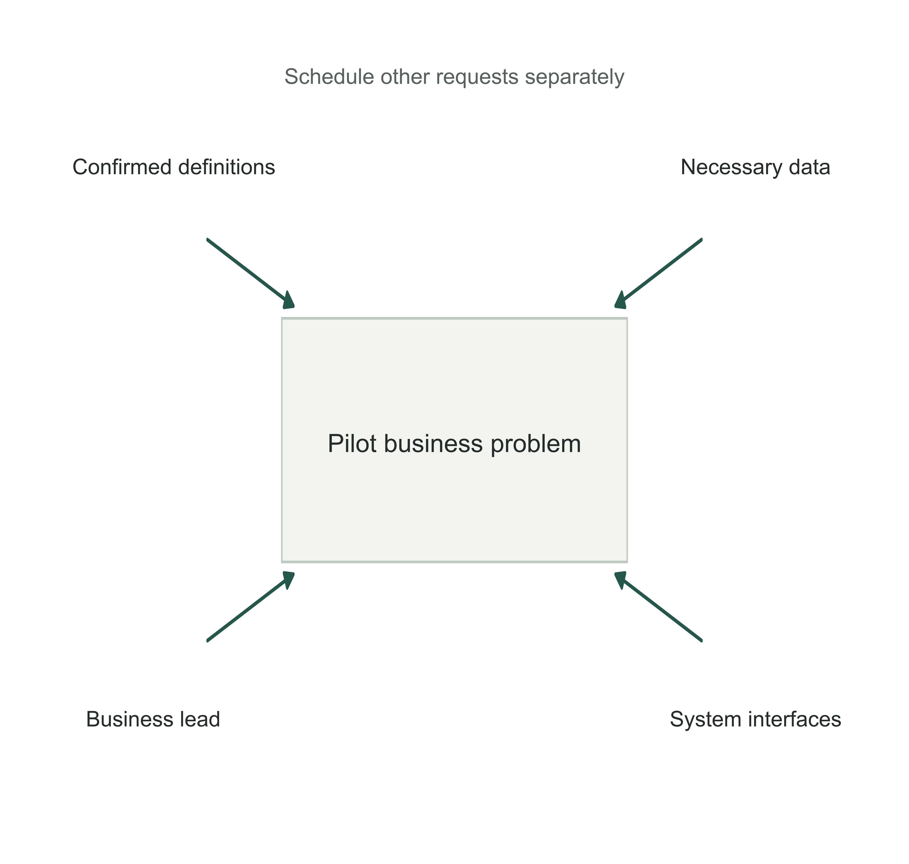

Figure 4-5 | Narrow the scope while retaining necessary dependencies. Scope diagram drawn by the author from the case's approach, not Shuyi's actual system topology. The pilot problem remains at the center, connected only to necessary definitions, data, and business cooperation. Other candidate requests remain outside the current scope.

Return to the fictional chain. The owner wants to ask every day, “Which store needs the most attention?” That question involves sales, gross profit, inventory, complaints, and causes of exceptions. Requiring comprehensive business advice at the outset may be too broad. A narrower version would be: “Within one region, list the stores whose sales changed significantly yesterday, using existing agreed definitions, and have the operations supervisor check the causes.” This still has practical value and makes it possible to observe whether data arrives on time, definitions agree, and the supervisor is willing to use the result.

Breaking the broad recommendation down this far lets the team test the conditions needed for the next step. If it cannot reliably generate even a list of changes, automated business decision-making has no sound starting point. If the list is accurate but the supervisor never acts on it, the team needs to understand why it is insufficiently useful, rather than keep adding model capabilities.

Project scope also needs explicit exclusions. For example: no forecast of next month's revenue, no automatic changes to store performance assessments, and no direct operating instructions to stores. These may be considered later, or they may be unsuitable for this project. Writing down the exclusions helps prevent departments from loading all their expectations into a single “intelligent business assistant.”

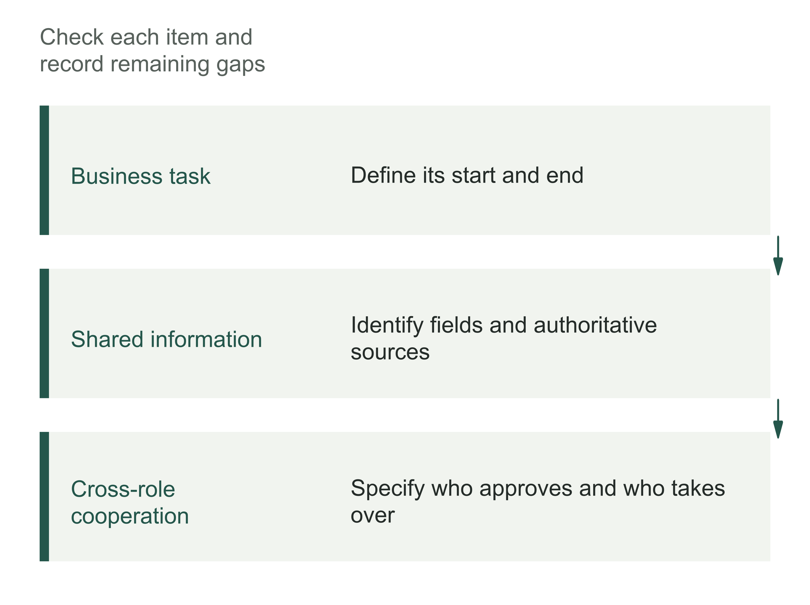

Figure 4-6 | Dependencies beneath a single problem. The author's analytical tool: pilot scope can be limited while its necessary dependencies remain complete.

## Write the problem card before discussing the technology

A problem card suitable for decision-making should include at least the work object, frequency, current handling method, desired improvement, and observation period. These five items are straightforward, but another colleague must be able to check them. Instead of “many settlement discrepancies each month,” specify how many statements awaited review in the most recent settlement cycle, how a discrepancy is defined, and who handles it.

When the current process or time spent is still unknown, write “to be measured” and identify the records to examine. This gives the team a useful next action, unlike an assumed savings percentage based on impressions. Gaps in a project proposal do not justify presenting estimates as statistics.

Table 4-1 | The author's example problem card. No savings amount is entered because a sufficient baseline has not yet been obtained. Chapter 5 develops the budget and the basis for judgment.

| Problem-card field | Fictional entry | Check before approval |
|---|---|---|
| Object and users | Promotional settlement statements handled by regional finance | Whether all discrepancy types are included |
| Current burden and desired outcome | Long waits for checking; aim to shorten end-to-end processing time | A set of actual records and the manual steps |
| Scope and observation period | One region, one settlement cycle, with human approval retained | Data availability, staff time, and someone to handle exceptions |

The problem card should describe a business outcome, rather than a feature name. “Build a RAG knowledge base” is a technical direction that does not yet explain why the work is worthwhile. RAG means retrieval-augmented generation: find relevant material first, then have the model organize an answer from it. “Help store managers find current promotion rules faster and reduce the use of outdated rules” identifies a specific problem. Samples should inform the eventual choice among retrieval augmentation, a rules engine, and existing search.

At the same time, avoid defining the outcome as a grand metric beyond the team's control. A checking assistant might improve turnaround time, but it can hardly take sole responsibility for company-wide profit growth. Outcome measures close to the task help reveal whether the project works. More distant business effects can be tracked, but other factors must be considered.

The business lead and engineering staff should ideally complete the problem card together. Business staff explain how the work is done and what happens when it goes wrong. Engineers investigate required system connections and verification methods. Finance helps distinguish potentially saved work time from actual expenses. The owner decides which task comes first and how many resources to allocate, without having to guess everyone's details.

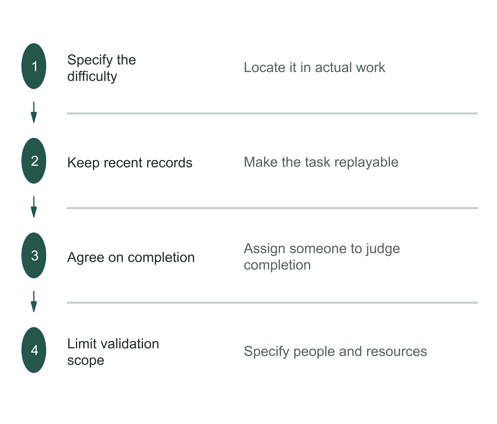

Figure 4-7 | Turning a problem card into a verifiable task. The author's analytical tool: each step produces inputs required by the next.

## Seek evidence for each of five dimensions

With problem cards in hand, compare the candidate projects. This chapter uses five dimensions: value, technical feasibility, risk controllability, data readiness, and organizational cooperation. These form the author's discussion framework, not an industry-validated predictive model. Every dimension needs reasons and a record of missing evidence, not merely a score.

For value, ask who benefits and what specifically improves. Waiting a few days less, doing less rework, or processing more orders may all be worthwhile. Whether they increase revenue or reduce spending requires a separate investigation. A large underlying business does not mean a pilot can deliver benefits on the same scale.

For technical feasibility, check whether the inputs can be processed, the results verified, and the necessary systems connected. Good model answers on demonstration material are a signal, but missing records, version conflicts, and changes in actual inputs must also enter the test. A carefully selected demonstration should not be the only evidence.

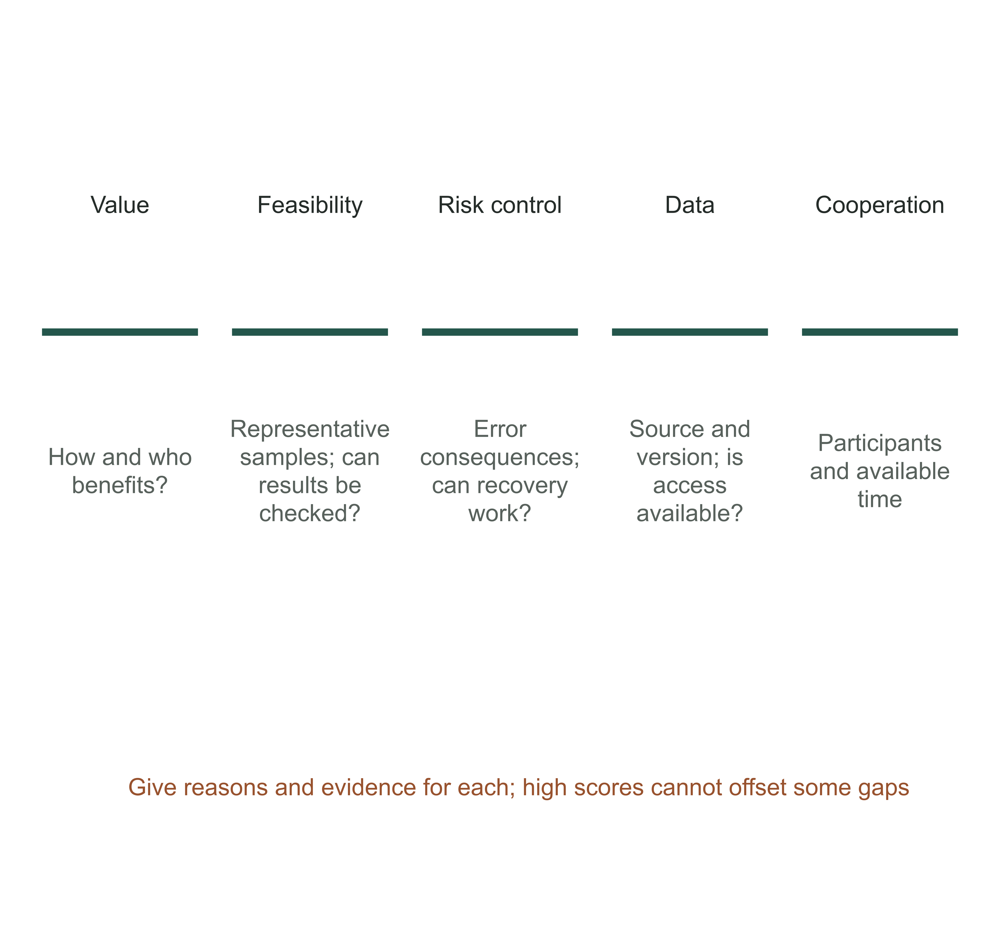

Figure 4-8 | Evidence needed for each of five dimensions. The author's five-dimension evidence chart. Its columns examine the benefit path, sample performance, consequences of errors, data availability, and actual cooperation. The dimensions cannot fully compensate for one another; radar-chart area is not used to represent overall merit.

Risk controllability concerns what happens after an error and whether it can be detected, stopped, and recovered from. Drafting an internal summary for review has different consequences from directly changing payment information. The use of a language model in both tasks does not justify identical approval conditions. This chapter sets no industry legal standards; the company's relevant responsible staff must check the specific constraints.

Data readiness is more than the volume of files. The question is whether access to the task's required information is lawful and clearly arranged, versions are traceable, and samples are sufficiently representative. A company may hold large amounts of data yet lack the fields needed to decide a particular type of exception, making an immediate start unsuitable.

When a department says it “supports AI,” ask who actually has time to participate. Can users provide records? Can the business lead confirm rules? Can the administrator arrange interfaces? Who handles errors? These arrangements say more about the project's ability to start than the number of hands raised in a meeting.

Compare the five dimensions together. A project that is easy to develop but needed by no one may not deserve priority. A project with high expected value but uncontrollable error consequences needs additional conditions first. Comparison determines where to spend investigation and testing resources next; it does not approve every proposal immediately.

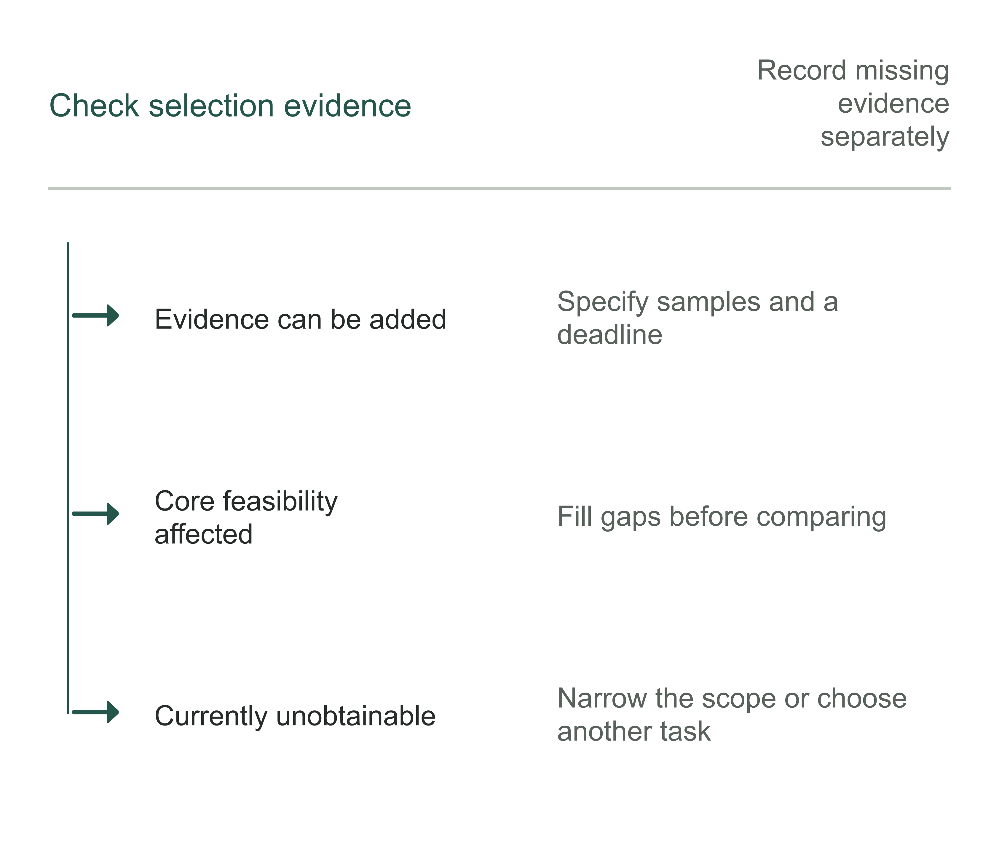

Figure 4-9 | Handling a dimension with no evidence. The author's analytical tool: an unknown should not automatically receive a middle score.

## Some gaps cannot be offset by a high score

Address necessary conditions before ranking. If the team cannot obtain required data, important proposed actions lack authorization, or errors have no acceptable handling path, pause that scope or change it to a controlled, read-only or assistive stage. High value does not make these gaps disappear.

These are conditions this chapter recommends confirming before a start; the company must refine them for the specific task. Higher-risk problems can still be explored, but the experiment must control consequences. For example, first test whether anomalies can be detected in historical records without executing real business actions. Passing that test still leaves the conditions for live operation to be checked.

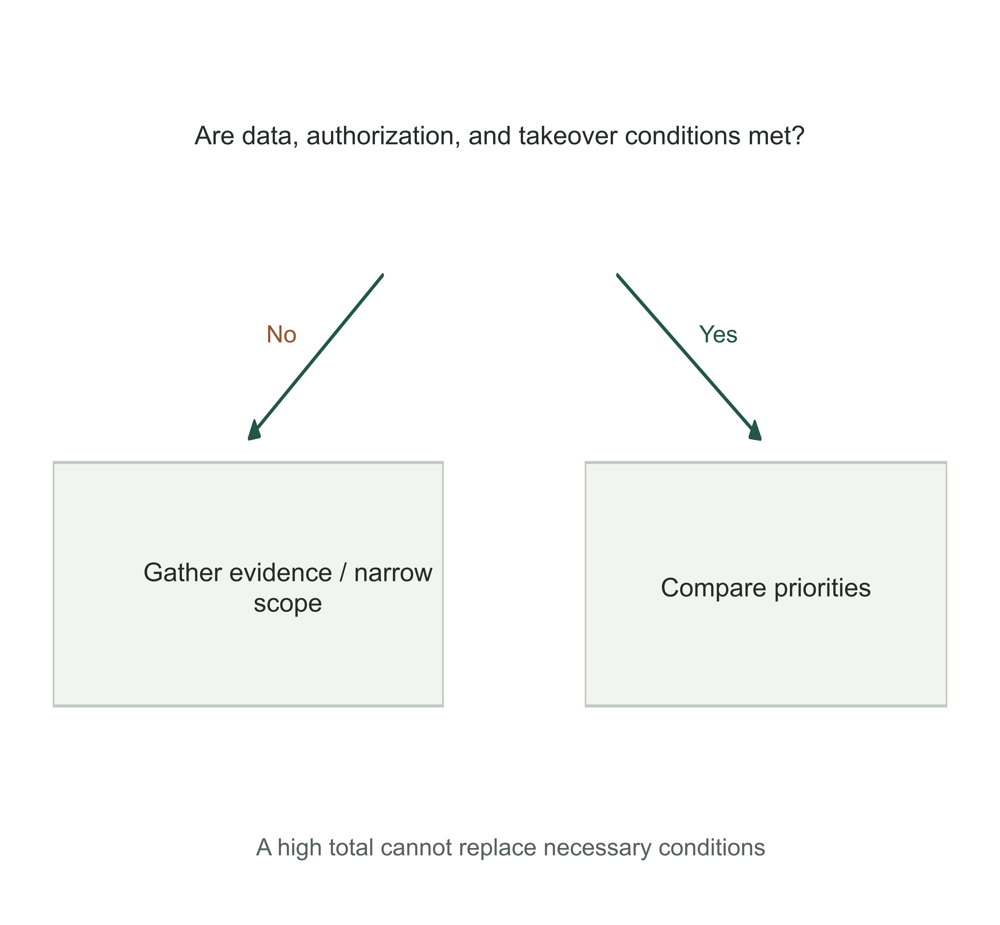

Figure 4-10 | Check entry conditions before comparing priorities. The author's selection branches. When necessary conditions are missing, first gather evidence or narrow permissions. Rank projects once conditions are met. “Pause” applies to the current scope, not permanent abandonment of the problem.

In the fictional chain, automatic replenishment may involve purchasing limits, inventory commitments, and supplier constraints. If approval arrangements remain undecided, the system should not place orders merely because its expected value is highest. It can first produce replenishment recommendations for comparison with the existing process. If reliable inventory data is unavailable, address that data issue first. Each reduction in scope should state what can still be tested, so that an unworkable project is not repeatedly renamed to justify further investment.

A store question-answering assistant may appear lower risk, but outdated food-safety or promotion rules in its sources can still make wrong answers consequential. “Read-only” cannot substitute for a risk judgment. Establish which material is valid, display the supporting evidence, and define when users must seek human confirmation.

Staffing is another necessary condition. “Human review” with no one available to perform it is merely text on a process diagram. If the responsible person has no time, adjust the pilot schedule, reduce the scope, or assign another capable person. Do not assume the gap will resolve itself after go-live.

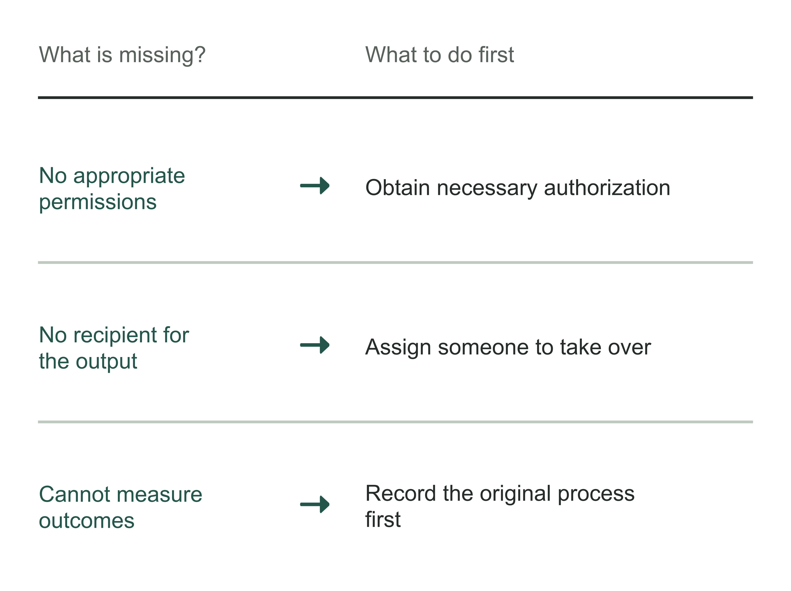

Figure 4-11 | Conditions that should be met before starting. The author's analytical tool: high scores elsewhere cannot offset these gaps.

## Scores support discussion; they cannot replace judgment

Once candidates satisfy the necessary conditions, simple rating levels can aid comparison. This example uses scores from 1 to 5 for each dimension, with higher scores indicating more favorable starting conditions. The risk dimension scores controllability, preventing higher risk from being mistaken for greater merit. Discuss weights before viewing results, and allow them to change with the company's objectives.

The following is entirely fictional. Promotional settlement checking scores 4, 4, 4, 3, and 5 for value, feasibility, risk controllability, data, and cooperation. Store-rule question answering scores 3, 4, 3, 4, and 4. With respective weights of 30%, 20%, 20%, 15%, and 15%, the totals are 4.00 and 3.50. These figures illustrate the calculation, not an assessment of an actual company.

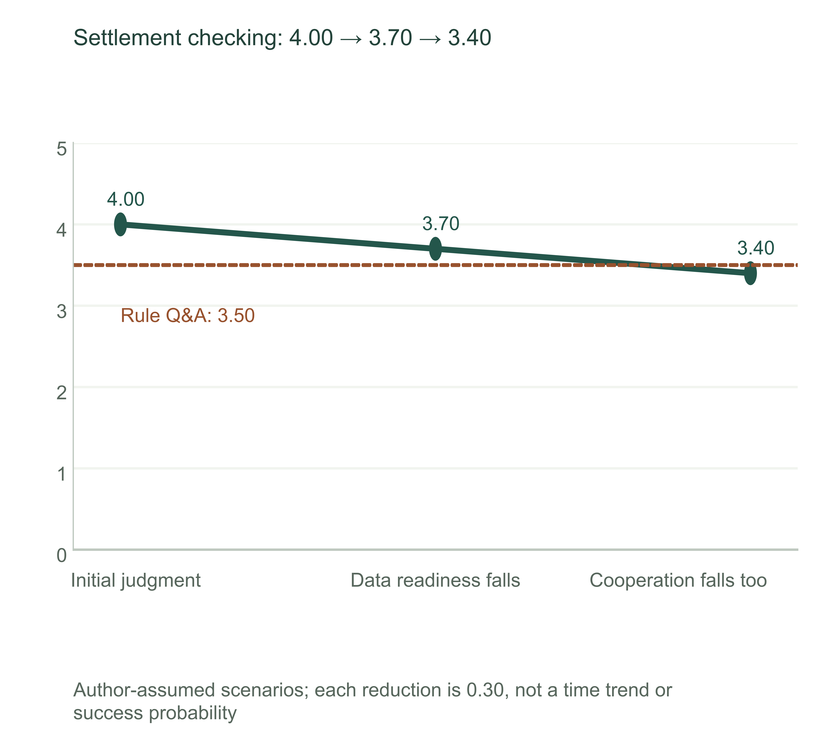

Figure 4-12 | How changed assumptions alter the ranking. Fictional sensitivity illustration. Settlement checking falls from 4.00 to 3.70 and then 3.40; rule question answering stays at 3.50 as a comparison, on a maximum score of 5. Scenario changes are not a time trend or a success probability. Automatic ordering is excluded because its authorization condition is unmet.

Under these assumptions, settlement checking initially leads. The finance lead's willingness to cooperate and relatively accessible samples both influence its score. If the team has not examined the question-answering project's sources equally carefully, unfamiliarity should not be treated as a disadvantage. Gather the missing evidence before comparing.

A simple sensitivity check is possible. If the settlement project's data score falls from 3 to 1, its total decreases by 0.30 to 3.70. If its cooperation score then falls from 5 to 3, the total decreases another 0.30 to 3.40, potentially changing the ranking. The score changes do not predict the future. They show the owner which uncertain judgments support the current choice.

For closely matched candidates, there is little value in arguing over decimal places. A short investigation often helps more than adding rating dimensions: obtain a representative set of actual tasks for each option, check the samples and system dependencies, and establish how much time responsible staff can provide. If the options remain close, choose the one that can generate useful evidence sooner without displacing critical business resources.

Scoring compares whether a task deserves to be done first under current conditions. Its budget still requires actual costs and records of the existing work. A score of 4 is not an 80% chance of success, and a high value score is not a confirmed benefit. Chapter 5 examines budgeting and the points at which spending requires another decision.

Table 4-2 | Further checks when scores are close (the author's checking tool)

| Current disagreement | Records to investigate | Choice affected |
|---|---|---|
| Similar expected benefits | Baseline task volume and losses | Which merits validation first |
| Similar implementation difficulty | Permissions, information, and available time of takeover staff | Which can be completed within a limited scope |
| Equal total scores | Stop conditions and opportunity cost | Whether to stage starts instead of launching together |

## Interview people about recent work, not only ideal requests

The interview method matters if ratings are to have evidence. “What would you most like AI to do?” often produces a wish list. “When did you last encounter this problem?” is more likely to reveal work that can be checked. Ask users to begin with the actual input and show the material they consulted, people they handed work to, waiting steps, and how the task ended.

This does not require copying all customer or employee data into the project team. People can review it together under existing permissions, retain necessary de-identified samples, or first record the workflow and field structure. The purpose is to understand the task, not collect unlimited data for development convenience.

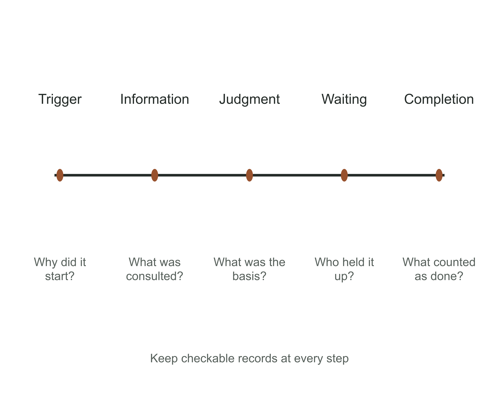

Figure 4-13 | Follow the most recent task. The author's task-replay sequence. Ask about the trigger, information, judgment, waiting, and completion, recording inspectable evidence at each point. This is an interview order; it does not assume that real workflows are always linear.

Distinguish processing time from waiting time. A finance employee may spend ten minutes checking a statement but wait two days for a store's explanation. If the goal is a shorter settlement cycle, reducing those ten minutes to five may leave the main bottleneck untouched. If the goal is less finance overtime, the five minutes may be worth investigating. Decide what should improve before choosing which interval to measure.

Also ask users, “How do you know this result is wrong?” Some judgments have explicit rules; others rely on experience; and some disagreements remain unresolved within the company. The last case needs a business decision. Greater model confidence cannot resolve it. Record disagreements to distinguish system errors from rules the company has not yet established for the system to follow.

Do not sample only smooth tasks. At least consider common cases, missing information, conflicting rules, human transfers, and eventual failures. The number of samples required depends on task variation and the purpose of the judgment; this chapter does not present a fixed count as sufficient proof. If only a few recent cases are examined, check whether month-end, promotion peaks, or other seasonal changes have been omitted.

Once the workflow is drawn, ask the people involved to check it again. An engineer may miss a seemingly informal but essential step, such as a store confirming something by phone before submitting a written explanation. Fill in such omissions before using the workflow to design the system.

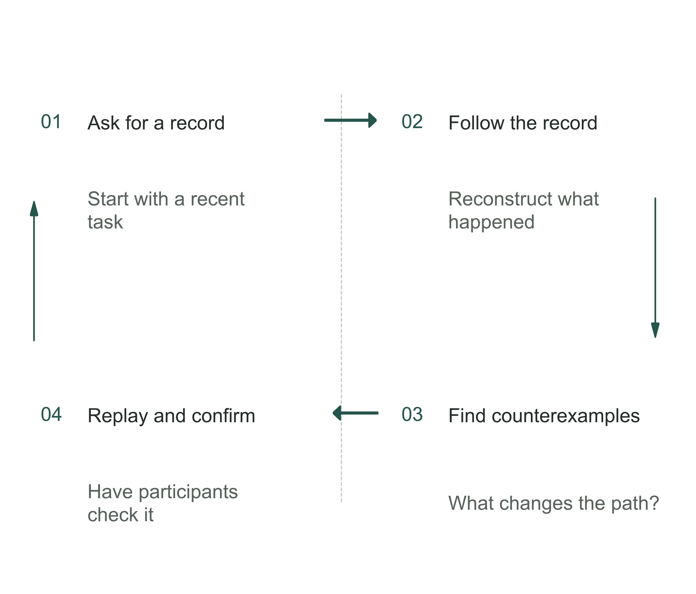

Figure 4-14 | Connecting an interview to actual work. The author's analytical tool: interview conclusions should lead back to original records.

## Defining the first pilot's scope

For lower-risk tasks whose error effects can be controlled, a starting scope might be one department, one stretch of workflow, and two to five users. This recommendation makes observation and communication easier; it is not a threshold proving success. Adjust the number of people and scope if shifts or different types of stores need coverage.

Even a limited scope must contain complete tasks. A few colleagues casually asking questions cannot adequately test adoption. Have them use the system as agreed in real work and record when they do not use it or return to the original process. That exposes practical obstacles. Fewer users reduce organizational complexity; they should not reduce evidence requirements.

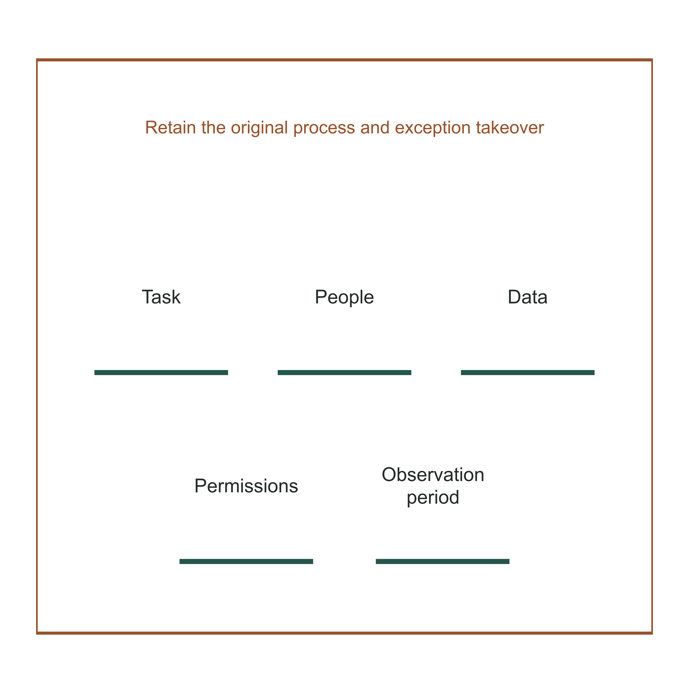

Figure 4-15 | Five elements of a pilot's scope. The author's pilot-scope boundary. Task, people, data, permissions, and observation period define the pilot together. The original process and exception takeover remain available outside it, preventing an isolated system with no exit path.

Observation time depends on the business rhythm. A few working days do not cover work settled monthly. Even daily tasks may be affected by holidays or promotions. Choose a period that captures those conditions, rather than declaring success when the planned deadline arrives.

Before starting, agree on when to continue, revise, or stop. Initial principles might be: continue observation or expand cautiously when outcomes improve and the human burden remains acceptable; fix problems concentrated in repairable inputs or rules; pause the current scope when necessary conditions cannot be met. Set specific thresholds against the baseline. This chapter does not invent accuracy or savings percentages for a company.

A project may find an important data problem before detecting any benefit. Record both facts honestly, then decide whether improved data warrants another trial. Do not describe identifying a problem as a realized benefit, or allow “still learning” to justify endless extensions.

## The first choice also has an opportunity cost

When the same business specialists and engineers work on this project, they have less time for other work. Compare not only expected benefits but whose time is consumed. A task requiring the owner, finance lead, and system administrator to participate together for an extended period may be impossible to staff, even if its software is inexpensive.

If the fictional chain is entering its annual settlement peak, finance may support the pilot but lack enough review time. There is no need to reinterpret this as “low value.” Retain the value judgment and change the start date, or first validate historical samples offline. Separating the project from its current timing makes the ranking discussion more honest.

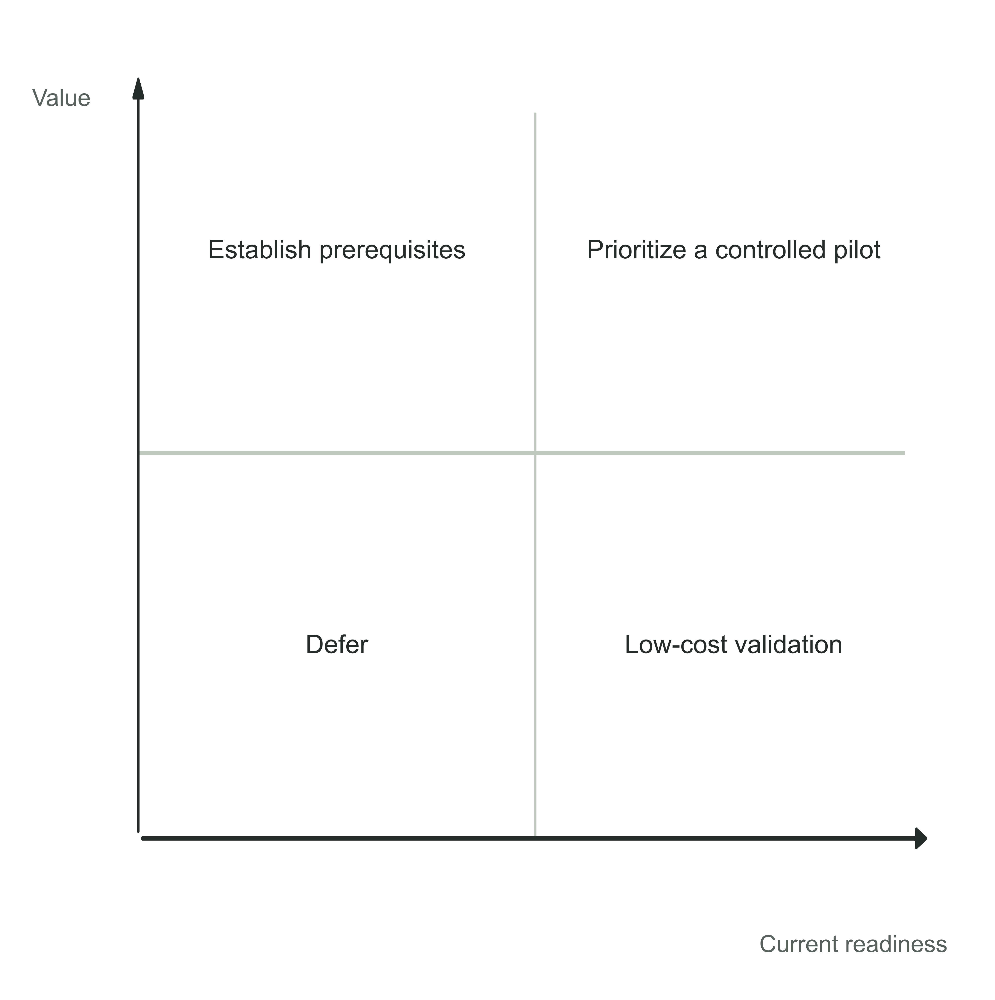

Figure 4-16 | Separate value from current readiness. The author's qualitative two-dimensional diagram. It supports discussion of an immediate pilot, prerequisite work, low-cost validation, or deferral. Its axes have no statistical scale, and positions are not success probabilities. Place actual candidates according to their evidence.

Another easily overlooked alternative is to improve the existing process. In the settlement example, if waiting mainly arises from stores lacking a standard submission template, standardizing it may remove much back-and-forth. Use that improvement as a comparison to test what additional help AI provides. An “AI budget” should not exclude lower-cost methods.

Some capabilities can only be assessed through a trial, but first state the question the trial should answer. For example: when information is missing, can the system accurately list what must be obtained? If it cannot, discuss changing the method, supplying information, or stopping. Do not assume further development will resolve the issue.

It is also possible to separate “first to validate” from “first to go live.” A high-value but uncertain problem may warrant a small offline test, while a better-prepared one enters a controlled pilot first. Keep their statuses distinct and do not allocate the same business lead's time twice merely to start many projects together.

Concentrate the initial resources. Giving several departments small demonstrations without adequate support may appear fair while leaving every direction without enough evidence. The owner needs to explain why this task comes first and when the other candidates will be reconsidered. Explicit review conditions sustain cooperation more effectively than a vague promise to do everything next time.

Record both what was known and what was unknown when choosing. If an interface turns out to be unavailable a month later, the record can reveal whether conditions changed or the initial investigation missed it. Otherwise execution staff may take all the blame while the original judgment remains uncorrected.

Keep a re-entry condition for each candidate on the project list. For example, reconsider the store-rule assistant after rule versions are verified, or replenishment after inventory access and order approval are established. The next discussion can begin with changed conditions, without replaying every demonstration.

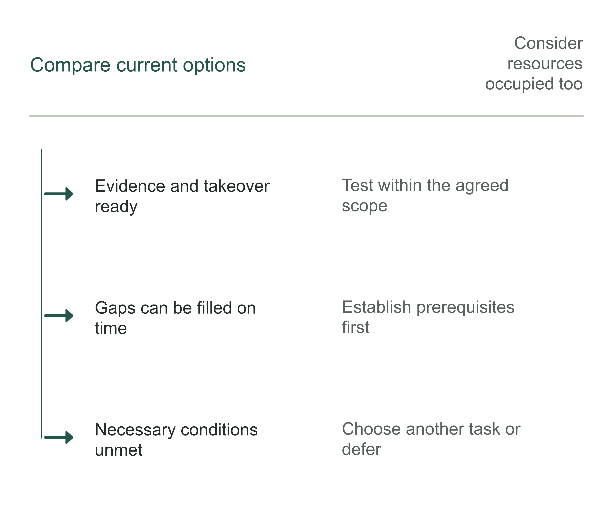

Figure 4-17 | Three paths before pilot approval. The author's analytical tool: retain reasons for unselected projects so they can be reviewed when conditions change.

## What this choice should leave behind

Return to the five opening proposals. The following teaching selection record, S04-01, shows how a decision can be made. Its findings, staffing arrangements, and time limits are assumptions. The earlier scores of 4.00 and 3.50 only illustrate scoring after necessary conditions are met. If this investigation finds that information or authorization remains unresolved, address those conditions rather than use the earlier scores as approval.

In this teaching record, finance has permission to examine historical records for one region and one settlement cycle, with a verifier assigned. Total time in the original process remains unmeasured. Promotional settlement checking is therefore selected for investigation and testing first, with no permission yet to write to production systems. The other four proposals each receive a reason for deferral, rather than merely “later.”

The owner should receive more than “settlement ranks first.” The decision should include reasons, key unknowns, and investment and exit boundaries. Retain reasons for unselected candidates to avoid restarting the argument at the next meeting. Conditions can change the ranking; there is no need to force persistence simply to defend the first judgment.

Table 4-3 | Selection record for five candidates (completed teaching example)

| Candidate problem | Current checks and decision | Re-entry conditions and responsible person |
|---|---|---|
| Promotional settlement checking | Sample access approved and verifier assigned; first validate historical records; net time saved unknown | Finance lead provides a complete baseline, exceptions, and takeover records before a decision on controlled use |
| Store-rule question answering | Unconfirmed versions mixed into sources; improve the material first; a smooth demonstration is insufficient | Operations lead confirms current rules, retired material, and the person receiving exceptions, then reassess |
| Automatic replenishment | Inventory definitions and order approval unclear; automatic orders prohibited | Procurement and IT confirm reliable inventory and authorization; separately discuss first testing replenishment recommendations |
| Campaign content generation | No evidence yet that generation is the bottleneck; retain templates and human review | Marketing records drafting, revision, and review time in routine work, then proposes again if the bottleneck remains |
| Owner's business-data queries | Key definitions such as “store” not aligned; defer comprehensive recommendations | Metric owner confirms a small core set of metrics, sources, and update responsibilities before read-only queries are reviewed |

S04-01 also caps this investigation: within the next 10 working days, 8 hours for business verification, 12 for engineering tests, and 4 for financial recalculation—24 person-hours in total, all for settlement samples. Marketing continues recording routine work without borrowing these engineers to start another pilot simultaneously. On working day 10, the finance lead submits original-process time and an exception list; the engineer reports whether information can be found and recommendations verified. The owner then decides whether to continue testing, improve the submission template first, or pause. Development time does not automatically increase if key conditions remain unmet.

If most time is spent waiting for stores to supply missing material, improve the submission template and measure again. If material can be read but reviewers lack time, choose another period or pause. Proceed to Chapter 5's budget discussion once inputs, takeover staff, and measurement scope are established. These 24 person-hours cap this investigation only. They are neither the later project's total budget nor a shared allocation for all five candidates.

Readers can use Worksheet 04-1 for the selected problem and Worksheet 04-2 to retain a separate record for each unselected option. The next meeting need only consider which conditions have changed and whether they justify a new ranking. Unchanged candidates do not need another demonstration contest.

Table 4-4 | First-pilot scope confirmation (the author's checking tool)

| Scope item | Specify before approval |
|---|---|
| Included | Task types, target users, permitted actions |
| Excluded | Branches not yet handled and prohibited actions |
| Change process | Who can approve scope expansion and on what records |
| Ending arrangements | When to review and who takes over unfinished work |

Keep this record so the next discussion can retrieve why the task was selected and under which conditions. Changed conditions can lead to a new decision.

The next chapter records the current state and investment limits: how long the original process takes, how much spending is permitted, and what counts as an outcome. Everyone should be able to check these accounts before the project starts.

## Notes and sources

[1] China Chain Store & Franchise Association, *2025 Collection of Innovative Cases in Retail Digitalization and New Technology Applications in China*, Shuyi case, PDF pages 21–23, printed pages 17–19. Company-submitted material included by the association; process descriptions, cost claims, and anticipated benefits are treated separately, with no presumption of independent audit. https://pdf.dfcfw.com/pdf/H3_AP202512041793604795_1.pdf?1764843573000.pdf=

[2] Digitforce, presentation by Shuyi Shaoxiancao CIO Wang Shifei, November 12, 2024. Locate the sections on “project objectives and scope” and “business-department participation and cooperation.” A provider-published customer presentation, not independent verification of results; its measurement scope is not combined directly with that of the later case. https://www.digitforce.com/newsinfo/655/

The five-dimension framework, scoring weights, initial pilot size, and interview tools are the author's methodological recommendations. The regional chain, candidate projects, scores, and final selection are entirely fictional teaching designs. The scoring tool has no statistical predictive significance.
