# Chapter 5 Work out the numbers first: how much to invest, and what counts as success

## After the 90%, read the fine print

A contract attachment published on a UK government procurement platform lists the effectiveness of analytics and AI solutions as a monthly performance measure. A good rating requires model accuracy of at least 90%, demonstrated support for business decisions through insights, measurable improvements from the AI solution, and response times meeting the service agreement. A related footnote states that service-level agreements for each AI or machine-learning solution will be agreed separately at delivery.[1]

This is much more specific than “guaranteed results.” Yet copying the 90% into our own budget request only begins the questioning. Checking one invoice field, judging whether an entire settlement statement is correct, and answering a business-rule question are different tasks. In each case, nine correct answers out of ten can leave a tenth that merely needs a sentence revised—or causes a payment to go to the wrong place.

The attachment establishes which measures the parties agreed to, not whether the project met them. We have not obtained the subsequent agreements or performance records, and that absence does not establish that no further agreement was made. For its own budget, a company must ask what task the percentage measures, how it is measured, and who confirms it.

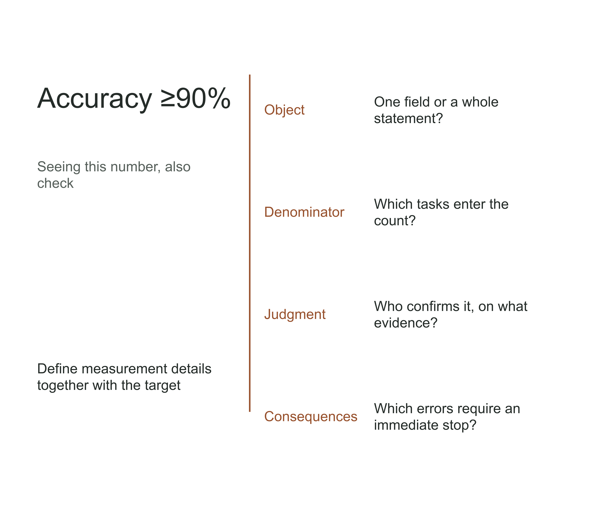

Figure 5-1 | Measurement details that must accompany a metric. An annotated page designed by the author around questions raised by reading a metric, not a contract screenshot or reproduction of its wording. The figure presents a number on the left and fields the company must specify on the right. It does not recommend a universal 90% threshold.

When approving a budget, the owner also needs to know which resources the company will commit, how the current work performs, how it will be compared after the pilot, and when to continue or stop. An amount alone may suffice for this approval but still leave no basis for judging the next request.

Chapter 4 selected the problem. This chapter continues with the fictional regional chain: try promotional settlement checking in one region, with software flagging possible discrepancies and finance staff verifying and approving them. All amounts, samples, and scenarios below are teaching assumptions, not actual quotes, industry averages, or operating records of the author's clients. We will examine why this investment merits a trial and where further spending requires another decision.

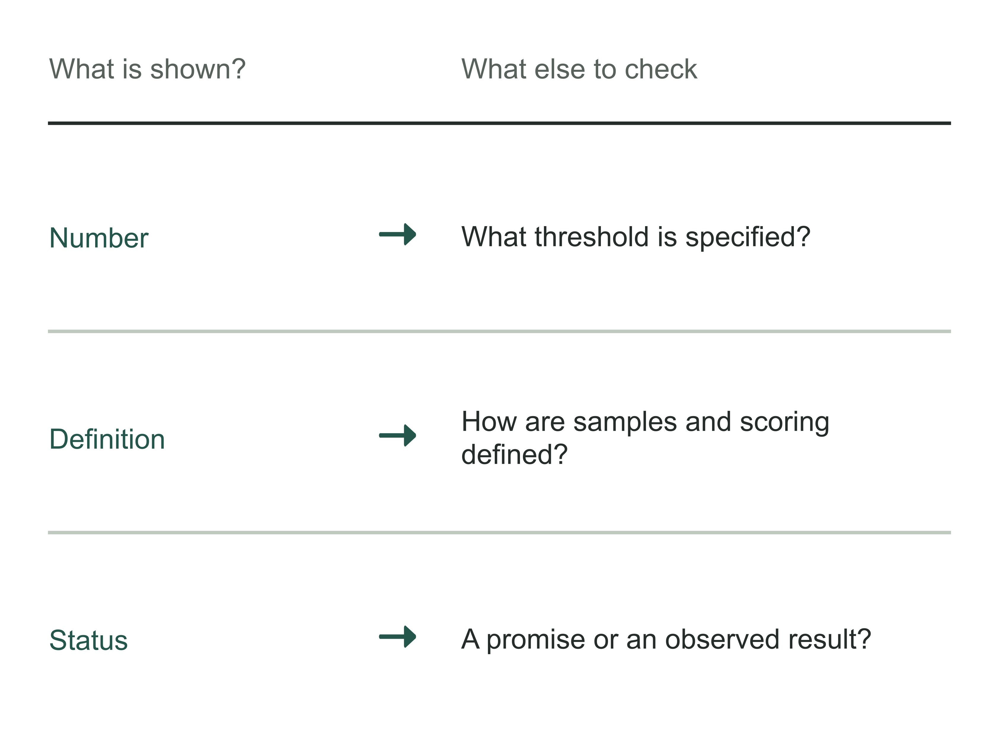

Figure 5-2 | Three checks when reading an accuracy promise. The author's analytical tool: a high threshold alone cannot prove that it has been met.

## Record how the work is done today

If a budget request promises “30% higher settlement efficiency,” the finance lead first needs to know the starting point for that 30%. How long did processing a statement take? Was that recorded in system logs or estimated from colleagues' impressions? Does it measure human handling time or calendar time from store submission to final completion? Without answers, a faster number next month may not reveal what improved.

This record of the original process is the baseline for later comparison. It need not be complex at the outset. Select a complete settlement cycle, keep a list of the region's incoming tasks, and record information from actual work: task type, entry and completion times, each person's handling time, and corrections made. Keep unfinished statements on the list with their unfinished status.

Returns and waiting are especially easy to overlook. Suppose checking a statement takes ten minutes, but obtaining additional material from the store takes two days. If the business objective is faster settlement, examine the two-day wait first. If frequent reviewer overtime is the main burden, the ten minutes matter more. Record both, but do not turn “five fewer minutes of handling” into “settlement two days earlier.”

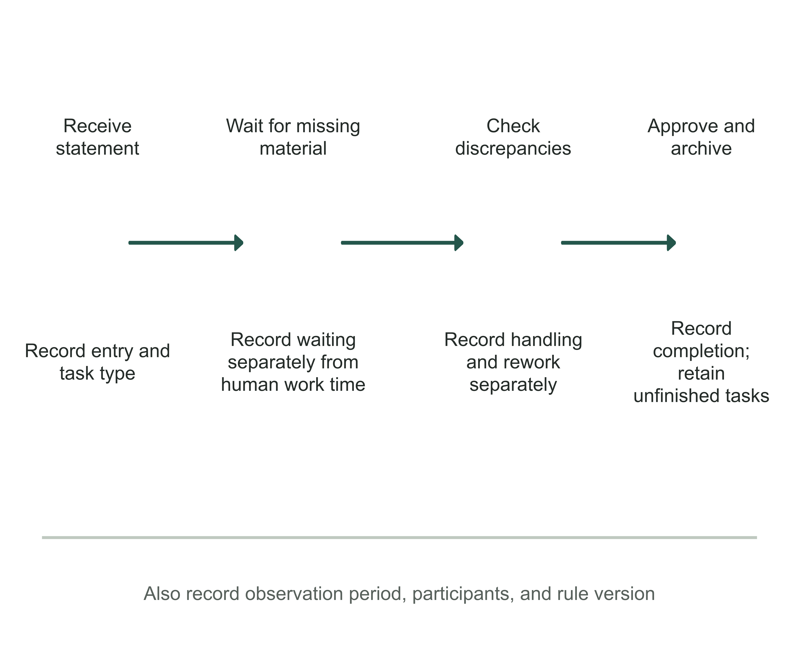

Figure 5-3 | The baseline must include handling and waiting. Record illustration for a fictional task. Horizontal positions show work sequence, not durations. Record handling time, waiting, and rework separately, and retain unfinished tasks within the scope.

Record the conditions as well. Month-end promotions and ordinary months, experienced and new staff, complete and severely incomplete documents can differ in difficulty. Measuring only simple routine statements and applying the savings percentage to a promotion peak may overstate benefits. Identify the sample's origin and uncovered cases without first building a company-wide data platform.

Employees' recollections still help. “Fridays are always hardest” suggests an observation period; “this customer always needs extra confirmation” suggests a task category. Such clues should direct the next review of records, rather than be multiplied directly by annual task volume to produce annual benefits.

Before recording, business and technical staff must agree on “complete.” Technical staff may treat a system response as the endpoint, while finance waits for discrepancies to be approved. Using the same statement, check where timing starts and ends. Without a shared definition, even precise measurements cannot be compared.

Table 5-1 | Baseline fields designed by the author. “Original average time” is deliberately not prefilled: the teaching company must measure it rather than derive a starting point from its budget aspirations.

| Baseline field | Teaching entry | Why it is needed |
|---|---|---|
| Scope and observation period | One region, one complete settlement cycle | Retain a comparable scope for trial operation |
| Task entry and endpoint | Receipt of a settlement statement through discrepancy approval and archiving | Avoid measuring only a short system segment |
| Separate time records | Human handling, waiting for missing material, rework | Reveal whether work is reduced or transferred |
| Quality and unfinished work | Error types, reasons for returns, unsettled items at period end | Avoid counting only smoothly completed statements |
| Confirmation and version | Finance confirms definitions; rule version retained | Give the before-and-after comparison a shared basis |

If no records exist, first approve a bounded measurement effort that delivers a checkable baseline and samples. Use available records directly. Commission additional measurement only for missing data that could change the investment judgment. Measurement should reduce later guesswork, rather than add routine approvals.

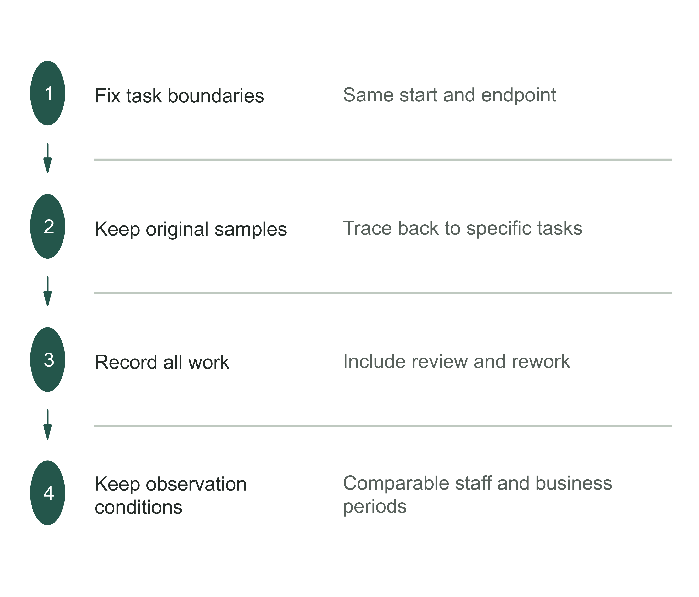

Figure 5-4 | How baseline records support later comparison. The author's analytical tool: incomparable conditions do not support a direct claim of the amount improved.

## Who contributes beyond the quoted price?

Consider the fictional company's eight-week pilot. Estimated software licensing and usage cost 12,000 renminbi (RMB); interface development, RMB 30,000; external information preparation, RMB 10,000; operating support, RMB 6,000; and a reserve for exit and handover, RMB 8,000. The total cash-budget ceiling is RMB 66,000, including a reserve that may not be spent.

Finance must also spend 60 hours explaining and reviewing, and technical staff 100 hours supporting interfaces and tests. To compare resource use, assume internal valuations of RMB 100 and RMB 150 per hour, respectively: RMB 6,000 and RMB 15,000. These rates are teaching parameters, not market wage standards. The RMB 21,000 means staff time must be scheduled, not that equivalent additional cash will be spent.

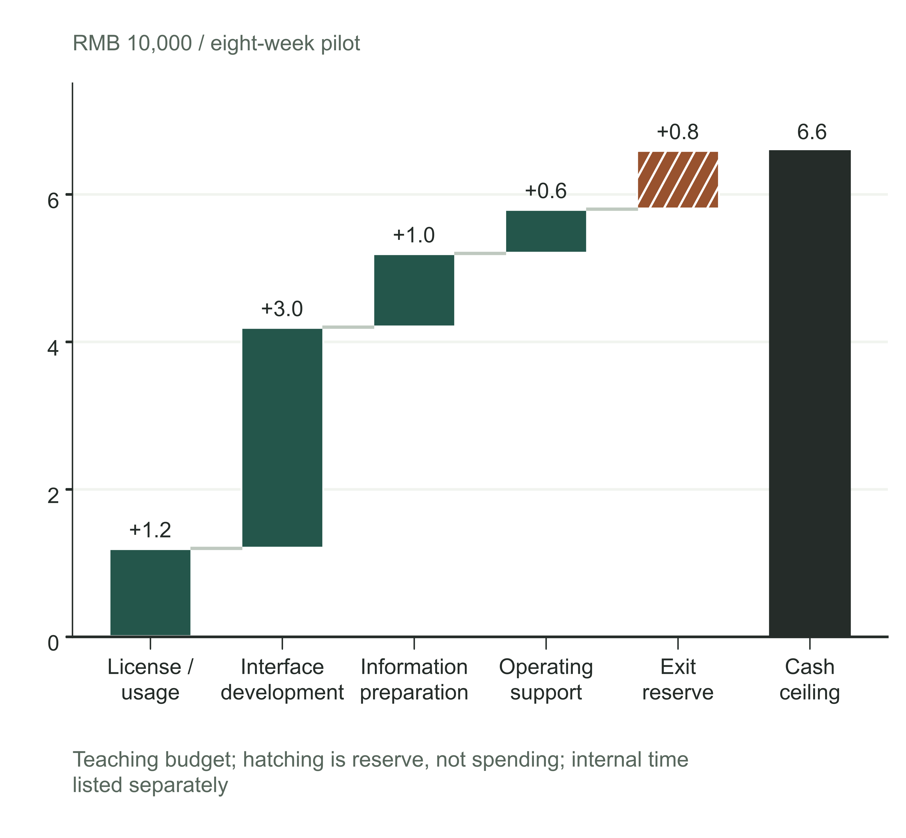

Figure 5-5 | Components of a pilot's cash budget. Fictional eight-week cash budget, in units of RMB 10,000; five items total 6.6. Hatching marks the RMB 8,000 reserve, not actual expenditure. Internal staff time is listed separately and is not added again in the waterfall chart.

Combining the cash budget and internal resource valuation gives a resource scale of RMB 87,000. The maximum cash to arrange remains RMB 66,000. These numbers answer different questions: the former helps compare whether the same specialists can undertake other projects; the latter helps plan payments and funds. Write the full names so that “total cost” does not keep changing meaning during the discussion.

Check for overlapping charges. If the provider's interface-development fee already includes data mapping, a separate information-preparation service should explain what additional work it covers. If operating support covers incident handling, ask whether temporary support costs extra. If internal staff are already included in a dedicated project budget, do not add their full salaries again within the same resource calculation.

Some work never appears in the provider's quote: who confirms business rules, grants permissions, updates old material, and retests after a version change? Existing teams can do it, but people and time must be available. A contract stating “customer cooperation required” does not establish that the company has made those arrangements.

Table 5-2 | Two views of the fictional budget. Valuations compare business resources; they do not recommend accounting recognition or capitalization.

| Current commitment | Eight-week teaching budget | Management use |
|---|---|---|
| External cash and reserve | Ceiling of RMB 66,000 | Check payment conditions; unused reserve is not spent |
| Finance cooperation | 60 hours; resource valuation RMB 6,000 | Check staffing conflicts with settlement peaks |
| Technical cooperation | 100 hours; resource valuation RMB 15,000 | Check interface, testing, and support work |
| Both resource types combined | RMB 87,000 | Compare project resource use, not additional cash |

The budget should also include work after a stop. How will data and records be retrieved? Who closes interfaces? How is the original process restored? What instructions does the next maintainer need? If this work is quoted only on the day of discontinuation, the company may be forced to keep paying. Preparing for handover makes stopping feasible; it does not imply that failure is expected.

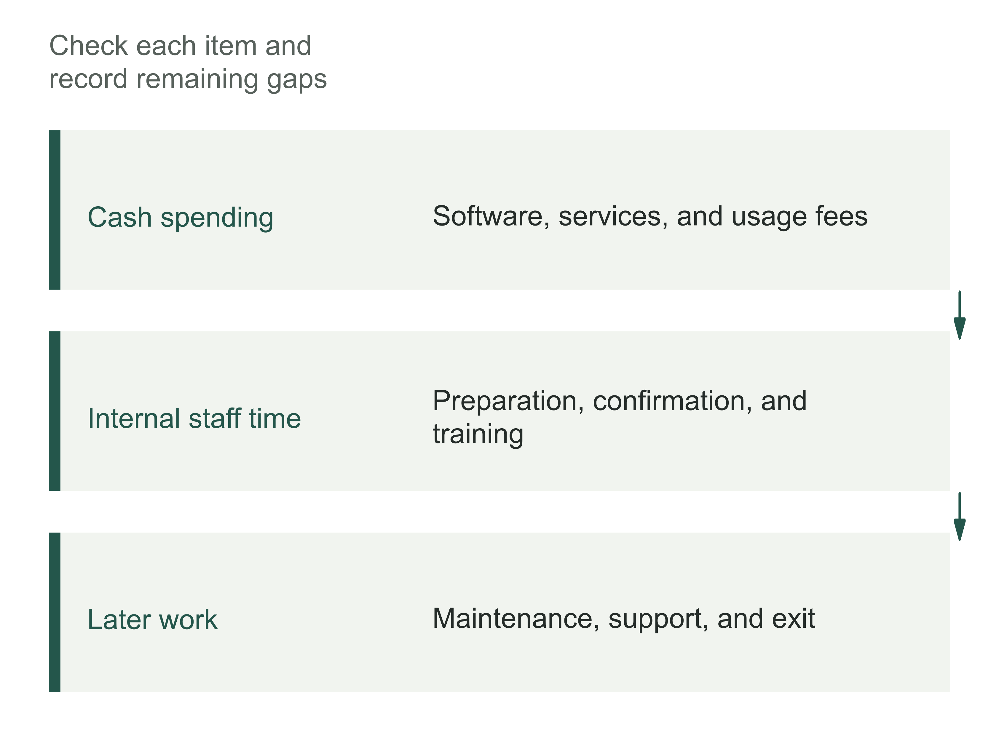

Figure 5-6 | Commitments to look for beneath the quoted price. The author's analytical tool: define the budget basis so the comparison covers more than the first payment.

Table 5-3 | Expense boundaries for the eight-week pilot and later operation (the author's teaching timeline)

| Period | Expense basis in this example | Avoiding double counting |
|---|---|---|
| Weeks 1–8: pilot | Cash ceiling RMB 66,000, including RMB 8,000 exit/handover reserve; internal resource valuation RMB 21,000 listed separately | Check the listed pilot service scope; do not add the later RMB 4,000 monthly expense again |
| Review at pilot end | Account for cash paid, committed but unpaid amounts, and unused reserve; confirm the start of later service billing | Unused reserve is not expenditure; pausing does not erase incurred obligations |
| Later stable operation | Assume additional operating cash of RMB 4,000 per month for a separately approved service period | Deduct overlap with pilot licensing or support first; do not charge twice |
| Cumulative project | Aggregate actual cash and obligations by period, with initial-investment recovery tracked separately | Separate monthly net amounts from the one-time investment; internal time valuation is not cash |

## Break a large commitment into decisions that can be reviewed

An eight-week budget does not require all fees to be paid on day one. The teaching company can prepare its baseline and samples first, develop interfaces after necessary material is confirmed available, and then enter controlled trial operation. Discuss each step's resources together with the evidence required to start the next.

Distinguish internal investment approval from contractual payment. Internally, the company may require sample conditions to be confirmed before committing to the next stage. External payment timing still depends on the actual contract and fulfilled delivery obligations. A changed internal judgment does not automatically remove payment for work completed as agreed. Chapter 7 connects the two arrangements.

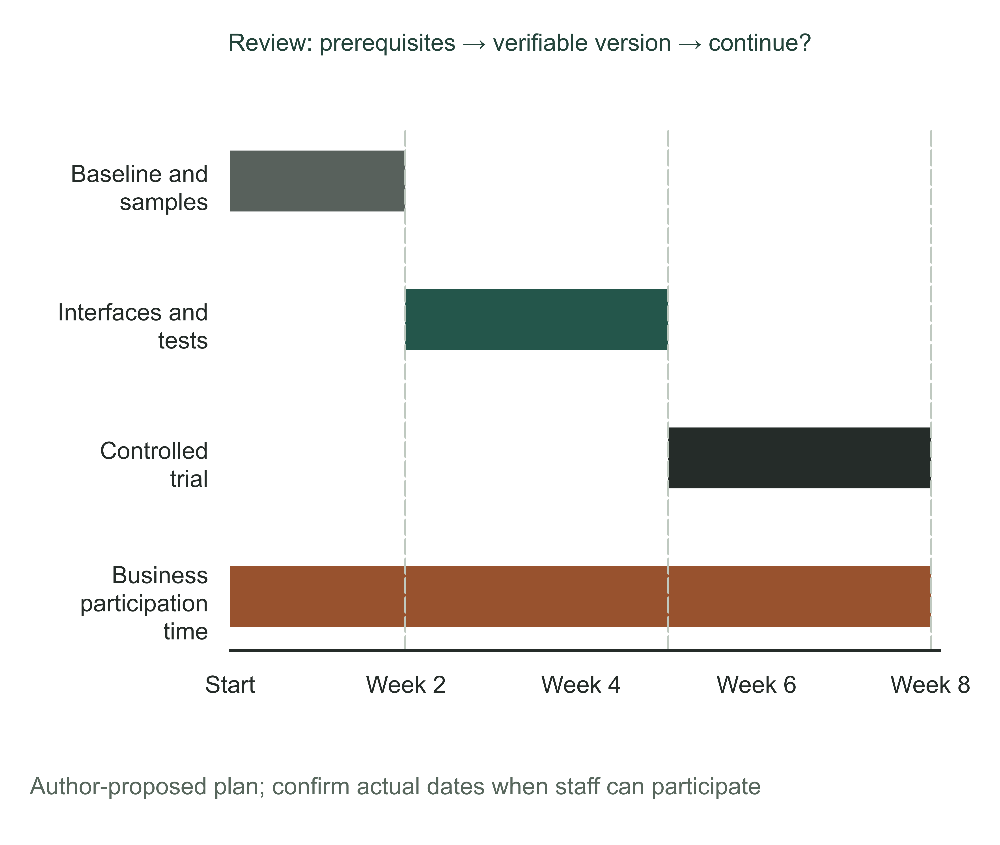

Figure 5-7 | Schedule budget stages and staff commitments together. Eight-week plan designed by the author. Bands show planned work periods, not actual progress. Review points decide whether to proceed. Passing the pilot is not automatically connected to company-wide expansion.

Staging should not mean “approve everything again every week.” Review facts that could change the choice: whether necessary data exists, interfaces work within limited permissions, testing reveals unacceptable errors, and business staff have time to participate. Verified, unchanged matters need no repeated proof.

Some software requires annual licensing, while interface development demands substantial upfront spending. Staged approval cannot save amounts already committed; show them explicitly in the budget. The owner can compare an alternative: validate de-identified samples offline first, then decide on the annual license once critical technical and information questions are resolved. Offline tests may cost less but cannot reveal whether employees will use the system in routine work. Compare what each approach can answer and what still requires live trial operation.

Schedule staff time in stages too. If finance's 60 hours are concentrated at month-end, averaging them into 7.5 hours per week across eight weeks hides the conflict. Identify specific periods requiring business judgments and ask the responsible person to confirm availability. If time is insufficient, narrow this round's scope or reschedule. Do not hide the gap under “active cooperation from all departments.”

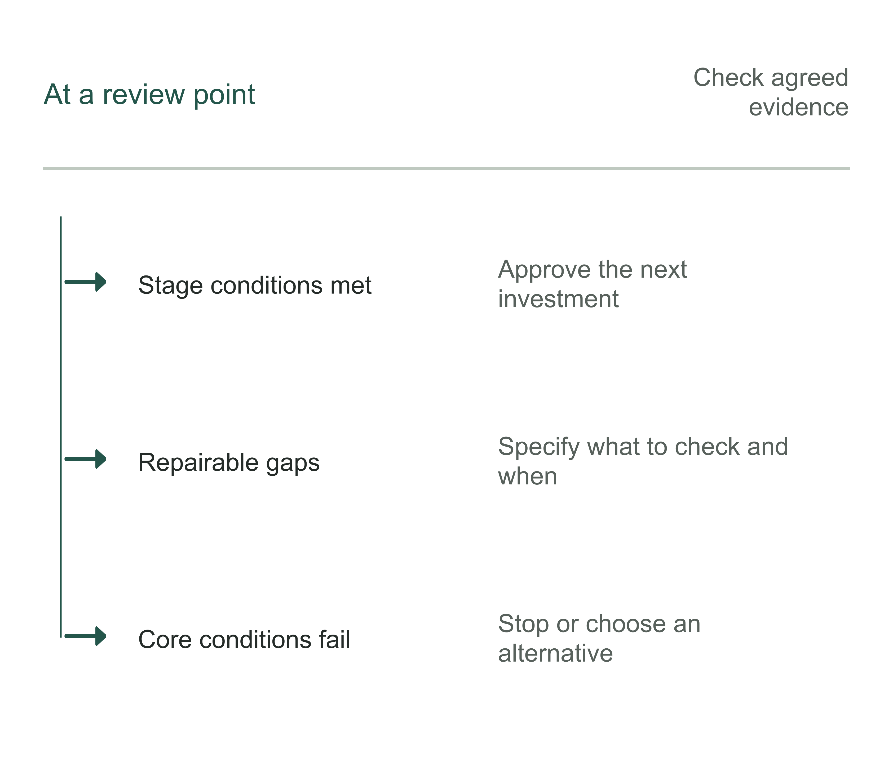

Figure 5-8 | Evidence for approving the next investment stage. The author's analytical tool: reaching a date triggers review, not automatic approval.

## Break benefit assumptions into their components

With investment boundaries established, explain why the spending is worthwhile. Consider a path that is easy to recalculate and easy to misuse: reducing external checking work for which payment is already planned. Released time can become a cash change through this path only if external purchasing can actually decrease.

Let N be monthly candidate tasks, a the share actually entering the new process, m the net minutes saved per complete task, and c the share that can replace paid external work. Assume outsourced work is billed hourly at RMB 120. Net time saved already deducts the task's additional review and rework; do not deduct them again later. Monthly potential cash savings are: N × a × m ÷ 60 × c × 120.

The formula separates “higher efficiency” into conditions that can be checked individually. N requires actual task lists; a requires sustained task entry, not account activations; m requires a complete-task comparison; c requires verification of replaceable external work and procurement arrangements. The external rate must also come from the company's contract or a verifiable quote, not an average salary taken from software marketing.

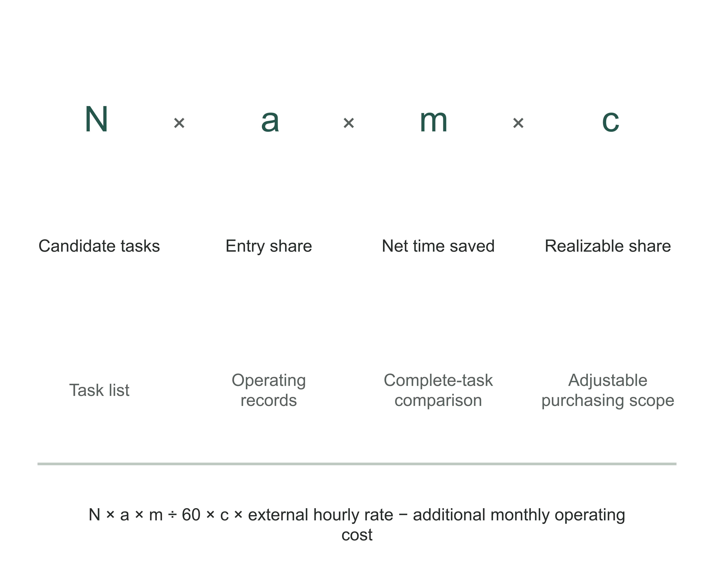

Figure 5-9 | Every multiplier from task to cash needs evidence. The author's teaching model. Each multiplier has corresponding records, and additional operating cash expenses must be deducted at the end. Arrows show calculation relationships, not proof that the company has saved money.

Assume additional operating cash expenses of RMB 4,000 per month. Instead of forcing the eight-week pilot cost into the same month, first ask whether stable operation might increase or reduce the monthly cash burden. Assess recovery of the initial investment afterward, considering the operating period.

The base scenario assumes 1,000 candidate tasks per month, 60% entering the new process, 6 net minutes saved per task, and 50% replacing paid external work. It releases 60 hours, of which 30 correspond to reducible external work, for potential savings of RMB 3,600. Deducting RMB 4,000 in additional operating expenses gives a monthly net cash difference of negative RMB 400.

This does not mean the project has no value. It means this cash path cannot yet cover additional operating expenses. If the company is buying shorter settlement waits or more traceable discrepancy records, establish separate outcome measures and specify what it is willing to pay. Do not make the formula positive by counting the same hours as salary savings, outsourcing savings, and added revenue.

The formula also reveals who can influence the result. A provider can improve software and interfaces without being able to decide whether finance reduces outsourcing purchases. UK government risk-allocation guidance recommends placing risk with the party best able to manage it; payment tied to outcomes outside a party's control may affect pricing and delivery.[3] Here, the delivery team improves software performance, while the company must confirm whether purchasing can fall. Establish each party's actions before agreeing on shared goals.

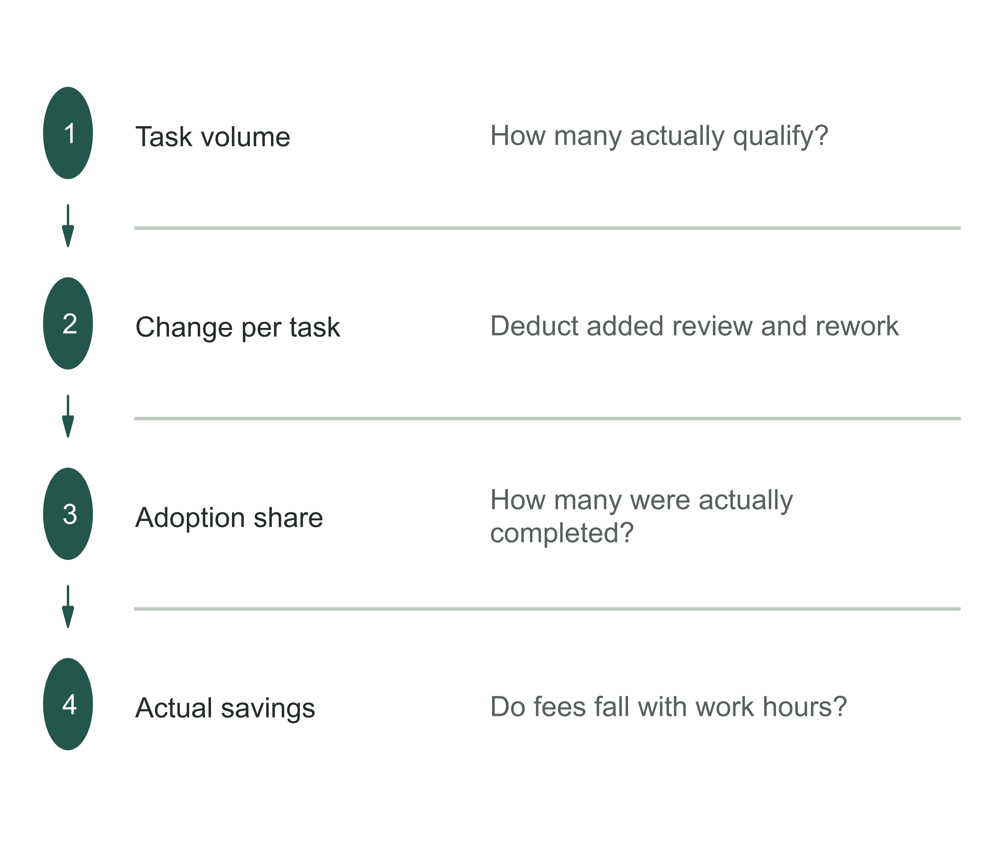

Figure 5-10 | Turn benefit forecasts into checkable assumptions. The author's analytical tool: retain definitions and the source of assumptions at every step.

## Compare three scenarios and examine their differences

Budgets commonly show pessimistic, base, and optimistic scenarios. They should represent different operating conditions, rather than increase or reduce one benefit number by 20%. Uniform discounts across three tables still leave the owner unsure which assumption to investigate first.

This example lists task volume, entry share, net time saved, and realizable share together. Additional operating expenses remain RMB 4,000 and the external rate RMB 120 per hour. Actual expenses may vary with usage, so a formal budget must include pricing tiers and minimum commitments.

Table 5-4 | All values are fictional assumptions. No occurrence probabilities are assigned to the scenarios. “Optimistic” is not a provider promise, and “base” is not a measured average.

| Condition and result | Pessimistic | Base | Optimistic |
|---|---:|---:|---:|
| Monthly candidate tasks | 600 | 1,000 | 1,400 |
| Share entering the new process | 40% | 60% | 80% |
| Net minutes saved per task | 4 | 6 | 8 |
| Share replacing paid work | 30% | 50% | 70% |
| Potential cash savings, RMB/month | 576 | 3,600 | 12,544 |
| Difference after operating expenses, RMB/month | −3,424 | −400 | 8,544 |

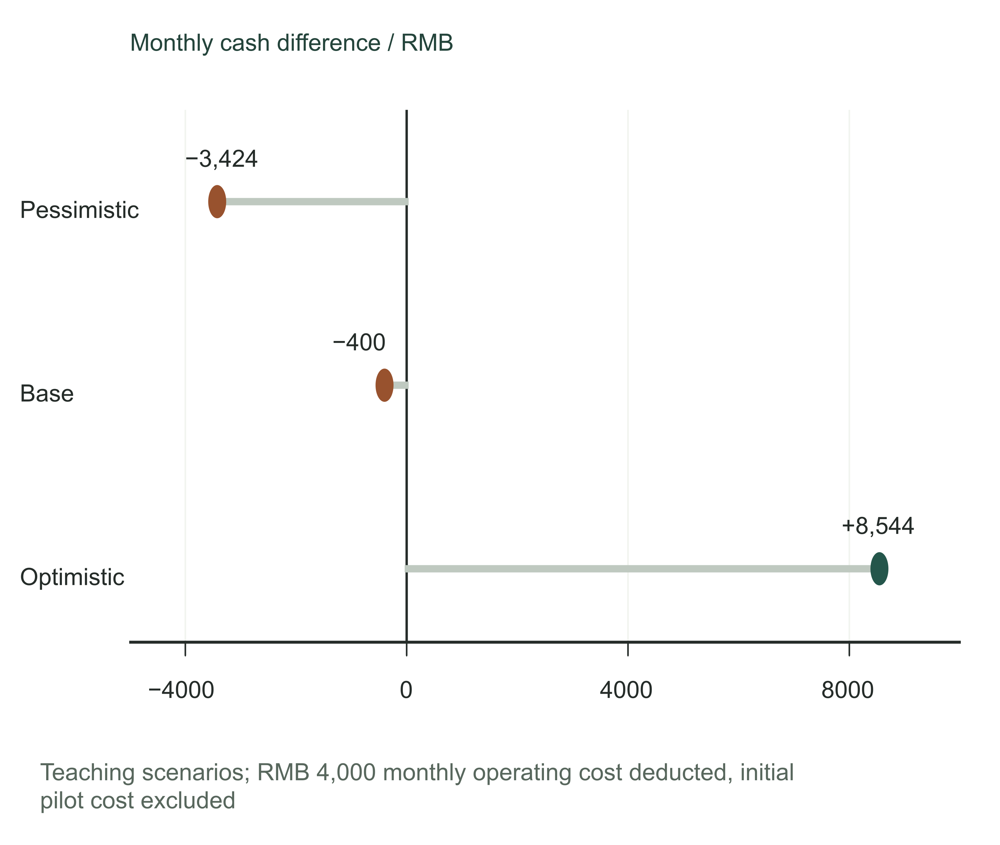

Figure 5-11 | Monthly cash difference under three operating scenarios. Positive/negative point plot using the same model as Table 5-4, in RMB per month. The zero line distinguishes whether assumed operating expenses are covered. Initial pilot expenses are excluded; this is not the whole project's return on investment.

After examining the three results, discuss which conditions have evidence. If the 1,400 tasks simply include future work from other regions, the optimistic scenario needs expansion investment and cannot retain the costs of connecting only one region. If the 8 minutes saved come from a few smooth tasks handled by the most experienced employees, they cannot represent all tasks directly.

Even if optimistic conditions persist, the RMB 8,544 monthly positive difference does not immediately recover the RMB 66,000 pilot budget. Dividing the budget ceiling by that amount gives roughly 7.7 months of such positive differences to cover initial cash, before ramp-up, downtime, fee changes, or the time value of money. This checks order of magnitude only, not a promised payback period. With a negative monthly difference in the base scenario, no payback period can be calculated along this cash path.

In the base scenario, monthly cash spending exceeds savings by RMB 400. To approve the pilot, the company must explain what the experiment will establish, or how much it will pay for better quality or shorter waits. It cannot claim that cost reduction is already proven. The teaching company can examine these conditions within its eight-week budget. If outsourcing purchases cannot fall and no other worthwhile value is confirmed, it commits to no later operating expenses. If quality becomes the goal instead, define its owner, cost ceiling, and acceptance method at that point; do not switch success standards at project closure.

For a first pilot, the judgment is often “worth a limited cost to investigate,” rather than “worth a large investment.” Approval can specify that this round tests task entry, complete-task net time saved, and the ability to reduce outsourcing purchases. After eight weeks, even without a satisfactory return, the company can check whether the promised evidence was obtained, instead of recasting every difficulty as “long-term value.”

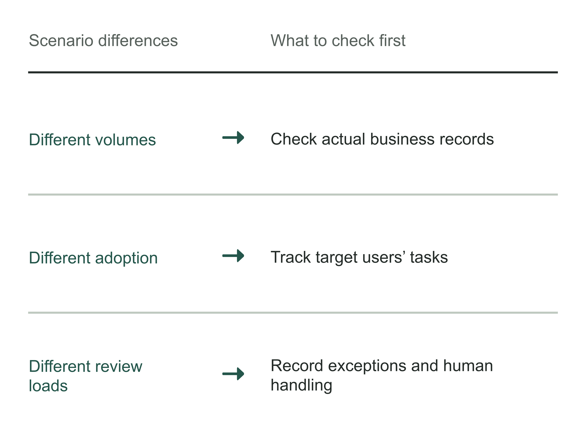

Figure 5-12 | What to investigate first behind scenario differences. The author's analytical tool: scenarios identify assumptions that determine the differences.

## Find the assumption most worth checking first

Three scenarios show combined changes but make it harder to see how one factor changes the choice. Hold volume at 1,000 monthly tasks and net time saved at 6 minutes each, then vary only entry share and the share replacing paid work. Retain the RMB 120 hourly rate and RMB 4,000 in additional monthly expenses.

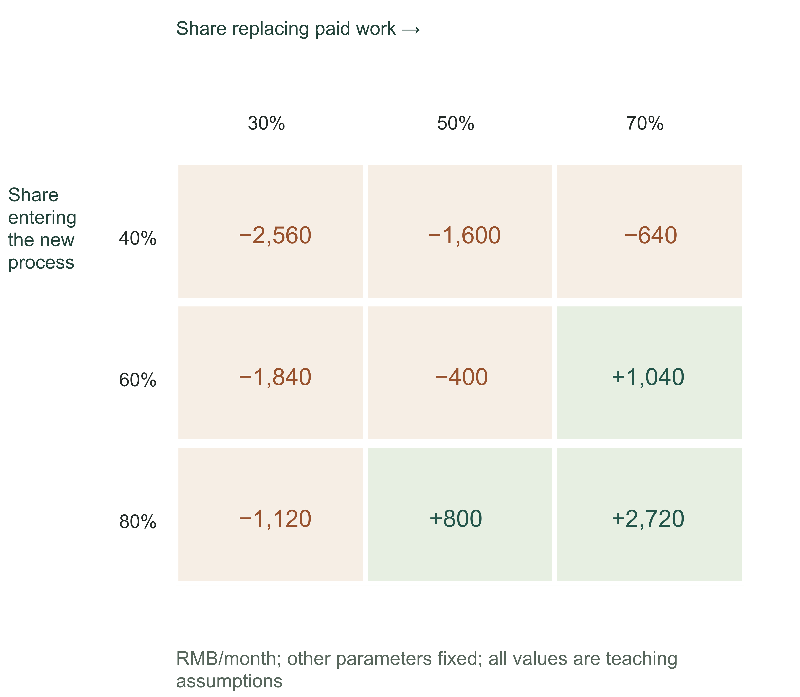

Figure 5-13 | Effects of entry share and realization conditions on monthly difference. Fictional two-factor sensitivity table, with cells in RMB per month. Rows show the share entering the new process; columns show the share replacing paid work. Color only assists differentiation of positive and negative values; numerical labels remain. Other conditions are fixed. This is not a heatmap of observed results.

At 60% entry, replacing only 30% of paid work gives a negative RMB 1,840 monthly difference; replacing 70% gives positive RMB 1,040. Software capability is identical in both cases. The difference comes from work and purchasing arrangements. The next interview may therefore need to involve the outsourcing procurement lead and check which workload can truly decrease, rather than ask the model to polish its answers further.

Conversely, a contractual minimum purchase may mean 30 fewer hours of external work does not lower the bill. In that case, c cannot reflect how much work could theoretically return in-house. Re-estimate it against the conditions for actual spending adjustments. If it cannot be confirmed, set this benefit path to zero for now, record the material still needed, and assess whether other evidence-backed value supports the pilot.

It is also possible to work backward to an order of magnitude. With base parameters unchanged, approximately 1,112 candidate tasks per month are needed to cover RMB 4,000 in operating expenses. If reliable records show only 600, do not keep concluding from the 1,000-task base table. If 2,000 exist, first check how many are within the current processable scope. This break-even point holds only under those assumptions; any changed parameter requires recalculation.

The table is most useful for deciding what to check next. If parameter ranges are unclear, precise probability simulation is unnecessary. Without comparable samples, there is no need for a risk-return curve. A budget can contain unknowns, provided it identifies who will examine which records and which input will be recalculated afterward.

Table 5-5 | Priority checks for key assumptions (the author's checking tool)

| Assumption | Records to check | Update after checking |
|---|---|---|
| Task volume | Recent business transactions | Applicable volume |
| Net savings | Complete-task time records | Benefit scenarios |
| Actual adoption | Target users' task-completion records | Realizable scale |
| Review burden | Exception and human-handling records | Capacity and ongoing costs |

## Turn “success” into a measurement plan

A benefit model still needs a method for deciding whether the pilot merits continuation. Examine adoption, quality, risk, and business outcomes separately. They interact but should not be compressed into one score: more users cannot offset unauthorized payments, and greater accuracy cannot compensate for exceptions with no takeover staff.

The teaching company can initially define quality as “candidate discrepancies have checkable evidence,” rather than require AI to decide final settlements. Finance helps define error types: missed discrepancies, false discrepancy flags, inapplicable rule references, and unverifiable outputs. Consequences differ, so record the types separately. A single “answer accuracy” measure can conceal rare but important failures.

Before measurement, specify whether each judgment concerns a field or a statement, included tasks, who confirms correctness, handling of disputed samples, the version used, and review timing. A UK general contract template also lists service levels and performance monitoring separately.[2] The specific AI-task questions here are the author's recommendations, not universal terms prescribed by that template.

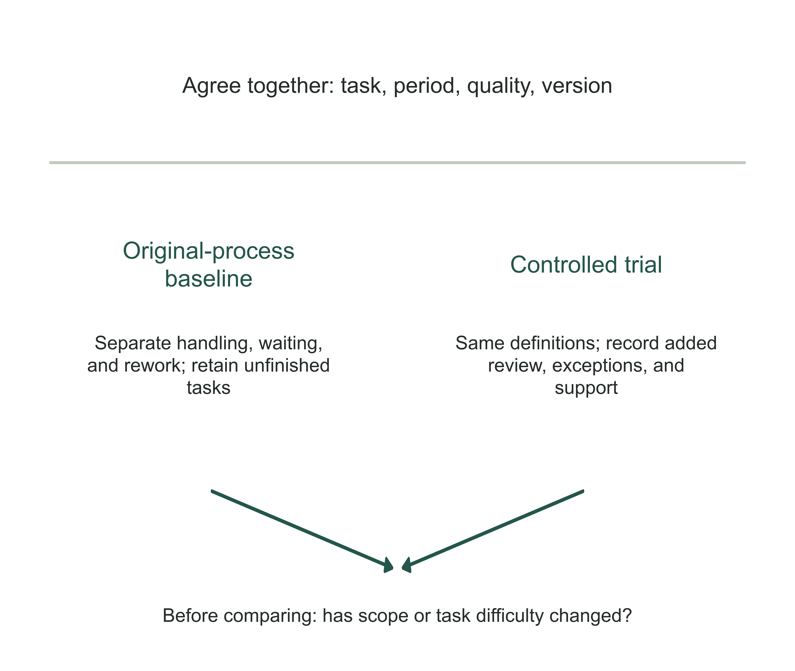

Figure 5-14 | Keep a common measure from baseline to trial. Comparison path designed by the author: establish shared definitions, record the old process and controlled trial separately, then check scope differences. Even with identical fields, check whether staff, task difficulty, and other conditions are comparable. Chapters 10 and 12 develop operational evaluation and statistical assessment further.

Separate development samples from acceptance samples. Repeatedly adapting the system to the same examples and then using them to prove reliability can overstate performance. Reserve tasks unused in development for business review against agreed standards. Once live trial operation begins, check for new types. Required sample size depends on task variation, error consequences, and the decision being made; do not copy a fixed number from a book.

If actual tasks occur monthly, observation should cover that cycle. Reaching the end date without enough incoming tasks means reporting insufficient evidence, not assembling acceptance from the last few successful demonstrations. Extending observation depends on what additional time can resolve and the resources it occupies.

Measure staff burden too. Finance may prepare large numbers of samples daily for the pilot, while engineers manually correct outputs behind the scenes. Unrecorded work makes the pilot experience look better than ordinary operation would. The delivery team may offer extra support, but list pilot support separately from work required in the long term.

Interpret zero incidents cautiously. No incorrect payment in a small sample establishes only that none was observed during that period, not zero risk at larger volume. Restrict the impact of intolerable actions through permissions and approval arrangements, then use records to test the controls. This chapter sets no uniform risk threshold: companies must determine theirs from their business and responsibilities.

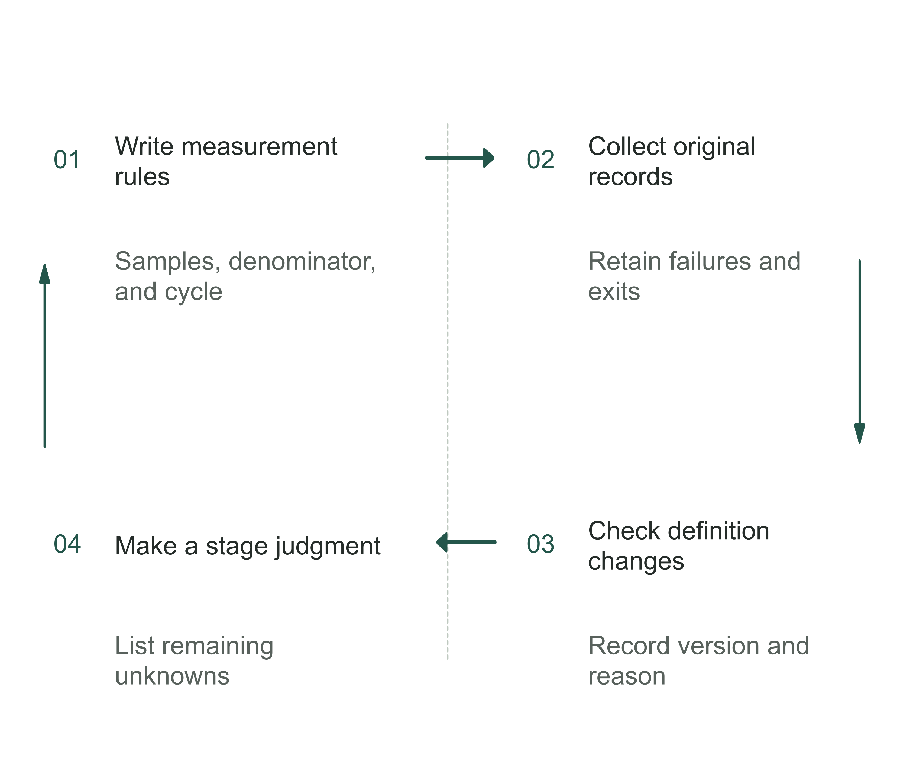

Figure 5-15 | How measurement accompanies project operation. The author's analytical tool: results from two periods cannot be directly combined after the measurement method changes.

## Write stop conditions before spending the money

The hardest part of a budget is often deciding when the current path no longer merits continuation. After considerable effort, “we have worked on it for so long” can become the reason for the next investment. A better approach distinguishes triggers before starting.

One category requires immediate narrowing or pausing: unauthorized external actions, untraceable critical records, or exceptions with no one to handle them. Another involves deviations with a defined repair path, such as inconsistent source versions causing a particular task type to fail. A third concerns failed economic assumptions: insufficient actual volume, support costs above expectations, or outsourcing purchases that cannot decrease as planned.

These call for different follow-up work. Pausing high-impact actions still leaves existing tasks to handle. Fixing information requires an owner and retest scope. Failed economic assumptions require another comparison of alternatives. Not every problem calls for retraining a model, and a disappointing metric need not invalidate every usable output.

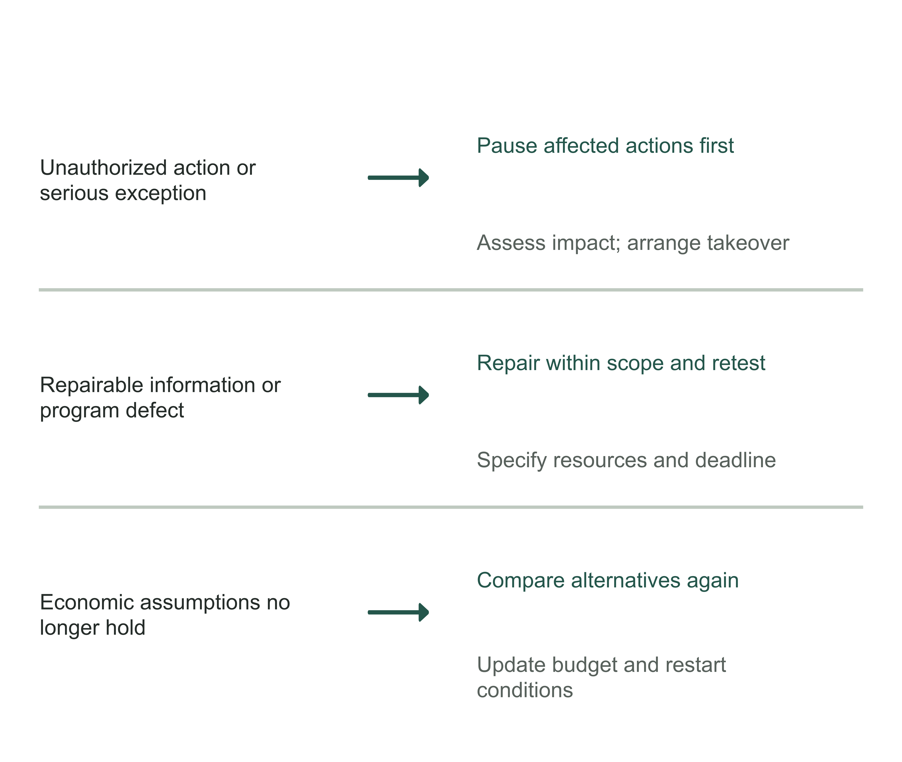

Figure 5-16 | Respond separately to risks, defects, and economic assumptions. Budget-review method designed by the author. Categories are not automatic decision rules; a project may require several actions at once. Every response needs an owner, records of what has already happened, and conditions for the next judgment.

Bound repairs as well. For example, permit one clearly identified field to be completed within the current budget, then review using samples unused in development. If critical data remains unavailable, close the current scope. This is more actionable than “optimize until satisfactory.” Continued observation should also specify the additional valid tasks required, who confirms them, and the next discussion date, avoiding endless extensions.

After stopping the pilot, retain confirmed definitions, test records, unsuitable scope, and restart conditions, provided necessary authorization is obtained and information handled appropriately. They give the team records for a later similar problem. Their benefit depends on later use; do not count all current spending as a return from “knowledge assets.”

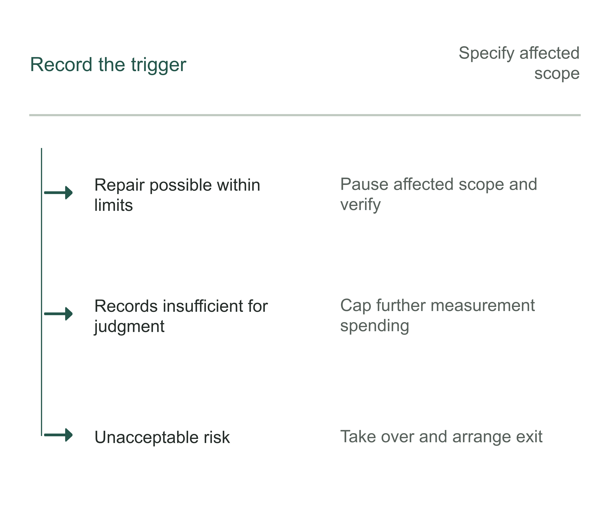

Figure 5-17 | After a stop condition is triggered. The author's analytical tool: pausing or exiting also requires assigning unfinished tasks.

## What exactly is approved this time?

For the teaching company, this round can approve one region, eight weeks, and a cash ceiling of RMB 66,000, with an additional allocation of 60 finance hours and 100 technical hours. Software only flags possible settlement discrepancies; finance retains verification and approval.

The base cash scenario remains negative RMB 400 per month. Before expanding, the team must validate conditions that could change the judgment or provide evidence of other outcomes worth funding.

Table 5-6 | Checks before signing a stage commitment (the author's checking tool)

| Item | Specify in this round |
|---|---|
| Permitted work | Tasks, information used, and exclusions |
| Resource limits | Cash, staff time, and call volume recorded separately |
| Basis for continuation | Samples, definitions, responsible person, and review date |
| Arrangements after stopping | Unfinished tasks, information, fees, and takeover staff |

In the appended worksheet, enter the investment scope first, then the baseline, measurement, and continuation conditions. For unknowns, identify who checks them and when they will be reviewed.

Chapter 6 assigns people with the authority to judge and the ability to deliver, so these commitments have someone to carry them out.

## Notes and sources

[1] UK Contracts Finder, *RM6100 Technology Services 3 Agreement*, public contract attachment, 277 pages, page 24, KPI4 “Analytics & AI Solutions Effectiveness” and footnote 4. This page was checked against the official original on September 9, 2026. Interpret the KPI together with the SLA agreed for each solution; it does not support conclusions about other contract terms or actual performance. https://www.contractsfinder.service.gov.uk/Notice/Attachment/9eb13f50-d293-49cf-b9ff-b096599ce4e1

[2] UK Government Commercial Function, *Call Off Schedule Templates*, Call Off Schedule 6, service levels and performance monitoring section, checked September 6, 2026. This is a general template, not the teaching company's contract. https://www.gov.uk/government/publications/simplified-bidder-pack-split-terms/call-off-schedule-templates

[3] UK Government Commercial Function, *Risk Allocation and Pricing Approaches guidance note*, June 15, 2026 version, sections 2.1 and 4.1.2–4.1.4. Public procurement guidance on risk and control capability, used to explain management tradeoffs, not general legal rules for Chinese companies. https://www.gov.uk/government/publications/the-sourcing-and-consultancy-playbooks/risk-allocation-and-pricing-approaches-guidance-note-html

Budgets, hourly rates, scenario parameters, tables, and worksheets are teaching designs by the author, not actual customer data, investment advice, or industry standards. All amounts are in RMB. Operating scenarios exclude initial pilot investment; cash spending and internal resource valuations are shown separately.
