# Chapter 6 Build the team: who decides, who delivers, and who owns the outcome

## Everyone is in the project chat, but work is still blocked

The budget is approved and interfaces connected. Before trial operation, an engineer discovers two versions of a promotional settlement rule. Finance follows the old definition; operations believes the new campaign plan should apply. The provider can change the system that day but cannot decide which version the company recognizes. The project manager presses for go-live, while both department leads say they need further confirmation. Everyone involved is in the chat, yet work remains blocked.

This is another teaching scenario from the fictional chain in the previous two chapters. What is missing is not a new title but a person authorized to confirm the rule. Adding an AI lead or asking the engineer to “own everything end to end” cannot decide the company's settlement rules.

Changing a rule begins with confirming its meaning and applicable tasks, then implementing it, testing its effects, and approving release. Actual processing outcomes must also be checked after go-live. One person may perform several steps, but each handover must specify the information needed and decisions authorized. When disagreements arise, people must know who can decide.

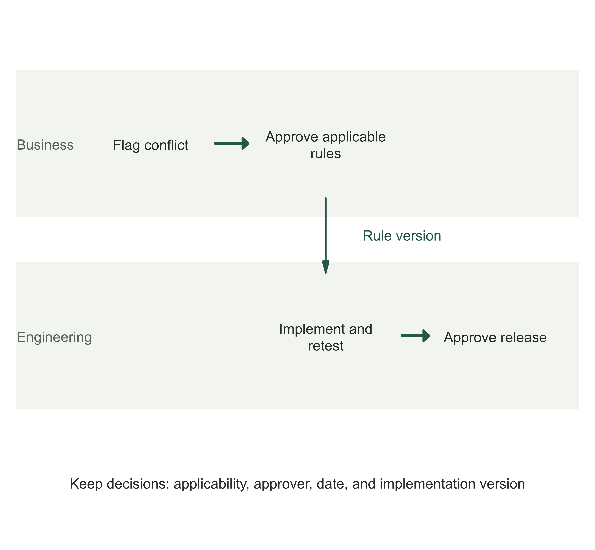

Figure 6-1 | How business and engineering cooperate on rule changes. Rule-change workflow drawn by the author for the fictional scenario. Business-rule approval and technical release are assigned separately; connections represent material to hand over. This is not an actual company's current procedure or a diagram of statutory responsibilities.

Chapter 3 distinguished people, software, and digital roles. This chapter moves beyond titles to turn Chapter 5's resource plan into a working team. Whether building internally, buying externally, or building jointly, someone must define the task, implement it, approve production use, and handle tasks the system cannot complete.

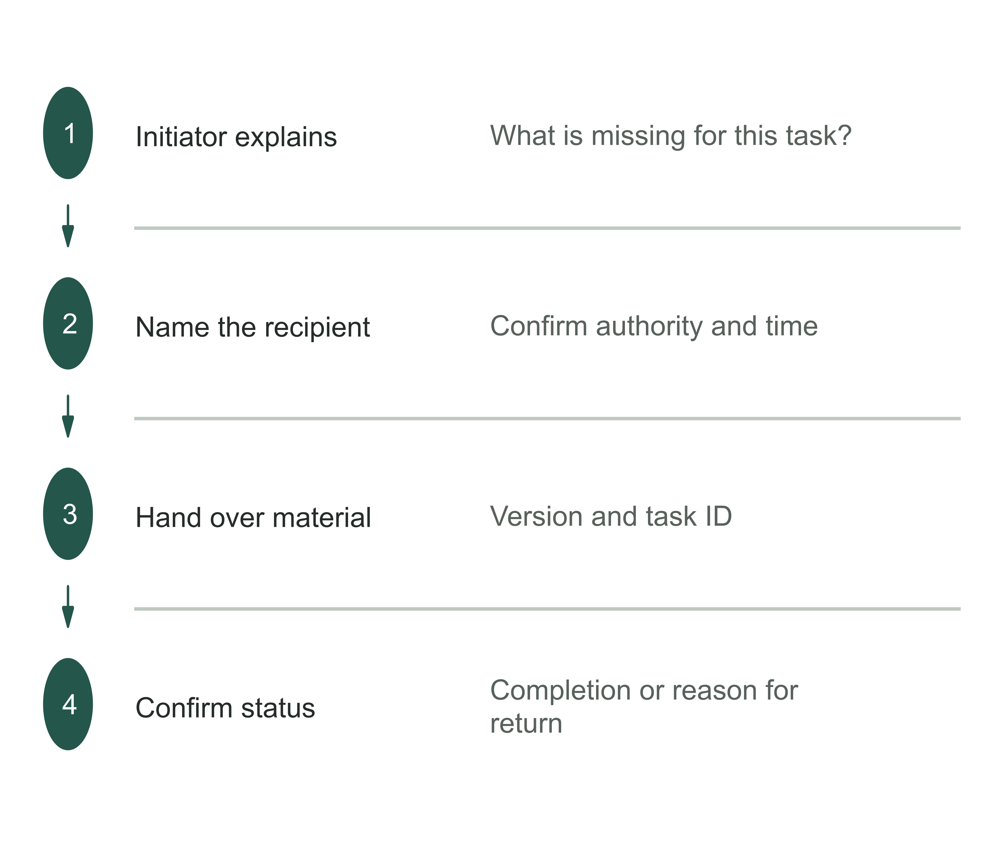

Figure 6-2 | Turn a chat message into a handover. The author's analytical tool: after sending the message, confirm that the recipient has taken over.

## Job descriptions show how responsibilities can be divided

Anthropic recruiting material examined for this book shows several divisions of responsibility. The Pre-Sales Program Lead screens opportunities and prioritizes them, routes delivery to internal teams, partners, or a joint effort, organizes scope confirmation, proposals, and legal and financial contracting processes, and prepares the handover to delivery. The description also states that demand at the time exceeded the team's capacity to serve, requiring choices.[1]

This arrangement first decides which projects receive limited engineering time. A willing customer does not mean every project should immediately enter the same engineering team. Without selection at this level, FDEs may rush between projects while work requiring continuity receives too little time.

During delivery, the Technical Deployment Lead owns scope, milestones, dependencies, success criteria, value hypotheses, and day-to-day progress, including baselines, metrics, and outcome measurement. The description explicitly says production coding is not required; the lead works with the FDE who builds the technical solution.[2] For the owner, the useful distinction is that the person organizing engineering work needs technical understanding without necessarily writing all the code.

The forward deployed engineer (FDE) role emphasizes building production applications within customer systems, delivering technical outputs usable in actual workflows, and feeding repeatable deployment patterns back to product and engineering teams.[3] Working within customer systems requires entering the real business environment. Yet this description does not disclose each project's repository permissions, release approvals, or rollback arrangements. Rollback returns software or configuration to a confirmed earlier version; business actions already taken require separate checks. Confirm these arrangements for every project.

A separate Manager, Forward Deployed Engineering description assigns staffing, architecture and code review, engineer development, and reusable material to management.[4] As delivery pressure grows, someone must protect time for quality standards and staff capability, rather than rely entirely on engineers doing this voluntarily between projects.

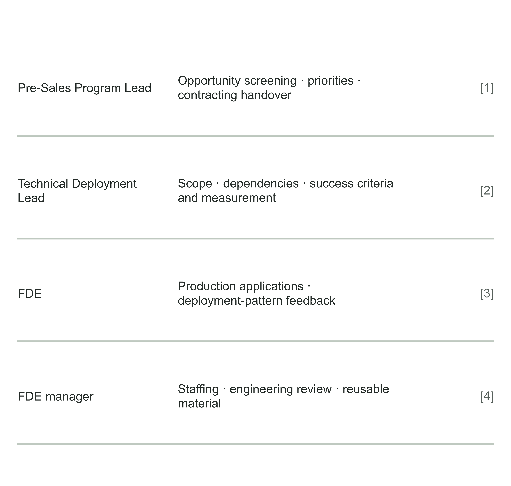

Figure 6-3 | Responsibility judgments supported by job descriptions. Responsibility index derived from four public job descriptions.[1][2][3][4] Only explicitly supported work is listed. Horizontal arrangement aids comparison; it does not represent actual reporting lines, fixed headcount, or a route followed by every project.

Recruiting material describes what a company wants people in those roles to do. It is not proof of successful client projects or sufficient evidence for a complete actual organization chart. It does prompt specific checks: who selects projects, confirms scope, develops, checks quality, and owns ongoing operation? If every answer is “the project team,” problems may still lack someone able to handle them.

A midsize company need not copy these roles. A business supervisor can lead, internal engineers can develop part of the system, and a provider can supply missing capabilities. Clarify work and handovers first, then decide which responsibilities need dedicated people.

Table 6-1 | Turning job descriptions into project arrangements (the author's checking tool)

| Role description | Specify for this project |
|---|---|
| Connect business and technology | Who proposes and receives which tasks? |
| Measure value | Who provides the baseline and confirms actual changes? |
| Drive adoption | Who owns training, permissions, and work adjustments? |

## Decide which decisions must remain with the company

For the opening settlement rule, the provider can demonstrate two implementations, explain affected tasks, and flag conflicts between rules. But an authorized person within the company must decide which interpretation represents its business arrangements. Outsourcing that judgment may leave the provider following a project manager's immediate verbal instruction, producing rules no one has formally endorsed.

The company must also decide which business consequences it accepts. Can certain discrepancies be cleared automatically? Which customer notifications require review? Which exceptions require a pause? Model confidence alone cannot answer these questions. The technical team explains capabilities and limits; the business lead defines task boundaries; finance, compliance, and other relevant staff participate within their responsibilities.

Resource commitments likewise belong to people authorized to allocate resources. Finance's willingness to try does not make an IT interface available this week. A project manager can coordinate without necessarily changing another department's priorities. The owner or authorized sponsor must resolve conflicts and accept the effect on other displaced work.

Table 6-2 | Decisions and supporting material (the author's comparison). This table does not transfer legal responsibilities. When one decision contains several professional approvals, record them separately; “the owner agreed” cannot replace all procedures.

| Decision required | What the delivery team should provide | Who the company should identify to confirm |
|---|---|---|
| Which rule version to use | Conflicting samples, affected scope, and implementation options | Person authorized to approve that business rule |
| Which actions may run automatically | Error consequences, permission design, and takeover method | Business and relevant control owners |
| Whether to enter production | Testing, release, and recovery material | Authorized production release owner |
| Whether to invest more or expand scope | Outcome records, remaining gaps, and resource requirements | Person with budget and scope decision authority |

Keeping decisions within the company does not require the owner to review every statement personally. Define delegation: responsible staff proceed within approved rules and budgets, and present options, impacts, and required decision-makers when the scope is exceeded. “Refer major matters to the owner” leaves people waiting for a response unless “major” is defined.

Someone must also be able to exercise that authority. A finance rule owner without time to inspect samples cannot resolve the blockage, however precise the title. The 60 hours already budgeted need named people, participation periods, and substitute arrangements, not just the previous chapter's table.

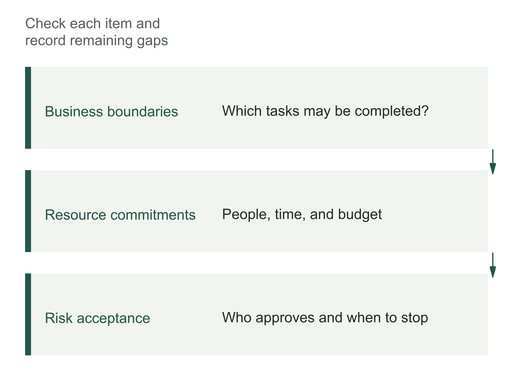

Figure 6-4 | Decisions the company must retain. The author's analytical tool: external teams can supply evidence, but company decision-makers remain necessary.

## Make the responsibility table verifiable

Many companies use RACI tables. R means responsible for execution, A accountable for the final decision, C consulted beforehand, and I informed of the result. These letters reveal different kinds of participation in a task, but cannot by themselves establish decision authority.

Consider an overly broad row: “Launch the settlement assistant: project manager A, provider R, finance C, IT C.” If finance finds a wrong rule, can it merely advise or prevent launch? Must IT still approve release? The row gives no answer. It assigns final accountability to a project manager who may lack authority for either decision.

Divide the work more precisely. The business lead makes the final rule decision; the delivery lead organizes building and repairs; an authorized business lead confirms business acceptance, using samples and test records from the delivery team; the production owner approves technical release. A/R in the figure means one role owns both decision and execution. One A per row is a design constraint this book adopts to clarify specific matters. If it cannot be arranged that way, first check whether the row combines two different decisions.

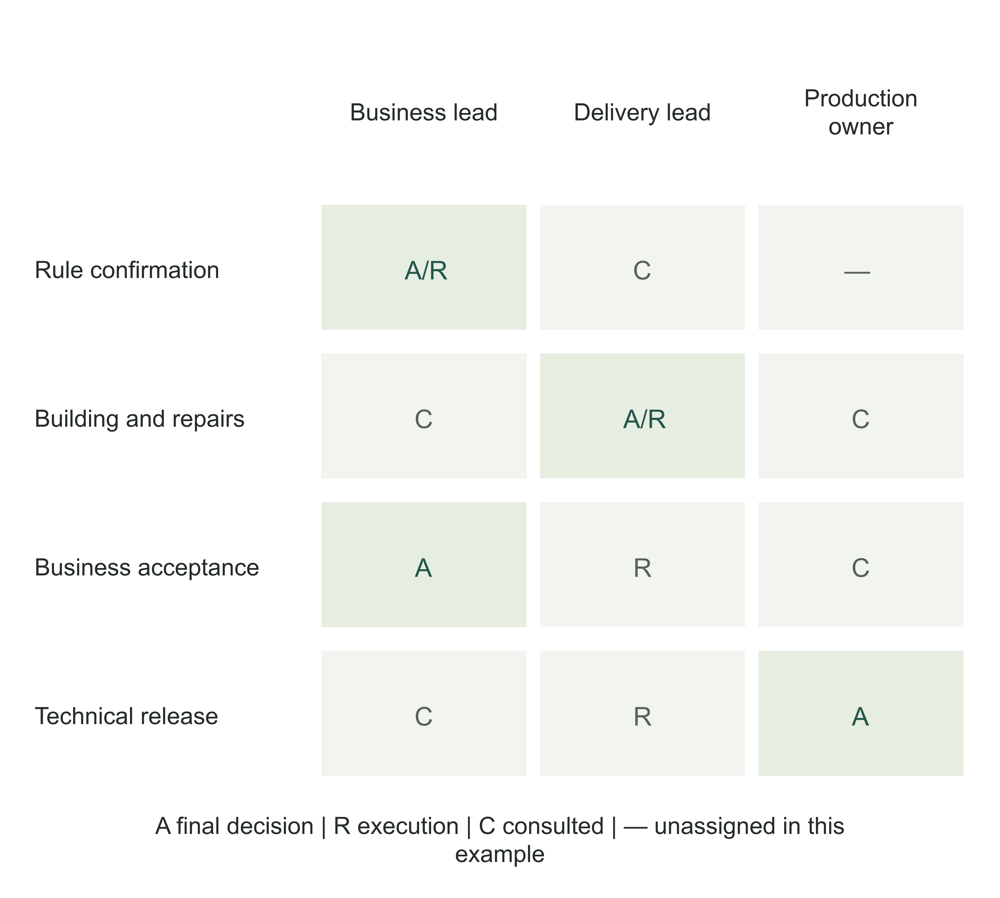

Figure 6-5 | Split a vague go-live task into specific responsibilities. Simplified responsibility matrix designed by the author for the teaching project. A is the final decision-maker, R the executor, and C a person consulted beforehand. A dash means no responsibility is assigned in this example. People may hold several roles, but the corresponding judgments must still be completed separately. Companies with different review arrangements should adjust staffing.

A small team can assign four types of responsibility to three people. In this teaching arrangement, Person 1 (the business owner) handles scope and additional resources, Person 2 (the finance supervisor) owns rules and business acceptance, and Person 3 (the engineering lead) handles both building and technical release. Person 3's combined roles do not allow that person's tests to replace Person 2's business confirmation. If a new rule cannot apply to last month's statements, Person 2 can halt that business path, Person 3 freezes the affected release and repairs it, and Person 1 decides only if budget or scope needs adjustment. If a high-impact technical release requires independent review, assign qualified, authorized staff. The three-person example cannot remove existing requirements.

After filling the table, walk through an actual change. If finance says the new rule cannot apply to last month's settlements, who changes its effective date, checks historical data, and decides to delay go-live? If the table cannot answer, revise it rather than tell colleagues to “follow RACI strictly.”

When one person holds several roles, check whether review loses its effect. Small teams cannot easily assign an independent person at every step, but another capable person can spot-check critical samples or conduct extra review before a high-impact release. Required separation depends on consequences and existing arrangements. Two names in a table do not by themselves establish controlled risk.

Use the responsibility table with daily task lists. The accountable person need not perform every detail, and executors can divide the work, but they must know where to refer matters beyond their authority. Project meetings need not recite role definitions. They should identify missing information, incomplete approvals, and decisions between alternatives.

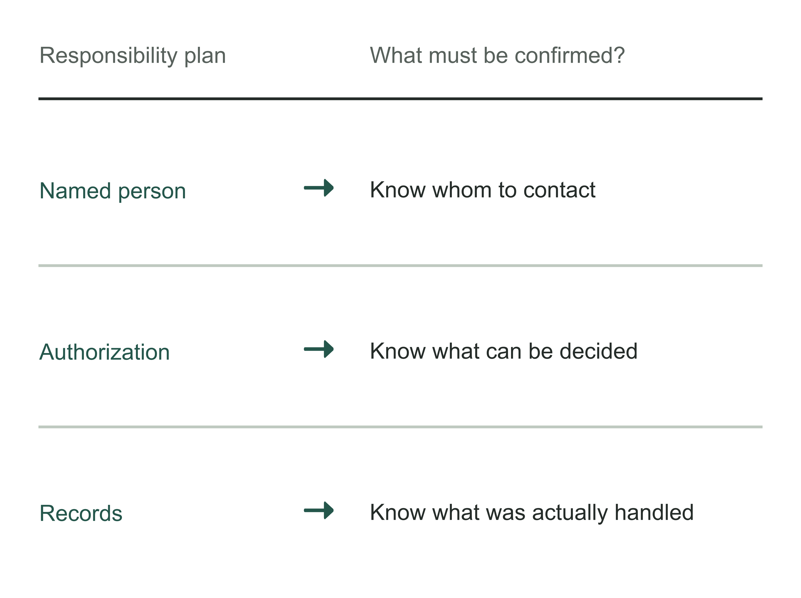

Figure 6-6 | Three kinds of evidence in a responsibility table. The author's analytical tool: check names, authorization, and actual performance separately.

## Assign decision authority and stop authority together

The project manager wants to launch on time, but an engineer finds an important error type still present in tests. Who can say, “We cannot release today”? Without advance agreement on stop authority, a quality issue can become an argument about attitudes: someone is too cautious, uncooperative, or focused only on schedule.

Assign stop authority by matter. A production owner can pause a version that fails release conditions; a business lead can stop use of an unconfirmed rule; anyone detecting unauthorized actions can initiate the agreed emergency response. Also assign who assesses impacts, repairs, and approves resumption after the pause.

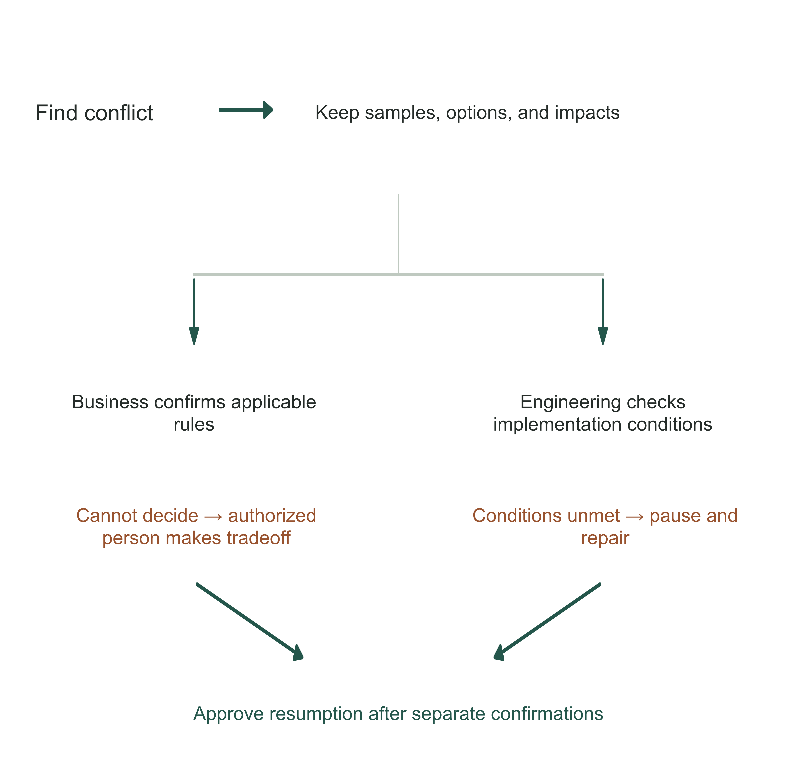

Figure 6-7 | Move disagreements from records to decisions. The author's rule-dispute path. Escalation material includes conflicting samples, alternative responses, and impacts. Engineering and business judgments are recorded separately; emergencies first restrict impacts under established response arrangements.

Stop authority must be usable promptly and subject to review. It should not justify indefinite shelving. If an unconfirmed rule causes the pause, identify whose judgment is missing. If data is the cause, show affected tasks and conditions for resumption. The team can then remove factual obstacles instead of arguing over personal authority.

Authority to resume is often overlooked. The repairer's “it's fixed” may be insufficient to restart. A pause involving a business rule requires business confirmation; a technical defect requires the release owner to examine retest material. Record multiple required professional confirmations individually, rather than assume one overall signature makes every issue disappear.

The owner handles conflicts beyond existing delegation: repairs needing more budget, delays affecting another business arrangement, or departments unable to agree on a rule. Escalation should bring comparable options: retain human handling for that task type, delay the entire launch, or narrow the pilot. “Please have leadership coordinate” alone gives little basis for a decision.

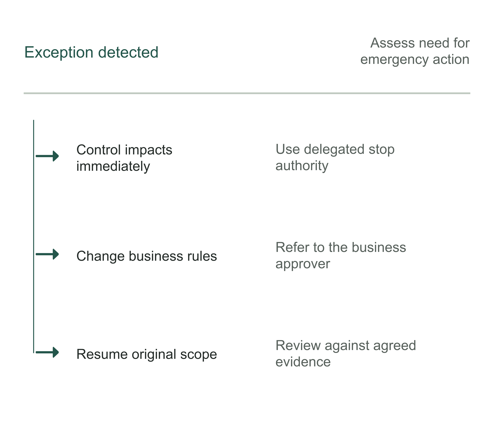

Figure 6-8 | Who may act first when an exception occurs? The author's analytical tool: specify permissions for initial impact control at the start.

## What to arrange for internal, external, and joint delivery

Once the team is identified, discuss which capabilities stay internal. Building internally lets the company continue modifying the system and develop business understanding, but also requires ongoing engineering, testing, operations, and staff development. The first engineer's recruitment cost is not the entire investment.

Buying mature capabilities can reduce some building work, but the company must still confirm applicability, prepare information, arrange permissions, verify outputs, and organize use. A standard product does not automatically make its provider responsible for redesigning every internal workflow. If buying delivery services, examine actual deliverables and maintenance responsibilities. Comparing the two takes more than an account price.

Even services called “FDE services” may supply different things. In one arrangement, engineers join the customer's team, with the customer directing their daily work. In another, the provider leads its own team and organizes delivery within an agreed scope. The first, staff augmentation, suits companies with an internal engineering lead that need an additional capability. If priorities and responsibility for checking outputs are still undefined, added external engineers may increase management burden. With provider managed delivery, verify who leads, handles rework, and maintains the result afterward. The company still confirms business rules and use boundaries. Chapter 15 compares these two business models using public service arrangements.

Joint delivery suits work requiring understanding on site and eventual internal takeover. It usually needs both delivery progress and knowledge transfer: internal staff participate in rule and interface decisions, help handle representative exceptions, and reproduce builds or configurations in their own environment. Copying internal staff into the project chat does not develop takeover capability.

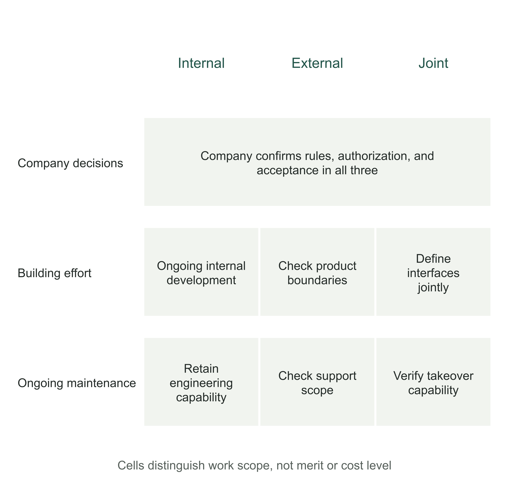

Figure 6-9 | Ongoing commitments under three delivery arrangements. The author's qualitative organizational comparison. Colored cells mark capabilities needing focused arrangements, not cost scores. All three retain the company's business decision and acceptance responsibilities.

The choice depends on specific conditions. Does the task change frequently? Do changes affect core company judgments? Does an existing product meet the requirements? Is someone available for ongoing internal maintenance? Can the company take the work back if it stops using the system or changes providers? These conditions can lead one company to choose different arrangements for different tasks.

For example, the teaching company might buy general document recognition, confirm settlement rules internally, and jointly develop the discrepancy-identification and review workflow. It need not use one model at every layer. Check both sides of each interface: who reports recognition errors, updates changed rules, and keeps the complete task running if a component fails?

Consider continuity among maintainers too. An internally built system understood by only one person may be difficult to take over when that employee leaves. A provider with complete handover material and verifiable exit arrangements does not necessarily deprive the buyer of all control. Judge control by the ability to inspect records, modify necessary parts, and restore work, rather than code ownership alone.

Compare the costs of the three arrangements on equivalent work. Add internal work excluded from external quotes and operating support omitted from internal budgets. Joint delivery may cost more while both sides contribute. If its purpose is gradual internal takeover, check whether external support actually decreases later instead of counting future savings as realized benefits now.

## A name on the list also needs available time

A business specialist participates in three AI projects, each requiring eight hours per week. Individually, each seems modest; together they require 24 hours. Suppose a 40-hour week already contains 28 hours of regular work and 6 hours of meetings and support. Only 6 hours remain for new projects, leaving the three projects 18 hours over capacity.

These figures are teaching assumptions, not recommended working hours. They expose a common budgeting problem: each project estimates its own time requirement without checking one person's total commitments. The gap may appear as overtime, delays, lower review quality, or displaced regular work.

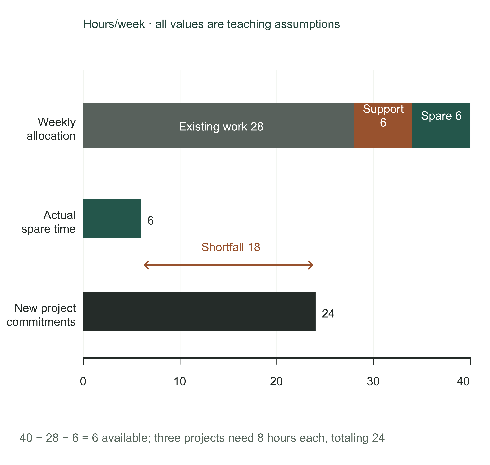

Figure 6-10 | Compare project requirements with actual spare capacity. Fictional staff-capacity comparison, in hours per week. Existing commitments total 34 hours, leaving 6; three new project commitments total 24, exceeding available capacity by 18. A shared zero baseline supports comparison. The 40-hour week is not an industry standard.

The answer need not be more recruitment. Prioritize a project, narrow this round's pilot, stagger periods requiring business judgments, or assign preparation to capable colleagues. If only this specialist can make the core judgments, reduce other work rather than leave every conflict for that person to absorb.

Engineers face the same issue. Live projects still need maintenance while new pilots need building. Recording only new-feature development turns operating support into an unacknowledged burden. An FDE manager or delivery lead needs visibility into concurrent projects, queued requests, and required quality checks before reasonably committing to another delivery.

Staffing changes by stage. Early work needs business explanation and sample confirmation; building needs continuous engineering time; trial operation needs users and takeover staff. Equal staffing from day one to the end can waste time yet leave key moments understaffed. Schedule Chapter 5's staged budget with this chapter's specific roles.

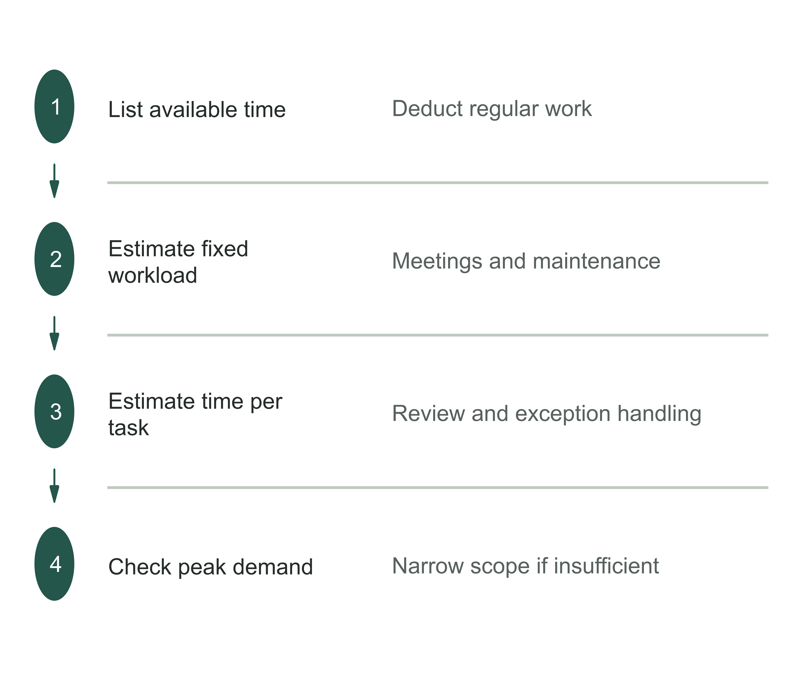

Figure 6-11 | Schedule work against available time. The author's analytical tool: calculate actual workload rather than simply count people.

## Find an internal champion and prepare a substitute

A colleague who understands the business and is willing to try can help identify real problems, organize trials, and collect feedback. This internal champion is valuable, but enthusiasm cannot replace formal authorization or sustain every training, support, and rule-maintenance task indefinitely.

Specify the champion's work. It may include organizing representative samples, helping colleagues try the system, recording issues, and contacting delivery staff. Decisions on rules, broader permissions, or additional investment belong to the relevant authorized people. If every issue must go through this one person, growth can turn the champion into a new queue.

After appointing a substitute, have that person complete a similar task independently from the instructions, then handle an actual or controlled simulated exception. If a step still requires verbal explanation from the original champion, improve the instructions or continue training. Passing this check establishes takeover ability only within the current scope, not suitability for every scenario.

Table 6-3 | Internal capability checks (the author's tool). A substitute needs appropriate authority and ability; “trained” cannot replace verification of actual task completion.

| Common dependency | Likely consequence | Verifiable improvement |
|---|---|---|
| Only the champion knows which tasks qualify | No one uses the system during the champion's absence, or scope expands incorrectly | A second user can determine applicability from the instructions |
| Issues are resolved only in private chats | Repeated questions about similar exceptions | Record the handling basis and have another person reproduce it |
| No formal time for rule maintenance or training | Support burden grows uncontrolled with adoption | Assign maintenance time, owners, and escalation contacts |

The champion can also help business staff describe issues clearly. “The system is hard to use” gives engineers little to reproduce. The task, rule version, expected result, and actual result make investigation possible. Business staff need not guess the technical cause first; engineering should provide an easy feedback channel and report progress.

Table 6-4 | Substitute checks when critical staff are absent (the author's checking tool)

| Work to take over | Prepare in advance |
|---|---|
| Judge exceptional tasks | Applicable rules, counterexamples, and approval boundaries |
| Restore operation | Version, steps, and exercise results |
| Hand over to business staff | Contacts, required information, and unfinished-task status |

## From sales handover to operating handover: inspect what is transferred

A project may have a complete proposal at signing but lack information needed to begin building. The delivery team will rediscover limitations unless it receives the demonstration samples, effects that remain plans, unapproved interfaces, and the people who will provide business judgments.

Sales should distinguish committed scope from assumptions still requiring validation. Delivery can use earlier interview records without treating unconfirmed matters as facts. A signed contract does not establish that all startup information and permissions are available. Check each item.

Moving from development to operation requires the current version, applicable inputs, known limitations, locations of monitoring and exception records, recovery steps, and maintenance contacts. The recipient also needs to check whether changes have taken effect. Judge sufficiency by the ability to complete work, not the number of files delivered.

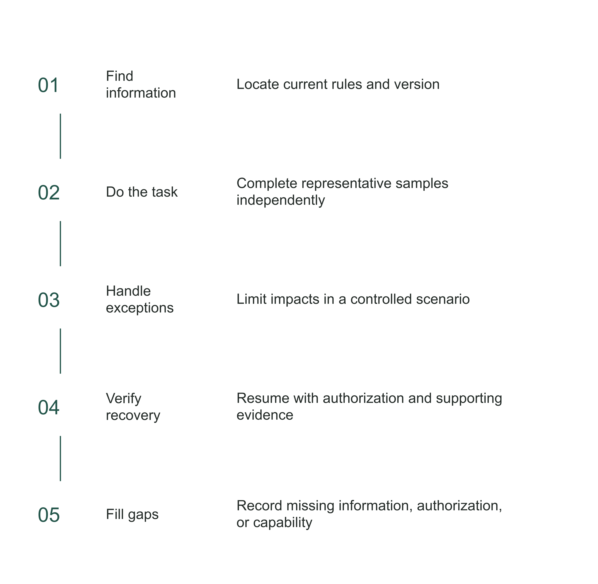

Figure 6-12 | Test a handover with a takeover exercise. Handover-validation sequence designed by the author: the recipient consults information, completes a task, handles an exception, confirms recovery, and records remaining gaps. Exercises should use controlled scenarios; the figure does not claim an actual client has completed one.

The teaching company can select a statement with conflicting rules. The day-to-day maintainer first decides whether to pause, then finds the approved applicable version in the records. If the original engineer must explain which rule the system used, information is missing from the handover. If the rule is known but necessary permissions are absent, authorization is missing. Address these separately rather than call both “more training needed.”

The actual recipient confirms whether the material is usable, with qualified people checking the business and technical portions separately. Known limitations and support arrangements can remain after confirmation. A successful exercise establishes takeover within the current scope; another scenario or version requires the applicability checks in Chapter 14.

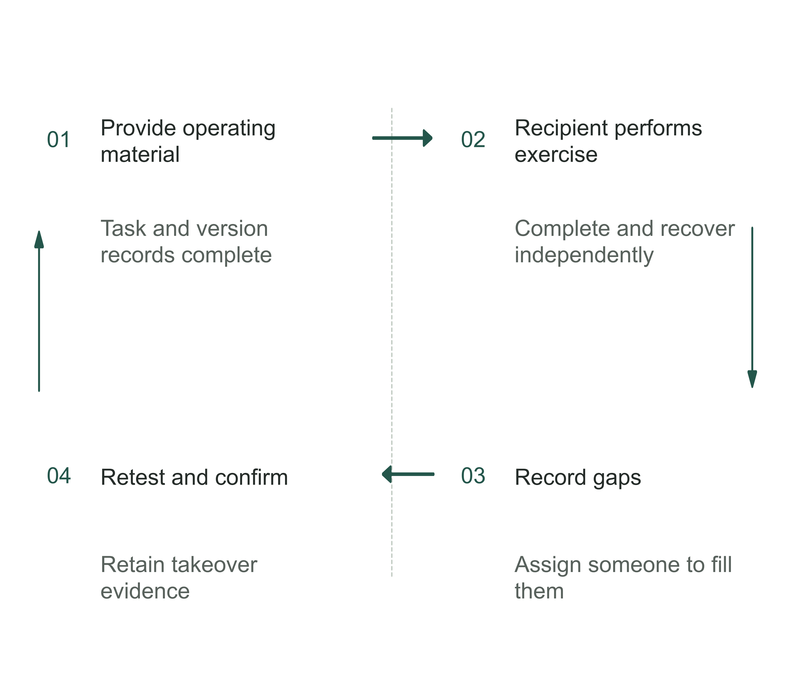

Figure 6-13 | Evidence of takeover ability after handover. The author's analytical tool: a receipt signature should rest on an actual exercise.

## At kickoff, check one complete task

At the next kickoff, walk through the opening rule change: who supplies conflicting samples, approves applicability, builds, reviews, releases, and takes over after an error? Enter the answers in the chapter worksheet and check whether these people have permissions and available time.

If any step still says “joint responsibility of the project team,” clarify the specific matters and owners further. When one person makes several critical judgments, check whether extra review or a substitute is needed. Before starting, the owner should resolve resource and authorization conflicts so decision-makers have both authority and time.

Once the team is arranged, external procurement needs one last check: are the responsibilities verbally assigned to the provider also included in delivery, acceptance, and operating agreements? Chapter 7 puts these commitments into contract material.

## Notes and sources

[1] Anthropic, *Pre-Sales Program Lead, Forward Deployed Engineering*, “About the role” and “Key responsibilities,” rechecked September 6, 2026. Opportunity screening, prioritization, partner routing, and sales handover are explicit role responsibilities; actual capacity and signing limits are not inferred. https://job-boards.greenhouse.io/anthropic/jobs/5391012008

[2] Anthropic, *Technical Deployment Lead*, “Responsibilities” and qualifications, rechecked September 6, 2026. Scope, dependencies, and value measurement describe role design, not an independent report of client outcomes. https://job-boards.greenhouse.io/anthropic/jobs/5017903008

[3] Anthropic, *Forward Deployed Engineer*, “Responsibilities,” rechecked September 6, 2026. Engineering construction and deliverable scope do not establish that all customer production permissions have been granted. https://job-boards.greenhouse.io/anthropic/jobs/5302966008

[4] Anthropic, *Manager, Forward Deployed Engineering*, “About the role” and “Responsibilities,” rechecked September 6, 2026. Used for quality, staffing, and reuse responsibilities; it does not disclose actual staffing levels or deployment results. https://job-boards.greenhouse.io/anthropic/jobs/5385634008

Job material reflects responsibilities visible when checked and may change with recruiting. The teaching company, responsibility matrix, comparison of internal, external, and joint delivery, staff-capacity figures, and worksheets are the author's designs. They do not establish specific parties' legal responsibilities or uniform industry procedures.
