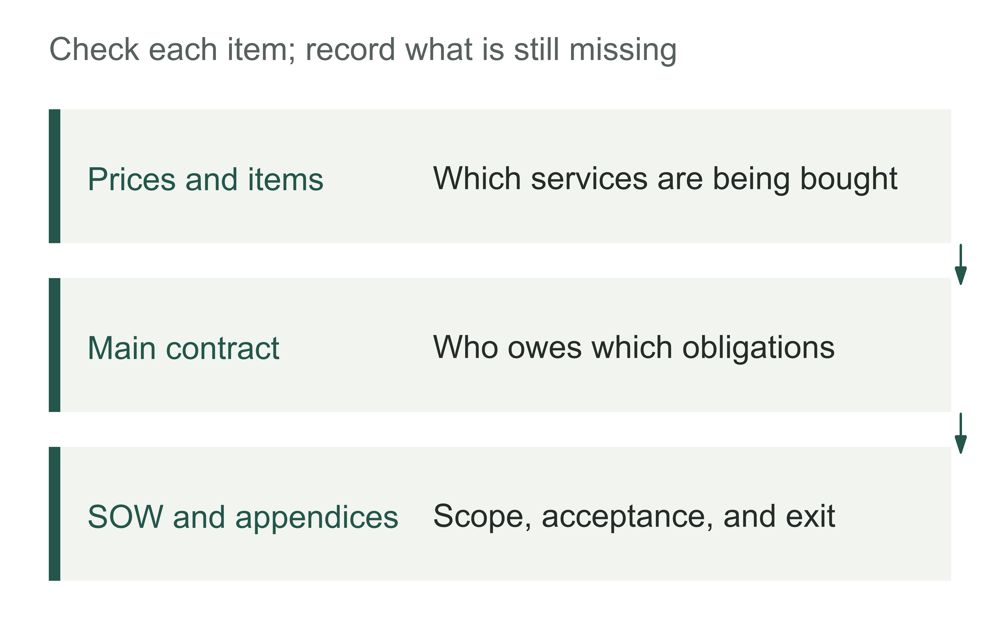
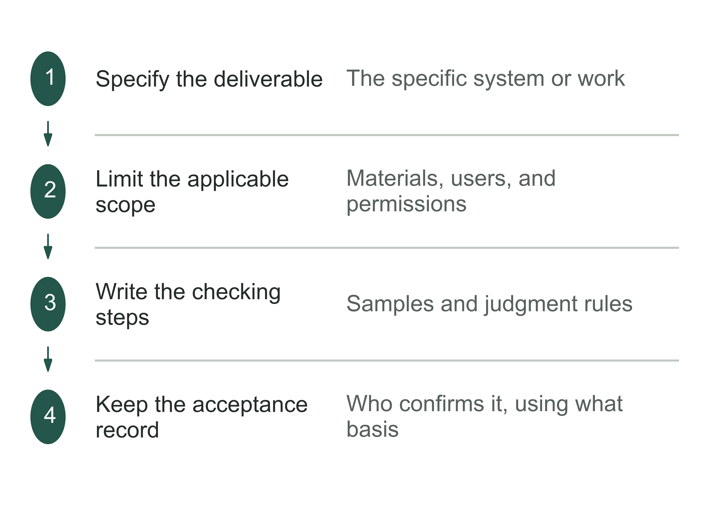
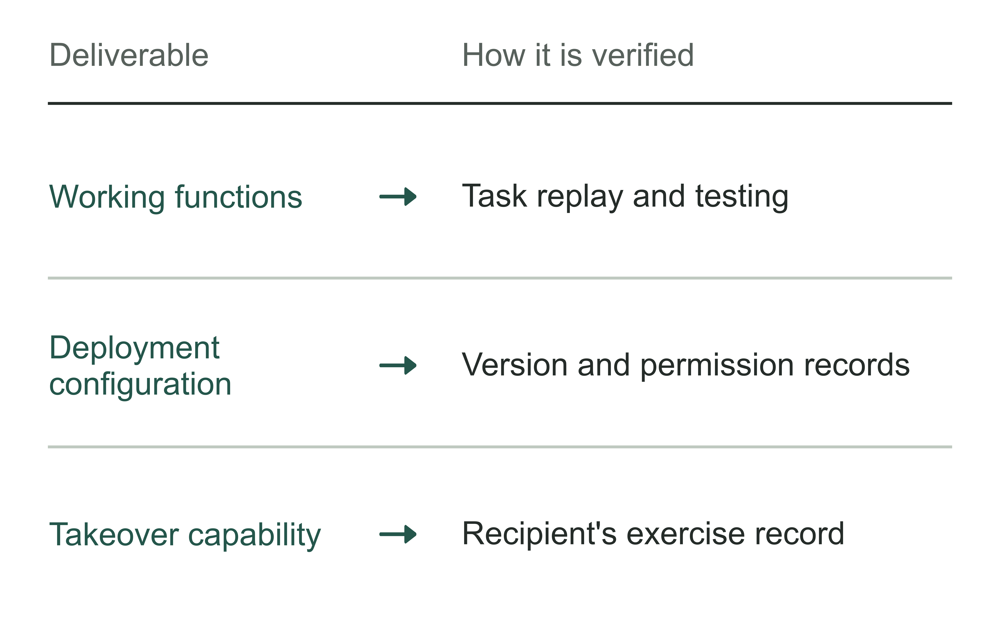
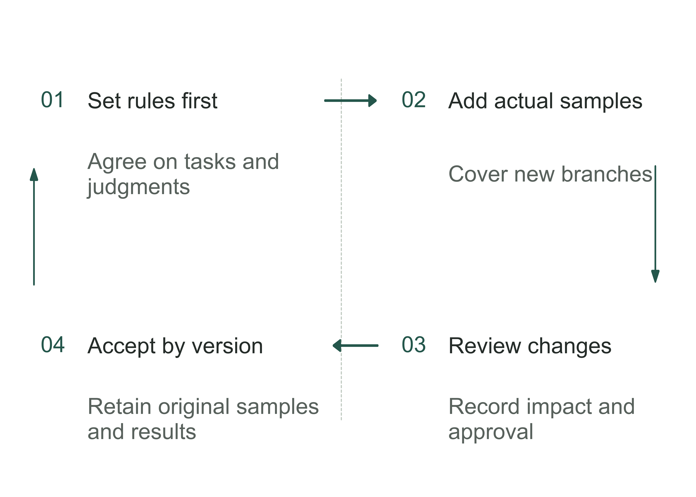
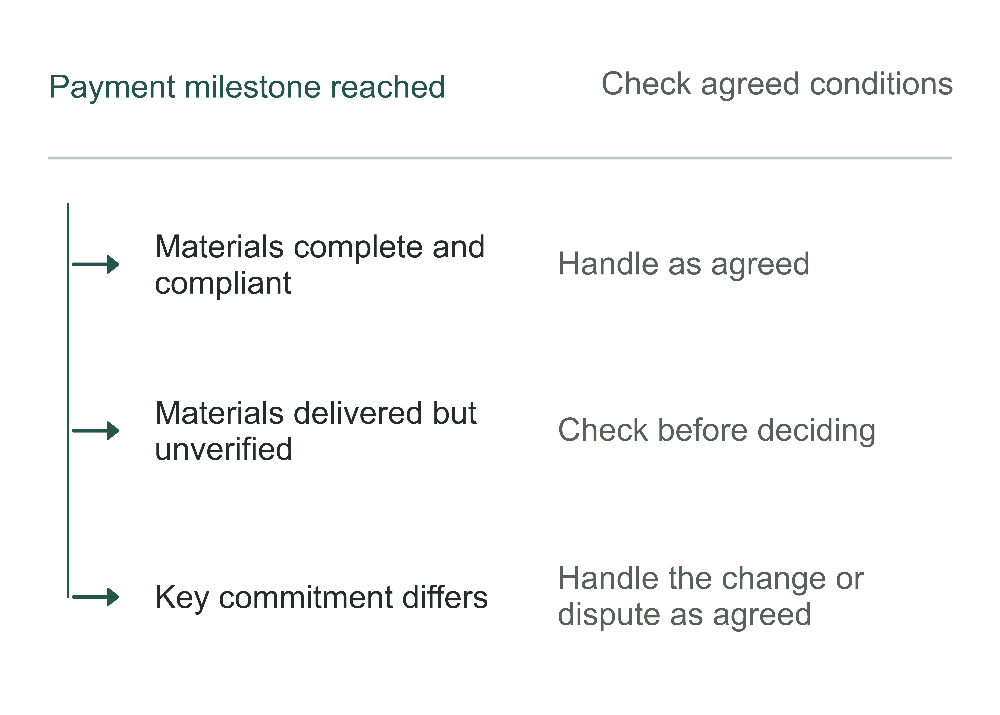
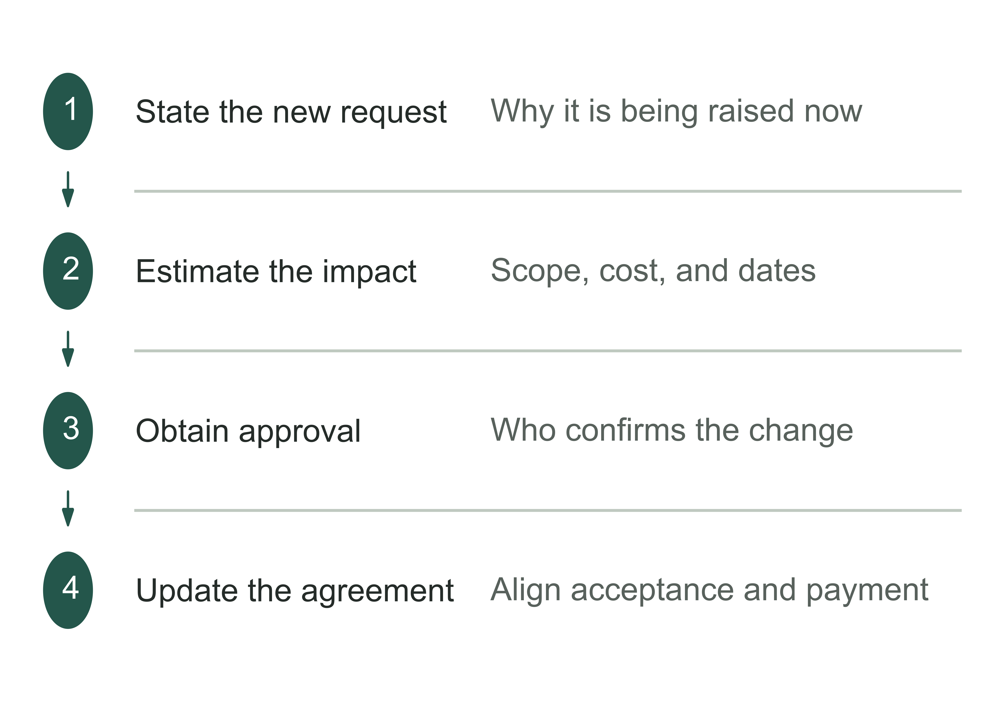
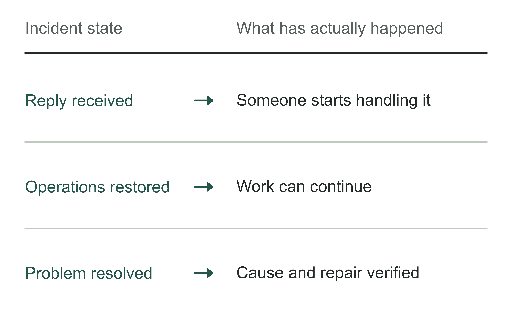
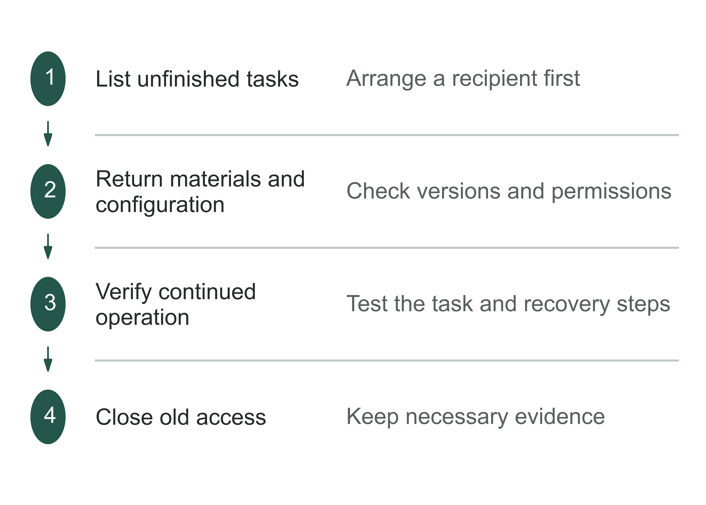

# Chapter 7 Agree on the contract: delivery, acceptance, incidents, and exit

## Technical services appear in the price list. Why read the main contract?

A procurement price list includes software, implementation, configuration, integration, and engineering services. The AI project a company wants to buy needs precisely this work, so a procurement route seems to be in place. Yet the main contract in the same document set may contain a scope restriction that changes the proposed approach.

Contract DIR-CPO-5687 from the Texas Department of Information Resources (DIR) provides such a comparison. Its price list includes Anthropic software and vendor-related technical services and support, as well as implementation, configuration, integration, data migration, business analysis, and other services covering all brands. But the main contract expressly excludes the development or procurement of custom software, products, or services, and the creation of intellectual property (IP). The last page of the price list also excludes development, customization of core software, and other work.[1]

These pages need to be read together. An entry for “engineering services” does not, on its own, establish that a customer can procure development of its own code through this contract. The team must determine whether the actual work is standard configuration or integration support, or goes beyond the scope expressly permitted by the documents. Both kinds of work may require engineers, but their procurement basis may differ.

Figure 7-1 | Check service names against the full document set. A reading guide based on the archived DIR-CPO-5687 documents.[1][2] It shows a checking sequence and scope constraints, not a hierarchy of contracts applicable in every jurisdiction.

The standard appendix also permits the customer and vendor to negotiate written arrangements for an order's statement of work, service levels, remedies, acceptance, and information security requirements, while stipulating that order terms must not conflict with the main contract.[2] Finding that a price list leaves acceptance unclear therefore does not mean these requirements cannot be added. But including custom development in an order does not automatically remove a restriction already stated in the main contract.

This chapter draws on archived contract documents; it cannot determine the legal effect of a particular reader's transaction. Before procurement, the team should check each item of actual work against the applicable documents. A vendor's presence in a procurement catalog, and technical services on its quotation, do not establish that the engineering work falls within the permitted procurement scope.

Figure 7-2 | Which documents support a procurement commitment? The author's analytical tool. Reading the documents in sequence does not replace checking how their provisions correspond.

## Turn “deliver an assistant” into work that can be checked

Return to the fictional settlement project from the previous two chapters. If the statement of work says only “Build an AI settlement assistant supporting document recognition, discrepancy checking, and intelligent Q&A,” the two parties can easily sign with different expectations. The company wants a workflow employees can continue using; the vendor may understand the promise as a few feature entry points and a demonstration.

Start with how one document is processed: which formats can be submitted, what happens to missing pages and duplicates, which version of the promotional rules applies, whether the software only flags possible discrepancies, who approves the settlement adjustment, where the result is written, and who takes over after a failure. Answering these questions one by one makes the vendor's work, and the conditions the company must provide, visible.

A statement of work is usually abbreviated to SOW. It need not lock down every implementation detail in advance. It should, however, tell both parties what this round must accomplish, what it expressly excludes, and how they will determine that the work has been done. Implementation can evolve through iterations; the completion criteria cannot remain undiscussed until the end.

Figure 7-3 | Add boundaries to a vague delivery description. A simulated scope annotation designed by the author, not a screenshot of an actual contract. Expand “build an assistant” into inputs, actions, outputs, exceptions, and exclusions; the parties must still confirm the specific rules.

In the teaching project, this round might process only settlement statements from specified stores in a prescribed format and generate a candidate discrepancy list. Disputed rules go to finance; the system does not make settlement adjustments on its own or issue payment instructions directly. With this wording, the company can discuss whether the scope is too narrow, the vendor can estimate the engineering effort, and the acceptance reviewers know what to examine.

Also specify the conditions the customer must provide: confirmed rules, samples authorized for use, an interface environment, and time for business staff to participate in confirmation. Agree in advance how the team will record the impact, adjust the work sequence, and reconfirm dates if these conditions are not ready on time. Leaving every customer dependency under “Party A shall actively cooperate” makes it hard to identify what is missing when delays arise.

Ordinary business staff should be able to understand the exclusions. “Changes to third-party systems excluded” may mean that the vendor delivers only interface specifications and the company must engage someone else to modify its financial system. If that interface is necessary to complete the task, the overall plan must assign responsibility and budget for it. Excluding it from one contract does not remove the need to do the work.

Figure 7-4 | From a service name to an acceptance action. The author's analytical tool. Every key word in a promise should correspond to a check that can be carried out.

Table 7-1 | Turn vague promises into questions that can be checked (the author's checking tool)

| Promise | Questions to resolve |
|---|---|
| Usable | For which tasks, people, and materials is it usable? |
| Timely | Which event starts the clock, and which state ends it? |
| Delivery complete | What deliverables, which samples, and whose acceptance? |

## Explain how each deliverable will be verified

A long list of documents does not guarantee easy acceptance. Delivering an operating manual does not prove that the person taking over can handle exceptions. Delivering a test report does not prove that the tested version is the version about to be released. Acceptance requires a correspondence between the deliverable, its version, the verification action, and the result.

For example, a vendor delivering a workflow to identify and review settlement discrepancies should be able to identify the rules it calls, the interfaces it uses, the samples on which it was tested, and how automatic processing stops when a document is uncertain. The company does not have to read every line of code, but it should be able to ask someone qualified to check that these records all refer to the same system.

Figure 7-5 | Trace a deliverable to a repeatable verification. The author's comparison of delivery and verification. Each line identifies “what is delivered, how it is checked, and who confirms it.” File counts and report length do not replace acceptance.

Table 7-2 | The author's teaching comparison. Different deliverables require different verification. One exercise does not establish that all safety and quality requirements have been met.

| Deliverable | What is actually done at acceptance | Evidence retained |
|---|---|---|
| Candidate discrepancy workflow | Complete an end-to-end task using the agreed samples | Inputs, outputs, rules, and system version |
| Exception takeover mechanism | Trigger a pause and human takeover using a controlled exception | Trigger record, person taking over, and handling result |
| Operational handover materials | Have the recipient independently locate the version and perform a task | Exercise record and gaps still to be filled |

Acceptance must also examine unfinished and rejected tasks. If a system blocks all difficult documents at the entry point, the portion admitted to the workflow may perform well, while employees' workload remains unchanged. The agreement should specify which inputs are in scope, which may be rejected, what reason a rejection leaves on record, and who takes the task back.

The delivery team can propose how to test; authorized acceptance reviewers confirm the results. Chapter 6 identified these people. This chapter must also specify what each person examines and which result each confirms. Business and technical judgments should be made separately. A project manager who does not understand the tests should not sign every acceptance judgment alone.

Figure 7-6 | Match deliverables to evidence. The author's analytical tool. Naming an item on a checklist still requires checking that the actual deliverable meets the agreement.

## Agree on acceptance criteria before work starts; develop samples as work progresses

“Accuracy meets the target” is still insufficient. Specify which tasks enter the calculation, who supplies the correct answers, how multiple reasonable results are handled, which errors are unacceptable, and which version is tested. Chapter 5 discussed measurement definitions. At the contract stage, those definitions must become acceptance criteria that both parties can locate.

The full sample set need not be ready at the first discussion. The parties can agree on the scope, sampling approach, and method of judgment, then jointly confirm the sample version during the baseline stage. The particular danger is one party selecting samples, changing the denominator, or adding previously undiscussed criteria as delivery nears completion. That turns differences that could have been addressed earlier into acceptance disputes.

Acceptance should also include representative exceptions, such as conflicting rules, missing fields, duplicate inputs, interface failures, and tasks outside the applicable scope. These samples test the promised handling of boundaries; they do not assign every difficult problem to the system without conditions. Permitting a handoff to a human in testing is a very different result from the system silently discarding a task.

Figure 7-7 | What must be jointly fixed in the acceptance record? The author's schematic acceptance record: scope and samples, judgment criteria, system version, and results and confirmation correspond to one another. The diagram assumes neither a success rate nor a uniform industry threshold.

After an initial failure, the acceptance reviewer supplies a reproducible defect list, the vendor states the repair scope and timing, and the agreed method is used for retesting. For example, after correcting the effective date of a new promotional rule, the team must also check documents from old campaigns. Showing that the one previously failing document now succeeds does not establish that other related tasks were unaffected.

Conditional acceptance is appropriate for outstanding items whose scope is clear, whose impact is acceptable, and whose handling has been arranged. The record should specify which work cannot yet be opened for use, who will complete it by when, and how it will be rechecked. Unauthorized actions or unacceptable critical errors should not be packaged as ordinary outstanding items through “conditional acceptance.”

Even after a version has passed, changes to the model, rules, tools, or interfaces may change its behavior. The parties should agree on which changes trigger which reviews, who supplies the records, and how far the original acceptance extends. This chapter establishes responsibilities and triggers; Chapter 10 develops the specific test design.

Figure 7-8 | Update acceptance samples without changing the criteria unnoticed. The author's analytical tool. Adding samples and changing acceptance criteria should be managed separately.

## Link payment milestones to verifiable progress

Contract payments must first fit the actual delivery. Standard software licenses, monthly services, and custom engineering incur costs differently; one set of percentages is unlikely to suit them all. The company wants to retain a constraint on unfinished work, while the vendor needs to pay startup and staffing costs. Payment discussions should consider investment and risk on both sides.

To illustrate the structure, assume a separate engineering service package priced at renminbi (RMB) 100,000. The parties discuss four payments of RMB 30,000, RMB 40,000, RMB 20,000, and RMB 10,000. This is an illustrative calculation for this chapter, not Chapter 5's pilot budget or a recommended quotation. The key issue is whether both parties can identify the condition attached to each payment, rather than the percentages themselves.

The first payment might correspond to the agreed startup arrangements and necessary preparation; the second to a verifiable version within the agreed scope; the third to acceptance of a controlled trial; and the last to operational handover and completion of agreed outstanding items. Each milestone should specify the required materials, confirming person, and payment procedure. Reaching a date and satisfying a condition may happen at different times; the arrangement must address this.

Figure 7-9 | Link a service fee to delivery conditions. The author's separate payment example: RMB 100,000 in total, paid in installments of RMB 30,000, 40,000, 20,000, and 10,000, totaling 100%. Milestones show a sequence of conditions, not a promise of evenly spaced calendar dates. They do not represent actual project percentages or statutory payment rules.

If a stage has not met its agreed condition, distinguish among a delivery defect, an unmet customer dependency, a changed scope, and a dispute about the judgment. All can delay a milestone, but they require different handling. Arrangements should also specify how completed portions are confirmed, how disputed portions are rechecked, and whether subsequent work continues.

Deferring all fees until the end does not automatically improve quality. The vendor may be unable to sustain its effort, and the company may go a long time without credible intermediate deliverables. A more useful discussion asks what progress both parties need to see before the next commitment, which risks remain, and what justifies continued investment.

Meeting payment conditions does not mean business benefits have been realized. A system may have been delivered as agreed while employees have yet to use it proficiently. Benefits may also depend on business volume, staffing, or other projects. The contract should specify the delivery and working conditions the parties can control. How much of the business change comes from this system must be examined separately using the methods in Chapter 12.

Figure 7-10 | Three states of evidence at a payment milestone. The author's analytical tool. The diagram helps check the basis for payment; specific rights and obligations are governed by the applicable contract.

## Changes will occur. Agree on how commitments can change

A pilot initially covers recognition of settlement statements in a prescribed format. During operation, the business department wants to add another type of historical document. The new requirement may have business value, but it should not simply be mixed into the original acceptance samples and then used to conclude that the vendor failed to deliver. First establish whether it is a defect or omission within the original scope, or new work.

A change record need not be a long report. Record the original agreement, proposed change, reason, affected tasks, labor and fees, timing, and testing impact, then obtain confirmation from an authorized person. The technical team explains implementation and risk, the business side judges whether the work is worthwhile, and the people responsible for procurement and budget check the change to the commitment.

Figure 7-11 | What decision basis should a change leave on record? A simulated change record designed by the author. Adding historical documents is a teaching example, not a real customer's change order. The change must be reflected separately in scope, investment, dates, and retesting.

Changes can also come from the supply chain. Updates to a model or external service, changes to interface policies, or the end of support for an existing component can affect the task. When signing, the company should know who controls each component, how the vendor will give notice, when an alternative is needed, and who evaluates and confirms the associated cost.

Finding that a problem originates in a third-party service cannot be the entire response. Even if the delivery vendor did not cause the fault, someone must establish its impact, coordinate support, and arrange temporary handling. Commercial responsibility is checked against the specific agreement. The immediate task still needs someone to handle it before all disputes are settled.

Emergency repairs may follow a different route from ordinary changes, but they must still leave a record. After limiting the impact, record the change, authorization, version, and retest results. Otherwise a temporary workaround can gradually become an unmaintained production system. At the next failure, the handover materials and actual environment may no longer match.

Figure 7-12 | Which arrangements must change when a change is approved? The author's analytical tool. Agreement in a chat cannot leave acceptance operating under the old criteria.

## A reply, restored operations, and a resolved problem are three different things

Credera's Generative AI Acceleration service on the UK government's Digital Marketplace makes a clear distinction. For a complete loss of service that it classifies as P1, its highest priority, the targets are a 30-minute response, restoration within 2 hours, and resolution within 1 business day. These targets apply during the agreed service hours; support fees are determined separately according to the volume of service the customer requires.[3]

These figures are the vendor's public disclosure. They cannot be treated as a service-level agreement (SLA) that a customer has signed or that has been performed. An SLA specifies service standards such as response and restoration, together with the responsibilities of both parties. This chapter uses the distinction between the fields; it does not recommend copying 30 minutes, 2 hours, and 1 business day into your own project. Tolerable interruptions, support hours, and alternatives can differ considerably between tasks.

Figure 7-13 | How response, restoration, and resolution are timed. The public service fields distinguish response, restoration, and resolution.[3] The figures are this vendor's disclosed P1 targets. The three separate record bands are not drawn to a common time scale; 1 business day is not converted into a fixed number of hours.

For the settlement workflow, receiving a ticket and starting an investigation is a response. Employees being able to continue through an approved alternative route is restoration of operations. Repairing the defect and verifying that the problem has been eliminated is resolution. Restoration may precede a permanent repair, but the quality, permissions, and workload of the temporary route must be clear.

Timing needs an identifiable basis as well. Starting from the user's first report, an automatic system alert, or the vendor's acknowledgment can produce different results. Handling outside service hours, whether the clock pauses while waiting for customer materials, who can approve a pause, and whose confirmation establishes restoration should all be traceable to records. Very short targets without defined start and end events make compliance hard to judge.

AI introduces another possibility: the service remains online while its outputs are persistently wrong. If incident levels depend only on availability, unauthorized settlement adjustments or incorrect customer notices may be underestimated. The company needs categories for quality and permission incidents based on task consequences, specifying when related actions should be paused before an availability failure occurs.

Incident handling should also specify communication frequency, escalation contacts, temporary takeover, and review materials. Service credits or other remedies can address commercial consequences, but they cannot replace an emergency stop and takeover. The business owner needs to confirm who can first contain the impact when a problem occurs, rather than relying only on a month-end table of missed targets.

Figure 7-14 | Three distinct points in service recovery. The author's analytical tool. Record the three points separately; none substitutes for another.

## What does the company recover when it exits?

Beamtree's end-of-contract description for RippleDown Coding lists stopping data ingestion, revoking transmission keys, closing application access, and copying or deleting stored data according to the customer's choice. If deletion is selected, it provides a deletion confirmation letter within 60 days after the contract ends.[4] This too is a vendor disclosure, without customer execution records that this chapter can verify.

The material reminds us that ending a contract requires a set of actions. Closing an account addresses access, but does not necessarily establish that data has been returned. Exporting a file does not necessarily establish that rules, configuration, and operating records have been handed over. At procurement, the company needs to know who will continue the original task after the service ends.

Figure 7-15 | Address work, access, and data separately at exit. The author's exit checklist, informed by publicly disclosed service exit actions.[4] Export, retention, and deletion depend on the data category and applicable requirements. The diagram does not assign one deadline to all materials.

First identify which assets must be taken back. They may include business rules, configuration, customer-provided materials, necessary operating records, evaluation materials, and agreed code deliverables. These do not necessarily carry the same rights or permit full export. Confirm each item in the scope and rights arrangements, rather than waiting until the contract ends to infer ownership of everything from “the data belongs to the customer.”

Then check whether the received materials can be used. File formats, field descriptions, rule versions, dependencies, and necessary permissions affect whether the recipient can reconstruct the work. The parties can agree that the recipient will reproduce a representative task in a controlled environment, recording what cannot be reproduced and how the gaps will be filled. Chapter 6's takeover exercise thereby becomes a handover action that can be accepted.

Table 7-3 | The author's exit comparison. List logs, backups, and derived materials according to the actual architecture. Confirm statutory retention requirements and third-party rights separately where applicable.

| Exit item | Disposition to confirm | Records that can be checked |
|---|---|---|
| Business work and configuration | Who continues processing, and which capabilities can be transferred | Takeover exercise and configuration version |
| Accounts, keys, and connections | What is closed or rotated, and when new data stops arriving | Revocation of authorization and connection checks |
| Customer data and copies | What is exported, retained as legally required, or deleted | Inventory, format, deadline, and evidence |

“Delete all data” also requires a specific inventory. Source materials, outputs, logs, caches, backups, vectors, and other derived materials may reside in different environments managed by the customer, vendor, or third parties. The responsible person should state their disposition, deadlines, and verification methods according to the actual architecture, so that deletion from the main database does not leave other copies unaddressed.

Exit arrangements must consider continuity of work. Revoking all access before discovering that exported materials are incomplete makes takeover harder. Keeping all permissions indefinitely while awaiting migration may leave unnecessary access in place. Follow an approved handover plan, specifying limited transitional access, its owner, and what happens when it expires.

Figure 7-16 | In what order should exit delivery be checked? The author's analytical tool. Confirm takeover first, then close support and access as agreed.

## Before signing, follow one commitment through to its end

Before signing, have the project team trace “put the candidate discrepancy workflow into use” from end to end: do scope, evidence, confirming people, handling after a failure, and exit handover correspond? Fill the answers into the worksheet, then check it alongside Chapter 5's budget and Chapter 6's responsibility table. The required work needs people, time, and authority, with someone responsible for the necessary interfaces.

These materials help both parties clarify the work. Specific provisions remain subject to applicable law and the signed documents.

The table below turns this chapter's separate RMB 100,000 service package into statement of work S07-01. All terms are teaching arrangements used to check consistency. They are not a ready-made legal contract and do not use Chapter 5's RMB 66,000 budget.

Table 7-4 | A one-page teaching delivery agreement: scope, acceptance, payment, and exit

| Item | Example terms for S07-01 |
|---|---|
| Delivery and exclusions | A candidate discrepancy workflow for settlement statements from the specified region in the prescribed format; no settlement adjustments, payments, or changes to third-party systems |
| Startup dependencies | The customer provides authorized samples, valid rules, an interface test environment, and finance staff's time to confirm rules; missing items have their impact recorded, and the parties reschedule the related work |
| Samples and judgment | Jointly freeze sample list S1 after work starts, covering ordinary cases, missing fields, rule conflicts, and timeouts; final acceptance does not begin before critical judgment criteria are set |
| Acceptance actions | Complete end-to-end tasks, exception takeover, and handover exercises on the same version V1; finance confirms business results, and the person responsible for production confirms readiness for release |
| Failure and retesting | The acceptance reviewer provides reproducible defect records, and the parties confirm repair timing; repair the original defects, then retest with samples not used in debugging; critical unauthorized actions are not ordinary outstanding items |
| Payment conditions | RMB 30,000 for startup preparation, RMB 40,000 for a verifiable version, RMB 20,000 for acceptance of a controlled trial, and RMB 10,000 for handover and completion of agreed outstanding items; each payment follows confirmation records and the agreed procedure |
| Changes and exit | Record the scope, fees, and retesting impact of a new document type separately; before exit, the recipient reproduces the task, agreed materials are returned item by item, and access is revoked and copies handled according to the inventory |

If sample list S1 has not been established, acceptance cannot be skipped on the grounds that “V1 has been delivered.” Nor can a later customer request for another document type retrospectively change S1 and establish that the original version was incomplete. In a dispute, S07-01 gives both parties an agreed scope and version to consult. An actual signing also requires the parties' legal identities, dates, service hours, specific metrics, and applicable provisions.

Once the agreement is tied to a task, return to the workplace to check whether it can be carried out. Chapter 8 examines the gap between the workflow on paper and employees' actual work.

## Notes and sources

[1] Texas DIR, DIR-CPO-5687 Contract, section 1.3 on page 1 and section 12 on page 9; Appendix C Pricing Index per Amendment 5, pages 2 and 32. Checked on September 6, 2026 against originals saved on September 3. The online PDF could not be read during that check; not all currently applicable conditions were confirmed. https://txdir.widen.net/view/pdf/6jiakmgdgw/DIR-CPO-5687-Contract.pdf https://txdir.widen.net/view/pdf/7wqikzkpbg/DIR-CPO-5687-Appendix-C-Pricing-Index-per-Amendment-5.pdf

[2] Texas DIR, DIR-CPO-5687 Appendix A Standard Contract Terms and Conditions, PDF page 8 (printed page 7), sections 4.2C–D. The originals and verification date are the same as in Chapter 7, note 1. Used to explain order negotiations and constraints from the main contract, without extending this document hierarchy to all transactions. https://txdir.widen.net/view/pdf/aczuxgeosr/DIR-CPO-5687-Appendix-A-Terms-and-Conditions.pdf

[3] Credera, Generative AI Acceleration, G-Cloud 14 service 876206332147316, “User support” and “Support levels,” checked again on the official website on September 6, 2026. Targets apply during service hours, and support volume is priced separately. Public disclosure does not establish that the terms were signed or performed. https://www.applytosupply.digitalmarketplace.service.gov.uk/g-cloud/services/876206332147316

[4] Beamtree, RippleDown Coding, G-Cloud 14 service 198321167423991, “End-of-contract process,” checked again on the official website on September 6, 2026. The 60-day period concerns a confirmation letter when deletion is selected; it is not a universal deadline for AI services. https://www.applytosupply.digitalmarketplace.service.gov.uk/g-cloud/services/198321167423991

The settlement company, scope annotations, acceptance records, RMB 100,000 payment example, and change and exit tools are teaching designs by the author. They do not represent actual customer contracts or execution records and do not replace professional review of a specific transaction.
