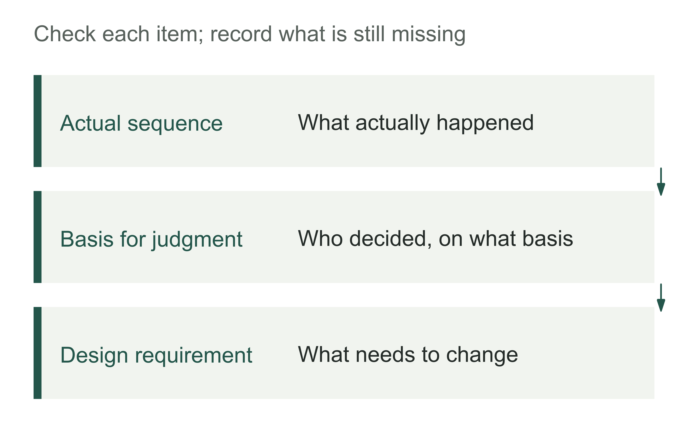
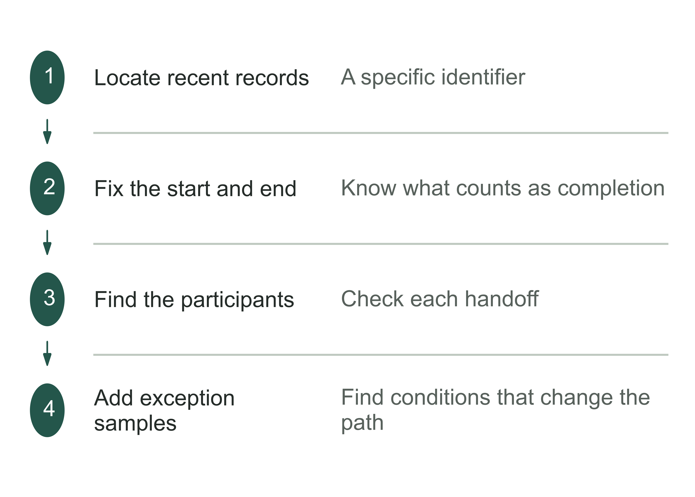
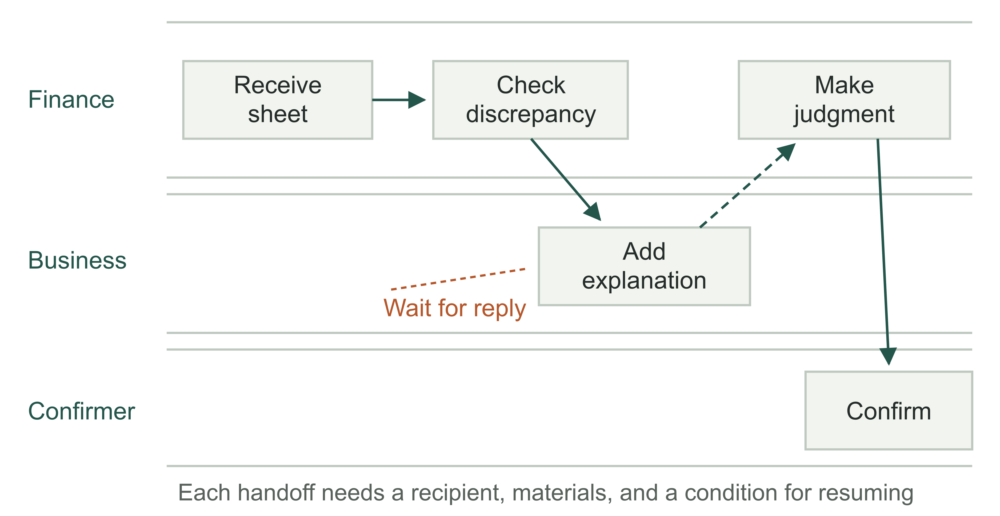
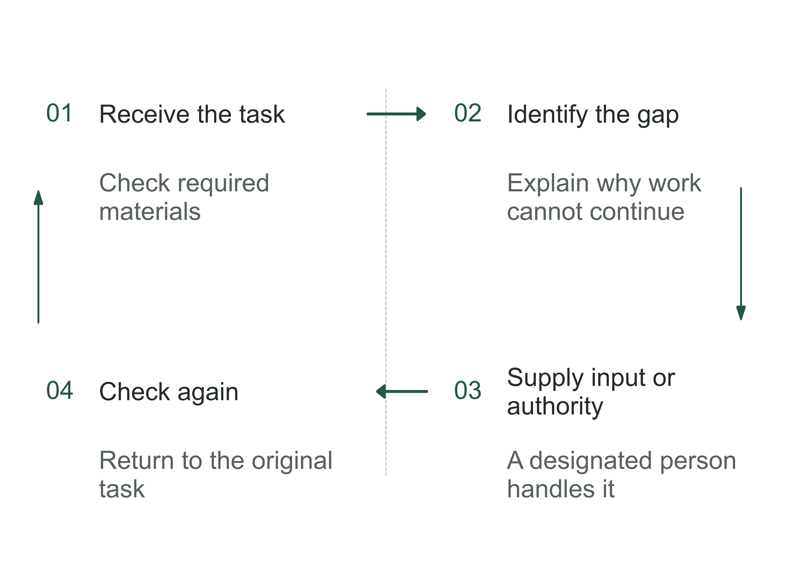
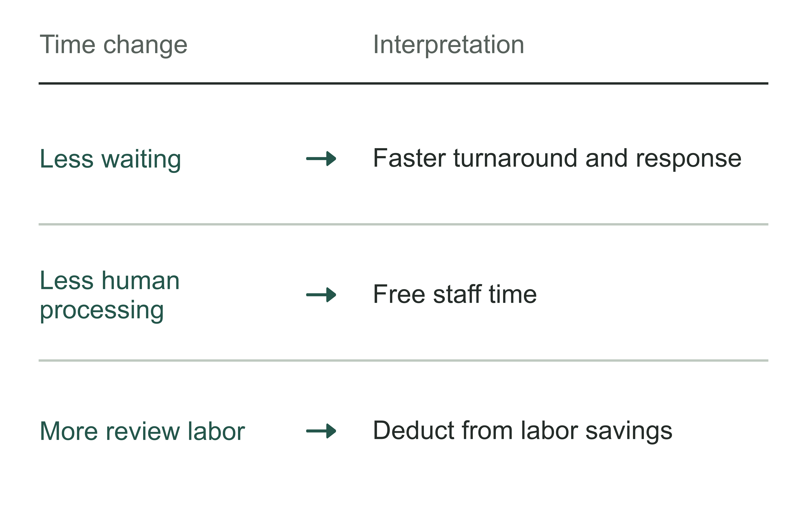
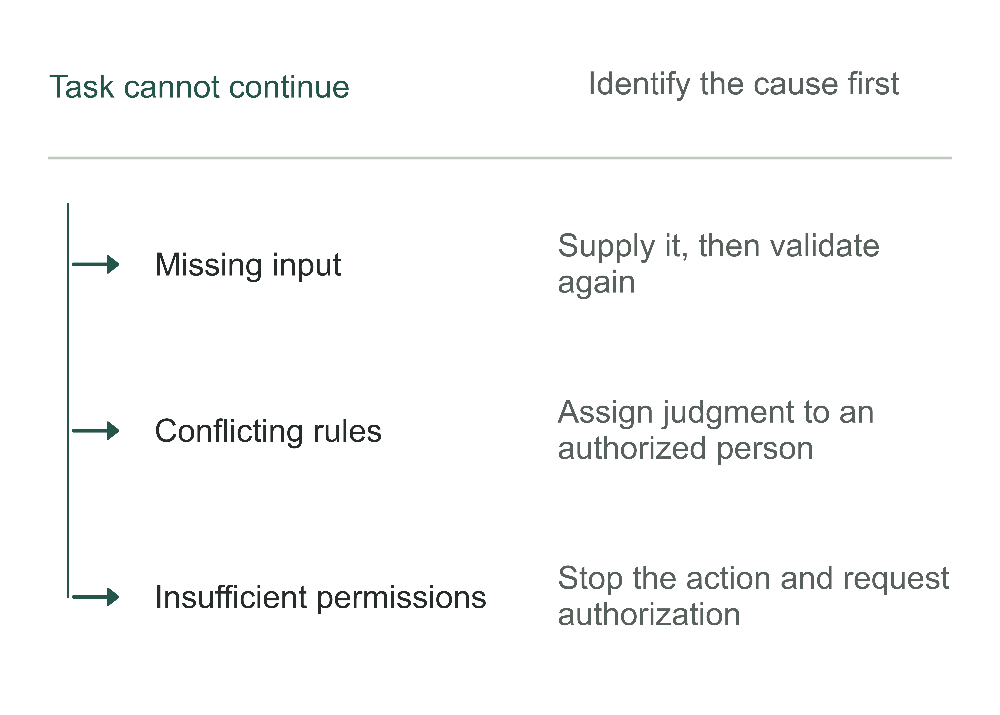
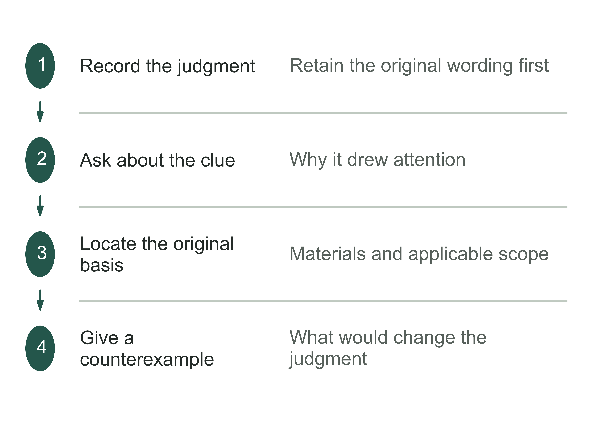
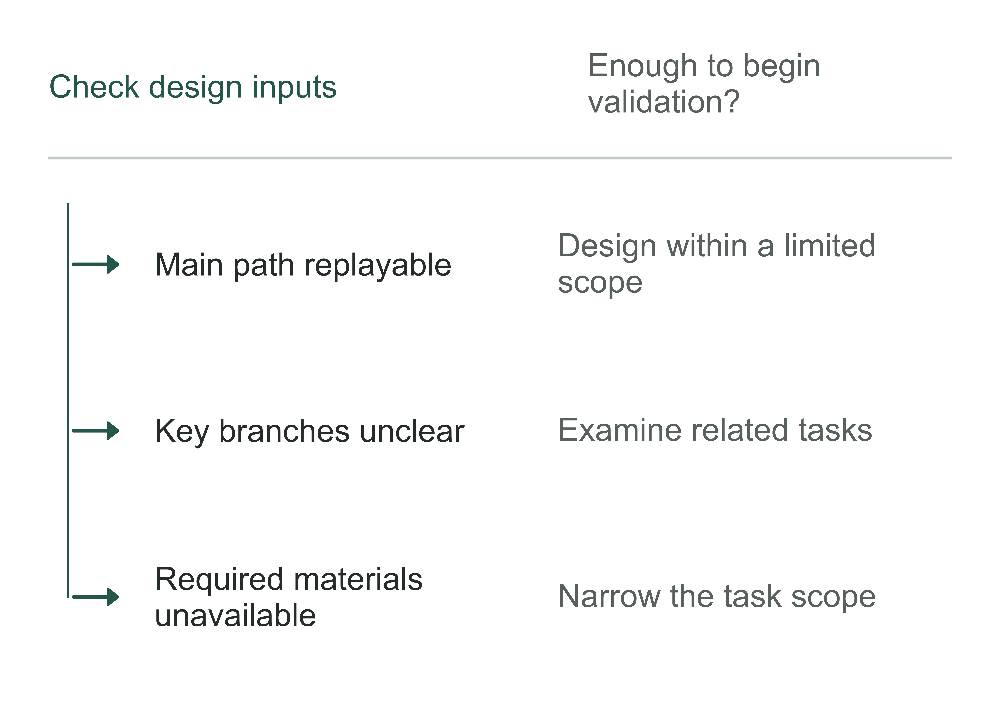

# Chapter 8 Observe work on site: reconstruct how employees actually work

Why does onboarding a new data source take more than a month?

In conference materials jointly published by Corteva and Databricks, this work once took 30–45 days. Calling it simply “connecting data” makes it easy to assume that transmission speed is the bottleneck. But the old workflow included identifying the source, writing ingestion pipelines, modeling data, configuring permissions, deploying across environments, and testing and validation. Moving data was only part of the work. The materials report that the new workflow cut the overall cycle to 4–7 days, a reduction of approximately 85%. This is a jointly published case claim, not an independent audit result.[1]

The case reminds business owners that a very short task name can encompass many different kinds of work. A procurement list or progress report may say only “data onboarding complete,” but the delivery team cannot stop at that phrase. It also needs to know who supplies the materials, where it waits for approval, and what makes the onboarded data usable.

Figure 8-1 | Different kinds of work sit beneath one task name. Regrouped from Corteva's original workflow; not drawn to a time scale. Source: slide 10 of the presentation listed in this chapter's note 1.

The preceding three chapters established investment, people, and external agreements. Now we need a closer view: how was the work the company intends to assign to AI actually completed the last time it occurred? This chapter should produce a workflow diagram that can be checked back at the workplace, together with records that support it. The system design in the next chapter should start here.

## Explain how the work happens before discussing products

Corteva's materials describe the old problems specifically: some pipelines were built manually, connection information was hard-coded, the knowledge needed for onboarding resided in individuals' experience, and different data sources behaved differently. The team used a metadata-driven approach to organize onboarding and made the repeatable parts into a framework.[2] Here, metadata can initially be understood as “information describing data and how it is processed”: where it comes from, which rules govern its processing, and where it goes. The key change was turning arrangements scattered across people and code into configurations and rules that could be used consistently.

This does not establish that every slow workflow can be fixed by adopting the same platform. The team's existing systems, governance foundations, and engineering investment may differ from another company's. Its before-and-after workflows also remind us that a stage labeled zero days does not mean the capability had no development cost or requires no subsequent maintenance. Copying cycle-time figures without examining what work was done earlier, reused, or still required judgment turns a case into a procurement promise.

Another misreading also needs to be prevented. The slides list generative AI-assisted modeling among future plans.[3] This case therefore cannot be described as a model single-handedly compressing several dozen days of work into a few days. For this book, it first shows that work on site can be reorganized. Whether to use a model, and at which step, should be decided from the actual task.

A business owner can turn this into a simple check: ask the business lead and engineering lead to explain separately what “onboarding complete” means. If one means a table is visible and the other means downstream reports work reliably, they are discussing different endpoints. Aligning the task's completion criteria is more valuable at this point than immediately discussing interfaces or models.

Figure 8-2 | Three layers of records in observing work. The author's analytical tool. Observations, explanations, and design recommendations should be traceable to one another.

## Reconstruct a recent task from its records

“How we usually do it” helps establish an overview but should not directly become the basis for design. People merge familiar steps, omit rare situations, and sometimes substitute prescribed procedures for their actual actions last time. This need not be concealment. Completing work usually does not require remembering every follow-up question, file search, and switch between systems.

Workplace observation therefore needs a specific object. Start, for example, with a completed task from the past 7–30 days. This window is a practical suggestion to make records easier to find, not a statistical standard. Frequent work can be more recent; infrequent approvals should be traced to the most recent actual occurrence. Establish the task ID, trigger time, completion criteria, and people who handled it, then ask employees to reconstruct what happened from the records left at the time.

Sample selection matters too. Starting with the most serious incident risks treating an exceptional emergency response as normal practice. Choosing only the smoothest task hides dependencies. First use an ordinary task to draw the main steps, then add a task that had to go back because of a problem with materials, rules, or authorization. Two tasks can reveal differences; they cannot establish coverage of every situation. Whether the number is sufficient depends on whether new branches that would change the design are still emerging.

The following teaching exercise continues the settlement example. All records are assumed, not records of the author's clients. Give the observed task ID O08-017: finance receives a store's settlement sheet, and its amounts differ from the system statement. The prescribed workflow contains just three steps: “receive, check, confirm.” To trace the task, its start should be the actual arrival of materials, rather than only finance's start of data entry. Its end should be a discrepancy handled on an identifiable basis, rather than merely an explanation generated by AI.

Figure 8-3 | Establish a replayable observation scope using one task. A schematic of the author's method. First fix the task, its start and end, and its records, then add exception samples. This is not a statistical requirement for sample size.

Specific questions should follow the actions. When an employee opens a file, first ask where this version came from and why it was used. When an amount is skipped, ask why it is being left unprocessed this time. Do not ask “How would you like AI to help?” before the actions are clear. That question can turn observation into a wish-list meeting: employees start describing imagined features, and actual work recedes into the background again.

The observer also changes the workplace. Some people add a check when being watched; others omit explanations to save time. After the work, ask another person involved to describe a key handoff using the records, or let the employee complete a task independently and replay it afterward. When accounts differ, first record the difference and the corresponding task conditions, without rushing to decide whose memory is more reliable.

Figure 8-4 | Choose a task that can be replayed. The author's analytical tool. Samples explain how the work operates; they do not automatically represent the distribution of all tasks.

Table 8-1 | Locating the observation records for O08-017 (the author's teaching example)

| Record ID | Record for this task | Judgment it supports |
|---|---|---|
| O08-017/A | Store submission, system statement, and versions used | Where the inputs came from, and whether the amount discrepancy is real |
| O08-017/B | Follow-up request at 9:20 on day one; reply at 9:20 the next day; receiving role recorded | Which handoff caused the 24-hour wait |
| O08-017/C | Judgment completed at 9:45 the next day; recording and confirmation completed at 10:00 | When the complete task ended; labor totaled 60 minutes |
| O08-017/D | Current policy lacks the applicable campaign ID; the business lead confirms it | The design must identify the specific missing item and must not guess before it is supplied |

## The workflow diagram must show the paths that go back

Return to the assumed settlement task. After finding a discrepancy, finance checks the system statement, then asks business staff to confirm the campaign policy. They do not reply immediately, so finance places the record in a pending queue. Only after receiving an explanation the next day does finance classify the difference, record its basis, and submit it for confirmation. The prescribed step “check” actually includes five actions: querying, asking, waiting, judging, and recording.

If only the three boxes in the prescribed workflow are automated, AI may keep guessing when information is missing, or mark a discrepancy complete while it still awaits an explanation. A workflow diagram is useful because it exposes such omissions before development. It need not show every mouse click, but it must show actions that change outputs, responsibilities, permissions, or waiting states.

Figure 8-5 | Handling a discrepancy crosses three work lanes. The fictional teaching workflow for O08-017. Dashed lines indicate waiting for a reply; final judgment and confirmation remain with personnel authorized by the company.

When drawing swimlanes, organizing them by the people or roles actually doing the work reveals handoffs more easily than organizing them by software menus. Every arrow crossing lanes must answer three questions: what is handed over, when the recipient learns that action is required, and who remains responsible if no reply arrives. Sending an email still requires confirming that someone has taken the task. This often explains why “the system did nothing wrong, but the work stopped moving.”

Then place the materials actually used beside the actions. Excel files, chat attachments, and handwritten lists outside formal systems belong in the observation as part of current work. Their absence from the IT asset list does not mean they do not exist; seeing them does not immediately justify requiring everything to migrate. Some temporary spreadsheets do duplicate data transfers, but others preserve the basis for judgments that formal systems do not yet accommodate. Understand their function before deciding to retain, replace, or remove them.

Conflicting practices may also appear. One store assigns a transaction to a campaign by transaction date; another uses settlement date. The person drawing the diagram cannot quietly choose one and label the other “incorrect operation.” Record both sets of conditions and their current bases, then ask someone authorized to set business rules to confirm. The allocation of authority in Chapter 6 now begins to affect each specific branch.

Figure 8-6 | How a returned task resumes. The author's analytical tool. A return arrow must have a condition for resuming work.

## Separate waiting time from labor time

“This settlement took a day” has at least two meanings: an employee spent a day processing it, or a day elapsed between receipt and completion. They lead to very different improvement plans. If most time is spent waiting for a reply, cutting a model's response from ten seconds to two seconds will barely affect when the customer receives a result.

The teaching records for O08-017 can be reconstructed as follows: work starts at 9:00 on day one, and a request for additional materials goes out at 9:20. The reply arrives at 9:20 the next day; judgment is complete at 9:45, followed by 15 minutes for recording and confirmation, ending at 10:00. Total elapsed time is 25 hours; actual processing is 20 + 25 + 15 = 60 minutes, with the other 24 hours spent waiting. That wait includes overnight hours. Multiplying 24 hours by the employee's hourly wage does not produce a wage saving available to the company.

Figure 8-7 | An elapsed 25 hours is not 25 labor hours. Fictional teaching data. The upper axis shows total elapsed time; the lower chart breaks down the 60 minutes of actual processing. Waiting includes nonworking hours.

These records suggest two different improvement routes. Reducing searching and recording may free finance staff's time; reducing waiting may bring settlement completion forward. The latter, however, requires examining whether the request is clear, the recipient is authorized to reply, and a handling time has been agreed. AI can help organize missing fields or send reminders. Generating text alone cannot make a person without a basis for judgment decide reliably.

During measurement, also record whether a person handles other tasks while waiting. Adding the elapsed times of multiple tasks counts the same period more than once. Observers can record task start and end times to determine elapsed time, and ask employees to log time by activity to estimate labor input. Keep the two sets of figures in separate columns. Chapter 5's financial judgment needs a baseline with this distinction.

Observation can begin without timestamps, provided precision is stated honestly. If an employee recalls “usually around half an hour,” record an estimate and state that it has not yet been observed. Do not enter it as an exact 30 minutes and plot it to one decimal place. A few records that locate a bottleneck are more useful than tidy figures that cannot be checked.

Figure 8-8 | Two kinds of time imply two kinds of improvement. The author's analytical tool. Different time measures cannot be added directly into a cash benefit.

## Exceptions are more than an “other” box in the workflow

Designers can easily detail the smooth path and combine everything else into “hand off to a human.” That establishes only that someone provides a fallback, not how the fallback works. If the person must find all the materials again every time, the system may have digitized the entry point without reducing the handling burden.

Distinguish at least three types of exception. Missing information requires specific fields to be supplied; conflicting rules require a business lead to decide which rule applies; insufficient permissions require an authorized person to decide whether work can continue. Their recipients, handling deadlines, and conditions for resuming differ. Combining them into one exception queue is likely to leave everyone seeing the task but no one knowing what to do first.

Figure 8-9 | The same “cannot continue” needs different next steps. Three situations identified by the author, not an exhaustive list of exceptions. Each branch records its recipient, missing evidence, and condition for resuming.

Select exception samples by risk and differences in design. Frequent format omissions involving small amounts may be suited to standardized inputs; an occasional rule dispute that could cause an incorrect payment may require a human decision. Low frequency does not establish that an exception can be ignored, and one high-risk exception does not invalidate all assistance. The key is to separate that exception clearly from the scope that can be processed automatically.

Table 8-2 | Example exception records in the fictional settlement scenario. Used to identify design conditions, not to replace the company's rules.

| Workplace finding | Evidence to retain | Design implication |
|---|---|---|
| Campaign ID missing | Original request and supplementary records | First prompt for the missing field; do not proceed to judgment until it is supplied |
| Dates in two rules overlap | Versions, effective scope, and confirmation by the responsible person | Submit the rule conflict; the model does not choose a rule itself |
| Person handling the task lacks confirmation authority | Scope of authorization and actual handoff records | Assign it to someone authorized to handle it; keep the task unfinished |

Also keep a list of serious situations not yet observed, such as a key owner being absent, materials that cannot be recovered, or duplicate task submission. These are hypothetical risks and must not be mixed into the occurrence counts of actual samples. Chapter 10 can use them to design tests. Workplace observation and risk scenarios can complement each other, but distinguish what happened from what is only envisaged.

Figure 8-10 | Specify who receives an exception and how it is handled. The author's analytical tool. Different causes require different routes to resuming work.

## Trace “I know from experience” to a basis that can be checked

The hardest knowledge to transfer in a company is often not a complex formula, but knowing when to pause. Finance sees a difference and asks the business side before classifying it. Customer service sees a particular complaint wording and checks the history first. A technician sees a data change and first confirms whether the upstream definition has changed. These judgments depend on the clues visible at the time, the people available, and an understanding of the consequences.

This book uses “work context” to describe those conditions: what materials a person has when the task occurs, what constraints apply, who they work with, and who bears the consequences of an error. This is a way to analyze work on site, not another theoretical label for a workflow. The same action can mean different things in different contexts. Extracting “handle it as last time” from a chat and putting it into a knowledge base may leave no indication of last time's customer, policy version, or authorization.

Record a specific judgment first, without making it a rule yet. Work backward from the final decision: what did the employee notice, which materials did they consult, and what would make them handle it differently? If they say “you know once you are familiar with it,” ask them to compare two tasks handled differently. What emerges is experience awaiting confirmation. Chapter 17 examines how individual experience is verified and approved to become a rule the company can use.

Figure 8-11 | Trace a decision to its conditions and counterexamples. The author's observation method. Arrows show the order of questions; records and the business lead must still check the clues and explanations.

Some experience cannot immediately become a stable rule. A policy may not yet address the issue, an employee may be following personal preferences, or several conditions may require judgment together. The system can first organize materials and propose a recommendation for a designated person to confirm; automatic execution need not be forced. Observation remains useful because it identifies which step needs a person and what that person must judge.

Knowing something also differs from being authorized to use it. Seeing customer materials during observation does not permit copying them into a development environment. Reading account information does not permit the system to initiate a payment. Mark the boundaries for observation, copying, testing use, and executable actions beside the records, and have the relevant company owners confirm them. Implementing permissions belongs to the next chapter; for now, prevent the requirements description from erasing these differences.

Figure 8-12 | Which changed conditions make experience inapplicable? The author's analytical tool. Identifying where a rule does not apply makes it easier to test and maintain.

Table 8-3 | Counterexample prompts when examining experience (the author's checking tool)

| Initial statement | Follow-up question |
|---|---|
| “It has always been this way” | Which objects, versions, or time conditions are exceptions? |
| “You can tell at a glance” | Which visible clue did you notice first? |
| “Someone else cannot do it” | Are they missing materials, authority, or a basis for judgment? |

## When can observation end and design begin?

Work on site can reach two extremes: starting development after one introduction, or continually adding interviews without ever beginning design. Sufficiency depends on whether there is evidence for key design questions and whether remaining uncertainty can be constrained within a clear scope, rather than how many meetings have taken place.

Take a completed task that was not part of the initial explanation and ask the workflow owner to walk through it using the new diagram. Do the diagram's steps correspond to the records? Can recipients be found for exceptions? Are the completion criteria interpreted consistently? If the diagram works only for the task selected by the original speaker, further observation is needed. If the main path can be replayed, remaining questions can be recorded as assumptions for a limited design, with an agreed method of validation.

Figure 8-13 | Findings must be traceable to records and usable in design. The author's diagram of corresponding deliverables. Each design requirement needs a stated basis and unresolved conditions. Guesses should not be presented as confirmed requirements.

For O08-017, Figure 8-5 shows the follow-up request and wait for a reply, record B identifies the waiting time, and record D identifies the missing campaign ID. The requirement given to an engineer should therefore be: “List documents missing a campaign ID and send them to business staff authorized to confirm it.” That is much more specific than “make the response faster.” Whether it shortens the 24-hour wait still requires comparison with similar tasks in the new workflow. Identifying a problem does not mean it has been solved.

The deliverable from observation should be more than a thick set of meeting minutes. At a minimum, the next engineer needs to see where the task starts and ends, the actual steps and exceptions it passes through, which materials can serve as evidence, where human judgment is needed, the previous processing and waiting times, and what remains unconfirmed. Attach a record location and confirming person to every important finding. Sensitive originals need not be copied everywhere; accessible locations and de-identified summaries are sufficient.

Table 8-4 | The author's checks for accepting workplace observations. Passing means the available material supports beginning design within a limited scope, not that all future situations have been covered.

| Check before design begins | Acceptable evidence | Action if unmet |
|---|---|---|
| Can an ordinary task be replayed? | Actions in the diagram correspond to actual records | Follow another task; do not infer from meeting minutes |
| Does someone handle exceptions? | Categories, recipients, and conditions for resuming | Narrow the pilot scope or add responsibility arrangements |
| Is the basis for judgment clear? | Versions, applicable conditions, and business confirmation | Retain human judgment and mark items awaiting confirmation |
| Can the baseline and boundaries be explained? | Labor time and elapsed time in separate columns; data use clear | Observe or restrict use first, then design |

Figure 8-14 | When can this round of observation end? The author's analytical tool. Observation can end when the materials support the next design step.

The business owner need not watch every operation, but can join the final check. Ask the team to identify a key step missing from the old workflow diagram that has now been confirmed, and explain how it affects the design. If the diagram merely looks better and the team cannot explain what the observation revealed, keep asking.

The question raised by Corteva's case at the start can now be answered differently: the time needed to onboard a data source depends on the work beneath that name and how it is organized. The same applies to the task a company gives to AI. Reconstruct it first to identify where a model fits, where rules or tools are needed, and where people should continue deciding. The next chapter turns these workplace records into a system that can complete tasks, limit permissions, and establish how work was processed.

## Notes and sources

[1] Databricks and Corteva, Accelerating Corteva’s Data Source Onboarding With Lakeflow, official 2026 conference listing and slides 6, 10, and 12, checked on September 6, 2026. The sum of the stage ranges does not fully match the reported overall cycle. The materials do not explain parallel work or rounding conventions, so no precise reduction is recalculated from them. https://www.databricks.com/dataaisummit/session/accelerating-cortevas-data-source-onboarding-lakeflow

[2] Databricks and Corteva, Accelerating Corteva’s Data Source Onboarding With Lakeflow, 2026 conference slides, slide 8. Work categories were redrawn from the saved official 28-page original; the slide itself was not copied. https://microsites.databricks.com/sites/default/files/dais/2026/D26B1873.pdf

[3] Databricks and Corteva, Accelerating Corteva’s Data Source Onboarding With Lakeflow, 2026 conference slides, slide 24. GenAI-assisted modeling is listed as a future plan and cannot be counted as an implemented result. The observation methods, settlement records, and time examples are teaching designs by the author, not evidence of outcomes for the author's clients. https://microsites.databricks.com/sites/default/files/dais/2026/D26B1873.pdf
