# Chapter 10 Entering production: evaluation, trial runs, and safety boundaries

A conference presentation can give a business owner confidence while leaving questions unanswered. In June 2026, accounting and professional services firm CLA and data platform company Databricks shared an evaluation approach for extracting information from SOC reports. Here, SOC refers to System and Organization Controls assurance reports, which concern controls at service organizations; professionals still need to review the extracted information. The slides stated that processing time fell from more than eight hours to less than ten minutes, with an F1 score of 0.95. F1 combines precision and recall: how many of the results found are correct, and how many of the results that should have been found were found. It is not overall accuracy.[1]

These two figures prompt further questions. Did the original human review and the new machine extraction cover the same work? How much additional time did human checking and correction take? Which fields and how many reports did the F1 score cover? The conference materials did not fully answer these questions. A score of 0.95 therefore cannot be rewritten as “95% accuracy across all the work,” nor is it enough to calculate how many labor hours a business could save.

What makes this case useful is the way it brings extraction, expert correction, and offline scoring into one workflow. After finding an error, the team must also check whether similar problems recur. A business preparing to go live should ask the same questions: Which tasks have been validated? Which still require human judgment? Can problems be handled promptly?

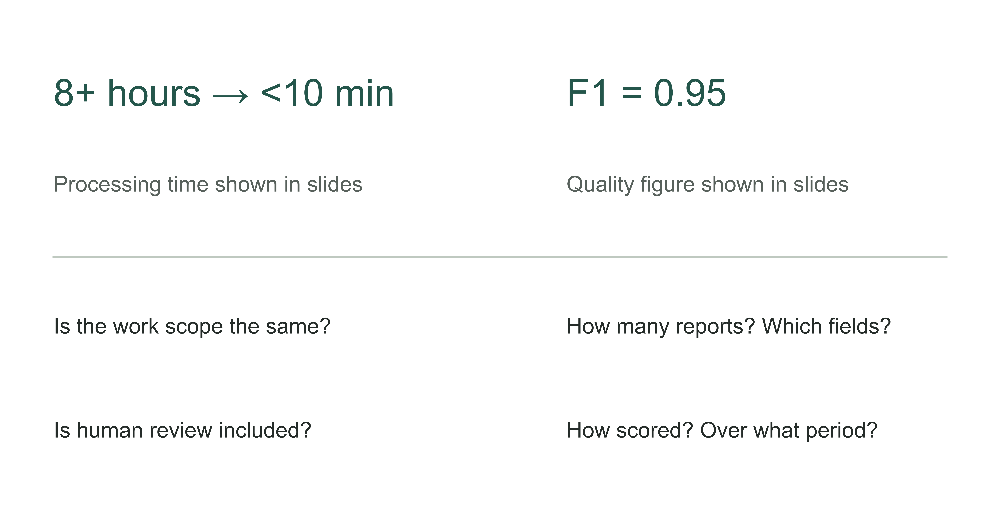

Figure 10-1 | From demonstration figures to a go-live decision. Metric-checking questions designed by the author. The figures in the CLA slides were presented by the source; the questions below them test the measurement definitions and do not imply that answers have been obtained.

Chapter 9 set out the system's data, permission, and action boundaries. This chapter turns those designs into checks that can be run repeatedly, then uses them to decide whether to expand the scope of use. Evaluation does not have to prove, in one round, that the system will never make a mistake. It must provide enough evidence to support the release decision at hand.

## First define what counts as completing a task correctly

A “correct answer” is often only part of a business task. Consider the fictional settlement assistant from the preceding chapter. It reads statements, identifies potential discrepancies, attaches supporting evidence, and submits them for finance staff to confirm. Evaluation must at least check whether it identified the right discrepancies, whether the evidence applies, whether it read only authorized material, and whether the proposed records entered the right work queue. Even an excellent written explanation cannot save a task if the item goes to the wrong store's queue.

Before evaluation, fix the start and end points. What materials, identity, and system state does the task begin with? What record should exist at the end, and which states must remain unchanged? When evidence or permission is missing, what constitutes a correct stop? Only with these conditions in writing can the technical team and business lead judge the same run in the same way.

Anthropic's evaluation engineering article distinguishes a task, an individual trial, a grader, and the final outcome in the environment. A software agent saying it has finished does not mean the corresponding result exists in the business system. The same task may also need repeated runs to reveal instability.[2] For a business owner, the most immediate use of this distinction is to ask the presenter to open the system where the result should exist, instead of showing only the assistant's final sentence.

Table 10-1 | The author's checks by layer. A task may undergo several checks at once; a content score cannot compensate for exceeding permissions or writing incorrect data.

| Evaluation layer | What to check in the settlement teaching task | What can mislead when viewed alone |
|---|---|---|
| Content | Whether the discrepancy, amount, and evidence are valid | Wording that sounds professional |
| Actions | Whether the work item, fields, and execution status are correct | The model saying “submitted” |
| Boundaries | Whether unauthorized material remained unread and prohibited actions remained unexecuted | An answer containing no leaked text |
| Takeover | Whether unresolved tasks reached designated people and remain traceable | “Transferred to a human” appearing on screen |

Stopping as required when a problem arises must also count as correct handling. If evidence is insufficient, leaving a work item with an identified recipient may meet the requirements better than inventing a complete answer. Conversely, referring every task to a human reduces the chance of a wrong machine decision but fails to perform the intended automation duties. Evaluation must recognize appropriate stops while also checking whether tasks the system should complete are being pushed back without reason.

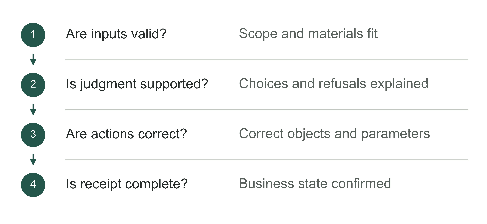

Figure 10-2 | The evaluation chain for a complete task. The author's analytical tool; checking only fragments of an answer misses the later stages of the task.

## High accuracy can still miss what matters most

The following explicitly fictional data illustrate the denominators. Assume an evaluation set contains 1,000 settlement tasks: 20 have real anomalies requiring investigation, and 980 are normal. The assistant finds 16 real anomalies and misses 4. It also flags 30 normal tasks as anomalous, while correctly passing the other 950 normal tasks.

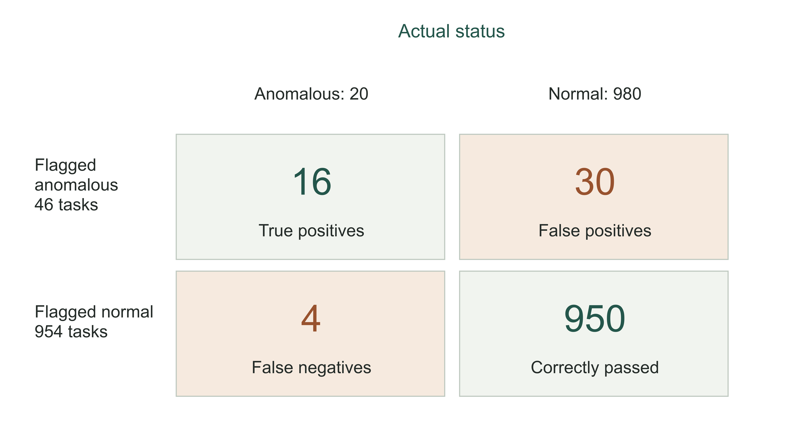

Figure 10-3 | Anomaly-detection count matrix. Fictional teaching data, measured in tasks. The four cells total 1,000; there are 20 actual anomalies and 46 model-flagged anomalies. These are not measured results from any business.

If the report gives only overall accuracy, the 16 correctly identified anomalies plus the 950 correctly passed normal tasks produce 966 correct results, or 96.6%. That looks good. Yet a program that never checks anything and labels every task normal achieves 98% accuracy, because normal tasks make up the overwhelming majority. The latter system misses every anomaly and still scores higher.

At least two more questions are needed. Of the 46 anomalies flagged by the assistant, only 16 are real, giving precision of approximately 34.8%. Of the 20 actual anomalies, it finds 16, giving recall of 80%. Precision shows a business owner how many false alarms enter the review queue; recall shows how many real problems remain undetected. The denominators differ, so the metrics cannot substitute for one another. F1 combines precision and recall into one metric. It still cannot show where errors occur or how costly they are, and it cannot replace permission checks.

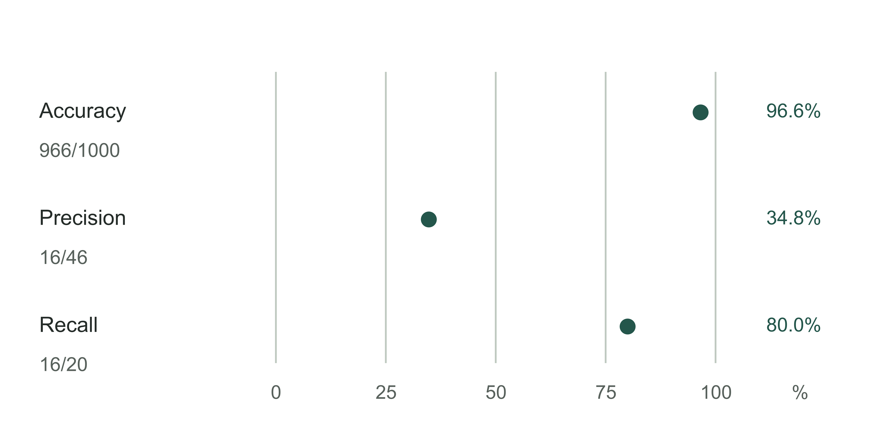

Figure 10-4 | Three denominators for the same set of tasks. A fictional teaching calculation. Accuracy is 966/1,000, precision is 16/46, and recall is 16/20. These metrics answer different questions and should not be averaged into a production admission score.

The next step is not simply to maximize recall. Sending more normal tasks for review might recover some missed anomalies, or it might bury finance staff in unproductive alerts. The tradeoff depends on consequences: What happens when one anomaly is missed? How much review labor does a false alarm require? Do the people taking over have time to handle it? Which errors should immediately stop further releases when discovered?

The same average score can also conceal different kinds of errors. A wrong amount, an incorrect store assignment, and a citation to an expired policy may each count as “one error” in a table, yet have different business consequences. Examine critical fields and tasks separately so that large numbers of easy records do not dilute a few important failures. If evidence for one task category is insufficient, that category can remain with human staff while other validated tasks are approved.

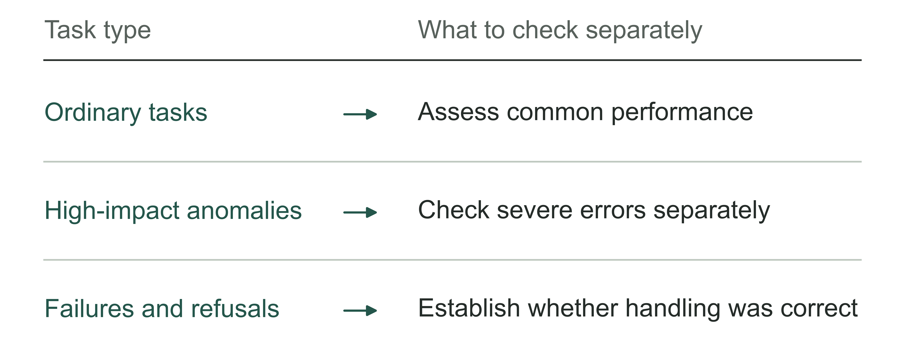

Figure 10-5 | What still needs to be unpacked beneath a high overall score. The author's analytical tool; large numbers of ordinary samples must not conceal critical branches.

Table 10-2 | Checking gaps in an evaluation report (the author's checking tool)

| Missing information | What it leaves out |
|---|---|
| Only an overall score | Critical anomalies and high-impact errors |
| No refusals listed | The distinction between appropriate stops and mistaken refusals |
| No task denominator | What the proportion actually represents |
| No version or period | The basis for comparison with production or other rounds |

## Samples must cover real work and retain difficult cases

The field records from Chapter 8 provide a starting point for an evaluation set. Common tasks show whether the system can handle everyday work; exceptions and past failures show where it breaks down. Both kinds of sample are needed, but their purposes should remain distinct. A test set deliberately enriched with difficult cases is useful for finding weaknesses, yet cannot directly represent the everyday incidence of anomalies.

For example, the team can sample actual tasks to form a representative set, then separately list challenge cases involving insufficient permissions, conflicting evidence, expired policies, and interface timeouts. The report should show both results for everyday samples and results for each challenge category. Do not mix the two sets arbitrarily and claim that one overall pass rate describes production performance. Certainly do not quietly remove difficult cases because they lower the score.

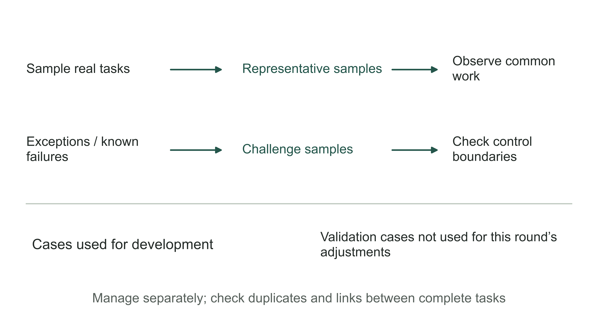

Figure 10-6 | Two uses of evaluation material. The author's sample-organization diagram. Representative samples assess common tasks; challenge samples validate boundaries. Cases used for development adjustments are managed separately from those used for final validation.

Evaluation material must also be distinguished by whether it has been used in debugging. Cases that engineers have repeatedly examined and used to change the system are suitable for checking whether known problems were fixed. They cannot, on their own, prove the same performance on new tasks. Retain a validation set that has not been used for the current round of adjustments, and record its origin and version. If its results are used for further changes, it has entered the development process, and new validation evidence is needed.

This separation requires more than different folders. If closely related fragments from the same statement appear in both development and validation sets, scores may look better than real performance warrants. Check duplicates and relationships by complete task, store, or time period, then choose a suitable split based on business differences. New and existing stores, or tasks before and after a rule change, may also need separate results.

Sample size depends on the scale of the decision. A few tasks can expose obvious design problems, but they rarely establish that severe, infrequent errors have disappeared. The report should say “not observed in this sample,” retaining the sample count and scope of coverage. Expanding permissions, adding stores, or introducing new types of material requires additional validation; one narrow test does not automatically support the new scope.

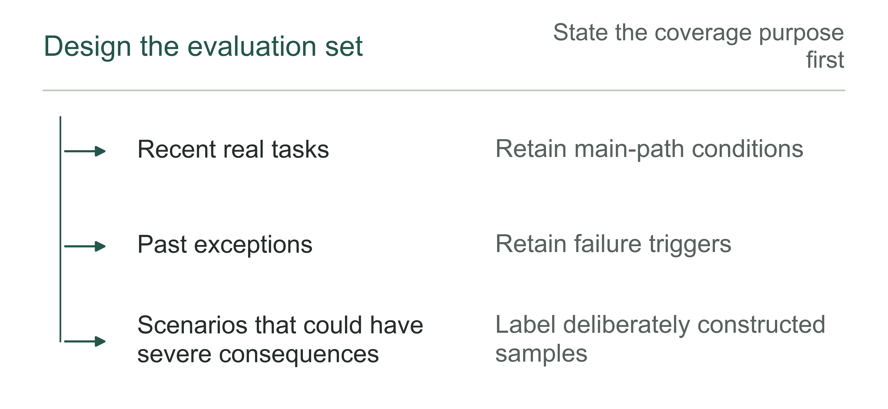

Figure 10-7 | Where additional test samples come from. The author's analytical tool; samples from different sources need labels and defined scopes of applicability.

## Scoring rules also need checking

If two people familiar with the business reach opposite conclusions about the same output, the standard may be the first problem. Before scoring, define what counts as an amount match, how to identify the same organization, whether abbreviations are acceptable, and whether a citation merely needs to be relevant or must support the conclusion. Otherwise, an apparent model improvement may simply reflect a more permissive scoring method.

Deterministic fields can be checked by reproducible programs. Semantic judgments can be supported by explicit scoring rules and calibrated against human-reviewed samples. The structured extraction in the CLA case involves matching objects in lists and recognizing equivalent expressions: one must first know which output object corresponds to which reference object before comparing fields.[1] Scoring line by line without matching objects can mark a correct answer wrong, or mark matching numbers from different objects correct.

Reference answers can also be wrong. When business experts disagree, retain the disagreement and the basis for the ruling. If rules are later revised, update the answer version and distinguish which version applies to historical tasks. Do not change an answer after seeing a particular system result and still call the before-and-after scores the same comparison.

When a model participates in grading, guard against a grader that favors longer, more confident text or wording closer to the reference answer. Test its judgments using correct, incorrect, and boundary cases already confirmed by business staff. Pay particular attention to answers that read smoothly but contain false facts, instead of testing only obvious nonsense. Recalibrate the grader after upgrades; it is not a permanently unchanging measuring stick.

Repeat the same task as needed and record each result. The teaching figure below shows four tasks run four times each. Some always pass, some pass occasionally, and some always fail. Selecting only the best run in each row makes the latter two kinds of problem disappear.

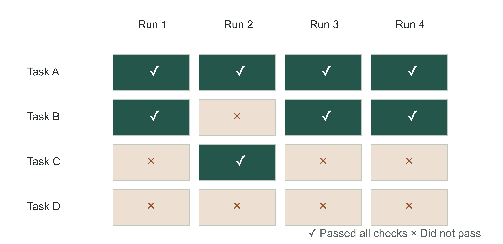

Figure 10-8 | Repeated runs must not retain only the best result. Fictional trial records. Each cell's symbol shows whether that run passed every predefined check. Repeated failures and occasional failures in a row call for different investigations; four trials do not establish a long-term probability.

If the business allows several candidates to be generated for human selection, evaluate that actual usage and include selection and retry costs. If the business requires each task to finish reliably in one attempt, “one of many attempts eventually succeeded” cannot replace evidence of reliability. The evaluation method should match the delivery commitment, instead of choosing the definition most likely to produce a good score.

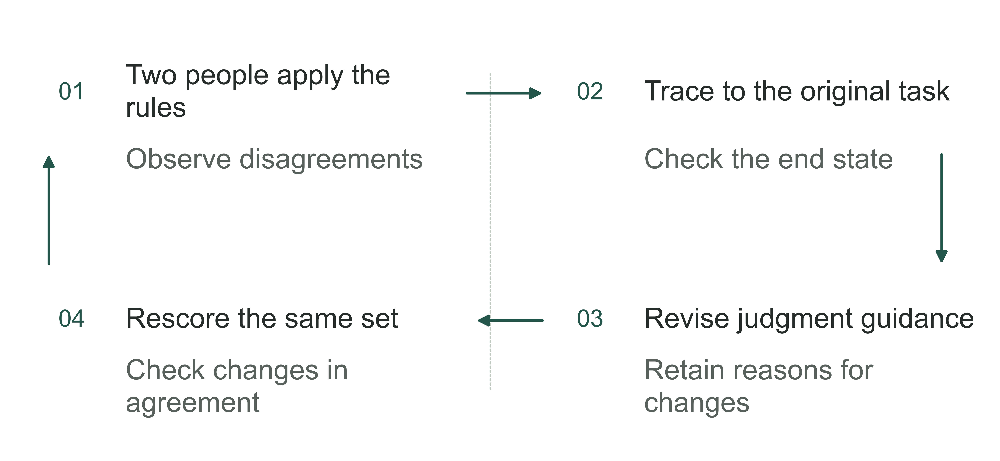

Figure 10-9 | Scoring rules also need replay tests. The author's analytical tool; rule changes should be versioned, without quietly recalculating old scores.

## Use staged trials to establish actual performance

Offline evaluation tests capability with controlled materials and environments. It makes failures easier to reproduce, but cannot fully reveal the pace of incoming work, the distribution of materials, or how people cooperate. After passing offline evaluation, the system usually needs observation under real working conditions. This does not mean allowing it to affect real business immediately.

Shadow operation gives the system authorized real inputs, generates results through an isolated path, and compares them with the existing process. Outputs are not used for business decisions and do not write to live systems. Side effects such as sending external messages, creating official work items, and updating records must actually be isolated. Labeling a screen “test” while tools remain connected to production write interfaces does not constitute shadow operation.

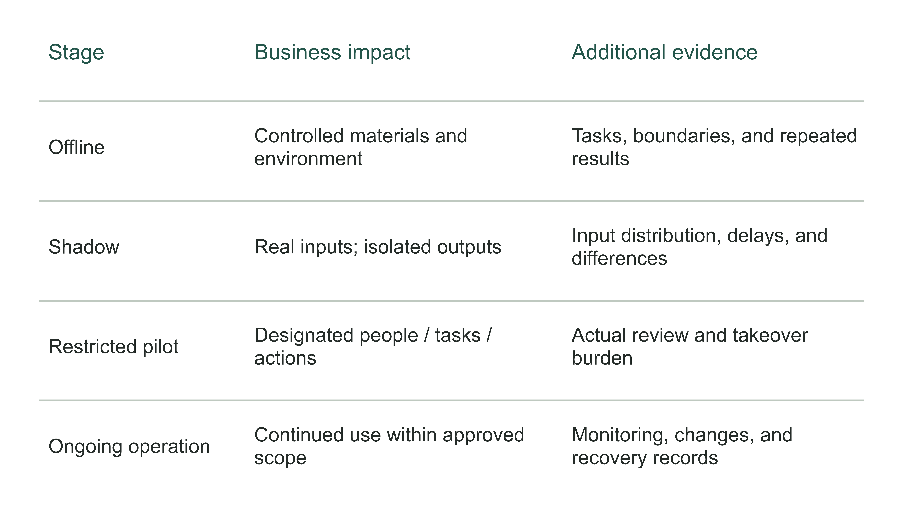

Figure 10-10 | Progressive release requires different evidence. The author's production admission path. Permissions and impact are limited separately at each stage. Moving to the next stage requires corresponding evidence; a calendar deadline does not automatically authorize release.

Shadow operation can reveal missing inputs, rule changes, and processing delays, but cannot prove that employees are willing to rely on the results. A restricted pilot begins to let designated staff use the system on limited tasks, specifying which outputs require review and which actions remain prohibited. Scope can be limited by task type, store, user, or time window. The choice depends on which limitation controls consequences and makes takeover manageable.

A small pilot does not necessarily have a small impact. One action with serious consequences can cause a serious problem even if it represents little traffic. Limiting task types often defines the boundary more clearly than limiting only a percentage of traffic. The team should state the actions permitted in this round, the maximum work queue, the reviewers, and the stop conditions. Unvalidated tasks continue through the existing process.

Each stage must specify three things: the checks required to begin, the conditions required to expand, and the problems that require a pause. If conditions are unmet, fix and retest, narrow the scope, or add records. A scheduled “go-live ceremony” is no reason to carry unresolved problems into formal operation.

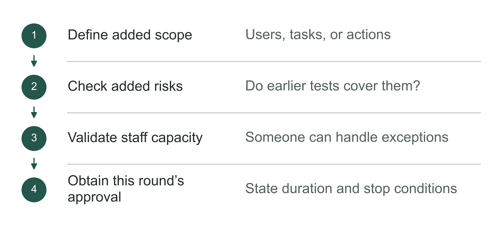

Figure 10-11 | Before each expansion of operating scope. The author's analytical tool; each authorization covers only its explicitly stated scope.

## What human takeover requires

“Someone reviews it” does not automatically repair system weaknesses. A reviewer who cannot see the source, locate differences, find time to act, or obtain permission to correct the result will struggle to take over. The takeover design should deliver the required materials, handling actions, deadlines, and escalation path together.

For the settlement teaching task, the review interface must at least show finance staff which record needs a decision, what proposed change is involved, where the evidence is, and why the system stopped. Conflicting evidence and incorrect parameters should not be collapsed into the same “failure.” The former may require a business lead's ruling; the latter may be fixable by the engineering team. Route the task to someone capable of handling the particular problem.

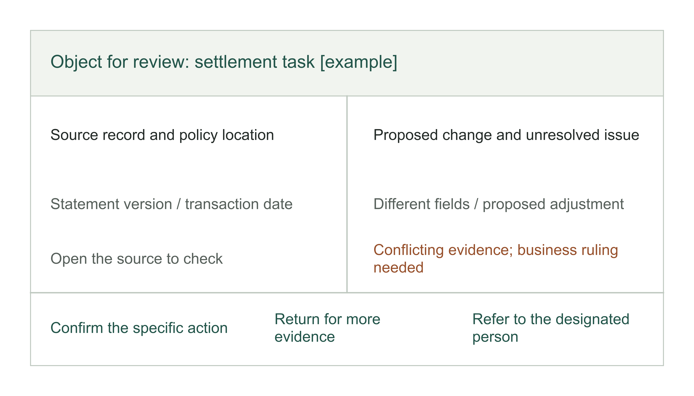

Figure 10-12 | What a review workspace should show. An interface wireframe designed by the author, not a screenshot of a real product. The object, evidence, differences, unresolved issue, and decision actions correspond on one screen so that reviewers do not have to reconstruct the context.

Separately sample results that the system has already released. Checking only results it flags as low confidence can miss confident but incorrect answers. Sample released results according to task consequences and record review findings. Sampling cannot replace the individual approvals required for high-consequence actions; the two serve different control purposes.

Also test whether people can handle the workload. A system may refer large numbers of tasks to humans without lowering its score, while employees work overtime to clear the queue. Record daily arrivals, completions, backlog, and the longest wait. When staff cannot keep up, reduce the tasks entering the new process or restore the original process. A “successful transfer to a human” completes only the handover; the task itself remains unfinished.

Plan for staff absences as well. Identify substitutes, escalation times, and whether the system may continue after a long period without anyone accepting the task. Sending a notification to a group can still leave no one actually responsible for handling it. These details determine whether the business remains in control when the system encounters an exception.

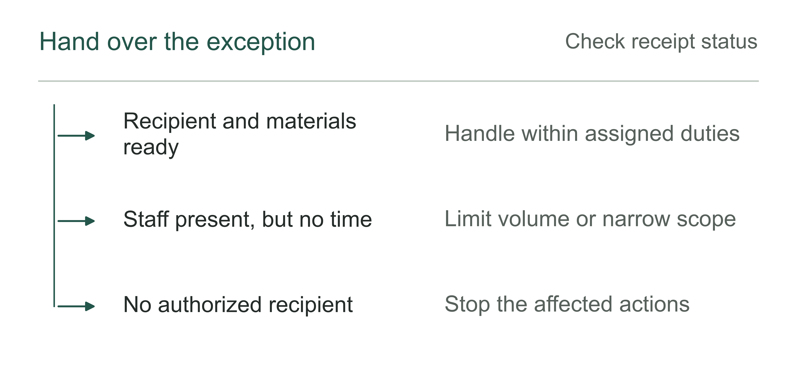

Figure 10-13 | Whether human takeover actually works. The author's analytical tool; a button provides only an entry point. Receipt and handling complete the takeover.

## Operating checks must cover delays, costs, and uncertainty

During the pilot, quality scores are only part of the operating dashboard. Timely service responses, failed attempts and retries, resources consumed per task, and prompt detection of exceptions can all affect the business. A short average response time may conceal a few tasks that hang for a long time. Assess slow tasks against business deadlines, instead of looking only at the average.

Latency checks also need a defined end point. The model producing its first word and a work item being fully handled are different timing end points. Record costs by complete task as well, including retrieval, tool calls, retries, and necessary review. These pilot records should test Chapter 5's budget assumptions, but they do not justify an early claim in this chapter that business benefits have already been realized.

Failure drills can create controlled conditions in an isolated environment: temporarily unavailable evidence, an interface timeout, an object changing after approval, or a takeover recipient who does not respond. Check whether the system stops promptly, leaves a traceable state, and can be handled by designated staff following the instructions. If the drill could affect real data, use test objects and isolated interfaces. Do not create a business incident to validate a control.

Alerts also need validation. Trigger a known exception and confirm who receives it, whether they understand it, whether they have operating permissions, and how long they take to acknowledge it. An alert being sent does not mean recovery has started, and a red dashboard does not mean anyone has taken over. A business owner need not review every technical log, but can ask for a complete drill record running from trigger through recovery and reconciliation.

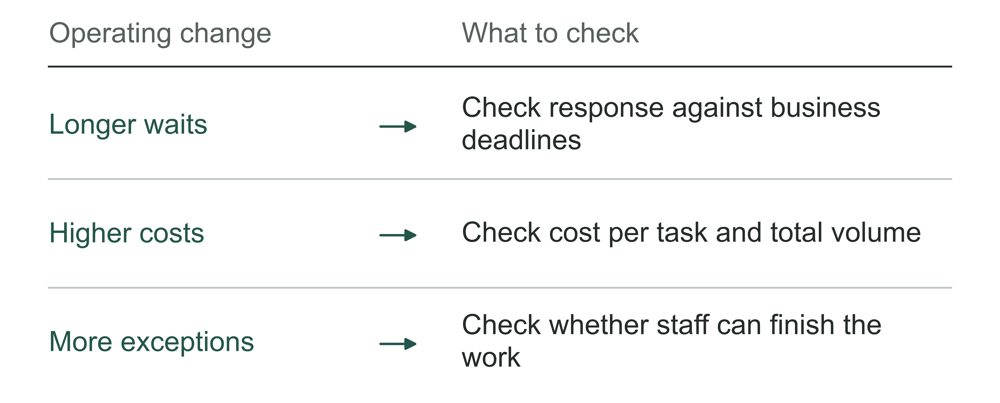

Figure 10-14 | Three operating burdens to check. The author's analytical tool; increased task volume can increase waiting, expense, and human handling.

## Rolling back software may leave the business unrecovered

AWS's agent architecture guide, Agentic AI Lens, emphasizes versioning behavior configurations, staged releases, and rehearsing rollbacks. Recovery should target a confirmed stable baseline, rather than merely the most recent previous version.[3] A business needs to associate models, prompts, rules, permissions, and tool configurations with a release so that it knows what to restore.

Recovery poses another problem. Returning to old software cannot automatically retract messages already sent, remove content the recipient has already seen, or cancel business changes already written. Distinguish stopping new effects, restoring system configurations, and handling business outcomes that have already occurred. The engineering team may execute the first two; the last often requires a business lead to reconcile what happened and decide on remedies.

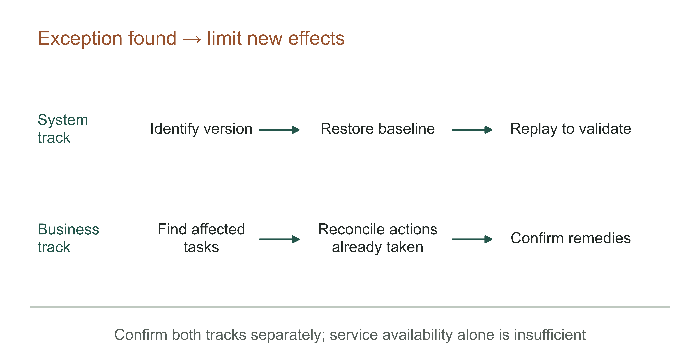

Figure 10-15 | Recovery must complete two tracks. The author's recovery-drill diagram. The timeline indicates sequence only, not minutes. Restoring configurations and reconciling affected business work proceed in parallel, with completion confirmed separately.

For the settlement assistant, if new rules flag a batch of normal records as potential discrepancies, first limit new tasks and identify the affected task IDs and versions. Then restore the validated configuration, replay necessary samples, and check whether staff have already acted on incorrect proposals. A work item merely created and an account already changed require different remedies. Neither should be covered by a blanket “rollback complete.”

Recovery drills should also check dependencies. Can the old version read the current data structure? Do old rules still apply to new transactions? Can expired credentials be restored? Keeping a copy of code does not answer these questions. If a safe rollback is unavailable, provide a pause, read-only operation, or a human process as an alternative, and validate its handling capacity in advance.

At the end of the drill, retain the trigger conditions, stop actions, affected scope, recovery version, business reconciliation, and person confirming it. The record reduces improvisation when a real problem occurs. If the team can only promise verbally that it “can switch back at any time,” the business owner should still regard recovery capability as unvalidated.

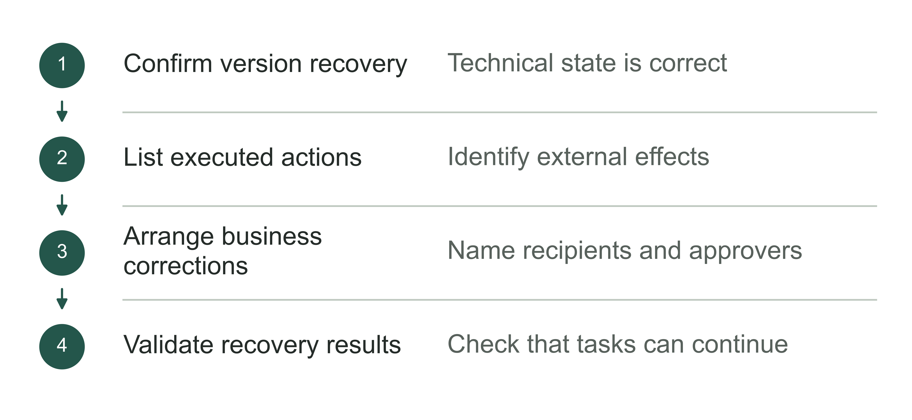

Figure 10-16 | Business reconciliation after software rollback. The author's analytical tool; rollback does not automatically undo business actions already taken.

## The business owner approves a scope, not a score

A production admission meeting can begin with a specific version, task, and set of permissions. The team presents representative and difficult-sample results, then human takeover and recovery drills. State which work is affected by unmet conditions, instead of labeling them broadly as “future optimization.”

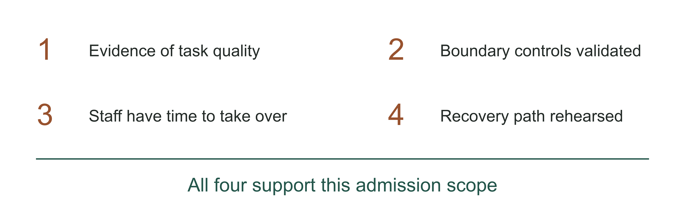

Figure 10-17 | Admission conditions cannot compensate for one another. The author's admission check. Task quality, boundary controls, human handling capacity, and recovery capability must each support the proposed scope. If any critical condition lacks evidence, repair it, investigate further, or narrow the scope.

Table 10-3 | Examples of the author's production admission decisions. These are not universal regulatory thresholds. Specific conditions depend on task consequences, existing policies, and confirmed delivery agreements.

| Current evidence | Decision it can support | Restrictions to retain |
|---|---|---|
| Common tasks pass; critical exceptions remain unvalidated | Allow a limited trial only if authorized tasks can be recognized before processing and unvalidated exceptions can be isolated | Recognition and isolation also require validation; otherwise, continue offline testing |
| Content quality is usable; write controls have not passed | Retain assistance with proposed results only after the read-only path's permissions, materials, and output boundaries pass independent validation | Disable writes; defects in shared permissions or data isolation do not justify releasing the read-only path |
| The system is usable; the takeover queue has a backlog | Reduce incoming volume or pause expansion | Validate again after increasing takeover capacity |
| A critical permission breach or recovery failure occurs | Pause the affected path and repair it | Pass tests and drills again before release |

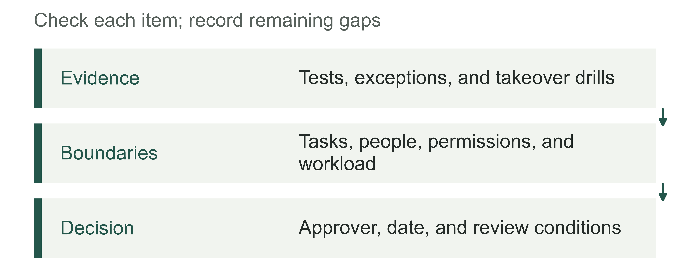

Figure 10-18 | What an admission decision must retain together. The author's analytical tool; later comparisons of operating changes require this admission baseline.

The following teaching record illustrates how to decide whether a version can enter a trial. Set T10 is separate from the earlier illustrative calculation of 1,000 anomaly-detection tasks; it does not represent an actual production success rate. This round considers only lists of potential discrepancies for designated stores. Writes and payments remain disabled throughout. A further necessary condition is that, before processing begins, the system can recognize the store and task type, reject unauthorized requests, and refer unconfirmed tasks to a human. Validation set H1 must check this too. If the system can only tell that a task lies outside its validated scope after fully processing it, “limited scope” cannot justify authorizing the trial.

Table 10-4 | A record from failure to limited release (the author's teaching example)

| Stage and record | Finding or response | Decision at this stage |
|---|---|---|
| Development replay D1, V0.1 | Old proposals remained in use after a statement changed; a sample lacking policy evidence was not correctly referred to a human | Both checks fail; trial operation prohibited |
| Repair V0.2 | Implement source-version checks and referral for missing evidence in code and workflow; retest known failed tasks | Passing the original cases shows the repair works; go-live is not yet approved |
| Held-out validation set H1 | Complete tasks not used for this round's adjustments, deduplicated by source order; business staff review against predefined standards | Record ordinary tasks, missing-evidence tasks, old-rule tasks, and unauthorized tasks individually; no agreed critical errors observed in this round |
| Recovery drill R1 | The takeover recipient handles tasks through the original process when the tool is unavailable; restoring the old proposal-generation function does not change business accounts | The production lead confirms the takeover path; remaining restrictions are retained |
| Admission A1 | Business and technical staff separately confirm V0.2, H1, and R1; two authorized reviewers participate for 10 working days | Enable only assistance with proposals; record all incoming and human-referred tasks; review at the end of the trial |

If H1 is used for debugging after revealing a problem, it can no longer be described as validation material excluded from debugging. After the repair, add new validation material. “Not observed in this round” in the table applies only to the teaching tasks actually listed; no sample size has been provided that could establish the disappearance of rare errors. A1 does not automatically extend to changes in tasks, permissions, materials, or human handling capacity. When a critical error occurs, the operating lead immediately stops the affected tasks and reports to the person authorized to handle the issue.

The approval document should state who may use which version on which tasks, the actions permitted, the person responsible for monitoring, the review date, and the conditions requiring an immediate stop. New material types, model changes, or additional tool permissions can make earlier evidence inapplicable. Add tests according to the change's actual impact; the fact that the name remains “the same assistant” does not preserve all previous approvals.

With these conditions in place, designated staff can begin a real trial. The next questions are whether the system fits employees' work, whether they bypass it, and whether they are willing to report problems. Chapter 11 addresses these questions. The versions, scope, and test records retained here also provide a basis for later comparisons.

## Notes and sources

[1] CLA and Databricks, [conference description](https://www.databricks.com/dataaisummit/session/stop-guessing-start-scoring-llm-extraction-evaluation-databricks) and [June 2026 slides](https://microsites.databricks.com/sites/default/files/dais/2026/D26B2127.pdf), pp. 8–10, 22–29, and 31. Checked 2026-09-07. Page 9 presents processing time and F1, without fully explaining the sample, observation period, or end-to-end human review included in the measurement. It does not establish ROI or long-term production performance. No original figures are reproduced in this chapter.

[2] Anthropic, [Demystifying evals for AI agents](https://www.anthropic.com/engineering/demystifying-evals-for-ai-agents), 2026-01-09, sections on tasks, trials, outcomes, and graders. Checked 2026-09-07. Cited for distinctions in evaluation; the settlement figures, repeated-run records, and checklists in this chapter are teaching designs by the author.

[3] AWS, [Agentic AI Lens](https://docs.aws.amazon.com/pdfs/wellarchitected/latest/agentic-ai-lens/agentic-ai-lens.pdf), AGENTOPS02-BP03 and AGENTOPS03-BP02, physical PDF pp. 56–58 and 73–74. Checked 2026-09-07. Cited for versioning, progressive release, and rehearsal principles; the guide's traffic percentages and recovery deadlines are not treated as universal standards for all businesses.
