# Chapter 11 Helping employees put AI to work

An application form can sometimes reveal more about everyday AI deployment than a launch event.

The University of Texas Rio Grande Valley (UTRGV) offers a ChatGPT Edu pilot for faculty and staff, with a limited number of licenses. Applicants must state their role, department, intended use, expected usage frequency and duration, and confirm matters concerning sensitive data. An application does not guarantee a license, and inactive licenses may be reassigned.[1]

The form makes the work after tool allocation concrete: who needs the tool, where they will use it, and how access will be managed afterward. The public page does not disclose the number of recipients, activity rates, or work outcomes, so it cannot establish whether the pilot succeeded. Businesses can borrow these management arrangements and assess their effects using their own actual records.

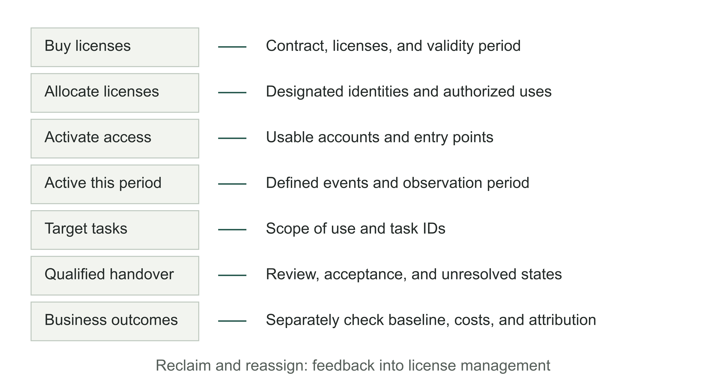

Figure 11-1 | How to judge whether employees are putting AI to work. The author's analytical framework. Equal-width layers represent different evidence, not proportions of people. Procurement units, people, and tasks cannot be divided directly by one another. Reclaiming licenses is part of feedback management.

Businesses encounter similar problems. The system has passed testing and accounts are active, yet employees still open their old spreadsheets when handling a task. Another product presentation may not solve this. Employees may lack suitable tasks, be unsure which materials they may enter, or have tried the system and found checking its work more time-consuming than doing the task again. All these situations appear as “inactivity,” but require very different responses.

Chapter 10 established the scope within which the system may enter production. This chapter examines what happens once employees begin using it: can they repeatedly complete authorized tasks, including the necessary review and handover? Attribution of business outcomes is addressed in Chapter 12.

## First decide which work AI will help complete

“Everyone should use AI” is easy to communicate and difficult to verify. One employee asks an inconsequential question every day; another uses AI once a month but completes preparation work that previously required several people to check. Ranking them by login count erases the differences in their actual work.

A pilot should first define the target task. A procurement department might choose “draft supplier meeting minutes from authorized materials, have the responsible person review them, and enter them into the project record.” This definition includes inputs, outputs, review, and destination. “Help procurement become more efficient” provides no basis for judging whether employees used the right method or where the work stalled.

Then identify who genuinely has opportunities to do this work during the observation period. Weekly activity is unsuitable for judging individual adoption of a quarterly task. Record status changes for employees reassigned, on leave, or without a task. Measurement definitions can change, but people who have not adopted the process must not quietly disappear from the denominator to improve the curve. Retain the initial pilot cohort and separately report the group with tasks in the current period so readers can see why the figures changed.

Table 11-1 | Using records to check adoption (the author's method)

| What to judge | Numerator and denominator | What must also be stated |
|---|---|---|
| Whether licenses have been allocated | Allocated licenses / available licenses | License unit, validity period, and reclamation |
| Whether recipients use the system | Active people in the period / designated recipient cohort | Definition of an active event, roles, and observation period |
| Whether target work enters the process | Tasks using the AI process / eligible tasks | Task scope, exceptions, and deduplication of repeated tasks |
| Whether work completes handover | Tasks meeting standards and handed over / tasks using the AI process | Acceptance criteria, returned tasks, and unresolved tasks |

Each figure answers its own question. A high allocation rate may indicate a smooth application and allocation process. A low task handover rate may indicate unusable outputs or a receiving department that still requires a different set of materials. Averaging these figures into an “AI adoption index” hides the specific point that needs attention.

Management should also agree when a task is unsuitable for further rollout. If obtaining the materials is costly and the task is rare, retaining human processing may be more economical than continuing training. Promoting adoption also includes stopping rollout of unsuitable tasks and moving support resources to roles with actual demand.

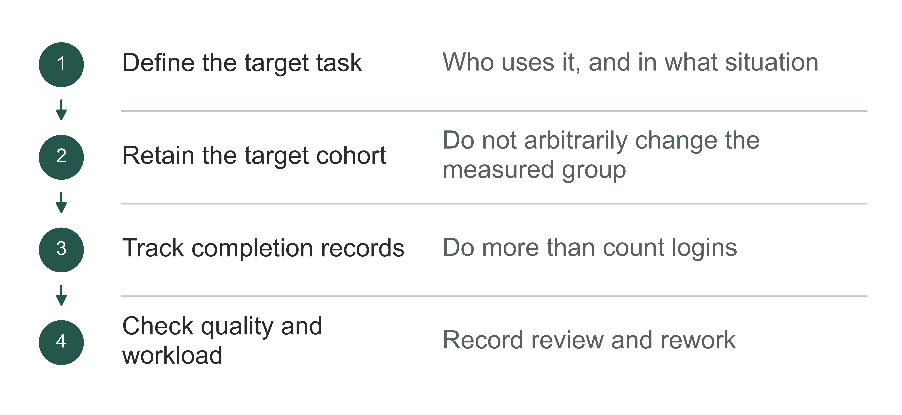

Figure 11-2 | Measure use through specific tasks. The author's analytical tool; measuring use requires examining whether tasks are completed.

## Total usage can rise while the original users stop

The following teaching data have no connection to the university above. Initially, 100 employees receive licenses, and 60 use them in week 1. By week 4, 45 of those original 100 use the system. Of these, 36 also used it in week 1, while 9 began later. During the same period, another 30 new employees receive licenses, and 20 use the system in week 4.

Total weekly active users rise from 60 to 65, apparently showing growth. Yet activity among the original 100 falls from 60% to 45%. Of the 60 active users in week 1, only 36 are active in week 4, or 60%. The 20 active people in the new cohort conceal the decline in the original cohort.

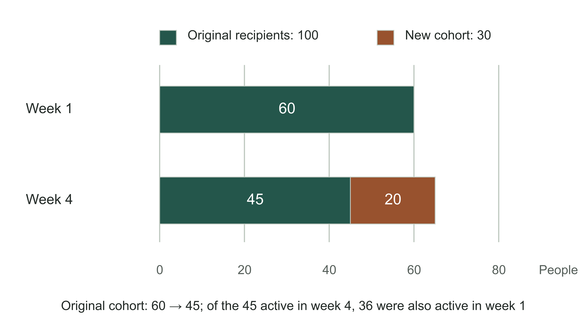

Figure 11-3 | Separate new arrivals from the original cohort. Teaching data, measured in people. The original cohort remains fixed at 100; week 4 adds 30 new license recipients. The ratio 36/60 indicates activity in both observed weeks, not continuous weekly use between them.

The next step is to investigate the change. High usage in week 1 may come from group training, with week 4 closer to normal work; the task may also be in a quiet season. Without that context, a decline cannot directly establish failure, nor can dilution by new users establish success.

Select suitable samples from three groups and examine specific tasks: people who keep using the system, people who stopped after trying it, and people who have tasks but have not started. Sample size depends on team size and differences within it; a few interviews cannot establish a conclusion about everyone. Ask about a recent actual piece of work: where it began, which materials were used, where the employee returned to an old tool, and how it was finally delivered. Spend less time asking “Are you satisfied with AI?” and more time examining a record of completed work.

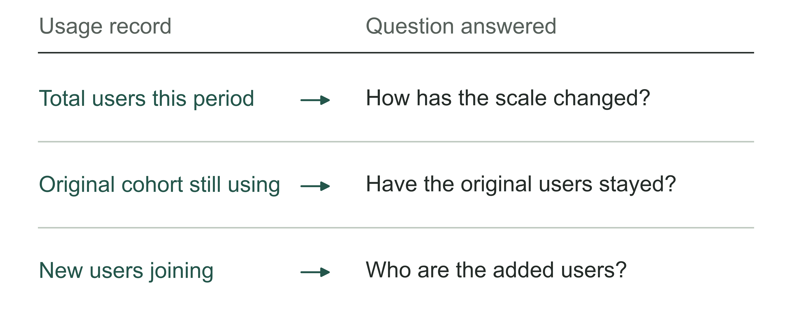

Figure 11-4 | What total users and continued use by the same employees reveal. The author's analytical tool; total growth and loss of original users can occur together.

Table 11-2 | How to track the same employees (the author's checking tool)

| Record item | Requirement |
|---|---|
| Cohort | Fix the target group at the start of this round |
| Task | Define the target work that counts as completed |
| Period | State the start, end, and comparable periods |
| Inflows and outflows | Record newcomers separately from the original cohort |

## Find the step where employees return to old tools

Consider a teaching scenario. An account manager needs to turn visit notes into an internal follow-up summary. The new tool drafts quickly, but the original notes are in another system, client fields must be removed manually, and the output must be pasted into a fixed template. The lead cannot see the source, so returns the task and asks the account manager to provide evidence. The model generates quickly, while the employee takes several extra steps to complete the handover.

In this situation, “employees do not know how to write prompts” is only a hypothesis to test. The forward deployed engineer (FDE) should follow a task through the existing path and record where transcription, waiting, judgment, and rework occur. If most time goes into logins and permissions, more prompt-writing classes offer limited help. If rework stems from missing critical fields, adjust inputs and acceptance criteria, instead of merely making the answer more fluent.

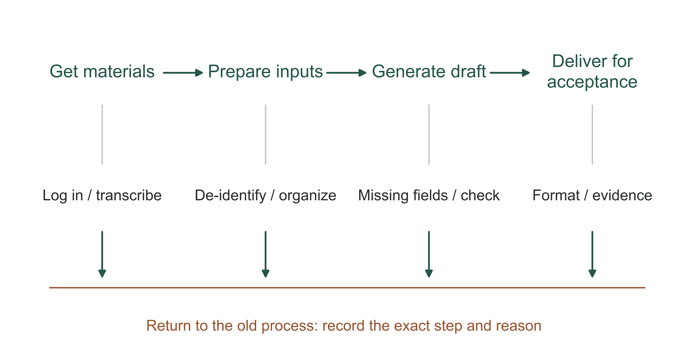

Figure 11-5 | How a task returns to old tools. A teaching process diagram designed by the author. The top shows work steps; the bottom marks possible returns to the old process. It does not represent actual customer processing times or failure frequencies.

Label this issue F11-08; it remains a teaching scenario. The old summary omitted the “source-record location” and “items requiring confirmation.” Unable to review it, the supervisor returned it. The account manager then sent the source separately and copied the explanation again. The process lead can first agree handover requirements with the supervisor: necessary summary points in the body, together with the location of an authorized source, open questions, and the next responsible person. Access to the source requires formal authorization; the model cannot grant permissions on an employee's behalf.

Teaching solution V0.2 begins with a standard input form and fixed output fields, without waiting for interfaces between systems to be developed. If the source recipient lacks access, an authorized business approver decides what summary may be provided or who should receive the task. Copying the full source to bypass permissions is unacceptable. Review time must be scheduled. Raising a question does not count as an operating failure, and unresolved tasks must remain in the records.

For the follow-up check, first repeat the original task, then have an ordinary user independently handle a similar new task, N11-09. In this teaching record, the supervisor found the evidence they were authorized to view, confirmed one open question, and accepted the work without requiring the whole document to be copied again. Another case in which source access could not be obtained still went to human handling. This shows only that the tested tasks' handover problem was resolved. It cannot establish broad willingness to adopt, let alone a time-saving percentage. Continue tracking completions, returns, and manual preparation for the same group before deciding whether interface development is worthwhile.

Improvements also cost something. Integrating systems may require a place in the business system team's schedule. A standard input form is quicker to implement temporarily, but still requires employees to prepare materials. These approaches can be adopted in stages, provided the team states how much work the temporary solution adds and what evidence would justify an interface. “It will be integrated later” is no reason to remove today's manual transfer work from the added workload.

After a repair, observe similar tasks again. Has the new entry point reduced abandonment? Is the receiving department still returning work? Closing a support ticket shows only that someone addressed an issue; it does not establish that an employee completed the task. A good change record retains the problem, revised version, validation task, and recipient's confirmation together.

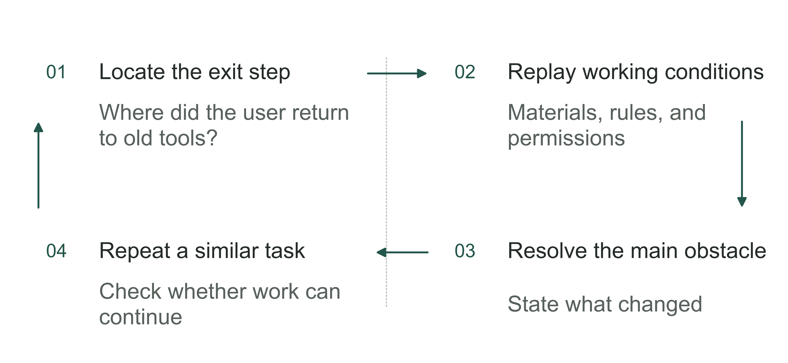

Figure 11-6 | Investigate along the path back to old tools. The author's analytical tool; do not interpret every exit as employee resistance.

## An account also needs permission for the task

Sometimes employees stop because they do not know whether use is allowed. The Texas State University Department of English's teaching resources page provides three course AI statement options: prohibited use, limited permission, and permission subject to assignment requirements. An institution providing a tool does not automatically authorize its use for every course assignment.[2]

This material reveals two levels of decision: the institution provides access, while specific work retains its own rules. Businesses can use this distinction to examine their authorization guidance. Marketing copy, internal analysis, and commitments to clients may require different material boundaries and review responsibilities. A broad statement that “the company supports AI use” offers little help with a specific task.

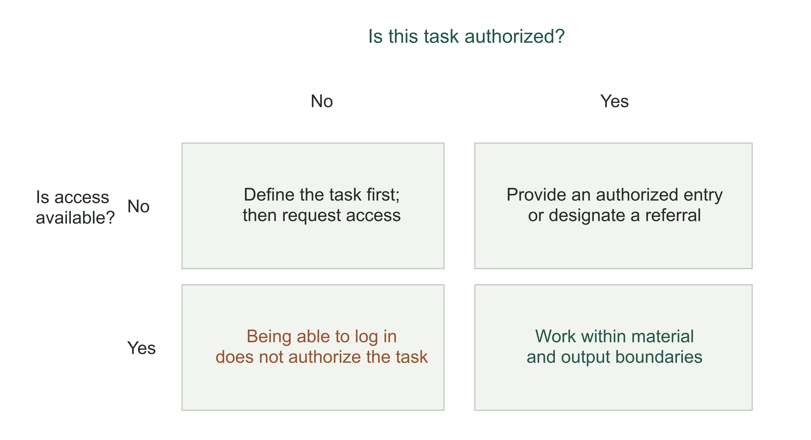

Figure 11-7 | Access and task permission must both be satisfied. The author's business authorization matrix. Course options inform this general management analysis; it is not the actual permission configuration of any university or business. Task permission must also cover materials and output destinations.

A short guide beside the target workflow is more useful than asking employees to recall a long policy from memory. It should identify authorized tools and accounts, usable materials, output purposes, and the required reviewer. For unlisted situations, employees need a responsible person who can answer and a temporary handling method. “Please ensure compliance yourself” does not resolve who makes the judgment.

Permission guidance must also match system behavior. If the guidance permits employees to read a category of internal material but the tool repeatedly denies access, the policy will appear impossible to follow. Conversely, material the system can open is not necessarily permitted for every purpose. Check technical access and business permission separately, then send discrepancies to an authorized person.

Checking usage need not mean reading every employee's prompts. Begin with task events, timestamps, states, and error categories. When a specific failure occurs, obtain the necessary records through the authorized process. Explain in advance what will be collected, who may view it, and how long it will be retained. Otherwise, employees may bypass formal tools to avoid exposing unfinished thinking, distorting usage records in the process.

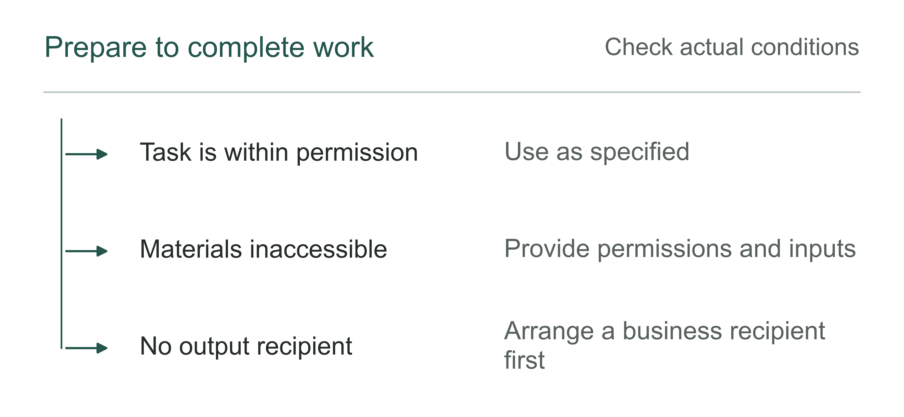

Figure 11-8 | What is still needed after activating an account. The author's analytical tool; confirm accounts, task permissions, and receiving arrangements separately.

## Training should end with independent completion of work

A product demonstration shows employees what a tool can do. Training for a role must enable them to complete their own work. The former can be presented to a large group; the latter must address differences between tasks.

For a draft of meeting minutes, training can start with a set of de-identified materials. Have employees complete the task through the original process, then through the authorized AI process, comparing omissions, errors, and review burden item by item. Next, introduce a record with conflicting material and observe whether they preserve open questions and refer them for judgment. Finally, have each employee independently complete another task and give the result to the actual receiving role for review. These actions reveal whether problems concern tool operation, business judgment, or handover.

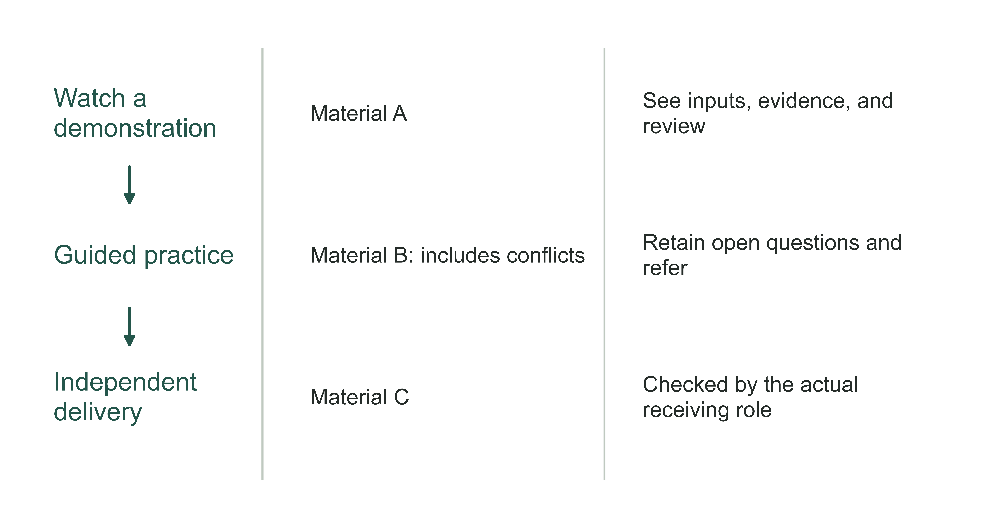

Figure 11-9 | Training ends with independent completion of work. The author's role-training design. Demonstration, guided practice, and independent delivery use different materials. Retain an observable output at each step instead of recording only attendance.

Early enthusiastic users can help with training, but cannot substitute for testing with ordinary employees. People who know the business and enjoy exploration often fill in missing inputs and recognize ambiguous outputs themselves. These hidden capabilities can become barriers for beginners. At minimum, check whether employees with different levels of proficiency understand the same task instructions before deciding that support materials are sufficient.

After training, employees need someone to turn to. Complex questions can be handled during regular office hours; common operating guidance belongs beside the task's entry point. A lively chat group alone can leave a few helpful colleagues answering questions indefinitely. The FDE should turn recurring issues into user guidance, program repairs, or business rules awaiting confirmation, and assign an ongoing owner.

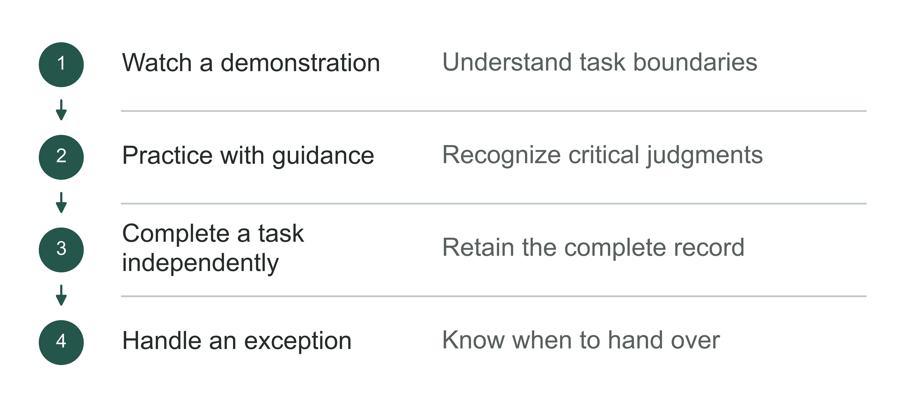

Figure 11-10 | The training path to independent delivery. The author's analytical tool; passing training requires evidence of task performance.

## Address burdens and incentives to sustain feedback

Employees may welcome faster drafting without wanting additional hidden responsibility. Suppose a supervisor previously decided whether the material was sufficient. The new process asks employees to judge whether AI outputs are reliable, while performance assessments still focus only on volume. Work boundaries change, review time remains unscheduled, and accountability for errors is unclear. Encouragement alone cannot solve these problems.

The lead should first document the changes: which step is reduced, which judgment is added, who benefits, and who takes on extra review. If the receiving department saves time by pushing all validation work upstream, the overall process may not improve. A pilot should reserve time for employees to learn and give feedback, as well as sufficient time for reviewers.

Useful feedback can be brief: task ID, stalled step, consequences, and the workaround used. Route different problems to people who can solve them. Account problems go to service support; incorrect materials to the material owner; outputs that fail task requirements to the delivery team. Conflicts over duties or performance assessment require a business manager's decision.

Table 11-3 | Records needed to close the feedback loop (the author's method)

| Problem signal | Responsible person this round | Check before closing | What to tell employees |
|---|---|---|---|
| Login or permission failure | Service support / permission owner | The original task can proceed with authorization or has an explicit referral | Available entry point and reason for restrictions |
| Drafts repeatedly omit critical fields | Delivery team and business acceptance reviewer | A similar new task passes the required checks | New version and known limitations |
| Receiving department requires rework | Process lead | Both sides use the same handover requirements | Revised acceptance criteria |
| Review burden is unscheduled | Business manager | Staff time and responsibilities are arranged | New handling scope and pace |

After closure, watch for recurrence. Employees who raise concerns without seeing a response may stop giving feedback. Fewer tickets can also mean that no one reports problems anymore. Compare ticket trends with task returns and bypass records to distinguish a better system from a failed information channel.

Do not interpret an employee's error report as unwillingness to use AI. Asking people to expose problems while assessing a pilot on “zero exceptions” encourages them to hide difficulties outside the system. When employees have reasons to reject an unsuitable task, record those reasons and use them to adjust the scope. Authorized managers should explicitly explain any changes to roles or performance assessment, instead of leaving employees to infer them from usage rankings.

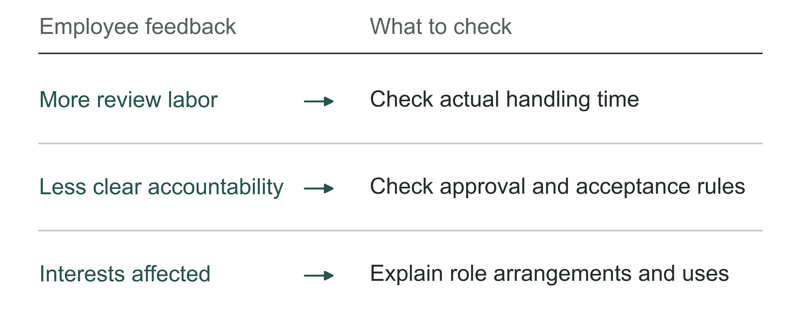

Figure 11-11 | What burden may lie behind the feedback. The author's analytical tool; different burdens require different responses.

## How to handle allowances as usage rises

More use creates new management questions. For features metered by credits or calls, high usage may reflect valuable work, failed retries, duplicate submissions, or unsuitable processing methods. The total signals a need to investigate; it does not supply the conclusion.

OpenAI Academy's ChatGPT Edu guidance recommends first using alerts to observe usage patterns, then choosing hard caps according to budget and cohort needs, with a monitoring owner, exception approvals, and support at the limit defined in advance.[4] This is deployment advice from the provider; it does not mean every business should relax allowances. Fixed budgets, clearly identified high-risk uses, or experimental environments may require hard constraints from the outset.

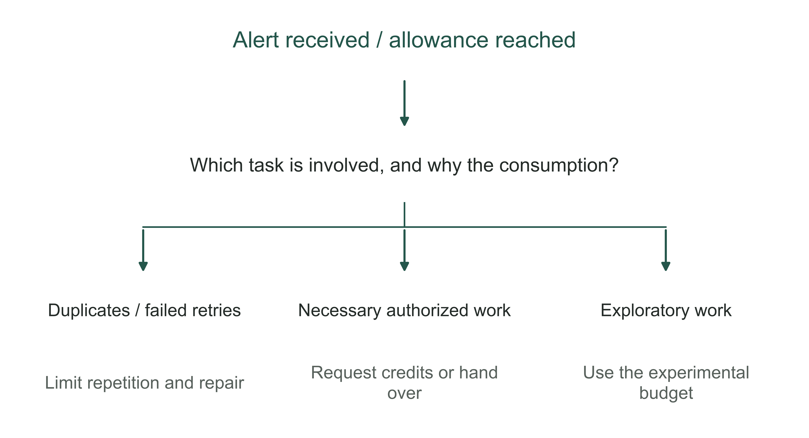

Figure 11-12 | At the limit, first establish the state of the work. The author's allowance-response branches. An authorized person must decide on increases; an important task does not automatically obtain more budget. Prepare the takeover path before the limit is reached.

Businesses can provide predictable allowances for routine work, a separate limited budget for exploration, and an approved handling path for important tasks. A limit notification should at least explain which work is affected, whether existing results have been saved, and how to continue or hand over. A sudden “insufficient credits” message can turn budget control into business interruption.

Deciding whether to increase an allowance requires looking at tasks. If many calls arise from the same failure, first restrict repetition and repair the cause. If employees consistently complete qualified handovers but a lack of credits creates a queue, compare the additional cost with acceptable alternatives. Finance staff check the added spending and associated workload; business staff confirm the work is necessary; technical staff explain the consumption. A shared task definition prevents these groups from arguing separately about the same usage chart.

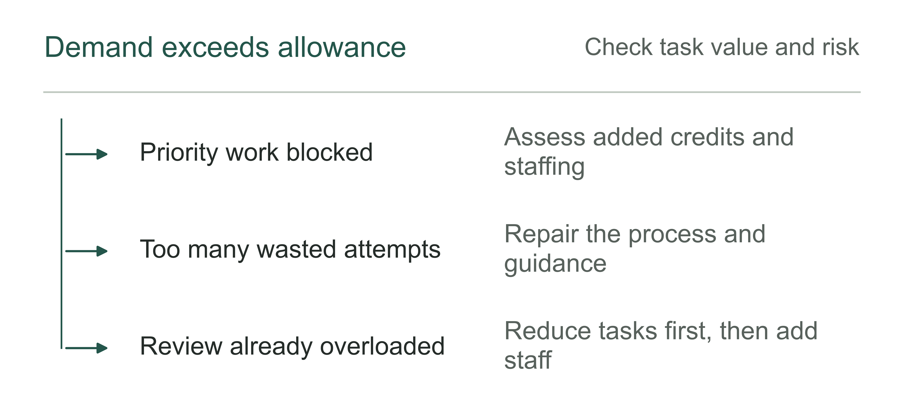

Figure 11-13 | What to decide first when the allowance is insufficient. The author's analytical tool; increasing the allowance also requires checking downstream handling capacity.

## Use one dashboard to decide the next round of action

Another OpenAI Academy guide considers weekly activity, different cohorts, support issues, surveys, and other signals together, and specifies surveys 120 and 240 days after workspace creation.[3] It reminds rollout leads that continued adjustments are needed after activation. Survey estimates of time saved can provide clues, but cannot be reported directly as realized financial benefits.

For business pilots, this book proposes separate reviews at 30, 60, and 120 days. These dates are the author's plan and can be adjusted to task cycles. At day 30, prioritize authorized entry points, task opportunities, and first completions. At day 60, examine whether the same cohort can complete work repeatedly and whether the main frictions have declined. At day 120, use task quality, support burden, and costs to decide whether to expand, maintain, narrow, or end the pilot. Observe low-frequency tasks over enough business cycles; do not force a conclusion to meet a calendar date.

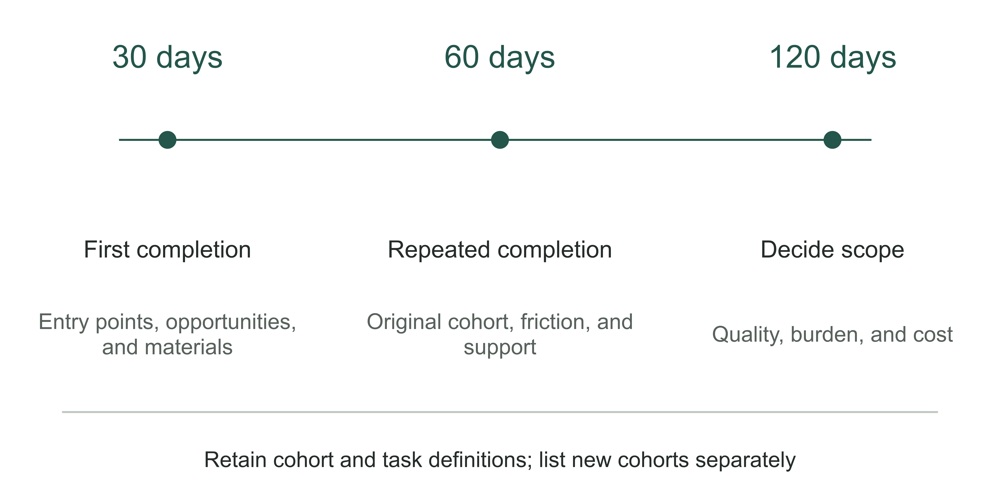

Figure 11-14 | Three review points on the same usage dashboard. The author's 30/60/120-day plan. The three points retain the same cohort and task definitions, with new cohorts reported separately. Spacing is illustrative, not a proportional time scale or the source provider's product-feature schedule.

Put task volume beside headcount on the dashboard. Assume a week has 80 eligible tasks, of which 60 use the AI process and 45 pass the specified acceptance checks and complete handover. Task coverage is 60/80, or 75%. The qualified handover rate among tasks that used the process is 45/60, also 75%. Overall qualified handover coverage is 45/80, or 56.25%. The denominators differ; choosing the most attractive figure cannot establish that deployment is complete.

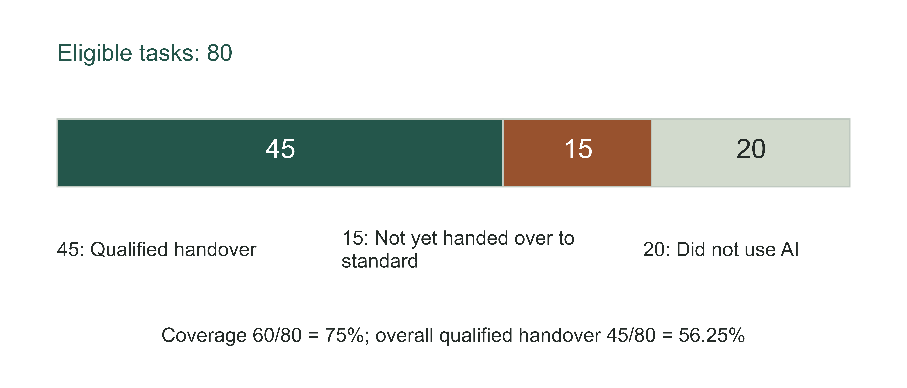

Figure 11-15 | From task coverage to qualified handover. A teaching calculation, measured in tasks. The 45 qualified handovers, 15 tasks not yet handed over to standard, and 20 tasks outside the AI process total 80. These counts must not be mixed with the people in Figure 11-3. Tasks not yet handed over are not all final failures.

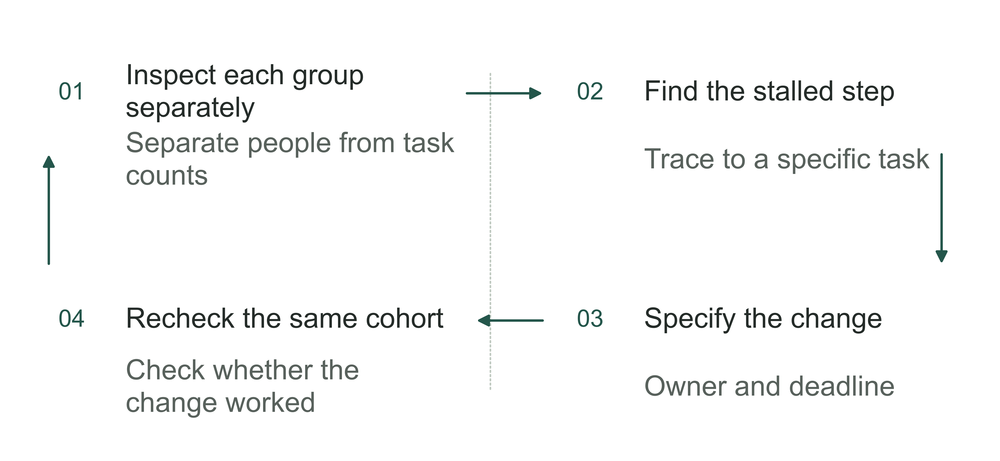

Figure 11-16 | Decide the next step from usage records. The author's analytical tool; dashboard conclusions must lead to actions that can be reviewed.

Table 11-4 | Start investigating where work stops (the author's checking tool)

| Observation | Check first | Who handles it |
|---|---|---|
| Login without completion | Task permission and input conditions | Business and permission maintainers |
| Frequent returns to old tools | Failed steps and recovery cost | Process and delivery leads |
| Review backlog | Exception volume and available time | Operating lead |

These records lead to different actions. For the 20 tasks outside the AI process, determine whether employees bypassed it or had valid exceptions. For the 15 that entered but did not yet achieve qualified handover, distinguish work in progress, returned tasks, and abandonment. Merely urging more employees to log in can leave the latter problems accumulating.

The chapter worksheet brings the cohort, observation period, task counts, main obstacles, and next responsible person onto one page. A review should state what will change and which subsequent records will assess the change. Continue outcome records from the initial work baseline and collect them alongside actual usage records. Once work can be completed consistently, use Chapter 12 to examine how much improved, which improvements came from this deployment, and whether actual business benefits followed.

## Notes and sources

[1] UTRGV, [ChatGPT Edu License Pilot](https://support.utrgv.edu/TDClient/1849/Portal/Requests/Service/55277/ChatGPT-Edu-License), service catalog sections How to apply, Important notes, and FAQ. Checked 2026-09-07. This chapter uses the page only to describe license operations; it does not infer actual use or outcomes.

[2] Texas State University Department of English, [Teaching First-Year English](https://www.english.txst.edu/faculty-resources/fye.html), Required Syllabus Statements re: Student AI Use. Checked 2026-09-07. The three statements are course options, not evidence of uniform university-wide implementation.

[3] OpenAI Academy, [Use Impact Data To Improve Your ChatGPT Edu Rollout](https://academy.openai.com/public/clubs/higher-education-05x4z/blogs/use-impact-data-to-improve-your-chatgpt-edu-rollout-2026-05-06), 2026-05-06. Checked 2026-09-07. The source's 120/240-day schedule and the author's 30/60/120-day plan in this book are recorded separately.

[4] OpenAI Academy, [Set Credit Guardrails Before Your ChatGPT Edu Rollout](https://academy.openai.com/public/clubs/higher-education-05x4z/blogs/set-credit-guardrails-before-your-chatgpt-edu-rollout-2026-05-06), 2026-05-06. Checked 2026-09-07. This chapter does not provide current product prices or instructions for configuring accounts.

The headcounts, task counts, and business operating scenarios in this chapter are teaching designs, not university pilot data or the author's client experiences. Figures, tables, and tools were designed by the author. Observing adoption cannot replace attribution analysis of business outcomes.
