# Chapter 12 Verifying outcomes: how much business value has AI created?

About two hours, 96%, and £458,000. These three figures appear in one local government's AI project and related service materials, yet cannot directly be combined into an investment return.

North Somerset Council in the United Kingdom and technology services provider Agilisys jointly piloted a tool for Education, Health and Care Plan (EHCP) assessments. The procurement notice stated that each assessment saved about two hours; the contract value was £458,000 excluding tax.[1] Official annual statistics published later showed that in 2025, approximately 96% of plans excluding exceptions were issued within 20 weeks.[2]

This warrants serious examination, but does not yet answer a business owner's main questions: Was the money well spent, and should investment expand? The two hours describe time saved in a particular assessment activity. The 96% is an annual timeliness rate with a specific denominator. The contract value includes research and development and related services. Their work scopes, observation periods, and kinds of evidence have not yet been aligned.

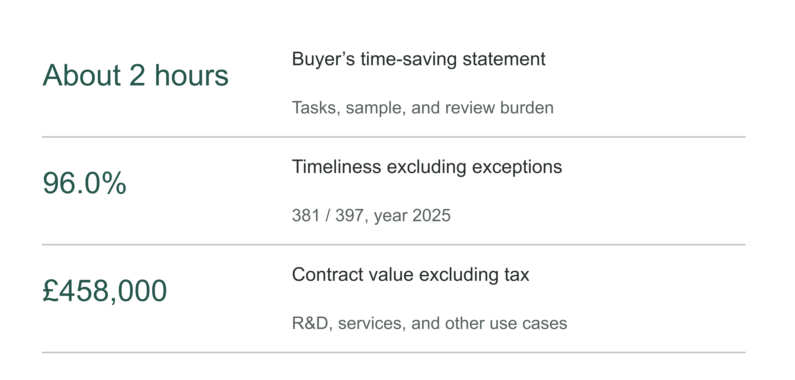

Figure 12-1 | What the three sets of figures answer. Redrawn from the procurement notice and UK Department for Education (DfE) annual statistics.[1][2] The figures sit alongside each other as three kinds of record; labor time, timeliness, and contract price have not been connected into a proven chain of benefits.

Chapter 5 addressed budgeting before investment, and Chapter 11 examined whether employees consistently use the system to complete work. We now assess outcomes after investment: what actually improved, how much the AI-enabled process contributed, and how much became changes in revenue, spending, or service. A business owner need not build a statistical model personally, but should know which records support each conclusion in the report.

## Start by stating the denominator behind 96%

The same annual dataset supports another figure: 90.9%. It does not contradict 96%. Of the 493 plans including exceptions in 2025, 448 were issued within 20 weeks. Excluding exceptions, 381 of 397 were timely. These definitions describe the overall position and the position after excluding exceptions, respectively.[2]

When reading a report, ask both whether 96% is true and what work that 96% represents. If the previous year included exceptions and the next excludes them, the displayed improvement combines business changes with a change in statistical scope. Even correctly calculated percentages can create a misleading comparison.

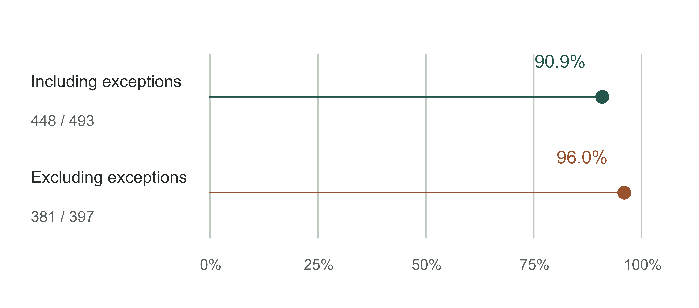

Figure 12-2 | Two timeliness rates in the same year. North Somerset, calendar year 2025: 448/493 is approximately 90.9%, and 381/397 approximately 96.0%.[2] Both use a 0–100% scale; the axis is not truncated to exaggerate the difference.

Business denominators can change quietly. At the start of a pilot, only standard tasks with complete materials are accepted. After expansion, tasks with missing attachments, multiple departments, or exception approvals also enter. A longer average completion time could indicate deterioration or harder work. Conversely, removing tasks returned to humans after failures can make the AI process look exceptionally good.

Outcome verification should begin with an inclusion rule: which tasks are eligible for observation, when timing begins, what state counts as complete, and how failures, withdrawals, and human referrals are recorded. Complex tasks may be listed separately, but should not be excluded only after results are known. When rules change, retain side-by-side tables under the old and new definitions so readers can see where the change occurred.

Table 12-1 | Definitions for recording outcomes of the same task, recommended by the author

| Element | What to record | Common misjudgment |
|---|---|---|
| Task covered | Task ID, type, and inclusion criteria | Treating easy tasks as all tasks |
| Start and end | Receipt, readiness for processing, first delivery, and final acceptance times | Treating draft generation as completed work |
| Path | AI-enabled steps, versions, human referrals, and retries | Keeping only successful calls |
| Outcome | Quality grade, rework, acceptance, and unresolved state | Letting unresolved tasks disappear |
| Scope | Observation period, unit, denominator, and exclusion reasons | Dividing people, tasks, and calls by one another |

This table also prevents a seemingly small bias: counting only work completed during the observation period. The new process may quickly handle easy tasks while leaving a few difficult ones unresolved. At the reporting cutoff, completed tasks have a short average processing time, but the backlog is growing. Alongside completion times, list opening unresolved tasks, arrivals, completions, withdrawals, and closing unresolved tasks, reconciling inflows and outflows. For unfinished tasks, at least report how long they have already waited.

System logs and employee reports serve different purposes. Logs can locate submission, generation, and acceptance times, but may not show how much other work an employee did between them. Ten minutes between clicks does not mean ten minutes of labor. Employees can explain checking and rewriting burdens, but retrospective recollections can omit scattered steps. First use a short sequence of consecutive task records to connect labor timing with system events, then decide which metrics can be collected from logs over time. A third-party report also needs its measurement method checked; a different name on the report does not supply a missing baseline.

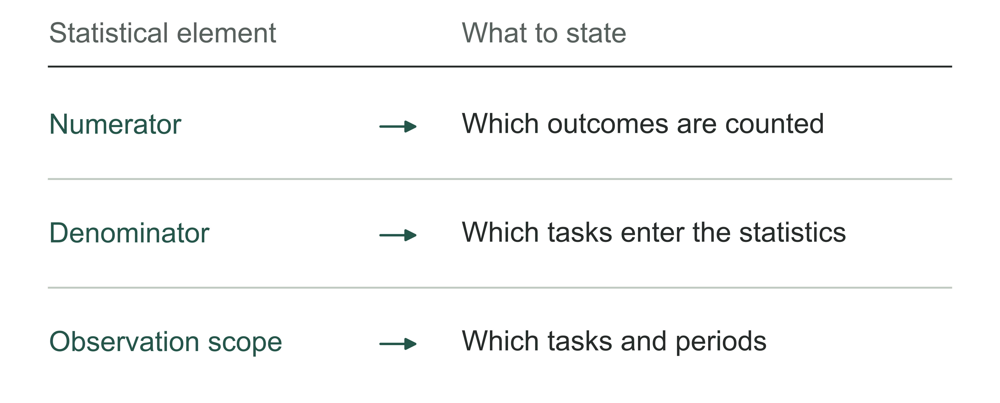

Figure 12-3 | What else to state when reporting percentages. The author's analytical tool; when necessary information is missing, first explain what cannot yet be judged.

## When did the improvement occur?

Putting annual figures back into time supports a sounder judgment. Using a single edition of the DfE data published in 2026 throughout, North Somerset's annual timeliness rates including exceptions were 36.6%, 63.0%, and 90.9% in 2023–2025. Service timeliness clearly improved over those three years, but the figures do not explain why.[2]

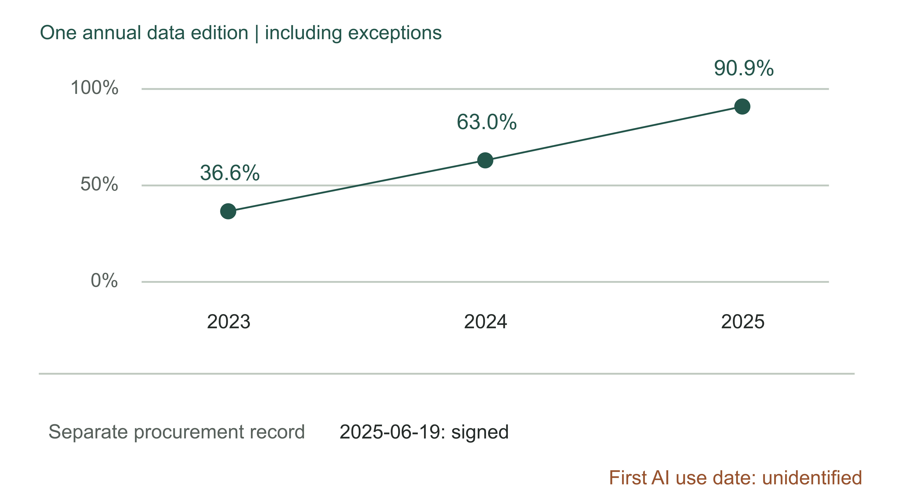

Figure 12-4 | Record annual improvements separately from procurement milestones. The top panel uses one edition of annual data; the bottom shows separate procurement milestones.[1][2] Annual points do not represent performance on the final day of each year. No first-use-of-AI line is shown because the available material cannot establish that date.

The contract notice records the signing date as June 19, 2025 and explicitly states that a joint pilot had already taken place.[1] We therefore cannot treat signing as first use and describe earlier improvement as “improvement even without AI.” That sounds cautious but adds another fact absent from the material.

The local government's May 2025 Special Educational Needs and Disabilities (SEND) newsletter attributes service progress to the combined work of the team and partner organizations.[3] This points to other changes worth tracing: added staff, backlog clearance, material preparation, and coordination across organizations can all affect outcomes. It neither proves that AI had no effect nor provides data separating the contributions.

Review also found that some historical timeliness figures in the newsletter differ from later annual statistics. The reason remains unresolved. We cannot select the most attractive figures from different publications and join them into a continuously rising line. This chapter uses only one dataset edition for annual comparisons; the local newsletter describes organizational work at that time. Internal weekly reports and year-end financial records may also be revised. Retaining publication dates, extraction dates, and original files makes differences explainable later.

Useful delivery records for an FDE team should be more detailed than contract dates: when each work unit began use, which tasks used which versions, when review rules changed, and whether staff changes or backlog clearance occurred at the same time. Without this actual operating timeline, even an attractive retrospective chart struggles to connect changes with specific interventions.

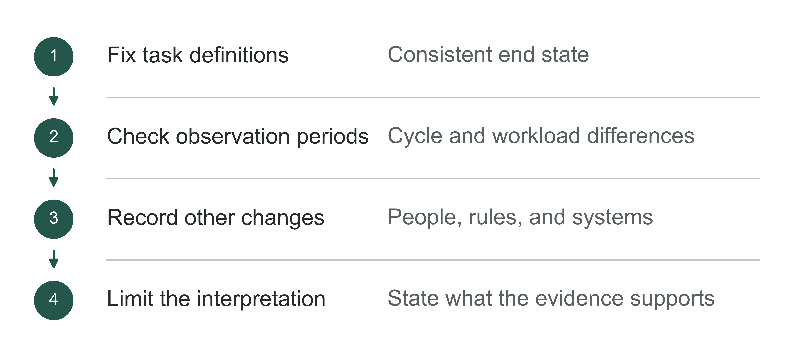

Figure 12-5 | Check comparability of before-and-after changes. The author's analytical tool; temporal sequence alone cannot establish causal attribution.

## Use a comparison to ask what would have happened anyway

Now leave the real case and consider a teaching calculation. Group A begins using AI, and its average time per task falls from 60 to 40 minutes. Saying “AI saved 20 minutes” assumes that nothing else changed. That assumption often goes unchecked.

Over the same period, Group B, which did not use AI, improves from 60 to 50 minutes. If the groups perform comparable work, had similar prior trends, face the same external changes, and Group A receives no additional help, Group B's 10-minute improvement provides a clue to changes shared by both. Group A's additional 10-minute improvement becomes the starting point for further investigation of AI's contribution.

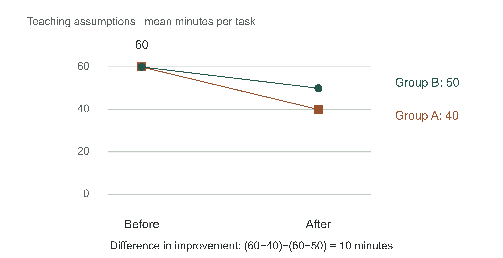

Figure 12-6 | First account for evidence of shared changes. Teaching assumptions, not North Somerset data. Group A improves by 20 minutes, Group B by 10, leaving a 10-minute difference. Four means can illustrate a calculation but cannot independently prove causality.

HM Treasury's Magenta Book methods guidance requires time-series evaluation to consider other concurrent interventions, seasonality, and related effects. It also explains how an unaffected comparison with similar historical trends can help identify shared changes.[4] An actual evaluation still needs sufficient observations and applicable assumptions. Labeling two columns “treatment” and “control” does not automatically produce a trustworthy conclusion.

If Group A contains the most experienced employees and Group B mostly beginners, the difference between means may include differences between people. If Group A also receives a new template and dedicated support, the observed effect concerns the whole deployment arrangement. A business owner may choose to invest in that arrangement, but should not attribute all the improvement to the model alone.

Where possible, agree the sequence of rollout and comparison method before go-live, instead of searching for a control afterward. If all teams must begin together, collect a longer operating record, mark every process and version change, and investigate how typical tasks were handled. The strength of evidence will be limited. Keep conclusions at the level it supports: improvement observed, deployment may have contributed, or an incremental effect estimated under specified conditions.

Small businesses need this discipline too, though measurement can be simple. Fix one task category and retain consecutive records of input conditions, handling paths, human checking, and final acceptance. Examine failures and slow tasks together. Do not generalize two enthusiastic users' impressions to an entire department, or retrospectively remove eligible exceptions to obtain an attractive mean.

There is also a management tradeoff. Stricter measurement may require more records and waiting time. An internal drafting tool that can be withdrawn at any time can begin with limited validation; work with irreversible consequences requires stronger evidence and review. Measurement effort should match the risk of the next decision. “A full evaluation is not worthwhile yet” cannot be rewritten as “effectiveness has been proven.”

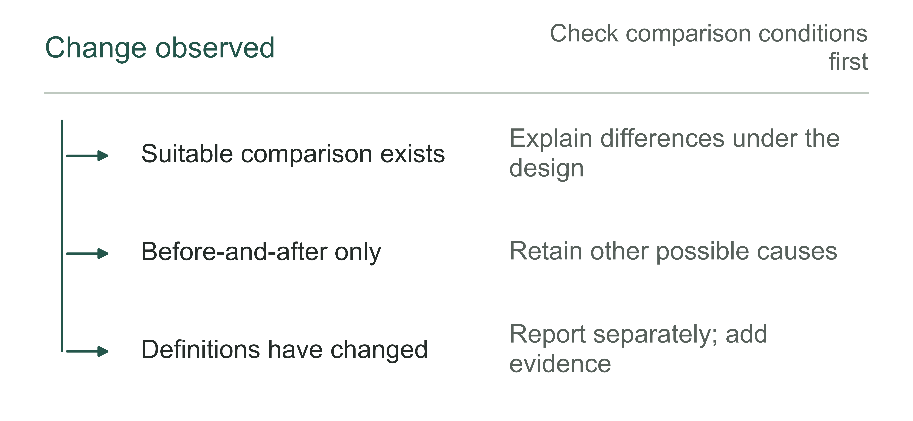

Figure 12-7 | How to write conclusions when comparison evidence is insufficient. The author's analytical tool; the strength of a conclusion should follow the strength of the evidence.

Table 12-2 | Labeling the strength of outcome conclusions (the author's checking tool)

| Evidence available | Appropriate wording to retain |
|---|---|
| Provider-disclosed metrics | Explicitly label provider disclosure and retain its scope |
| Before-and-after records under the same definitions | Report observed changes and explain other changes |
| An interpretable comparison design | Explain differences and remaining limitations under the design |
| Only forecasts or contract thresholds | Label assumptions or commitments, not actual results |

## What belongs beside speed?

Another official North Somerset statistic offers a signal in a different direction. Registered appeals to the SEND Tribunal rose from 94 in 2024 to 128 in 2025, while the published appeal rate rose from 4.6% to 5.4%. The corresponding statistical denominators for appealable decisions were 2,055 and 2,352.[5]

The decisions covered by these appeals differ from the denominator of 493 newly issued plans that year. We cannot divide 128 by 493 or conclude that AI reduced plan quality. The available aggregate table does not link appeals to specific AI-enabled work records. When timeliness improves while dispute signals rise, however, managers have reason to investigate dispute types, timing, and outcomes.

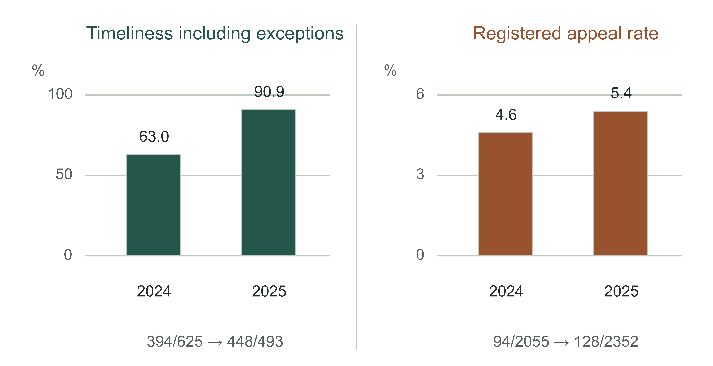

Figure 12-8 | Retain a separate denominator for each outcome. Timeliness including exceptions and registered appeal rates, 2024–2025.[2][5] The panels use different scales and populations. They cannot be subtracted or compared by graphical slope; the figure shows only each series' own change.

This also guides business metric selection. Faster customer service replies should be assessed alongside resolution, repeat calls, and escalation. Faster document preparation requires checking missing evidence and human rework. More sales recommendations require examining customer uptake, subsequent revenue, and fulfillment costs. Later outcomes often take longer to appear; a short pilot should not pretend to have observed them already.

North Somerset has a general quality assurance framework covering sampling, staff review, and multi-agency scrutiny, including attention to children's and families' voices, comprehensibility, and how outcomes are stated.[6] The framework suggests directions for checking, but does not publicly establish that AI-generated content received a dedicated audit against these requirements, nor give an error rate for AI samples. Policy documents and actual execution records must be obtained separately.

Business quality samples should likewise avoid looking only at tasks the system handled smoothly. Examine normally completed tasks, substantial human rewrites, human referrals, and complaints together. Record who sampled, the selection rules, and whether evaluators knew that AI was involved. List severe errors separately so that high pass rates on many small tasks do not dilute them. If quality has not yet been accepted, report time savings only as an outcome awaiting verification.

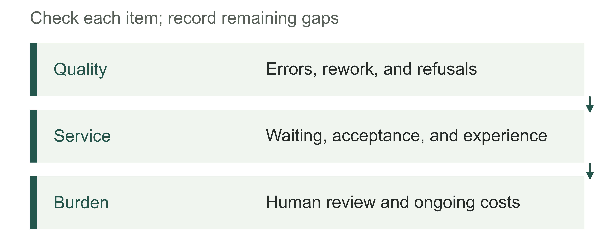

Figure 12-9 | Outcome constraints alongside speed. The author's analytical tool; faster work is meaningful only while other constraints remain satisfied.

## How do two hours reach the cash ledger?

The buyer's statement of about two hours saved per assessment is a usage signal worth following.[1] To turn it into a business judgment, we need the number of cases measured, the period, whether preparation and review are included, and the variation between tasks. Multiplying two hours directly by annual plan volume and then an hourly wage crosses several unverified steps in succession.

Consider a separate, complete teaching ledger. In one month, 600 eligible tasks reach final acceptance. Comparable measurement shows 12 minutes saved per task on the original step, totaling 120 hours. Added material preparation, review, and rework total 30 hours, leaving 90 hours of net released capacity. Those 30 hours include added burdens from related failures and human referrals; we cannot count savings on successful tasks while omitting labor added by failed tasks.

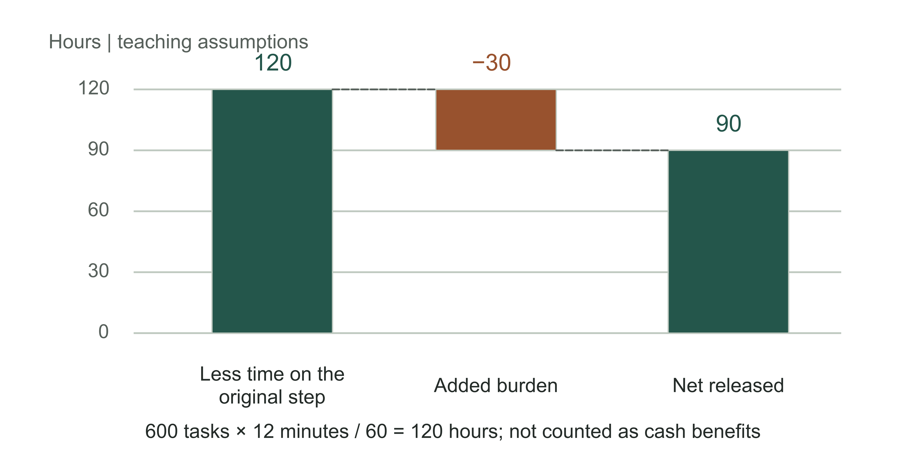

Figure 12-10 | Calculate net hours first, then trace their use. Teaching assumptions. 600×12/60 = 120 hours; 120−30 = 90 hours. Net released hours have neither been multiplied by a wage nor recorded as cash savings.

The 90 hours have several possible destinations. If employees use them to clear a backlog, value appears in more completed tasks and shorter waits. If used for more thorough review, quality records should show the value. If no new work absorbs them, the result may simply be a lighter workload. Each can matter, but requires its own evidence.

Cash savings can be discussed only when overtime, outsourcing, or other spending that would otherwise have been paid actually declines. With salaries still paid as usual, releasing 90 hours does not automatically reduce that month's expenses. Valuing those 90 hours at internal labor cost can support resource allocation, but label the column “value of available labor hours” and keep it separate from cash benefits.

Assume 40 of the 90 hours actually replace external work that otherwise needed purchasing, without moving that procurement elsewhere. At the illustrative rate of renminbi (RMB) 300 per hour, avoided spending is RMB 12,000. The same month adds RMB 5,000 in tool fees and RMB 2,000 in external support. The net cash improvement across these three items is therefore RMB 5,000. Record the other 50 hours' destination separately; do not convert them into cash and add them again.

Table 12-3 | Teaching monthly ledger: separate labor hours, cash, and one-time investment

| Item | Calculation or amount | Column |
|---|---|---|
| Net released hours | 120−30 = 90 hours | Available labor hours |
| Replaced external work | 40×300 = RMB 12,000 | Avoided cash spending |
| Added tools and external support | 5,000+2,000 = RMB 7,000 | Additional cash spending |
| Net amount above for this month | 12,000−7,000 = RMB 5,000 | Monthly cash improvement |
| One-time go-live investment | Assumed RMB 30,000 | Cumulative project investment, reported separately |

RMB 5,000 does not mean the whole project has recovered its investment. If another RMB 30,000 was paid before go-live, the teaching assumption of unchanged monthly net improvement and no other incremental spending requires six months of cumulative improvement to cover that initial outlay. Real projects face seasonality, renewals, insufficient demand, and maintenance changes. This arithmetic is not a payback commitment. Chapter 5 discussed budget assumptions; here, actual monthly records must replace them.

Revenue projects require the same care. Higher sales do not imply an equal increase in cash; examine refunds, collection timing, and additional fulfillment spending for those orders. If released hours are used to serve new orders, do not count all hours as savings while also treating all revenue as additional net benefits. Explain where value was realized so the same resource is not counted twice.

Risk reduction and service quality are sometimes the main reasons to invest. For these projects, state the resources needed for each qualified task, the severe errors that must be avoided, and the acceptable cost of improvement. Without a credible incident probability, do not multiply a hypothetical loss by a subjective probability and present it as realized financial benefits. A project without cash savings can still warrant continuation; approval should rest on verified service improvements and acceptable costs.

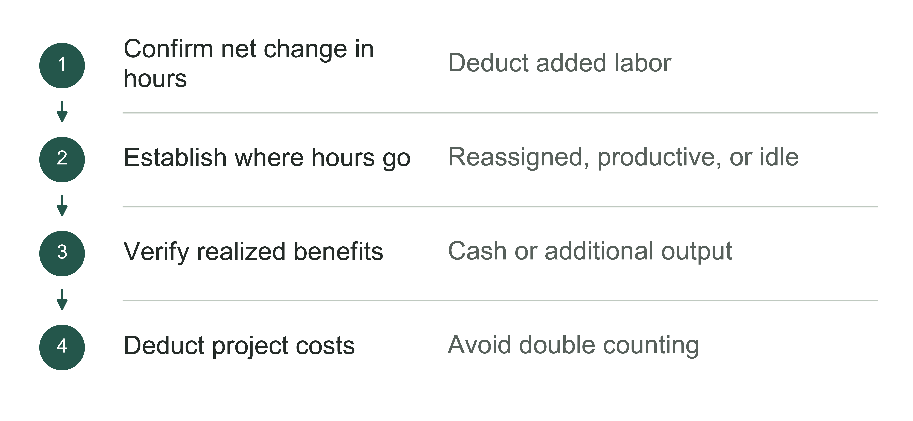

Figure 12-11 | From available labor hours to business accounts. The author's analytical tool; different paths to realized value require different evidence and cannot be added indiscriminately.

## Costs must be traceable to this project

The £458,000 contract price cannot directly stand in for the actual cost of EHCP processing in a particular year. The description also covers research and development, related consulting, and other use cases. Its procurement scope does not match one task's annual statistics.[1] Other payments to the same provider can be allocated to this project only when contract IDs, invoices, service periods, and delivery scope can be matched.

A business can verify costs using a project cost table alongside the general ledger. Record licenses by actual service period and authorized use. Explain the allocation basis for shared platform costs. Link external support to specific tickets and separately record internal hours and their valuation. State the status of obligations already incurred but unpaid, and services prepaid but unused, so payment timing is not treated as cost-incurrence timing.

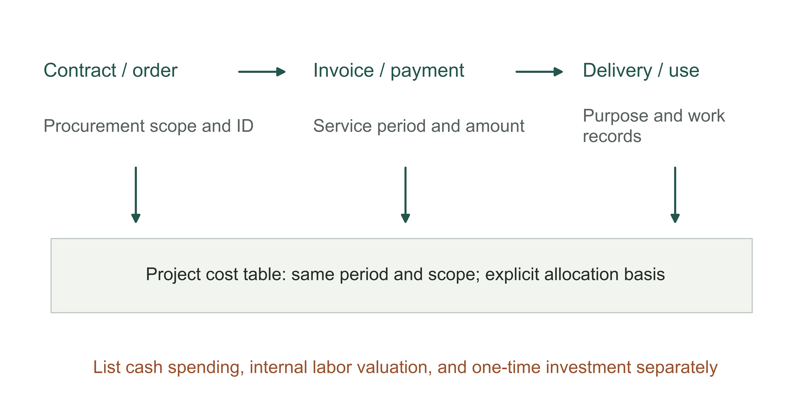

Figure 12-12 | Trace the total to comparable costs. The author's cost-tracing framework. Connections indicate relationships to check; they do not establish that existing North Somerset payments have been reconciled. Retain the allocation basis for shared costs.

Allocation need not pursue false precision. If a platform serves several teams without reliable usage data, explain a temporary allocation by headcount or service scope, then test whether another reasonable method changes the investment conclusion. If both methods show benefits far below costs, arguing over decimal places adds little. If the conclusion depends heavily on allocation, collect usage and support records first.

There are also two different business questions: whether the past investment met expectations, and whether further investment is worthwhile from today. The former requires a full account of startup investment and losses already incurred. The latter compares added costs, avoidable costs, and expected incremental outcomes in the next stage. Money already spent does not establish a reason to continue; failure to recover past investment does not by itself establish that the next stage is uneconomic.

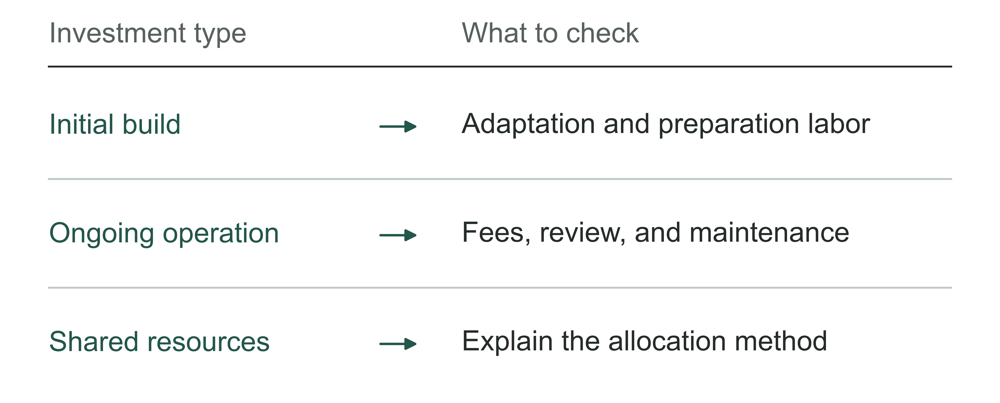

Figure 12-13 | Which costs should be traced to the same project. The author's analytical tool; unclear cost attribution undermines comparability between projects.

## How to decide when evidence is still insufficient

Insufficient evidence does not force an immediate choice between “believe” and “stop.” First identify what is missing and which decision it would change. If time savings are only self-reported, measure a sequence of complete tasks. If released time is confirmed but has no assigned use, the business lead must decide how to use it. If spending genuinely falls but quality deteriorates, first limit use and investigate.

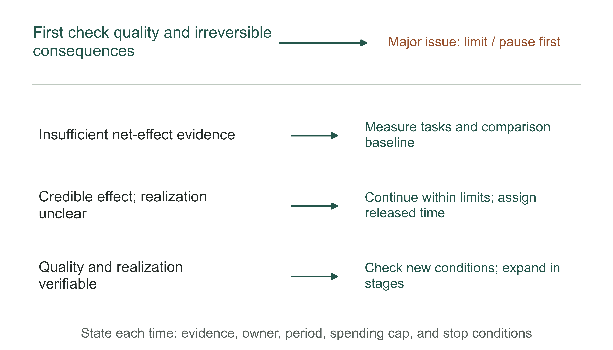

Figure 12-14 | Choose the next step according to the evidence gap. The author's decision framework. Address severe quality issues first. Without a major issue, use the missing evidence to decide on additional measurement, limited continuation, or staged expansion. These are not universal numerical thresholds for all projects.

When continuing validation, specify the observation period, spending limit, and stop conditions. For example, retain only one authorized task category and record every incoming task and final state. The actual receiving role checks quality, and finance verifies avoidable spending. The point is not merely to extend the pilot another month, but to identify which missing evidence will exist when that month ends.

Return to the 600-task teaching ledger and prepare a monthly report, M12-01, to support a continuation decision. To demonstrate verification, further assume no opening unresolved tasks and final acceptance of all 600 tasks meeting the predefined inclusion criteria. Of these, 40 passed through human handling; those 40 were not removed from the denominator. The added 30 hours already include preparation, review, rework, and human-referral burdens. The teaching quality record further assumes that every task underwent the specified review and no agreed severe errors were found. These are drill inputs, not measured client results.

In the drill, finance obtains matching records of canceled external work and new expenses, allowing RMB 12,000 to be recorded as spending avoided by replacing 40 hours of outsourced work. The business lead assigns the remaining 50 hours to an existing backlog and does not count them as cash. Even if these records hold, the report establishes changes only for this round's deployment arrangement. If templates were standardized at the same time and no independent comparison exists, the model cannot receive separate credit.

Table 12-4 | Monthly outcomes and the next-stage decision (completed teaching example)

| Verification item | This month's conclusion | Constraint on the next step |
|---|---|---|
| Task scope and quality | 600 tasks finally accepted, including 40 referred to humans; no severe errors under the teaching assumptions | Continue recording human referrals and unresolved work; validate new scope separately |
| Net hours | 120−30 = 90 hours; 40 replace external work and 50 clear backlog | Separate hours and cash; avoid double valuation |
| Cash and cumulative investment | This month: 12,000−7,000 = RMB 5,000; cumulative balance including startup investment: −RMB 25,000 | Investment not yet recovered; six months is the total payback period only if these simplified assumptions remain unchanged |
| Maintain current scope | Assume comparable demand and replacement of external work continue next month; additional cash capped at RMB 7,000 | Approve 30 days of observation; finance reviews actual costs |
| Expand immediately | New-team quality, task mix, and support costs are unvalidated | Not approved this round; obtain evidence for the new scope first |
| Stop immediately | Restoring external procurement for equivalent work saves RMB 7,000 but adds RMB 12,000 | Under this assumption, stopping costs RMB 5,000 more than maintaining current scope; recalculate if conditions change |

The teaching decision is therefore to run for another 30 days with the original team and task scope, under the business lead's responsibility. Additional cash spending on tools and external support must total no more than RMB 7,000, verified by finance. Record internal review time separately and assign it to specific people. Register task arrivals, acceptance, human referrals, and unfinished states daily. After 30 days, recalculate using external spending actually canceled and all added expenses. Do not treat RMB 5,000 as a benefit already secured for next month. This approval covers only the stated scope, excluding a second team or more complex tasks.

Early review conditions should also be specific. An agreed severe quality error requires pausing the affected scope and business-led takeover. Spending expected to exceed the cap requires additional approval first. If external work does not actually decline or added labor substantially exceeds the estimate, finance recalculates. If the RMB 12,000 external spending can no longer be reduced, do not copy the table's conclusion that “stopping costs more.” Chapter 13 addresses repair and exit; here, we first state which new evidence changes the decision.

A real monthly report must also handle tasks spanning months. M12-01 assumes zero unresolved tasks at both opening and closing; that convenience cannot carry into every month. First reconcile unique task IDs: opening unresolved tasks + new arrivals this period + other transfers in = accepted this period + other closures or transfers out + closing unresolved tasks. Use the same scope and cutoff throughout, assigning each task to one category according to its state at that point. A task closed before the period and reopened during it belongs in other transfers in if not already included in the current cohort. Reopening a task already included changes its state without adding another task. Retain reasons for cancellations and transfers out; they do not count as acceptance. Human referral likewise does not create a new task.

Use a separate teaching record, M12-X1: 10 unresolved tasks at opening, 100 new arrivals, and no other transfers in; 90 accepted this period, of which 10 came from opening work and 80 from new arrivals; 5 canceled and 15 unresolved at closing. The totals reconcile: 10+100 = 90+5+15. Yet “the proportion of new arrivals accepted in the same period” is 80/100, not 90/100. Keep the 5 canceled tasks in the arrival cohort with reasons, instead of excluding them retrospectively to improve the rate. This table explains task destinations; acceptance counts alone cannot calculate hours or cash saved. Record this period's labor and spending on tasks spanning periods separately when they occur.

Report M12-01 can be entered in Worksheet 12-1, with its calculations in Worksheet 12-2. It separates “what was observed this month,” “what is assumed,” and “what is permitted next month.” This avoids mechanically stopping before payback or immediately expanding because the first month has positive cash.

Expansion requires checking whether conditions still hold. Can an experienced group's results apply to ordinary employees? Can standard-task results apply to complex tasks? Will results persist after dedicated on-site support leaves? Each needs further observation. Retain staged expansion, periodic review, and exit arrangements. Expand a work method with stated conditions, instead of copying the previous group's benefit percentage.

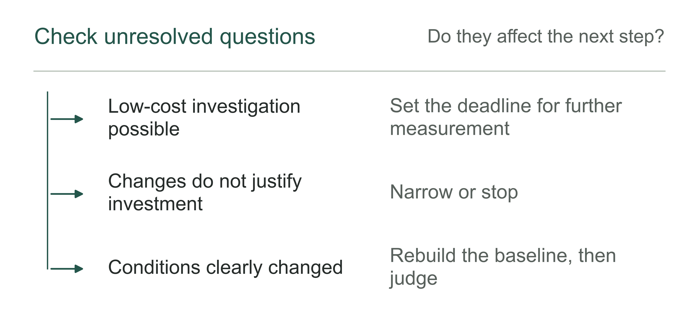

Figure 12-15 | Resource decisions while outcomes remain uncertain. The author's analytical tool; each unresolved question should have an explicit investigation budget and deadline.

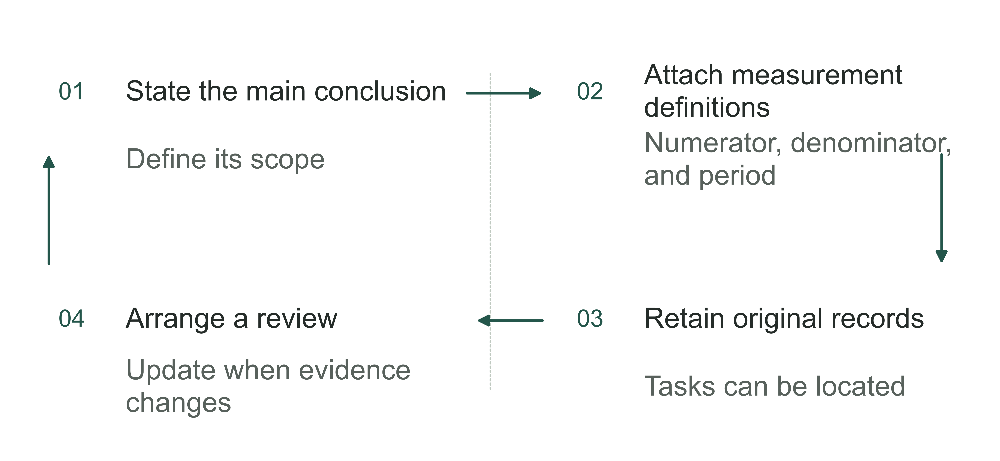

Figure 12-16 | Keep outcome reports reproducible. The author's analytical tool; review may revise conclusions, while old versions remain traceable.

Returning to North Somerset, what can currently be confirmed is that the buyer disclosed tool delivery and time savings, and official annual data show improved service timeliness. The available records cannot yet answer how much AI alone contributed, the quality of AI-enabled work, or the project's actual net cash change. Further investigation should seek those missing records.

A business owner's final outcome report can begin with one reviewable statement: for which task, period, and quality conditions, against which baseline, what change was observed; how much may come from deployment, how much has been realized, and what scope is approved next. The chapter worksheet brings these elements onto one page. For fields that cannot yet be completed, assign someone to investigate before entering a success claim.

## Notes and sources

[1] North Somerset Council, [UK7 contract details notice 2025/S000-061149](https://www.find-tender.service.gov.uk/Notice/061149-2025), October 1, 2025, pp. 1–4. Official site access was restricted on September 7, 2026; checked against a previously saved complete five-page PDF. Time savings are the buyer's statement, without disclosed samples or independent attribution. The signing date is not the date AI was first used.

[2] Department for Education, [Timeliness—assessment and EHC plans issued](https://explore-education-statistics.service.gov.uk/data-catalogue/data-set/90d7c9d3-d811-46f1-ae61-39ea674d4654), annual data published June 25, 2026 and updated June 30. Filters select North Somerset and All EHC plans, with both overall fields also restricted; the downloaded CSV matches the existing archive. This chapter shows the 2023–2025 window, not continuous monotonic improvement since 2019.

[3] North Somerset, SEND Newsletter, May 2025, p. 5; [newsletter](https://n-somerset.gov.uk/sites/default/files/2025-05/SEND%20Newsletter%20May%202025.pdf). Figures in the local point-in-time material differ from later annual data. The reasons remain unresolved, so they are not combined for year-on-year comparisons.

[4] HM Treasury, Magenta Book Annex A, A2.4; [evaluation methods](https://www.gov.uk/government/publications/the-magenta-book/magenta-book-annex-a-analytical-methods-for-use-within-an-evaluation-html). Checked 2026-09-07. Used only to explain methodological conditions. The four means, labor hours, and cash ledger in this chapter are separate teaching assumptions and do not represent actual client results.

[5] DfE, SEND Tribunal appeal rate, calendar years 2024 and 2025; [original CSV](https://content.explore-education-statistics.service.gov.uk/api/releases/fcf02cd2-8330-4a2c-87e7-76b684391c45/files/330e4c5f-158a-41d5-97aa-76204facc80c). Published rates and denominators are used. The table notes disclose methodological adjustments and differences in extraction timing; the figures are not reconstructed as the appeal probability for new plans, nor used to attribute causality to AI.

[6] North Somerset, Quality Assurance Framework, pp. 3 and 6; [quality framework](https://n-somerset.gov.uk/sites/default/files/2025-02/North%20Somerset%20quality%20assurance%20framework.pdf). This is a general governance design, not the result of a dedicated AI audit.
