# Chapter 13 Facing failure: when to repair, pause, or exit

Why might a revised report still fail to give a client enough confidence to accept it?

On September 30, 2025, Australia's Department of Employment and Workplace Relations (DEWR) confirmed in a letter to Deloitte that it had received the revised report, while stating that further quality assurance (QA) checks were needed before acceptance. The two parties were also arranging repayment of the final installment. The department had previously requested a refund of AUD 97,587.11, including tax.[2] The report had been revised, but whether its quality problems had been resolved and how the payment would be handled remained separate questions.

The case concerned an assurance review of the Targeted Compliance Framework (TCF), which manages employment services participants' compliance with their obligations. The provider used generative AI to prepare summaries and citations. Errors were not adequately detected and entered the delivered report.[1] The available material does not say that the participants were forward deployed engineers (FDEs), but any AI implementation team may face the same problem: when a deliverable is wrong, how can the team prevent further impact while retaining the parts that have been verified and remain useful?

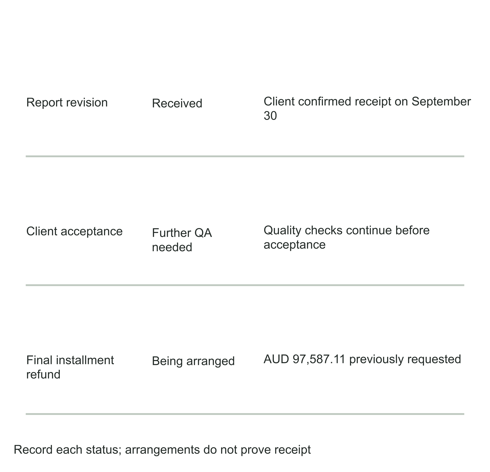

Figure 13-1 | Revision, acceptance, and refunds each require evidence. Compiled from correspondence between DEWR and Deloitte.[2] The figure shows only verifiable states. Arranging a refund is not evidence that the money has been received, and receiving a revised draft is not final acceptance.

Chapter 12 discussed how to verify outcomes. This chapter considers what to do when those outcomes are unsatisfactory: identify what went wrong, contain the impact, and then decide whether to repair the problem, how much time and money to spend, and when to exit. A proposal presented to the business owner should specify an accountable person, a deadline, costs, and a way to verify the result.

## How errors passed through existing review

Table 13-1 | The publicly documented response after errors were found in the report, based on the explanatory letter and correspondence[1][2]

| Date (2025) | Verifiable event | Status |
|---|---|---|
| July 4 | Date of the original report listed in the explanatory letter | Original report date confirmed |
| August 22 | Media raised questions about four sources | Initial leads identified; further investigation |
| Early September | Client requested corrections and repayment of the final installment | Remediation and refund requested |
| September 26 | Provider submitted a revision statement | Provider's statement of revision and review |
| September 30 | Client continued QA and contacted the provider about arranging the refund | Insufficient grounds to regard the matter as closed |
| October 14 | Acknowledgment that required review and oversight had not been followed | Subsequent explanation of control execution |

In its September 2, 2025 explanatory letter, Deloitte described the code analysis and report publication work separately. The toolchain for the former was deployed in the client's Microsoft Azure cloud environment with the client's agreement. For the latter, two AI assistance tools, MyAssist and ChatGPT, were also used to further condense existing summaries of court proceedings and to complete and format citations. The letter stated that staff had received responsible AI training, outputs had been reviewed, and some errors had been corrected, although others had been missed.[1]

It is easy to read this and conclude, “All the controls were in place, and AI was still unreliable.” That conclusion moves too quickly. The record establishes that some review occurred. It does not establish that the review covered everything that needed checking or that the methods were sufficient to detect these errors. In an October 14 apology letter to the client, the provider subsequently acknowledged that the required review and oversight processes had not been followed.[2] Taken together, the two explanations identify a more specific problem: someone having checked the work is not equivalent to the required checks having been fully carried out.

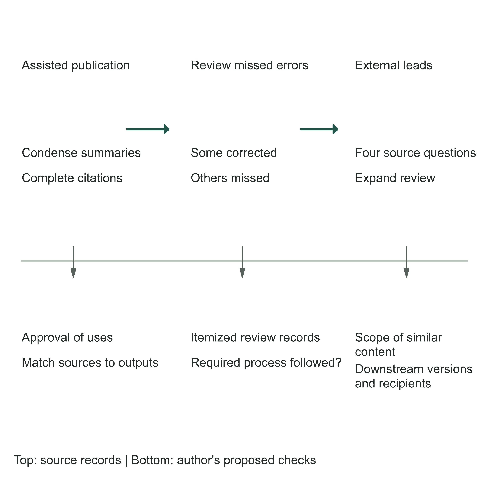

Figure 13-2 | From assisted editing to a defective deliverable. The upper panel reconstructs the uses and discovery process from the provider's explanation; the lower panel shows control points the author recommends checking.[1] The lower panel is not a record of actions already implemented in that project.

When generative AI handles citations, its output may combine real names, familiar topics, and neatly formatted bibliographic details. Looking only at style and formatting may not reveal the problem. Review must return to the corresponding source: does the publication exist, do the author, title, and year match, and does the cited passage actually support the claim in the text? These are three progressively deeper tasks. Finding a real book does not replace checking whether that book contains the relevant argument.

The same applies to summaries. A summary may invent no new proper nouns yet omit a condition that determines the scope of application, or compress a party's argument into a finding by the court. The reviewer needs to compare the summary with the original passage side by side, checking the relationships among the actors, actions, conditions, and conclusions. Asking the same model to judge whether it summarized the original accurately may provide leads for review, but it does not automatically supply independent evidence.

Deployment in a customer controlled environment has a clear purpose here: to define where data is stored, accessed, and processed. It cannot, by itself, guarantee that every citation is genuine. Similarly, training establishes that staff received guidance; it cannot replace a checking record for a specific deliverable. When reviewing an incident analysis, a business owner can leave statements such as “We used compliant tools” and “All employees attended training” in the background section, then ask which checks addressed this particular error, who performed them, and what evidence they retained.

The team should also check whether approval covered the actual uses. A client's agreement to a code analysis toolchain cannot be interpreted as automatic agreement to other uses for summarizing, editing, and publication. DEWR's subsequent correspondence asked the provider for further information about those tools and uses.[2] For an implementation team, approval records should at least answer: what material is processed, what operation is performed, where the output enters the workflow, and who accepts it? Recording only the software name can obscure the boundary as its uses gradually expand.

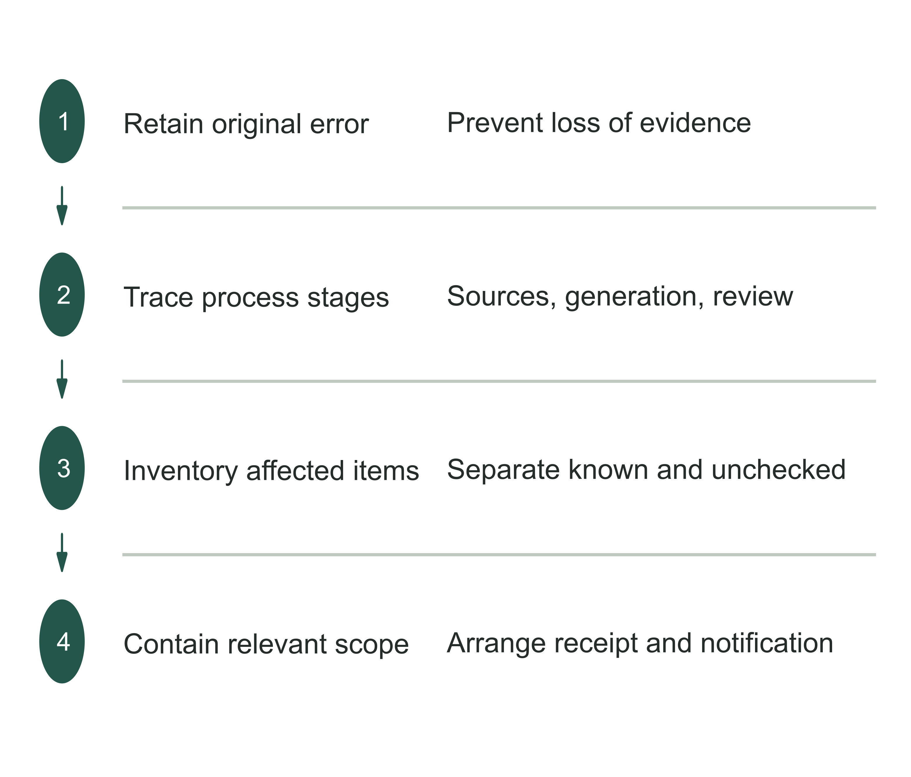

Figure 13-3 | From discovering an error to containing its impact. The author's analytical tool: establish the known impact before declaring everything valid or invalid.

## Expand the investigation from one error without declaring everything invalid

The provider's explanatory letter records that media raised questions about four academic sources on August 22. Further investigation identified inaccurate outputs caused by generative AI, and an expanded review then found additional errors.[1] Four was the starting point of the investigation, not the total number of errors in the report. This sequence suggests a useful response: treat confirmed errors as leads for finding other problems of the same kind.

An expanded investigation needs a boundary. If the same tool handled the citations throughout a chapter, correcting only the four that were identified would clearly be insufficient. If a data table came from a separate, traceable process, however, its contents should not be declared entirely invalid simply because it appears in the same report. First define the potentially affected set by shared generation conditions, then establish which of its contents were used, copied, or passed on.

Trace in two directions from the location of the error. Upstream, find the original material, prompts, tool version, operator, and review records. Downstream, find the delivered versions, recipients, and decisions that relied on the content. Upstream tracing helps identify the cause; downstream tracing helps determine whom to notify and what to remedy. A team that does only the former may produce a technical incident report while overlooking people who have already used the old report.

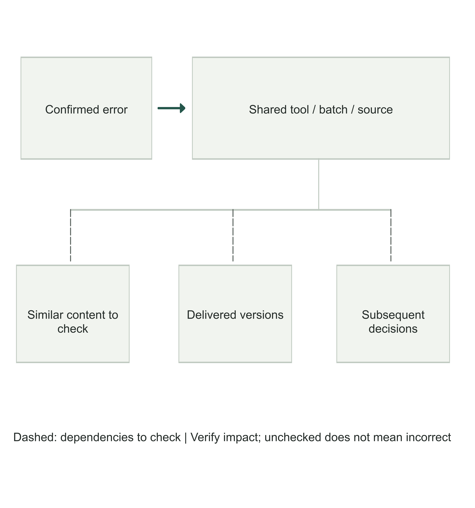

Figure 13-4 | Define the investigation through shared sources and downstream uses. A schematic of the author's method. Dashed lines represent dependencies to investigate; solid lines represent identified relationships. A connection does not establish that every connected item is already wrong.

Investigation records should distinguish three states: confirmed error, similar content awaiting review, and checked with no problem of this kind found. “No error found yet” needs to specify what was checked; it cannot simply become “No impact.” If a complete review cannot be finished immediately, the team can stop further distribution of the suspect version, retain the parts already verified, and tell users which conclusions should not be relied on for the time being.

Containment must account for what the business can withstand. Pausing publication of a report has a different impact from shutting down an entire business system. Disabling automatic submission while retaining human drafting may be enough to contain the present risk. If the error is affecting irreversible decisions, waiting for a complete root cause report before acting would be too late. Restricting the specific high risk operation first, then establishing the scope, is a response to incomplete information; it does not require prior proof that the entire system has failed.

Retain original outputs and versions during the response. Overwriting the erroneous file may make the directory look tidy, but it can break the trail needed for later verification. Follow existing project requirements for which records to retain, how long to keep them, and who can access them; do not spread sensitive material further for the sake of the investigation. A correction for users also needs to reach the recipients of the old version and explain the effects of the change, rather than simply send a new attachment without context.

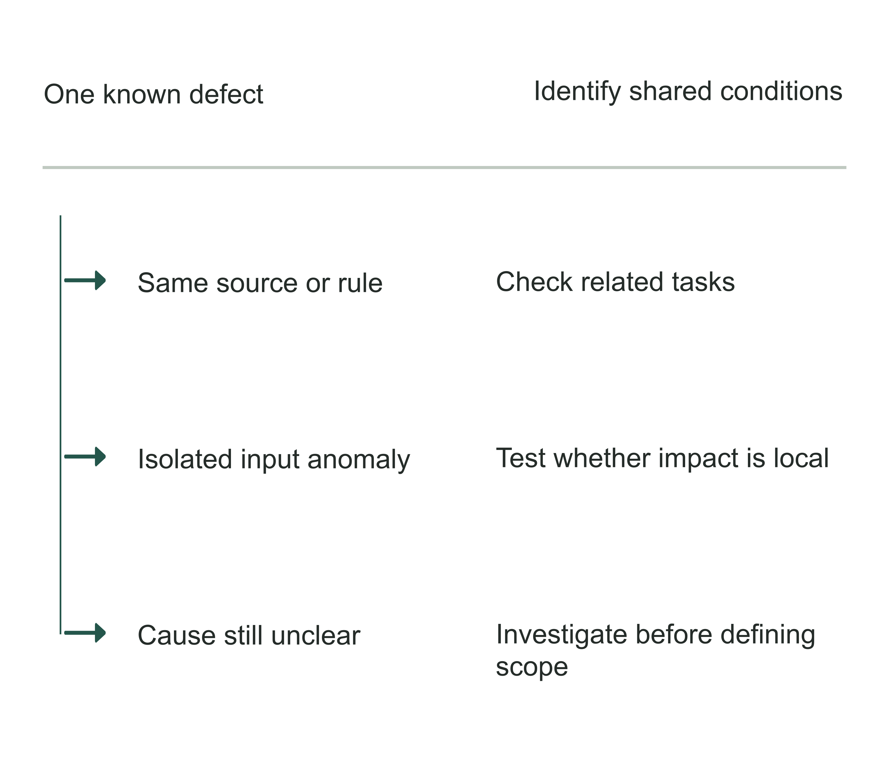

Figure 13-5 | Grounds for expanding the investigation. The author's analytical tool: adjust the scope as evidence of shared causes develops.

Table 13-2 | Fields for an inventory of affected tasks (the author's checking tool)

| Field | Why retain it |
|---|---|
| Task and version | Identify shared triggering conditions |
| Stage reached | Distinguish advice, system writes, and downstream actions |
| Current recipient | Arrange follow-up handling so the task is not left unassigned |
| Known facts and open questions | Avoid expanding or narrowing the impact prematurely |

## Before pausing, specify what is being paused

“A project did not go live on time” and “A model has produced errors” call for different responses. A joint University of Colorado announcement on March 19, 2026 postponed student access to ChatGPT Edu until August 14 while retaining the original March 31 schedule for faculty and staff. The announcement referred to faculty concerns about the learning environment and classroom autonomy.[3] This supports a governance arrangement adjusted by user group. It should not be described as a technical failure, nor as a delay affecting all users.

Businesses can also respond by work scope. A finance department might continue using AI to organize internal material while pausing external submissions. A customer service system could continue retrieval while pausing automatic commitments. Headquarters could retain workflows with completed authorization while deferring scenarios needing confirmation from local departments. These are response examples proposed by the author. In each case, the pause must be defined in terms of specific functions, people, and permissions.

Table 13-3 | Identify what has failed before choosing what to investigate, as recommended by the author

| Observed problem | What to check first | Possible first step | What it does not directly establish |
|---|---|---|---|
| Incorrect output | Original source, version, downstream use | Restrict affected outputs and expand review | All results are invalid |
| Review missed errors | Checks, evidence, responsible reviewer | Repeat the checks and repair the review process | Training will solve the problem |
| Go-live delayed | User group and outstanding approval | Adjust scope and approval arrangements | The technology has failed |
| Employees use it very little over an extended period | Real tasks, alternative workflows, added burden | Investigate task fit and work arrangements | Employees refuse to change |
| Benefits unproven | Baseline, denominator, costs, observation period | Fill measurement gaps within a deadline and control investment | It has been proved to have no value |

Clarifying the problem makes it possible to decide where the next money and staff time should go. If authorization is missing, more model testing may not help. If slow review keeps employees from using the system, further training may merely introduce more people to an awkward workflow. The team should identify the obstacle that most urgently needs resolving and explain what must be established or repaired before continuing is justified.

Several problems may coexist. Unstable output quality may increase the review burden and further discourage use; low use may then reduce the task sample available for evaluation. There is no need to argue over a single category. Address the parts that could increase harm first, then track the other conditions. The classification table organizes investigation and responsibility; it does not assign a permanent label to a complex project.

A pause also needs a review date and an accountable person. An indefinite “wait and see” can allow costs to continue while the business department assumes the project has stopped. The decision should state which capabilities remain, which costs continue, who will complete further checks, and who will decide whether to resume or exit when the period ends. If resumption conditions cannot yet be specified, at least identify which uncertainty the next review must resolve.

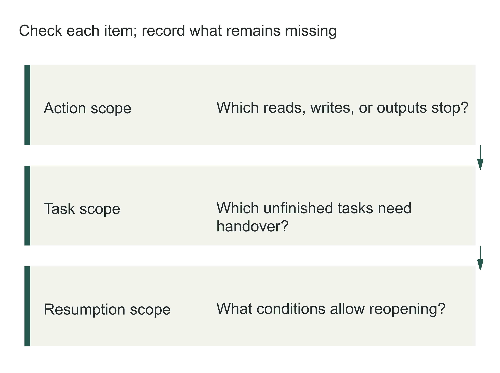

Figure 13-6 | What a pause decision needs to specify. The author's analytical tool: a pause needs more than an undefined status label.

## Judge whether repair is worthwhile by comparing choices from today onward

Money already spent deserves review, but does not automatically justify spending more. A repair decision should put the remaining options on the same future cost schedule: continue within limits, pause and repair, return to human processing, or replace the solution. The paths must serve comparable workloads and quality requirements; otherwise, a lower cost may simply reflect less work being done.

The following is an illustrative calculation in renminbi (RMB), not the costs of the Deloitte project. Assume that the same set of business tasks must be handled over the next 12 weeks. Returning to human processing costs RMB 120,000. The repair path requires RMB 60,000 in one-time repair costs, RMB 30,000 for subsequent operation, and RMB 10,000 reserved to prepare for exit at the end of the 12 weeks, totaling RMB 100,000. The RMB 200,000 already invested is recorded separately and is not added again to one particular option.

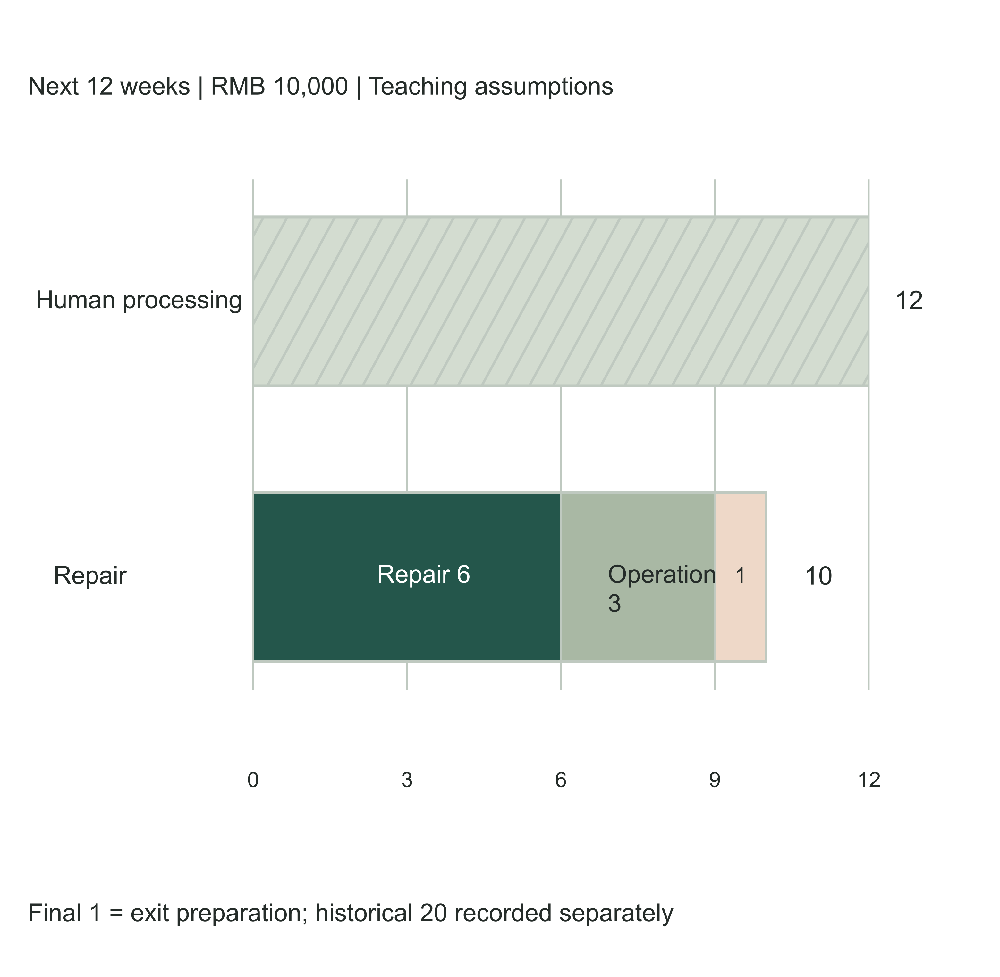

Figure 13-7 | Compare repair and human processing over the same period. Teaching assumptions: the next 12 weeks, equivalent workload and quality targets; amounts in RMB. The repair path is 60,000 + 30,000 + 10,000 = 100,000. The historical RMB 200,000 is excluded from the future spending bars. Only the listed costs are compared; this is not a complete investment valuation.

Under these assumptions, the repair path's listed costs are RMB 20,000 lower. That is a modest cushion: if repairs cost an additional RMB 30,000, the total becomes RMB 130,000, higher than the human processing path. More fundamentally, can the team complete the repair before the business work is due? Who handles tasks during the repair? If those burdens are excluded from the RMB 60,000 estimate, the table understates costs and must be revised.

The cost comparison therefore needs an explanation of its estimates. Which work does the RMB 60,000 cover, who estimated it, and are the time and resources needed for verification available? Does the RMB 30,000 for operation include human review and human handling after failures? Is the RMB 10,000 reserve sufficient for handover? If it is only a provisional budget, label it as awaiting validation. Precise decimals should not create an impression of certainty.

Table 13-4 | How repair overruns change the choice in the same illustrative calculation

| Additional repair spending | Repair path total | Human processing total | Comparison of listed costs only |
|---|---:|---:|---|
| RMB 0 | RMB 100,000 | RMB 120,000 | Repair costs RMB 20,000 less |
| RMB 20,000 | RMB 120,000 | RMB 120,000 | Equal |
| RMB 30,000 | RMB 130,000 | RMB 120,000 | Repair costs RMB 10,000 more |

The table invents no probabilities for the scenarios and assigns no arbitrary amount to reputational damage. Consequences that cannot be reliably priced should be stated separately as business constraints: no further distribution of incorrect content, no missed service deadline, no loss of essential records, and so on. A path that cannot meet those requirements should not be approved on the basis of lower nominal costs.

The RMB 200,000 already spent still belongs in the overall project accounts and review. It helps the business identify flaws in the original choice, omitted cost estimates, and changes needed for similar projects. But when comparing choices from today onward, the argument “We have already invested RMB 200,000; another RMB 60,000 will save it” must not obscure other costs or the possibility of failure. Conversely, assets already created that remain usable should be treated according to their actual use in each path. Unpaid contractual obligations that can still be avoided should not all be classified as sunk costs.

Refunds likewise need conservative recording. A provider's willingness to discuss repayment may improve the negotiating position, but it cannot directly offset the repair budget. Record the request, the response, the arrangements, and actual receipt separately; enter them in financial records on the appropriate basis only when the corresponding evidence exists. The chapter's illustrative calculation assumes no refund income, avoiding an unconfirmed receipt that would make repair appear cheaper.

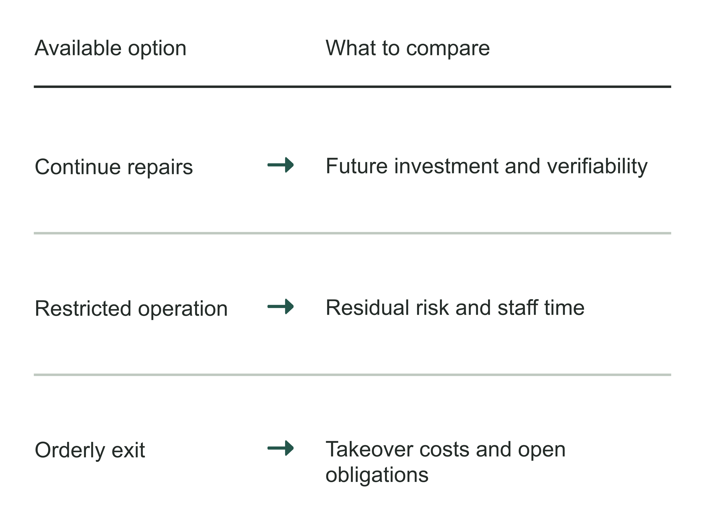

Figure 13-8 | Compare three options from today onward. The author's analytical tool: record costs already incurred in the historical accounts; they do not replace comparison of future choices.

Table 13-5 | Working comparison of future options (the author's checking tool)

| Option | Additional investment | Conditions that must be verified |
|---|---|---|
| Repair and resume | Resources for this repair and revalidation | Defects eliminated and normal tasks still completed |
| Continue within limits | Labor for controls and human takeover | Risk contained and staff have time to handle the work |
| Orderly exit | Resources for takeover and outstanding obligations | Unfinished tasks and materials have recipients who will take them over |

Turn these choices into teaching decision D13-01: first pause the defective external sending function, with the business supervisor responsible for unfinished tasks. Within 10 working days, the delivery lead submits repaired version v0.2 and retest records for both the original failed tasks and new tasks. Cash spending on repair and validation is capped at RMB 60,000. Operation and human support for the next 12 weeks are budgeted at RMB 30,000, with RMB 10,000 reserved for exit handover. Continue checking against the RMB 100,000 total.

On the tenth working day, the business and technical leads each confirm whether the limited scope can resume. If validation fails, humans continue handling the work; the repair period is not automatically extended because RMB 200,000 has already been spent. If estimated repair costs exceed RMB 60,000, compare the revised path with the RMB 120,000 human option before deciding whether to add funds. Retain old outputs, affected tasks, and the results of their handling. After the technical version resumes, the business supervisor must also establish whether the effects of old outputs have been addressed, rather than merely sign “Resumption complete.”

## Resumption requires proof of two things

Correcting known errors is necessary for resumption. The team must also verify that the process that allowed those errors through has changed. If only the text is corrected and the review method remains the same, the next similar deliverable may repeat the failure. If only the process is changed without tracing content already distributed, users may still rely on the erroneous old material.

In the Deloitte case, the provider submitted revisions on September 26 and maintained the report's conclusions, while the client still stated on September 30 that further checks were needed before acceptance.[2] The provider's revision statement and the client's acceptance decision are separate judgments made by different parties. The client has grounds to request material sufficient to support acceptance; the provider needs to explain what changed, why, and how the changes affect other conclusions.

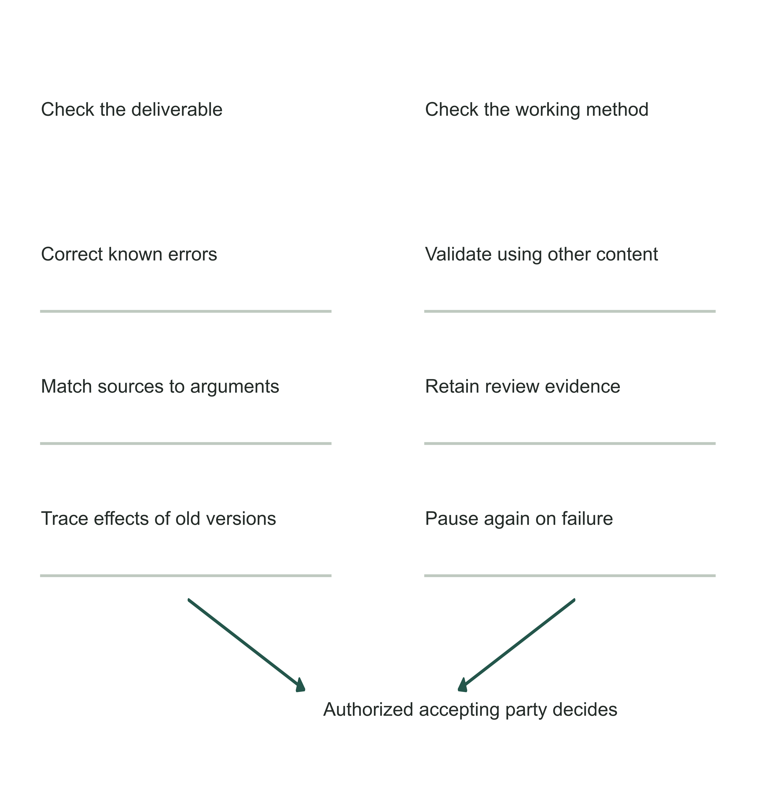

Figure 13-9 | Validate known errors and the review process separately. The author's proposed division of resumption checks. The left path checks the deliverable; the right checks the working method. The authorized accepting party makes the final decision. This is not a reconstruction of the client's actual acceptance procedure.

For citation problems, deliverable checks may include a correction list, links to corresponding sources, and a fresh reading of affected arguments. Checking the working method requires other content that was not used in the repair, to observe whether the new process detects problems and retains valid supporting evidence. If the original team still participates in review, distinguish production, checking, and acceptance responsibilities clearly and retain arrangements for cross-checks. Adding “independent” to the report title is insufficient.

Independence here begins with a judgment that is not locked to the original conclusion. A capable person who did not produce the work can check critical parts, or external reviewers can be engaged according to risk. External status alone is not sufficient: what material did they receive, and what methods did they use? One review in the case was led by the provider's chief risk officer. It should not be rewritten as verification by an external third party.[2]

Specify resumption conditions before retesting where possible. For example, identify which deliverables must be checked item by item against originals, which failures trigger another pause, and which set of real tasks needs observation. Set these conditions according to business risk, rather than applying a generic percentage accuracy threshold. A few errors concentrated in intolerable categories can make resumption of the relevant function unacceptable, however good the overall average.

Resumption can also proceed in stages: validate within a controlled scope, then open lower risk operations while retaining human takeover and monitoring. Decide at the next observation point whether to expand. Each step should state its scope and stop conditions. If validation continues to fail, the original passing criteria cannot be rewritten indefinitely until the project barely qualifies. New facts may justify new criteria, but the reasons for changing them and the accepting person must be recorded.

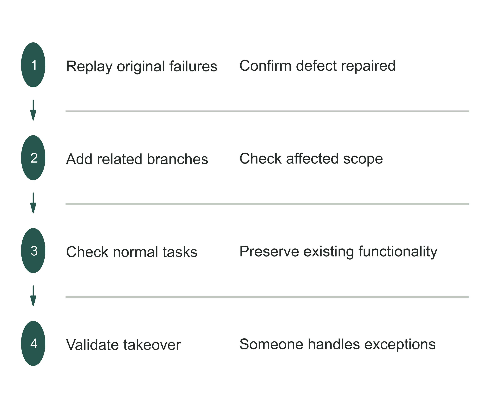

Figure 13-10 | Two checks before resuming operation. The author's analytical tool: repairing one sample and resuming the overall operation are different judgments.

## Exit has deliverables too

Some problems can be repaired but are not worth repairing further under the present time and cost constraints. Missing the period when the business needed the solution, being unable to obtain necessary data, or facing an ongoing burden greater than the alternative may make exit reasonable. These judgments require project evidence; they do not mean AI has no value elsewhere.

The exit decision should identify which project or function stops, who takes over the business work, and which obligations remain. Chapter 7 discussed agreeing exit arrangements in advance in the contract. At execution, establish which actions those arrangements have produced. Sending a termination notice, completing handover, revoking access, and settling costs cannot share one “Ended” status.

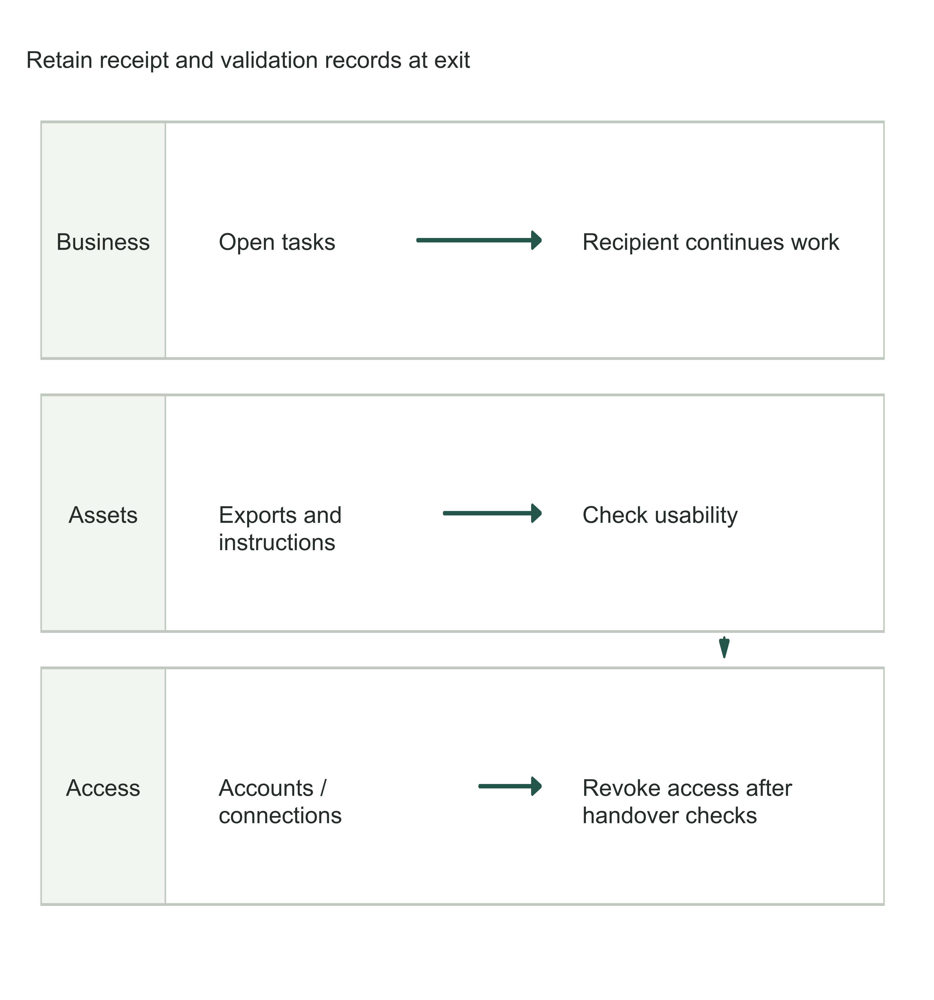

Figure 13-11 | Hand over business work, assets, and access separately at exit. An exit handover process designed by the author. Confirm receipt and business continuity before completing the corresponding access changes. The specific sequence depends on the contract, record retention, and system dependencies.

Business handover begins with open tasks. Which have been delivered but not accepted, which need additional work, and which require user notification? The receiving party must be able to distinguish these states and obtain the materials needed to continue. A folder labeled “Data exported” is not a usable handover by itself. Check the format, field definitions, versions, and necessary links to sources as well.

Technical exit requires itemized handling of accounts, access tokens, connections, scheduled tasks, and external dependencies. An access token is a credential used by a system to verify identity or access permissions. An unused interface does not establish that background calls have stopped. Coordinate access revocation with handover so the sole export channel is not closed too early. The handling record should identify who receives and verifies the handover, which access remains, and why. Retain and delete data under the requirements already applicable; “Delete everything” is not a substitute for completion.

At exit, inventory costs and retainable work separately. The cost list should show what is unpaid, disputed, refunded, and still continuing. The work inventory should identify interfaces, process documentation, testing material, and lessons that can lawfully remain in use. They may be useful later, but anticipated reuse value cannot be recorded as benefits already achieved without subsequent verification.

For a business owner, the most useful evidence for exit acceptance is that the recipient can continue the work, known problems have an assigned destination, and someone is responsible for remaining costs and access. A signature saying “Project closed” cannot answer those questions. The pilot retirement discussed in Chapter 1 also reminds us that stopping one application should not be interpreted as an entire institution abandoning AI.

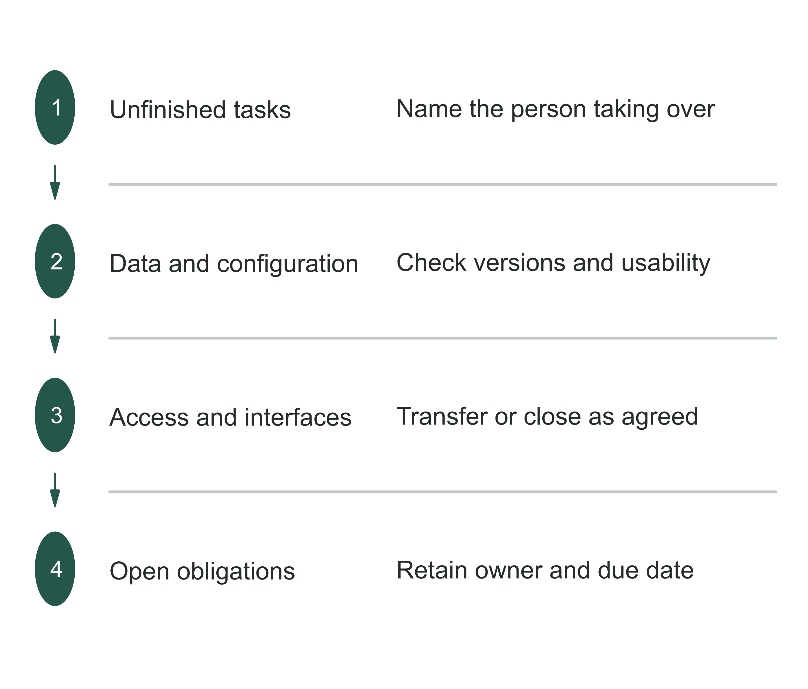

Figure 13-12 | What to hand over first at exit. The author's analytical tool: exit completion rests on actual takeover and arrangements for obligations.

## Let one failure change the next decision

Incident reviews often end with “Strengthen training and improve processes.” At the next budget meeting, those words offer little help in recognizing the same problem. A more useful ending specifies how a concrete condition has changed: which deliverables must now include links to original sources, which changes of use need renewed confirmation, and who may pause external distribution under which conditions.

At portfolio level, check whether errors could recur across projects. If several projects share the same citation handling step, the present problem warrants corresponding checks. If they merely share an industry label, that does not establish the same defect in other projects. Shared tools, data, processes, or responsibility arrangements should justify broader management action, rather than general optimism or pessimism about AI.

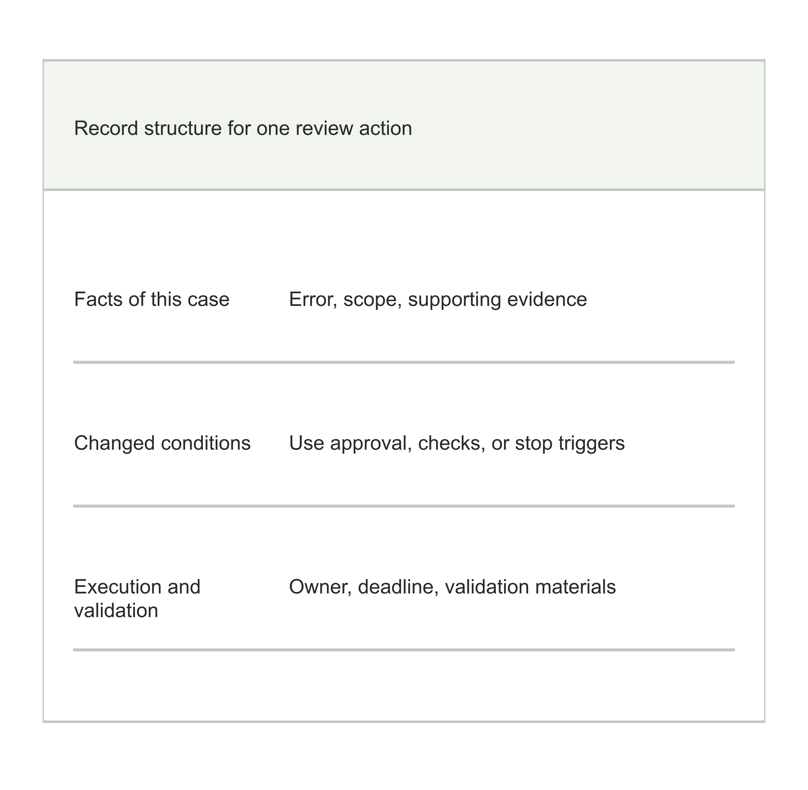

Figure 13-13 | Turn review findings into conditions that can be checked next time. An incident review record designed by the author. Separate facts of this case, grounds for judgment, and follow-up actions. An item without an evidence identifier remains a task to complete.

When managing several projects, also consider who is affected by further waiting. Projects may share engineers and key business staff; two more weeks of repairs on one project may delay another project's testing. An additional investment proposal should therefore specify whose time it consumes and which work is deferred, as well as its costs. If an amount cannot yet be calculated, list the affected tasks and dates first.

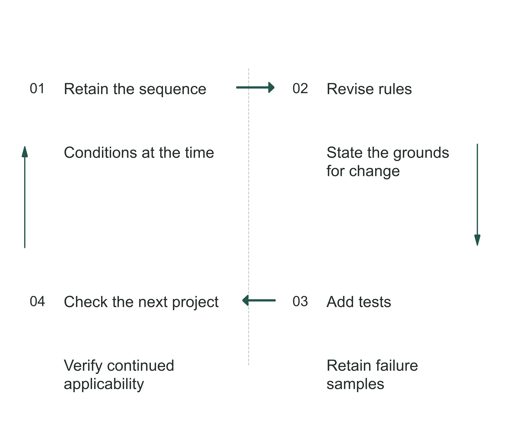

Figure 13-14 | Bring failure into the next decision. The author's analytical tool: review outputs should change something specific in rules, testing, or responsibility.

Table 13-6 | Where review findings should go (the author's checking tool)

| Finding | Formal output to change |
|---|---|
| Incorrect material or rule | Material version, applicable conditions, approval record |
| A branch missing from testing | Regression samples and judgment criteria |
| Incomplete handover | Acceptance criteria, exercises, escalation path |
| Support omitted from budget | Ongoing costs and staff arrangements |

The end-of-chapter worksheet supports a specific response discussion. Record confirmed facts and affected scope first, compare feasible paths, and then state the decision, spending cap, review date, and accepting person. Do not choose “Continue” or “Exit” first and work backward to collect supporting material. Nor must every uncertainty be eliminated before interim action: contain risks that cannot be allowed to grow, and continue checking the remaining questions within the agreed time.

After a project produces errors, the business owner most needs to see whether the team can explain precisely what is wrong, what remains unknown, and how the next step will be tested. Repair, pause, and exit can each be appropriate. Turning every path into checkable responsibilities and deliverables allows a failure to change subsequent investment. The next chapter discusses how to transfer verified practices to other people and use them in the next project.

## Notes and sources

[1] Deloitte, explanatory letter to the Australian Department of Finance, September 2, 2025, FOI 25-26-084 Document 1, pp. 2–3. Approval of code analysis, publication uses, training, and partial review are statements by the provider. [Official publicly released PDF](https://www.finance.gov.au/sites/default/files/foi-25-26-084-document-1.pdf).

[2] DEWR and Deloitte, correspondence on the TCF Assurance Review, parliamentary public PDF, 11 pages, especially pp. 6–11. The date on the refund request letter differs by one day from the directory date, so the text uses “early September.” The correspondence checked cannot, on its own, establish receipt of the refund, final acceptance, or termination of the contract. The original refund hearing record has not yet been obtained in full; neither an actual receipt date nor the refund as a proportion of the contract amount is used. [Parliamentary correspondence PDF](https://www.aph.gov.au/-/media/Estimates/eet/supp2526/TCF_Assurance_Review_-_correspondence_between_Deloitte_and_DEWR.pdf).

[3] CU President and campus Chancellors, “Update on planned ChatGPT Edu launch,” March 19, 2026. Joint university announcement. It records the arrangements for different user groups at that time, not evidence of actual go-live outcomes. [University announcement](https://www.cuanschutz.edu/chancellor/messages/communiques/update-on-planned-chatgpt-edu-launch-3-19-26).

The methods, illustrative calculation, and tools in this chapter were designed by the author. They do not represent Deloitte's or the University of Colorado's actual internal operations or financial results, or legal advice for a particular jurisdiction. Sources were checked as of September 7, 2026; the material cited in note 2 was checked against valid originals retained earlier.
