# Chapter 14 Replicating capability: give the next delivery a head start

The delivery folder contains code, operating instructions, test results, and a video of a successful run from start to finish. A second team installs the system according to the instructions. Yet the very first new submission produces an incorrect list of missing documents.

The following fictional repair intake exercise tests how delivery capability transfers. Team A originally built a document checking component for company-operated service site A. It reads applications and attachments, identifies the documents required for intake, and drafts an internal list of missing documents for an intake clerk to confirm. It does not diagnose equipment, decide warranty eligibility, or automatically email customers. Team B now wants to use it at channel service site B for work at the same level. Assume that this intake for a repeat repair requires documents confirming completion of the previous repair, and both sites must check this.

Documents at both sites contain a “Date signed for” field. Site A's form uses it for the customer's acknowledgment of completed repairs; site B's logistics form records the equipment's arrival at the warehouse. Team B retains the old field mapping. The component then treats a warehouse receipt as proof of repair completion and omits documents that actually need to be supplied. The file was read and the date copied correctly, but the system misunderstood the business event represented by that date.

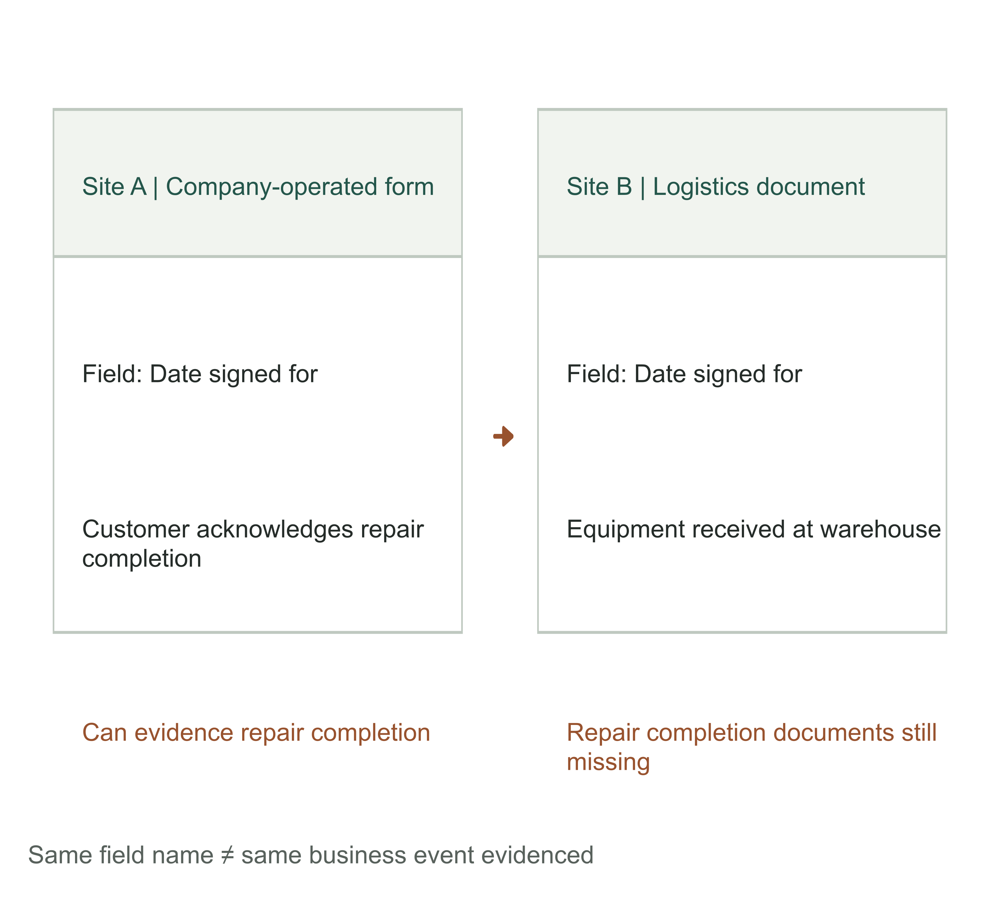

Figure 14-1 | The work behind the same field name has changed. A fictional teaching scenario. The same field name refers to different events; retaining the old mapping changes the document checking conclusion. The figure does not describe a real company's repair or warranty rules.

By the end of Chapter 13, we knew that a project should leave usable work and lessons with conditions attached. This chapter takes the next step: can those outputs still support delivery when the users and working conditions change? The business owner needs to decide where the next project can pick up the work and which tasks must be done again.

## Does a complete delivery folder mean the next team can use it?

Team B's problem cannot be solved by recording another operating video. A video can demonstrate the sequence of clicks without explaining why site A treats a receipt field as completion evidence. The original developer may have known that background for so long that they never recognized it as an input condition. A relationship obvious to its creator can be precisely what the receiving team most needs explained.

This book uses “delivery assets” for components, test methods, configuration templates, and troubleshooting methods that can serve subsequent projects. Organizing them requires documented conditions of use, instructions, and a named maintainer. Until another team has used and validated an output, record it as a candidate. Putting it in a shared directory does not establish that it is reusable.

Nor should assets be divided according to folder size. If the entire site A project is packaged together, Team B must rediscover the shared parts among client-specific content. If it is split too finely and only a field-reading function remains, rules and tests that must be used together may become separated. A useful unit centers on a purpose that can be independently explained, validated, and maintained. Here, the component for “Checking missing documents against a confirmed document list” can be retained, with the company-operated site's completion definition and field mapping kept as separate configuration.

Trace what the component uses as it is organized. Which document format do the reading rules depend on? Who confirmed the document list? What scope do the test samples cover? Which role receives the output? “Configurable” should mean that the receiving team can find the settings, understand their meaning, and validate behavior after a change. If every site name change requires the original developer to search hidden code branches, that part has not yet become a configurable asset.

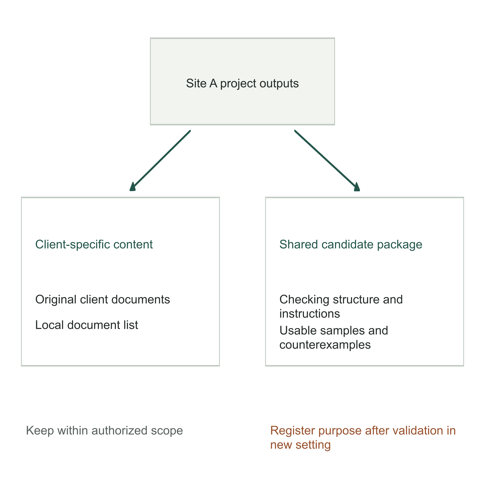

Figure 14-2 | Separate reusable parts from project outputs. The author's classification and dependency diagram for project outputs. Lines indicate dependencies or derivation. Original client material remains within its authorized scope; the shared candidate package retains structure, instructions, and appropriately processed validation material.

Whether original material can leave the project is a separate judgment. Abstracting the counterexample “The same field name does not imply the same meaning” does not authorize placing client documents directly in a shared test library. Even after names are changed, business terms, system identifiers, and attachment contents may remain subject to restrictions on use. The reuse package should identify which materials can be supplied and which can only be checked in the original environment. Where necessary, create clearly labeled synthetic samples and retain the caveat that they do not represent the distribution of real tasks.

Useful parts can also be recovered from a failed project, with reasons for retaining them stated explicitly. If field reading was validated but document interpretation failed, retain the reading method and add the failure conditions as a counterexample; do not stamp the entire package “Validated.” Conversely, a highly client-specific method may be excellent yet worth retaining only in the original client's environment. Without a second reasonable use, further investment in abstraction and maintenance may be less appropriate than implementing the specific requirements again next time.

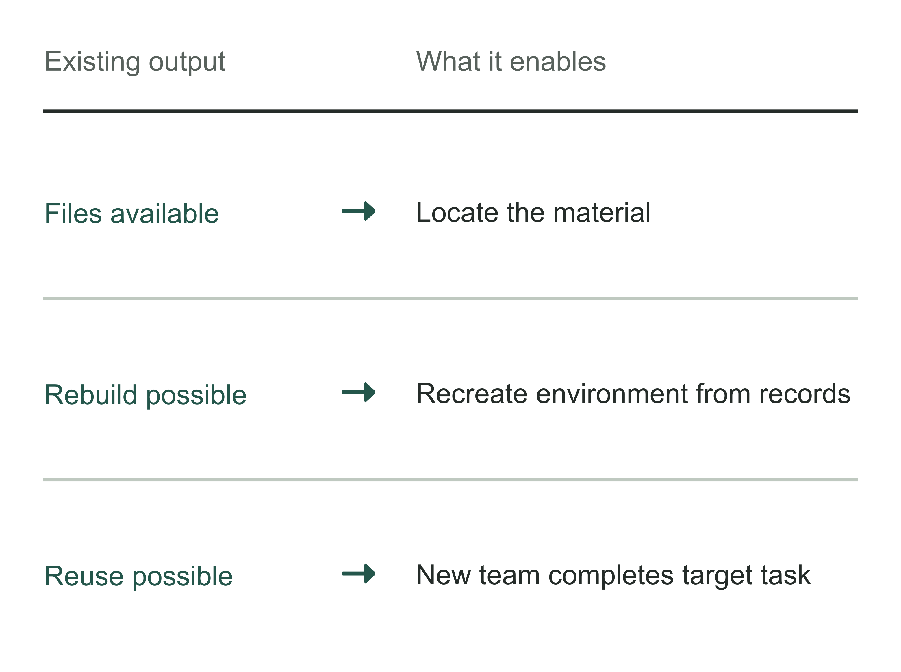

Figure 14-3 | Distinguish complete files from a usable asset. The author's analytical tool: each of the three states requires its own validation record.

## Specific conditions reveal where an asset does not apply

“Suitable for after-sales service” is too broad to help Team B decide whether site B can reuse the asset. A more useful description specifies which application formats it reads, which confirmed document list it checks, which fields can serve as evidence of which events, and that its output stops at an internal missing-document list. When document meanings conflict, it leaves the matter unresolved for a designated intake clerk to confirm. These conditions allow the receiving team to identify mismatches.

Together, the conditions define the asset's scope of applicability: the tasks and materials it handles, the rules it uses, its users, and the relevant version. Conditions must be specific enough to check against an actual document. A mismatch triggers revalidation. An asset cannot be called “universal” in general terms and then every problem blamed on the client's unusual circumstances.

Table 14-1 | Handle five kinds of content separately when transferring site A's outputs to site B, as designed by the author

| Content | What can be transferred | What still needs to be done at site B |
|---|---|---|
| Structure for checking missing documents | Checking steps and output format | Verify site B's document list and completion state |
| Field mappings and rules | Original configuration and reasons for its choices | Reconfigure field meanings and confirm their basis of application |
| Old samples and test methods | Sample structures, counterexamples, judgment criteria | Add new site B material and calibrate expected results |
| Old scores and authorization to operate | Historical records for the original scope | Establish evidence and a new acceptance decision for the new scope |
| Accounts and access arrangements | Description of role requirements | Obtain access and approvals under site B's actual arrangements |

Transfer should save the labor of rediscovering methods and rewriting structures. It does not give site B the business premises of site A. The third row is particularly easy to misuse: old tests help find problems encountered before, but cannot prove that new material contains no new problems. Rerunning the same old documents establishes only that they still work after the change. It does not address the difference between channel warehouse receipt and acknowledgment of completed repairs.

Team B needs site B documents that have not been used in debugging, with the business recipient specifying the correct result in advance. Some submissions should produce a missing-document list, others are complete, and some contain conflicting documents that must remain unresolved. A component that changes every conflict to “Documents complete” has not fulfilled its responsibility, even if its list looks shorter. The reasoning method can be reused; which documents are missing and who accepts the result still depend on site B's work.

Scope also helps reject unsuitable transfers. Suppose site C wants the same component to decide warranty eligibility directly. The task's completion state, grounds, and consequences have changed. Adding a “Warranty covered?” field to the old component is not a completed extension. Some document reading capability can be inherited, but warranty decisions must be defined and validated separately. Recording “Warranty decisions not covered” in the asset catalog can save the next team more trial and error than the vague claim “Supports the entire repair process.”

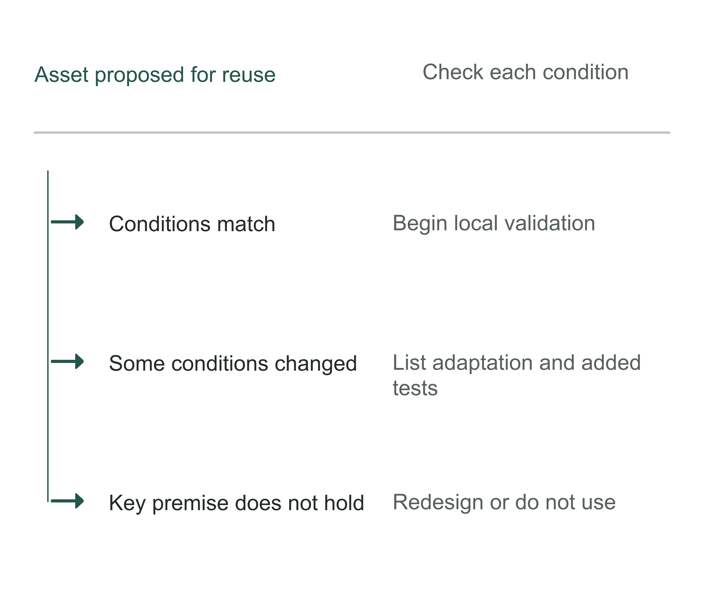

Figure 14-4 | Does the next scenario fall within the asset's scope? The author's analytical tool: “Similar clients” does not replace checking conditions one by one.

Table 14-2 | Check for conditions in which the asset does not apply (the author's checking tool)

| Claimed condition for reuse | Counterexamples to seek |
|---|---|
| Same document structure | Missing fields, different versions, different object definitions |
| Similar business rules | Different approval boundaries, exceptions, completion states |
| Compatible environment | Mismatched permissions, interfaces, dependency versions |

## Change the people before the scenario to locate the obstacle

If Team B changes the client, model, and interface when first encountering the component, it will struggle to identify the source of an error. To locate dependencies, it can first process documents not used in the teaching demonstration in an authorized site A validation environment. This checks whether the documentation and outputs support reuse by different people. The conditions can then be transferred to site B one by one. The final check must still validate Team B's actual target combination at site B; diagnostic separation cannot replace that check.

The original developer can provide support, but each intervention should be recorded. Explaining a term in the published instructions differs from adding an undocumented rule on the spot; answering an installation question differs from doing critical design work for Team B. Recording the support makes it possible to decide whether to improve documentation, change the asset, or acknowledge that this delivery still depends on the original developer's dedicated labor.

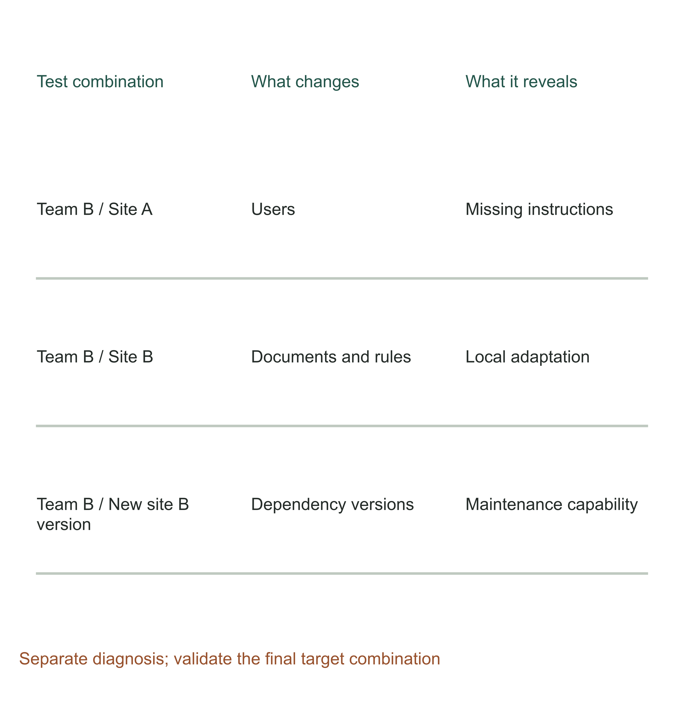

Figure 14-5 | Three changes expose different dependencies. The author's validation plan. Conditions change incrementally to locate problems, followed by a check of the target combination. Connections indicate checking order, not inevitable success or universal certification levels.

In this teaching exercise, Team B can first follow the instructions, then process a submission with conflicting attachments, and finally explain when it would stop checking. If the team must ask the original developer when to stop, the asset's instructions omit an important condition. After the omission is corrected, test with a different set of materials. Do not record the original developer's guided run as independent completion.

“Independent” here does not mean cutting off all help. Real delivery uses platform support, colleague review, and business explanations. Before acceptance, specify which support is permitted and which decisions the receiving team must make, then observe against that arrangement. Banning all questions may turn the test into a memory exam; unlimited substitution by the original developer hides the fact that capability remains concentrated in one person.

Table 14-3 | How a transfer record changes the conclusion; all entries are teaching designs

| Check | Observation | Treatment of the asset |
|---|---|---|
| Team B reuses it in site A's environment | Original developer explains an undocumented reason for a mapping | Add instructions and retest with new material |
| Team B transfers to site B | Warehouse receipt is mistaken for completion acknowledgment | Withdraw that mapping, reconfigure, and add counterexamples |
| Retest with new site B material | Missing documents correctly listed; conflicts passed to the intake clerk | Can support acceptance limited to this scope |
| Site C requests warranty decisions | Task consequences exceed the original purpose | Retain only the reading part and define a separate decision task |

Do not report only “One successful transfer.” Record the asset version, the receiving team's prior experience, the material scope, failures and unresolved items, original developer interventions, and the purpose approved by the accepting person. Team B may already know site B's system, and the documents may happen to cover only simple work. Keeping these conditions lets the next team understand how different its starting point is.

Evaluating labor savings also requires a basis for comparison. The original project may have been slower because material had to be obtained, rules established, and confirmation awaited for the first time. The second may be faster because the business is already prepared, rather than because the component reduces equivalent labor. Completing a transfer is evidence of usability; reasonably attributing how much labor it saved is a stronger outcome judgment. Without comparable records, report actual work and support time first. An attractive percentage decline cannot replace an explanation.

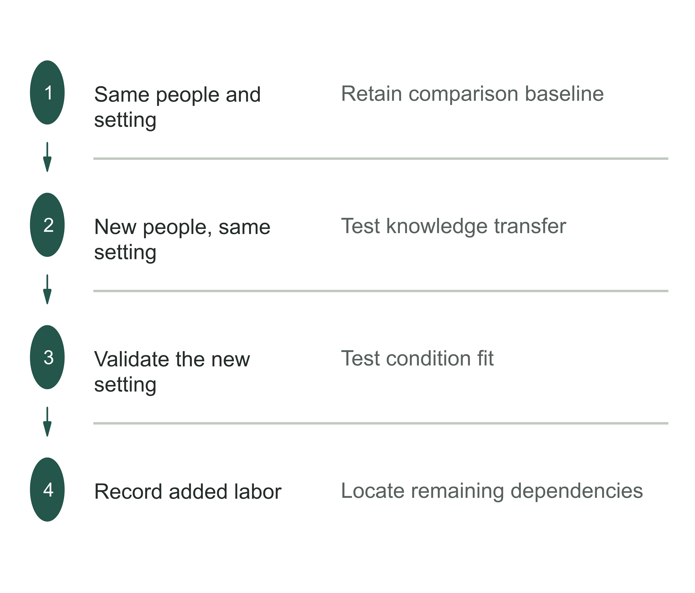

Figure 14-6 | Test dependence on people and scenarios separately. The author's analytical tool: changing too many conditions at once makes failures difficult to explain.

## Upgrades expose another dependency

Team B's successful reuse at site B still does not establish what happens at the next version change. Suppose an upgraded document reader changes how it merges fields in multipage forms, keeping only the last value for a repeated field name. Installation succeeds and old single-page samples pass, but an attachment containing two receipt records may lose the association between dates and events. Reading behavior changed; the downstream document judgment is affected.

The maintainer needs to trace downstream dependencies from the change. Which field mappings depend on the old merging method? Which tests include repeated fields across pages? Which deployments still use the old version? This dependency map helps determine which teams to notify, which tasks to retest, and which upgrades to defer. Without knowing who uses a version, wider sharing makes it harder to locate all affected teams when a problem is discovered.

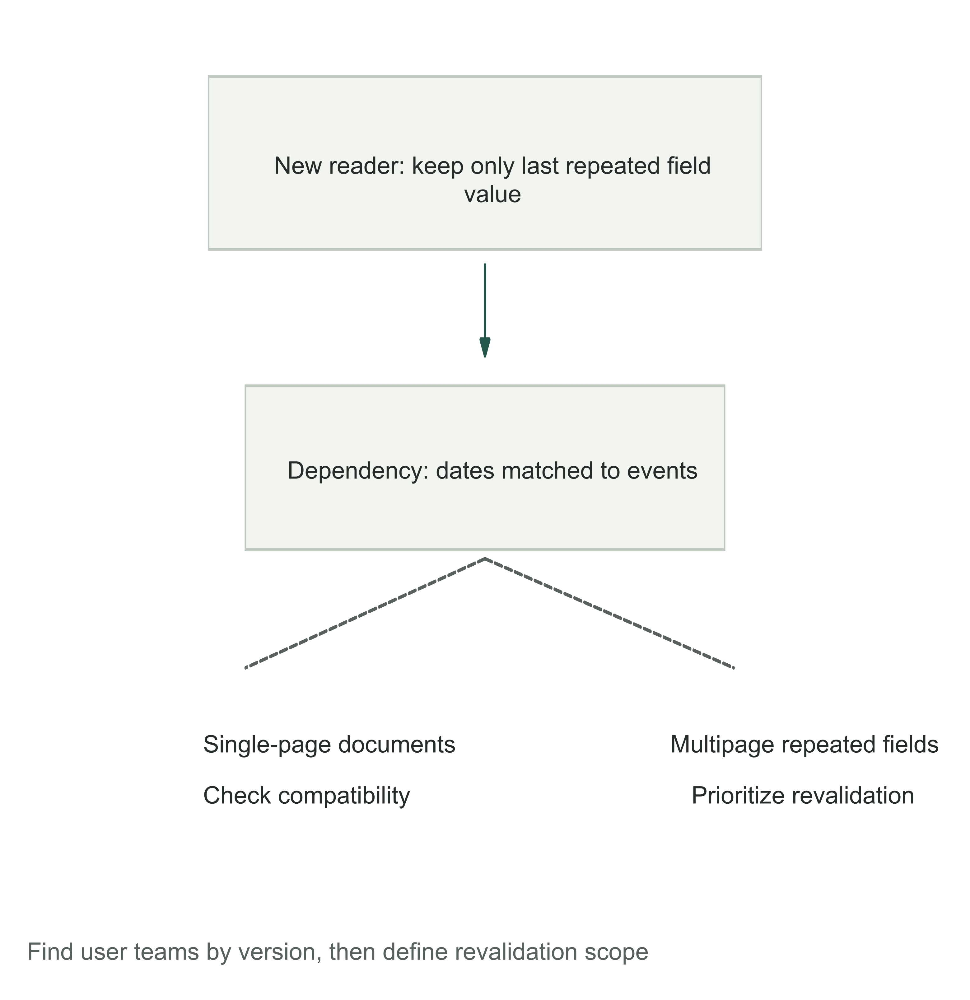

Figure 14-7 | Version changes propagate through dependencies to specific uses. A fictional upgrade schematic. Solid lines show known dependencies; dashed lines show effects to investigate. Being affected does not mean an error has already occurred. Checks focus on uses the change can reach.

Retesting should not be limited to two extremes: repeat everything for every project, or test only the changed function. The former may make shared maintenance unaffordable; the latter may miss downstream behavior. State which assumptions the change affects, then select the corresponding samples, configurations, and target environments. Expand review or defer the upgrade when the affected scope cannot be explained. Targeted revalidation requires sufficiently clear dependencies, not merely a maintainer's wish to do less testing.

Post-upgrade passing records must distinguish two outcomes. A combination that has been revalidated and another awaiting checks because material is missing cannot share a “New version usable” label. The verified old combination can remain supported, with a deadline and accountable person assigned to deployments whose validation is incomplete. If the old version can no longer run safely, restrict use or take over the work under the project's established procedure. The asset owner cannot lower authorization requirements merely to preserve compatibility.

For each reuse, record the shared component version, local configuration version, test material, and acceptance record. They need not have the same version number, but must be traceably linked. A changed business rule may invalidate the configuration even when not a line of component code has changed; it still needs checking.

Assets also need retirement. A shared branch may have only one site left using it and need patches at every upgrade. Another branch may have no users for an extended period, with only the name “universal” left in the catalog. The former can become client-specific support; the latter can be marked “No longer recommended,” with instructions for existing users to continue. Ending a recommendation differs from immediate deletion. Cleaning a directory must not cut off projects still operating.

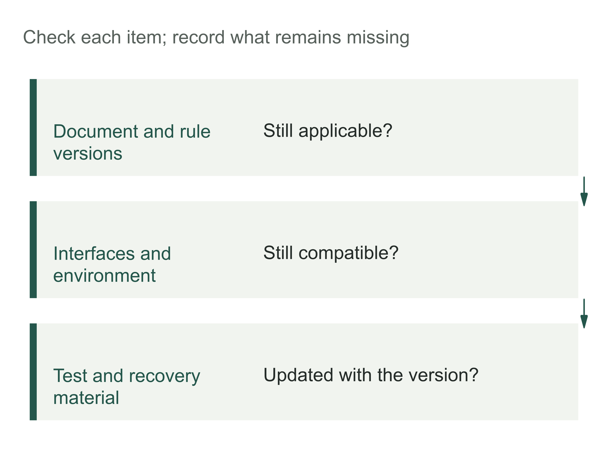

Figure 14-8 | Dependencies to check together during an upgrade. The author's analytical tool: upgrading only the software leaves old assumptions in other layers.

## Record the labor after delivery too

Replication capability is especially easy to overestimate after initial acceptance. A project is handed to Team B on time, but the original developer spends subsequent weeks answering mapping, compatibility, and upgrade questions. If those hours are recorded only as shared support costs without links to the project, the new project's time looks very low. The necessary work has actually been recorded elsewhere.

Consider an independent illustrative calculation. Assume two paths provide one delivery with the same scope, quality, and workload, observed for another 8 weeks. Reimplementation requires 80 labor hours for delivery and 16 for later support, totaling 96 hours. Reuse requires 48 hours for adaptation and delivery, with subsequent support initially estimated at 28 hours, totaling 76. Both paths include relevant labor by the implementation and business teams; elapsed waiting time is excluded.

Comparing only initial delivery gives a saving of 32 hours. With the baseline support assumption, the difference falls to 20 hours. If later support on the reuse path rises to 48 hours, both paths total 96. At 60 support hours, reuse totals 108, which is 12 more than reimplementation. This is not a prediction about a technology; it is a reminder to retain a variable in acceptance records that could change the judgment.

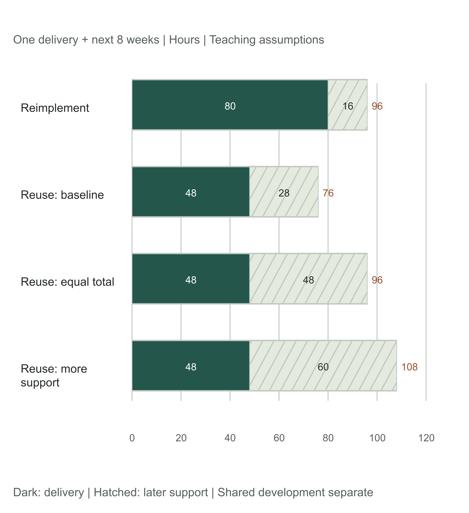

Figure 14-9 | Labor saved initially may return later. Independent teaching assumptions; units: hours. Each row covers one comparable delivery and the following 8 weeks; shared asset development is recorded separately. 48 + 28 = 76; 48 + 48 = 96; 48 + 60 = 108.

Ask who provides the support. The 28 hours may include explanations from the original developer, fixes by a shared maintainer, troubleshooting by Team B, and review by business intake clerks. Allocate each activity once, so the same joint debugging session does not enter both “Adaptation and delivery” and “Maintenance support.” For a meeting with several participants, count each person's actual labor. A full day waiting for a reply is not automatically a full day's labor.

Shared development costs must also be included. The initial work to organize reusable components, write instructions, prepare counterexamples, and create a validation environment should be recorded separately. These activities may serve several projects and should not all be charged to one, but they cannot disappear from the overall accounts. This section completes the labor calculation for delivery and later support; the next chapter considers allocation of shared investment and whether revenue can cover support.

Eight weeks is the example's observation period, not a universal duration sufficient to prove long-term stability. If a rule changes only every six months and no upgrade occurs during the window, record “This type of maintenance has not yet been observed.” Treating work that did not occur as a zero cost will mislead subsequent decisions. At acceptance, list unobserved changes as later observation obligations or arrange an upgrade exercise with a defined scope. Keep exercise results separate from actual operating records.

Maintenance is not only a burden. If Team B discovers the difference in site B's field meaning and returns that counterexample to the shared package, the next team may find similar problems sooner. On return, distinguish site B's dedicated mapping from the shared check “Confirm meaning even when field names match.” Merging every local patch straight into the shared version may accumulate conflicting branches in an otherwise clear asset and make reuse harder.

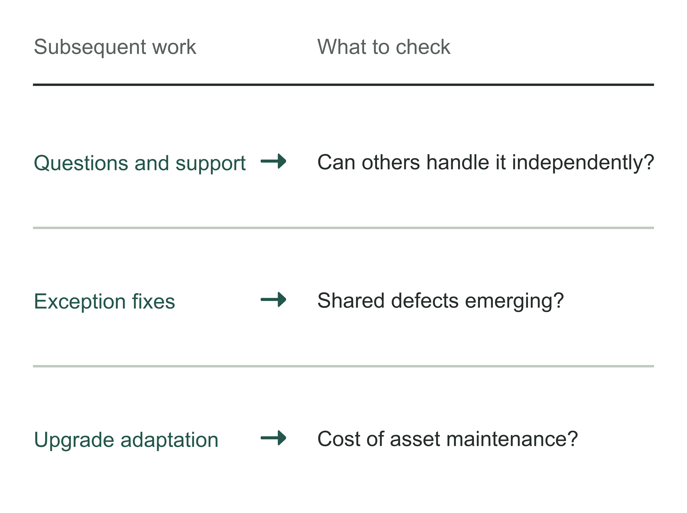

Figure 14-10 | Include post-deployment labor in the reuse judgment. The author's analytical tool: faster initial delivery does not establish that total subsequent labor has fallen.

## What support do platforms and certification provide?

Large service companies are already trying to connect internal practice, platforms, and engineering development. On June 11, 2026, technology services company DXC Technology (DXC below) and Anthropic announced an alliance. DXC described a “Customer Zero” approach: use the AI assistant Claude in its own operations first, then extend the work to clients.[2] Anthropic's announcement described selecting people from DXC's existing engineering talent and developing them through partner courses and supplementary DXC courses.[1] Internal use provides a place to discover problems; courses offer a way for more engineers to understand what is learned.

DXC's announcement proposed a 90-day training and certification path. Developing tens of thousands of engineers and application builders remained the two parties' plan.[2] The investor transcript from the same day also described the initial July training as a future arrangement.[3] These materials show how the company intended to organize talent. They cannot supply actual numbers certified, pass rates, or success rates for a second team's independent delivery.

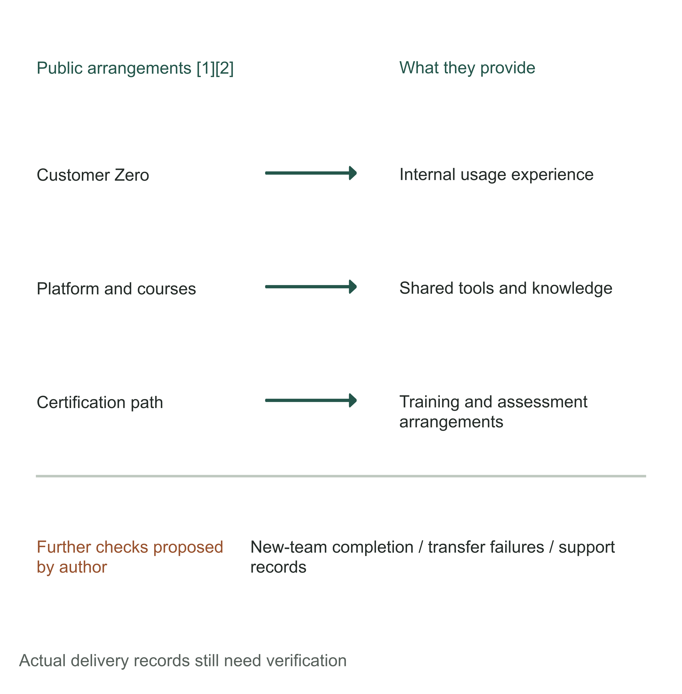

Figure 14-11 | What organizational arrangements and delivery evidence each answer. The upper half is compiled from DXC's and Anthropic's public arrangements[1][2]; the lower half contains validation records the author recommends obtaining. These are not a continuous acceptance ladder the company has already completed.

Disclosures about production deployments deserve attention, but their counting units still matter. The announcement from the same day used “More than 50,” while the investor transcript gave 57 and explicitly included DXC itself.[2][3] The two numbers cannot be combined into a growth curve, nor can all 57 be treated as external clients. Even if the deployment count is accurate, answering this chapter's question requires knowing which teams reused what, which tasks they handled, and who undertook subsequent changes.

Metrics also have different evidentiary bases. Footnotes to a set of efficiency and accuracy charts in DXC's investor presentation state that they draw on key performance indicator (KPI) targets and timed workflow analyses. Production telemetry—monitoring data automatically collected during actual production operation—would still be used to validate the results as deployment expanded.[4] This chapter therefore does not treat them as evidence of long-term outcomes across teams. The bilateral announcements and the company's investor material share a commercial perspective. More sources do not automatically supply independent validation.

These limitations do not remove the usefulness of organizational arrangements. A shared platform can offer consistent packaging, operation, and recordkeeping, reducing repeated environment setup. Courses can teach engineers to explain why a component works as it does. Partners can help solve problems beyond the local team's capability. A business owner needs to identify which part of this support they are buying or building, then request the corresponding evidence. Platform proficiency does not necessarily include judgment about local document meanings; business knowledge does not necessarily include maintaining platform versions.

Certification can therefore inform task assignment, but should correspond to actual responsibilities. Someone who can configure a system from instructions can undertake reuse within a defined scope. Someone who can identify a new scenario's premises, adjust validation methods, and explain failures can undertake broader transfer design. This is the author's proposed way to assign work, not a redefinition of any vendor's certification levels. After an asset version changes or a task expands, prior performance remains only part of the evidence.

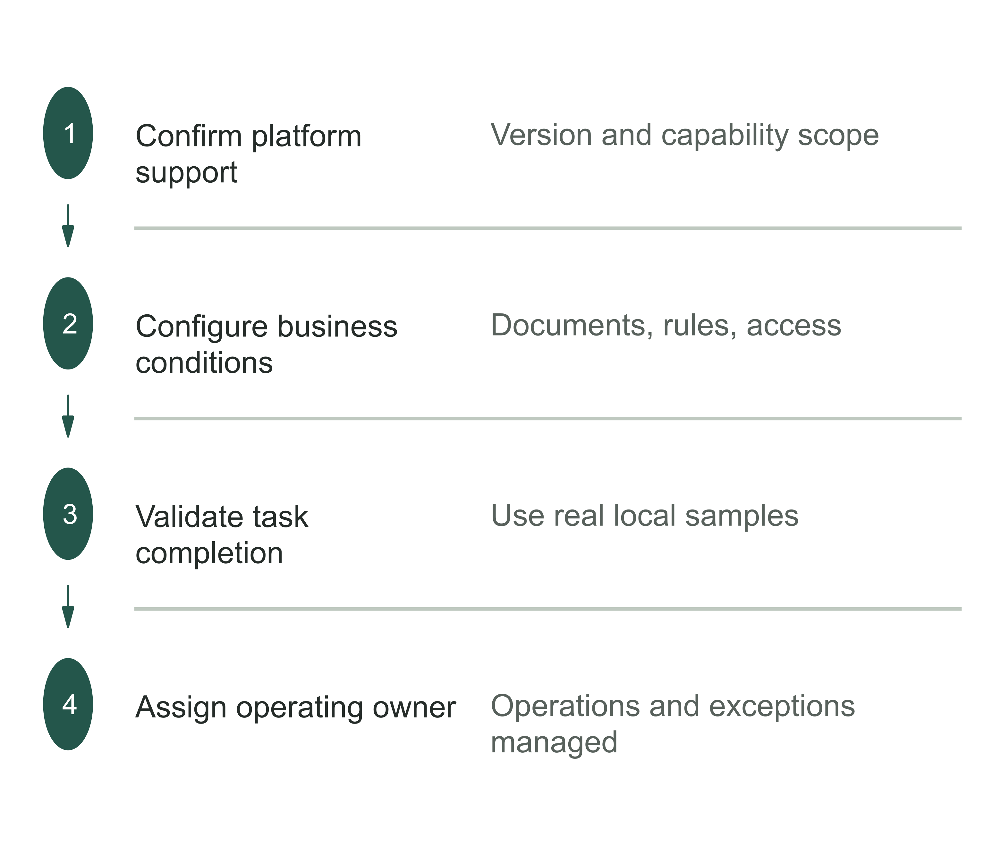

Figure 14-12 | Put the platform to work in a local project. The author's analytical tool: certification or platform features do not automatically establish local outcomes.

## Approve the next reuse rather than declare universal replication

Return to Team B. The business owner can now request a decision with clear scope: can site B use a particular version to draft an internal missing-document list, which document list does it rely on, who receives unresolved items, which changes trigger revalidation, and who arranges later support? If evidence supports these conditions, reuse within that scope can be approved. If field mapping still depends on the original developer's verbal explanation, complete the instructions and revalidate as the next step. There is no need to wait for the entire platform to “mature” before acting.

The end-of-chapter worksheet checks one asset at a time. Compare the old and new purposes first, then list usage records, failures, and their resolution. “Reused” requires a record of the new team completing the task with new material. “Awaiting validation” must state what is missing and who will check it. Reject reuse explicitly where the asset does not apply, and arrange separately for parts still requiring dedicated development and maintenance. A longer asset catalog should not be the sole objective.

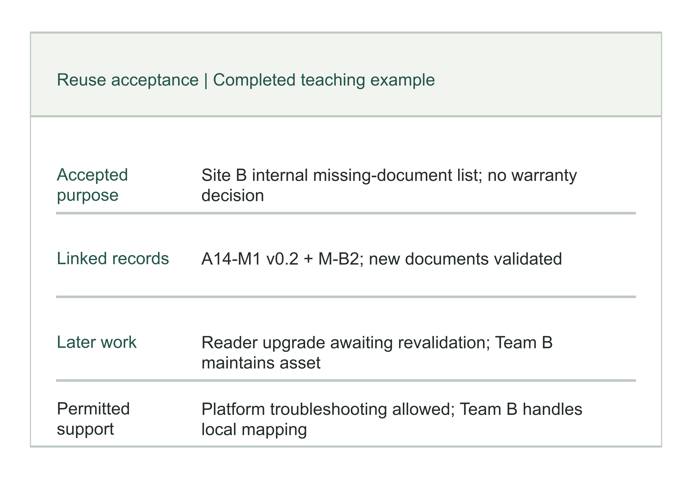

Figure 14-13 | Evidence to retain for one reuse decision. A completed example designed by the author. Acceptance applies to a specific version and purpose. The observations, roles, and later obligations in the example are all teaching designs.

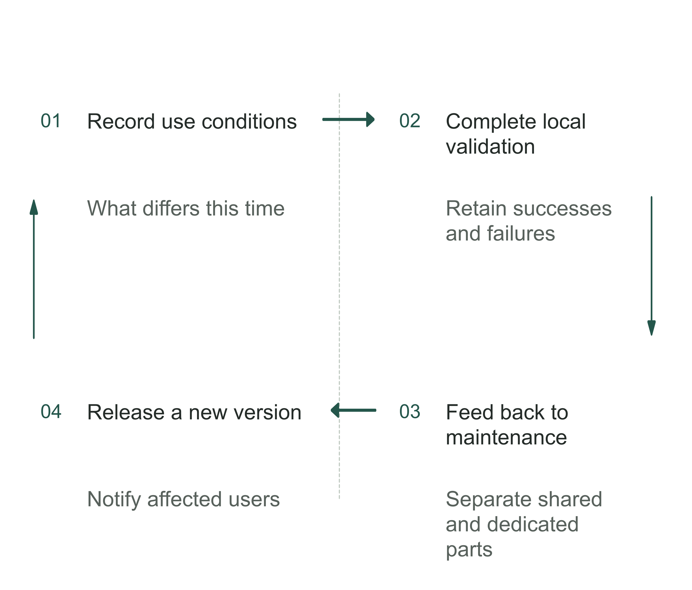

Figure 14-14 | How each reuse updates the asset. The author's analytical tool: replication capability requires maintenance and feedback.

Table 14-4 | Version card for the document checking asset (completed teaching example)

| Field | This reuse at site B |
|---|---|
| Asset and version | A14-M1 v0.2: component generating an internal missing-document list; does not decide warranty eligibility |
| Basis of application | Site B document list and mapping M-B2; warehouse receipt is not completion acknowledgment |
| Reuse evidence | Team B followed instructions to process new material; missing documents correctly listed, conflicts passed to intake clerk; linked to the replay in Table 14-3 |
| Original developer support | Previously explained the mapping rationale, now incorporated in instructions; that guided run was not independent completion, and checks were repeated with different material |
| Change and maintenance | Changes to the document list, field meanings, or interfaces trigger revalidation; Team B maintains it, with original team's support scope recorded separately |
| Excluded use | Site C warranty decisions are outside this version; reading capability may be used separately, while the decision task requires a new project |

Start with an output that has a clear purpose and that others are reusing. Record the dependencies remaining after changes of people, scenario, and version. Steps the receiving team has completed, and those still requiring the original team's support, become conditions for the next reuse decision.

When another team can complete the work under defined conditions, the next question is economic: can subsequent project revenue cover shared development and ongoing maintenance, and how will development, troubleshooting, and support workloads change as projects increase? Chapter 15 follows these records into customization, gross margin, renewal, and scale.

## Notes and sources

[1] Anthropic, “DXC will integrate Claude into the systems banks, airlines, and other regulated industries rely on,” June 11, 2026, section “Building a team of Claude-certified engineers.” Official announcement. Talent selection, supplementary courses, and plan status are publicly described arrangements, not independently verified outcomes. [Official announcement](https://www.anthropic.com/news/dxc-anthropic-alliance).

[2] DXC, “DXC and Anthropic Announce Multi-Year Global Alliance to Bring AI into Mission-Critical Enterprise Systems,” June 11, 2026, main text and “Forward-Deployed Engineers” section. Official announcement. Ninety days was the training and certification path described at the time; “Customer Zero” is the company's terminology. [Official announcement](https://dxc.com/newsroom/06112026-dxc-and-anthropic-announce-multi-year-global-alliance-to-bring-ai-into-mission-critical-enterprise-systems).

[3] DXC Investor Day 2026 Transcript, June 11, 2026, PDF pp. 5, 7, and 60. Official transcript. Page 60 explicitly includes DXC itself in the count of 57. Initial training in July was a plan on that date; this chapter makes no judgment about subsequent execution. [Official transcript](https://s27.q4cdn.com/120381974/files/doc_downloads/Investor-Day-2026-Transcript.pdf).

[4] DXC, Investor Day 2026 Presentation, PDF p. 72 and footnotes on p. 75. Investor presentation material; the official PDF was obtained again on September 9, 2026. Targets, timed analyses, and production telemetry should be understood as different evidentiary bases. [Official presentation](https://s27.q4cdn.com/120381974/files/doc_presentation/2026/06/DXC-Investor-Day-2026-Presentation.pdf).

The repair intake scenario, transfer results, labor calculations, validation plans, and worksheets were designed by the author for teaching. They do not represent DXC's or the author's clients' actual results. Calculations in different chapters are not a continuous set of accounts for one company. “Delivery asset” is an engineering and organizational management term; it does not establish that accounting asset recognition criteria have been met.
