# Chapter 15 Understanding the business: customization, gross margin, renewal, and scale

An AI platform has been deployed at a client's organization, yet the provider says it will not increase revenue from existing contracts in the near term. Is this a good business?

In the Q&A at its June 11, 2026 Investor Day, DXC explained that the basic version of its enterprise AI platform OASIS would enter existing client accounts under current contract terms, leaving near-term revenue from those contracts broadly unchanged. Tiered upgrades and independent licensing offered additional commercial paths. Management also gave an example in which four or five certified forward deployed engineers (FDEs) could enter an environment operated by another service provider, help the client redesign processes, and license OASIS separately.[1] These arrangements use the same platform, but their sources of revenue differ.

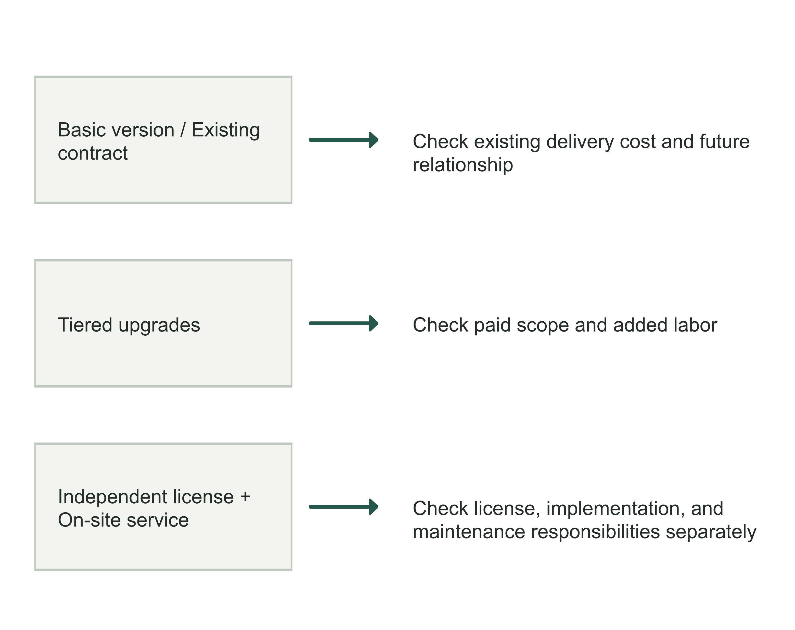

Figure 15-1 | One platform enters three revenue arrangements. Compiled from the commercial arrangements described at DXC's Investor Day.[1] Lines represent commercial paths, not completed sales or realized profit. Deployment counts cannot be priced uniformly across the basic version, upgrades, and independent licensing.

Chapter 14 checked whether an output remains usable after being handed to others. This chapter follows the accounts: can revenue cover development, delivery, and subsequent maintenance? The operator of an implementation company needs to know whether taking on more projects could mean more work and less money. The buyer also needs to judge whether the provider can supply the promised service over the long term. Their accounts are connected, but provider revenue does not establish that the client has benefited.

Buyers can start with the labor behind the charges, then read the assessment of continuing service near the end of the chapter. Operators of delivery companies can recalculate in the order of costs, project cohorts, staffing, and renewal. The teaching calculations below comprise Group A's project accounts, Group B's staffing accounts, and Group C's renewal accounts. They cannot be combined across groups into one company's income statement.

## Where does the money come from after deployment?

Including the basic version in an existing contract does not necessarily make the commercial arrangement a failure. If it reduces the cost of delivering existing services, unchanged revenue may still leave a larger balance after costs. If it makes the client more willing to renew, it may protect future revenue. These are paths requiring verification. Knowing only that deployment has occurred does not establish whether costs have fallen, and certainly does not justify attributing all revenue that would have renewed anyway to the platform.

Paid upgrades raise another set of questions. Is the client paying for a wider scope of use, greater processing volume, a particular capability, or a stronger service commitment? If an additional paid module also promises more interfaces and round-the-clock support, the added revenue brings its own delivery burden. A provider cannot count all of it as software revenue growth, leave implementation staff in a different cost center, and then declare that software inherently has high gross margins.

Independent licensing does not necessarily mean independence from services. The client may need FDEs on site to complete the work, or the original service provider or another partner may take over maintenance. The provider should explain when engineers participate, when they withdraw, and who charges for and delivers work beyond standard capabilities. Buyers need to know where the license fee's coverage ends to identify what is missing from the quoted price.

Breaking revenue down by the actual commitments is the first step in economic analysis. A project may charge a one-time implementation fee, an annual service fee, usage fees, and additional modification fees. It may instead have a single total price covering several of these obligations. This chapter's breakdown clarifies the relationship between work and economics. Financial recognition must still follow the actual contract and applicable basis; a management analysis table cannot simply be treated as accounting entries.

Table 15-1 | Match charges to actual labor, as recommended by the author

| Charging arrangement | Labor or expenditure to track | Easily missed items |
|---|---|---|
| One-time implementation | Requirements investigation, adaptation, validation, and delivery | Presales work before a contract is signed; rework |
| Continuing service | Cloud resources, review, failures, and upgrades | Coverage outside working hours; infrequent major changes |
| Usage fees | Calls and processing costs for each task type | Retries, complex tasks, human takeover |
| Additional modifications | Added scope and new acceptance conditions | Client-specific branches included free in sales promises |

The table also exposes mismatches between pricing and labor. With per-account pricing, a small number of heavy users may generate most costs. With per-task pricing, the difficulty of human takeover may vary greatly between tasks. With outcome-based pricing, outcomes may depend on material and business decisions controlled by the client. When choosing a pricing unit, check whether it adequately explains the main changes in cost. An easily counted unit may simplify collection, but the parties must also clarify which work and risks each bears.

Customization need not always be eliminated. Client-specific labor can be a reasonable business when its scope is clear, its price appropriate, and sufficient capability is available. The problem is knowingly repeating the work each time while promising prices and services on the assumption that almost no labor is required, or using free customization to acquire clients without ever recording the subsequent obligations it creates.

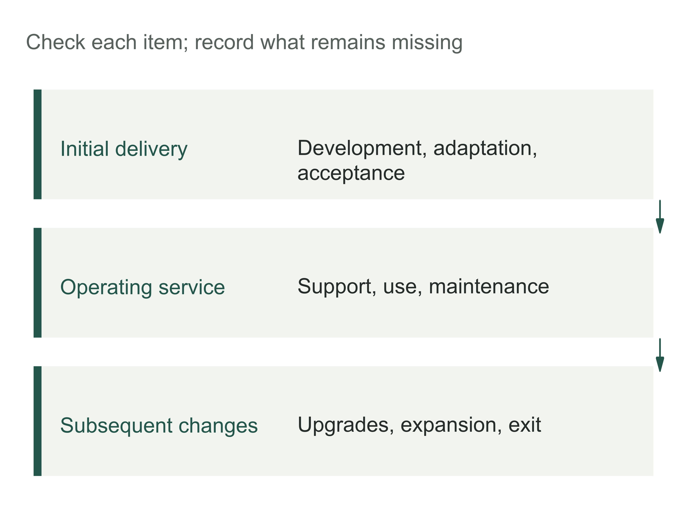

Figure 15-2 | Continuing work beneath deployment revenue. The author's analytical tool: check the labor undertaken beyond the names of revenue categories.

## Buying engineers or a team responsible for delivery?

Companies that place FDEs in client environments may charge for engineers' working time or undertake a delivery task with clear scope. Even when two quotes are similar in amount, the providers may undertake different management work. Distinguish this first to see whether the cheaper quote requires you to arrange an additional engineering lead.

Uvik publicly describes assigning its own senior engineers to client teams, with clients managing daily work. Its service page lists hourly rates, monthly statements of work (SOWs), and personnel replacement arrangements.[2] This supplements engineering capability, while the client needs someone to prioritize tasks, check outputs, and coordinate dependencies. If an internal lead can already manage the team and a particular skill or period of engineering time is missing, this purchase has a clear purpose. If how to advance the project remains unclear, time spent waiting for decisions after the engineers arrive may still be billable, depending on the agreement.

Optywise includes team leadership in its service. It employs and manages an engineering pod, agreeing delivery scope, duration, and price for one use case in an SOW. Its public offering advances production delivery in six-week cycles.[3] This describes how it sells and organizes service; it cannot be treated as a record showing that every project was completed within six weeks. Buyers should ask more specifically: what will this cycle deliver, how will failed checks lead to rework, and which missing client prerequisites require a revised plan?

The difference concerns who organizes several people's work into a delivery that can be accepted, rather than whether the engineers are excellent. In the first arrangement, the client buys external capability and undertakes more engineering management. In the second, the provider leads the team within the agreed scope, while the client still confirms business rules, provides necessary conditions, and performs acceptance. Pricing by deliverable does not mean sharing in the client's profit.

Table 15-2 | What to check first in three procurement arrangements, summarized by the author from public service descriptions[2][3][4]

| Purchase arrangement | Who organizes daily work | What the buyer still arranges | Check before pricing |
|---|---|---|---|
| Engineers join the client's team | Client lead | Task priorities, engineering checks, and business confirmation | Billable time, replacement, and handover |
| Provider leads delivery | Provider's delivery lead | Business rules, access to material, and acceptance | Deliverables, rework, and change scope |
| Platform and engineering services combined | Allocated by agreement | Business confirmation, use, and operating connections | What licensing, implementation, and support each cover |

Other providers offer FDEs together with a platform. Turing's enterprise AI service describes both engineering teams and its own platform, covering construction, deployment, and operation.[4] Its public page does not separate the charges and profit for platform and service. Buyers comparing these offerings should ask separately about software capabilities, implementation work, and long-term support. Providers also need to record the corresponding costs separately to determine whether revenue growth comes from greater software use or continued input from more engineers.

### For cross-border delivery, first ask who connects the work

These services already have cross-border supply. Uvik's service page lists an Estonian headquarters, a UK business office, and arrangements for collaboration across US Eastern and European time zones. Optywise lists an address in Pune, India, and explicitly targets US and Canadian clients.[2][3] These materials establish that providers are supplying engineering capability across borders. They do not establish that this model is generally profitable.

For Chinese teams preparing to enter overseas markets, I place greater weight on a division of work that can first be tested on a limited scale. A lead who understands the client's industry and can communicate promptly confirms requirements and advances acceptance. The engineering team builds within the locations and access scope permitted by the client. The client-side lead can come from the provider or a local partner. The value of this role lies in explaining business questions clearly, referring disagreements to someone authorized to decide, and keeping delivery moving. If the contact merely forwards messages, the remote team will continue guessing what the client means.

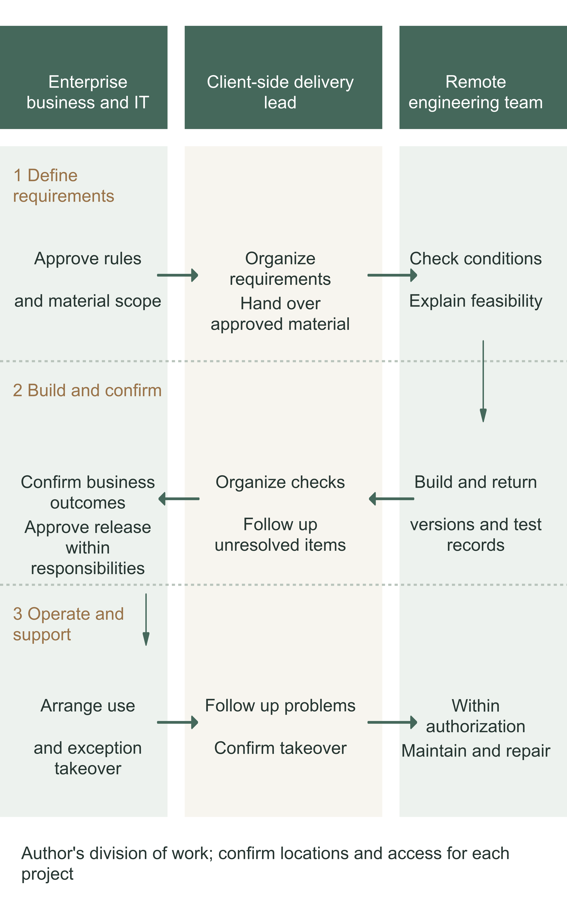

Figure 15-3 | How cross-border delivery completes a handover. A division of work proposed by the author, not a verified client project. The client-side lead organizes delivery and does not replace the enterprise's authority to approve rules and release. The remote team receives only approved material and access. Personnel locations and on-site requirements must be confirmed for each project; see Chapter 16 for specific handover checks.

This business cannot be assessed merely by subtracting engineer salaries from the hourly price charged to clients. The client-side lead's time, unsuccessful presales work, gaps between projects, personnel replacement and handover, travel, rework, and later support can all consume that difference. Lower remote engineering costs may also be offset by the client-side lead's time spent repeatedly explaining requirements. Actual records are needed to establish which labor the price covers.

A trial can start with one small task in a familiar industry. Agree scope and fees separately for diagnosis, delivery, and subsequent support, then record the time actually spent on each. In particular, check whether the lead must explain the same kinds of rules afresh each time, whether the client supplies material as agreed, and whether the next engineer can take over. The team has a basis for continuing the business when clients will pay for consistently reliable delivery.

Buyers can use the same reasoning to compare two quotes: one has a lower unit price but requires them to lead the team; the other has a higher total price but includes engineering management and agreed rework. Add internal input to the comparison, then verify that the provider actually has people undertaking the work. Once the work behind revenue is clear, check where its costs are recorded.

## Before gross margin, locate the costs

When reading a gross margin figure, first identify its revenue scope and deductions. Gross profit generally concerns revenue less the corresponding cost of sales. Project contribution, segment profit, and company net profit may each include or exclude different expenses. They answer different questions; similar names do not make them directly comparable.

DXC's Form 10-Q for the quarter ended June 30, 2026 includes costs of services, selling, general and administrative expenses, and depreciation and amortization in its segment profit definition, with a separate reconciliation to company-level profit. The filing does not report OASIS revenue and profit separately.[5] A segment margin therefore cannot be entered into a product gross margin field, nor does the absence of separate disclosure mean that the product contributes nothing.

For practical management, start with accounts traceable to activity records. An implementation engineer reconfiguring one client's interface incurs delivery labor for that project. A maintainer repairing a component shared by several projects incurs shared maintenance. Presales staff validating three opportunities that never become contracts still incur acquisition activity costs. One person may undertake several activities at different times; cost attribution should follow the activity, rather than just the department name.

Group A: project and cohort accounts. These are teaching assumptions. All amounts are in renminbi (RMB); figures and tables specify when values are shown in units of RMB 10,000. These accounts have no conversion relationship to the preceding chapter's labor hours. Assume a type of project generates RMB 200,000 during the 12 months from the start of delivery, covering agreed implementation and services. First-cohort projects require an average of RMB 80,000 in delivery labor, RMB 20,000 in cloud and third-party services, and RMB 30,000 in subsequent dedicated support. After these three deductions, RMB 70,000 remains. Deduct another RMB 20,000 allocated from acquisition activities for the same cohort, leaving RMB 50,000 for shared capabilities and other expenses.

Labor amounts here are assumed actual labor costs, including the corresponding employment burden. They cannot be inferred from “hours saved.” The RMB 20,000 acquisition cost also includes a reasonable allocation from unsuccessful opportunities, rather than just sales work after signing. If failed presales work is excluded entirely, contracted projects may look increasingly attractive while the overall sales system grows more expensive.

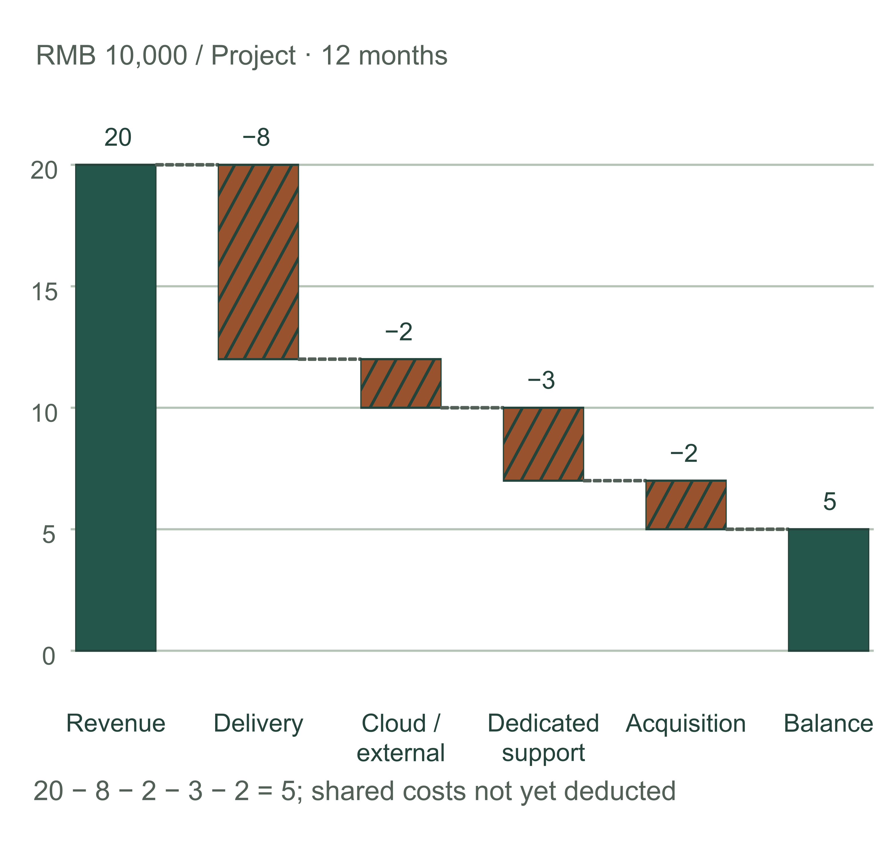

Figure 15-4 | The deductions from RMB 200,000 in revenue. Independent teaching assumptions; each project covers 12 months from the start of delivery; units: RMB 10,000. 20 − 8 − 2 − 3 − 2 = 5. Shared investment and other unlisted expenses have not yet been deducted from the balance, which is not called net profit.

Project support and shared maintenance require a boundary that can be checked. Changing a local field mapping for one client is that client's work; repairing a shared parsing component is shared work. Troubleshooting may diagnose a local problem first and then discover a shared defect. The time can be split by actual activity, but the same hour cannot be recorded in both places. Merging code into the main branch does not automatically turn all preceding client labor into shared investment.

Shared development has its own timing. Building a validation environment, writing instructions, and abstracting common interfaces occur before or during the first cohort. They may serve future clients, but the future client count remains an assumption. Managers can record the total separately, then check how much existing and additional projects each bear. They cannot simply divide it by dozens of unsigned clients to make the first cohort's accounts look better.

Deciding whether to take the next order in the short term requires checking its incremental revenue and costs. Evaluating the whole business also requires shared development and long-term maintenance. Both analyses are necessary. Financial reporting across periods follows the applicable rules separately; this chapter's management examples do not prescribe development capitalization or revenue recognition methods.

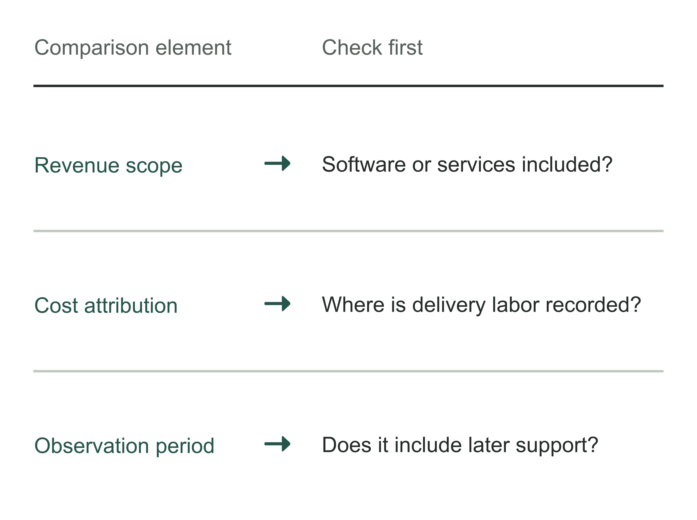

Figure 15-5 | Align these bases before comparing gross margins. The author's analytical tool: gross margins cannot be compared directly when these three bases differ.

## Is the second cohort really easier to deliver?

RMB 50,000 left by one project does not yet show whether platform investment is worthwhile. Assume the first cohort has 4 projects of the same type, each with RMB 200,000 in revenue and RMB 150,000 in combined delivery, operation, support, and acquisition costs. Shared development adds RMB 240,000 and shared maintenance RMB 80,000, totaling RMB 320,000. The first cohort's total revenue is RMB 800,000 and listed costs RMB 920,000, leaving a negative balance of RMB 120,000.

The second cohort increases to 8 projects. Assume reusable assets reduce each project's delivery cost from RMB 80,000 to RMB 50,000. Cloud and third-party costs remain RMB 20,000 and acquisition costs RMB 20,000, while dedicated support rises from RMB 30,000 to RMB 40,000. This simulates a difficult economic judgment: initial adaptation falls, but later compatibility problems increase. Listed costs are RMB 130,000 per project, leaving RMB 70,000 after deductions from revenue.

Both cohorts must be measured through each project's twelfth month from the start of delivery, with comparable service scope, workload, and quality requirements. The first cohort's full year of support expenses cannot be compared with expenses from the second cohort's first three weeks after going live. This chapter groups projects by the start of delivery and compares records after equal service durations. Actual analysis must also distinguish project complexity and retain costs of exited or failed projects.

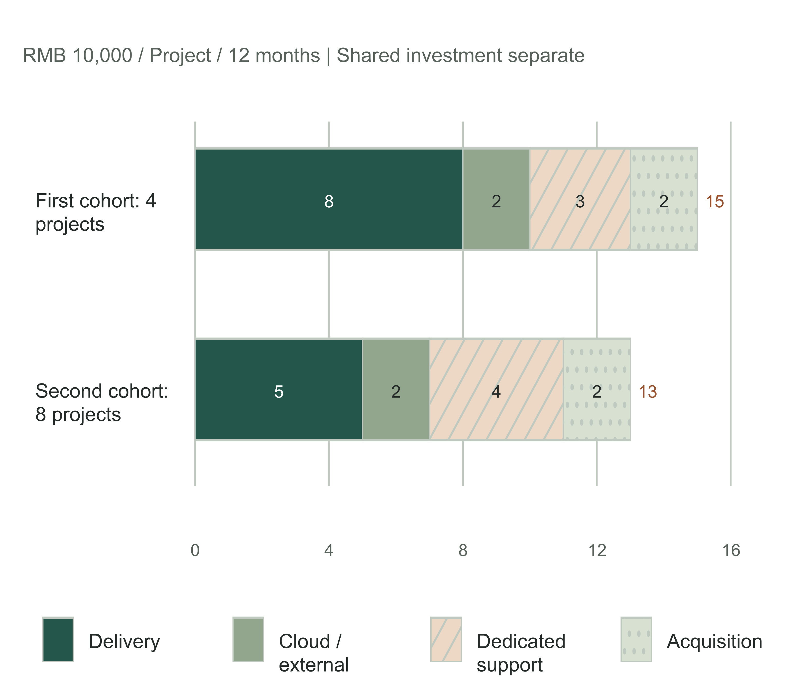

Figure 15-6 | Combine lower delivery costs with higher support expenses. Independent teaching assumptions; 12 months per project; units: RMB 10,000. First cohort: 8 + 2 + 3 + 2 = 15; second cohort: 5 + 2 + 4 + 2 = 13. Both include acquisition; shared investment is recorded separately.

To account for shared expenses, assume further that the two cohorts begin in different years. All agreed services for the first cohort end in the first year, with no renewals or residual obligations entering the second. The second cohort incurs no new shared development, while shared maintenance is RMB 160,000. Second-cohort revenue is therefore RMB 1,600,000 and project-related costs RMB 1,040,000. After deducting RMB 160,000 in shared maintenance, the balance is RMB 400,000. Combined listed revenue for both cohorts is RMB 2,400,000 and costs RMB 2,120,000, leaving a cumulative balance of RMB 280,000.

Under the assumed prices, scope, and costs, this result shows that the second cohort can bear more shared investment. It does not establish that a real company is profitable or predict future client numbers. Unallocated headquarters expenses, taxes, financing, and other unlisted expenditures must be added as the purpose of the analysis requires. If first-cohort clients continue receiving service, both their revenue and support must enter the second year. That revenue cannot be included while the corresponding work is omitted.

Table 15-3 | How two project cohorts bear shared investment; teaching assumptions; units: RMB 10,000

| Item | First cohort: 4 projects | Second cohort: 8 projects | Both cohorts |
|---|---:|---:|---:|
| Revenue | 80 | 160 | 240 |
| Project and acquisition costs | 60 | 104 | 164 |
| Shared development | 24 | 0 | 24 |
| Shared maintenance | 8 | 16 | 24 |
| Balance after listed costs | −12 | 40 | 28 |

Averages alone also hide differences between clients. Of the second cohort's 8 projects, perhaps 6 need almost no support while 2 require sustained senior engineering involvement. The RMB 40,000 average can support the overall accounts but cannot explain who must handle another similar large client. List the projects requiring most support, their problem types, and the personnel involved, so sales promises confront actual delivery limits.

Shared cost allocation must retain a check against the total. Equal allocation by project count suits the same-type projects in this teaching example. If actual clients differ greatly in usage, dedicated versions, or maintenance requirements, first check which activities drive costs. Changing the allocation method changes who appears profitable, not how much the business spent overall. If one allocation adjustment improves every project's profit, check whether an expense has disappeared.

Nor can all improvement in the second cohort be attributed to assets. More complete client material, a more experienced team, and simpler tasks all affect delivery costs. Economic accounts show whether the cohort improved; explaining why also requires records of these conditions. Even if individual factors cannot be separated, the company can organize the next cohort within the scope already evidenced. It should avoid promising that an unverified decline in unit costs will continue indefinitely.

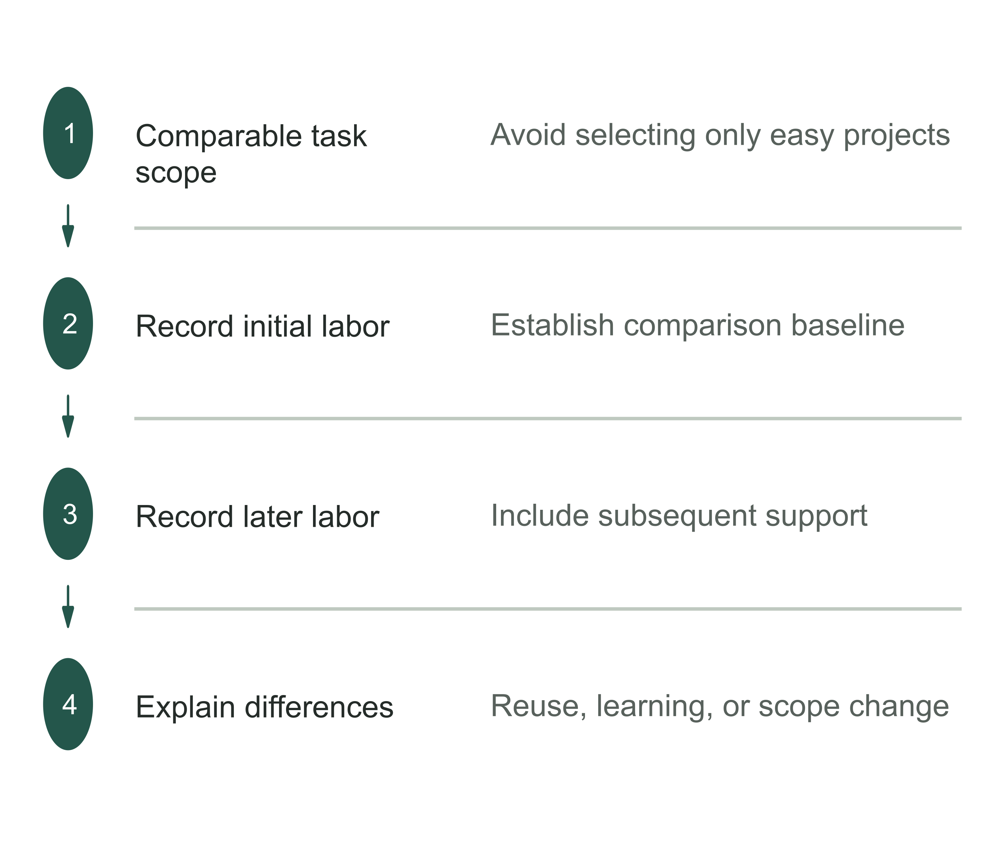

Figure 15-7 | Evidence that the second cohort is easier to deliver. The author's analytical tool: comparable records must support a decline in labor.

Table 15-4 | The minimum ledger for comparing cohorts (the author's checking tool)

| Record | Requirement for comparability |
|---|---|
| Task scope | Identify delivery content added or removed |
| Initial labor | Record development and adaptation on the same basis |
| Subsequent labor | Cover support observation periods of equal length |
| Quality and rework | Do not produce low costs by underrecording service |

## How do later support and additional staff affect profit?

Return to the second cohort's accounts. With other conditions unchanged, increasing support costs per project from RMB 40,000 to RMB 90,000 adds RMB 50,000 each, or RMB 400,000 across 8 projects. This exactly exhausts the original RMB 400,000 balance. Although initial implementation requires less labor, subsequent support can still consume the cohort's entire balance. For an expansion decision, this variable is more direct than the number of reusable components.

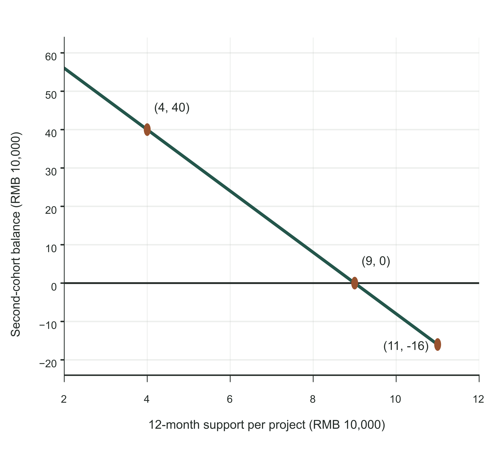

Figure 15-8 | More later support consumes the second cohort's balance. Uses the second cohort's teaching parameters. The horizontal axis is 12-month support cost per project; the vertical axis is the balance after listed costs for 8 projects. Both use RMB 10,000. Balance = 72 − 8 × support cost; it reaches zero at RMB 90,000, with other parameters unchanged.

Post-delivery support does not necessarily decline naturally. Interface upgrades, rule changes, rare exceptions, and replacement of key personnel may cluster only after some time. If a project has not experienced these changes, the corresponding expenses can only be estimated, with the basis and next checking date stated. Using a new project's short-term record to represent its entire service period understates subsequent responsibilities.

Beyond total costs, check whether critical capability is sufficient. One engineer familiar with an old system cannot handle every client's emergency simultaneously. Adding one person does not necessarily add an equivalent amount of independent delivery capacity immediately. Some businesses must add coverage, review, and backup personnel as a group, creating steps in costs. A downward trend in average cost per client may reverse temporarily when the next group joins.

Group B: independent annual staffing accounts, separate from Group A's project accounts. Assume annual service revenue of RMB 60,000 per client, with RMB 20,000 in cloud resources and externally purchased variable costs. Each support team costs RMB 300,000 a year and can serve at most 10 clients with equal workloads. To observe the cost effect of additional staffing, assume clients occupy capacity for a full year and teams must be added as whole groups. Personnel costs enter only the team item, not the RMB 20,000 per client.

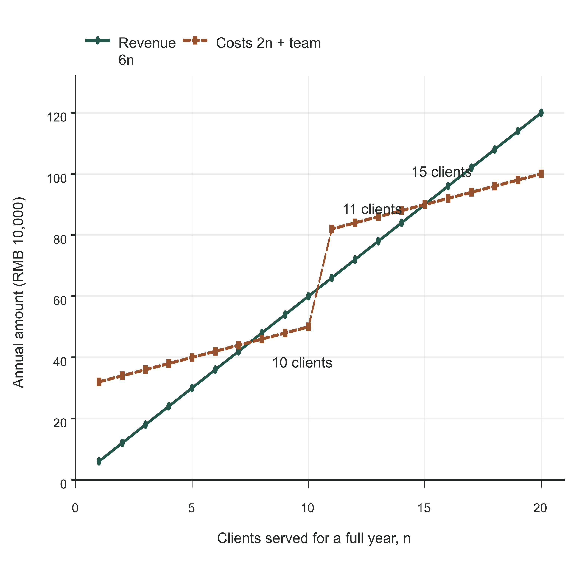

Figure 15-9 | An additional client may first trigger a whole team's cost. Independent teaching model. The horizontal axis is the number of clients served for a full year; the vertical axis is annual amounts in RMB 10,000. Revenue = 6n; listed costs = 2n + 30 × ceiling(n ÷ 10). Points and lines connect only integer client counts; they do not imply that clients can be divided continuously.

With 10 clients, revenue is RMB 600,000, costs RMB 500,000, and the balance RMB 100,000. Client 11 triggers a second team: revenue reaches RMB 660,000 and costs RMB 820,000, bringing the balance down to negative RMB 160,000. It breaks even again at 15 clients and leaves RMB 200,000 at 20. The decision to take client 11 should also arrange additional demand, team availability, and transition funding.

The annual balance does not yet explain when cash becomes available. Clients may pay later while staff and cloud resources must be paid first. Even if full-year listed revenue exceeds costs, additional funding may be needed during early expansion. Conversely, collecting payment in advance does not reduce subsequent service obligations. The examples assume collectible revenue and do not model payment or collection timing. Actual expansion must separately identify funding gaps and arrangements to sustain service.

Actual team capacity is rarely so orderly. Clients may enter in stages, workload peaks may differ, and external partners may handle some peaks. The model requires managers to explain their staffing assumptions: how many more clients with similar workloads the current team can take, when staff must next be added, and who handles tasks until the new team can work independently. Neither permanently full utilization nor indefinitely adding clients without personnel should be taken for granted.

A lower customization share does not necessarily mean that more projects produce more money. Limited customization that occupies scarce experts for a long time may be harder to expand than extensive standard implementation. Explicitly priced dedicated services can also run sustainably if they cover personnel and management costs. Check how much development and support each increment of revenue creates, whether the price is sufficient, and whether people can undertake the work over the long term.

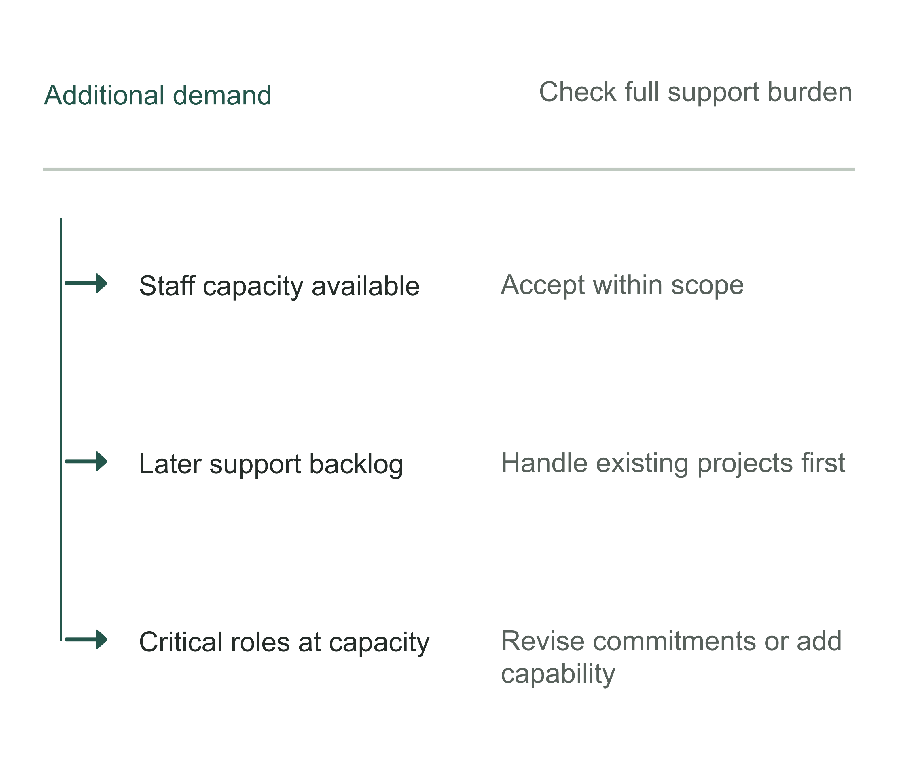

Figure 15-10 | How many new projects can be taken on when staff are scarce? The author's analytical tool: confirm who handles post-deployment support before signing more projects.

## Renewal growth: who stays, and why?

Renewal supplies a substantial signal: clients are willing to continue a commitment. They may stay because task value is stable, but also because replacement is difficult, a budget cycle has not ended, or no suitable alternative has been found. The reason changes expectations for the next period. Entering “Renewed” in a table is not enough to judge the quality of the relationship.

First fix the original client cohort, then check comparable recurring revenue over two periods of equal length. Group C: independent renewal accounts. The original cohort generates RMB 1,000,000 in year one. In year two, exits reduce revenue by RMB 200,000 and contraction by RMB 100,000, while expansion by retained clients adds RMB 400,000, producing RMB 1,100,000. All new-client revenue is excluded, and one-time implementation fees are not mixed into recurring revenue.

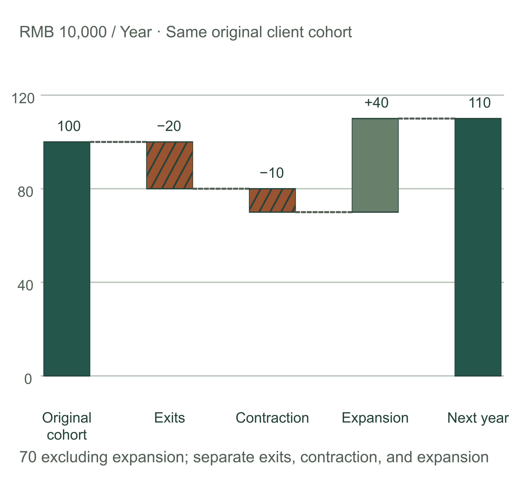

Figure 15-11 | Original-client revenue can grow alongside exits and contraction. Independent teaching assumptions; the same original client cohort over two equal annual periods; units: RMB 10,000. 100 − 20 − 10 + 40 = 110; excluding expansion leaves 70. Changes in the figure are not client counts.

On this explicit basis, revenue retention including expansion is 110%; excluding expansion, it is 70%. Companies disclosing similar metrics may use annualized period-end amounts, actual period revenue, or different exclusions. Their definitions must still be read before comparison. The two percentages here separate exits, contraction, and expansion; they do not establish a universal “excellent renewal rate.”

Next, check costs. Assume direct service costs for the original cohort increase from RMB 600,000 to RMB 850,000. Revenue rises, but the balance after these costs falls from RMB 400,000 to RMB 250,000. Added scope may require new interfaces or more review, and discounts or changed commitments may also occur. Expansion revenue has value but must be judged together with expansion obligations. A retention percentage cannot replace profit analysis.

Ask about clients that exited too. If exits cluster in tasks with poor material conditions and long-term dependence on human takeover, the remaining clients may better fit current capabilities. If exits cluster among deeply integrated clients, investigate possible problems with value, price, or service. Both explanations require client and task records; the cause cannot be guessed from a revenue chart alone.

Clients willing to explain which tasks they will continue using, which results they want to retain, and which scope they wish to reduce offer evidence closer to business operations than general satisfaction. Providers should also record what they did to secure renewal: reduce prices, include modifications free, extend response hours, or reduce scope. Additional commitments that preserve unchanged revenue may still increase next year's costs.

Credible long-term retention rests on clients knowing why they continue buying and providers having the capability to meet the corresponding commitments. Migration costs are part of economic choices, but deepening dependence cannot automatically replace evidence that value has improved.

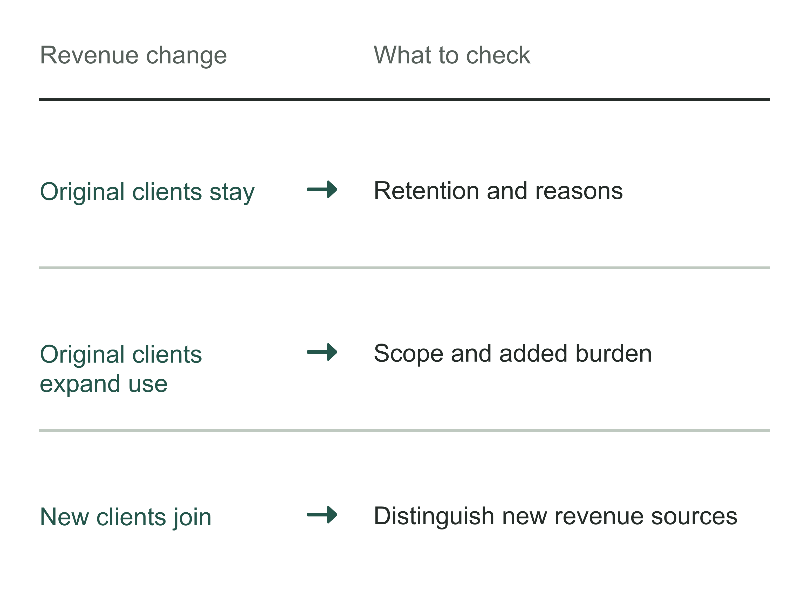

Figure 15-12 | Separate the changes behind renewal growth. The author's analytical tool: growth in total revenue does not establish sustainable benefits for every original client.

Table 15-5 | Different evidence for interpreting renewal (the author's checking tool)

| Intended judgment | What to find first |
|---|---|
| Original clients continue buying | Contract or transaction records and cohort definition |
| Scope of use expands | Actual added tasks and input |
| Clients obtain value | Client-side outcome records and cost basis |
| Service can continue | Provider support staff and responsibility arrangements |

## How can the buyer judge whether the relationship can continue?

Buyers usually cannot obtain a provider's complete product income statement. Nor must they calculate a precise gross margin before procuring service. It is more practical to clarify each condition affecting the current work: which services the quote covers, who handles daily maintenance, which requirements incur additional charges, how work is handed over when key personnel leave, and what the buyer must undertake during an interruption.

Low provider prices may reflect mature capabilities and shared costs already borne by a larger business volume, or subsidies intended to enter a new market. Buyers can accept time-limited discounts but should check price and service arrangements after they expire. Assuming that senior staff available on demand during a pilot will remain a long-term condition of formal operation understates labor that must later be purchased or undertaken internally.

Also check the difficulty of switching providers. A contractual right to export material establishes one right; another team's ability to understand rules, connect interfaces, and complete tasks requires actual preparation. Within a limited scope, check the material inventory, version instructions, and conditions for taking over. Estimate parallel operation, human coverage, and revalidation during the transition. Chapters 7 and 13 addressed exit arrangements. Here the question is how these burdens affect renewal decisions and whether advance investment is needed to retain options.

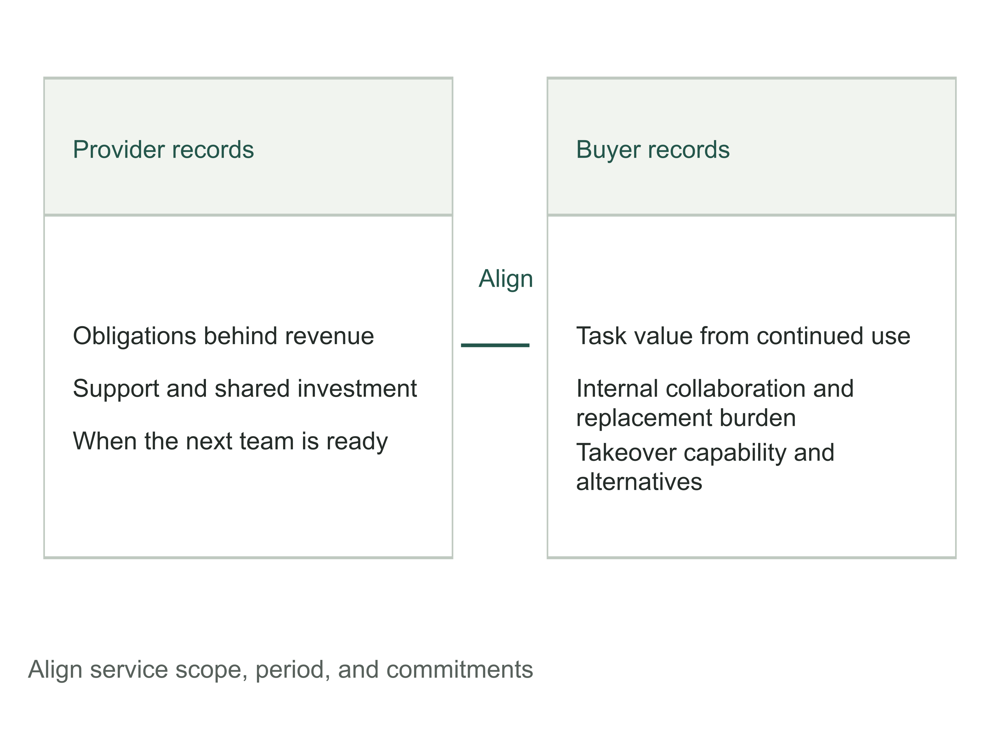

Figure 15-13 | Both sides need their own evidence for the same service relationship. The author's analytical framework. The provider records revenue and capability to fulfill obligations; the buyer records task value and burdens undertaken. Evidence from the two sides aligns at service scope and cannot substitute for the other side's evidence.

Retaining options does not require changing providers every year. Stable cooperation can reduce repeated learning and coordination, and clients may willingly pay for reliable service. Compare feasible paths—continuing, reducing scope, changing the division of work, and replacement—and the value and obligations each leaves. For core services that are difficult to replace, make charges, maintenance scope, and takeover capability more visible.

Providers can use the same records to improve pricing. If a type of dedicated branch requires additional maintenance for two consecutive cohorts, check whether it should be priced separately, whether commitments should shrink, or whether shared capability is worth developing. Do not keep treating necessary human work as an occasional exception merely to maintain a “productized” appearance. Showing clients the service boundaries covered by the price also helps reduce disputes discovered only after signing.

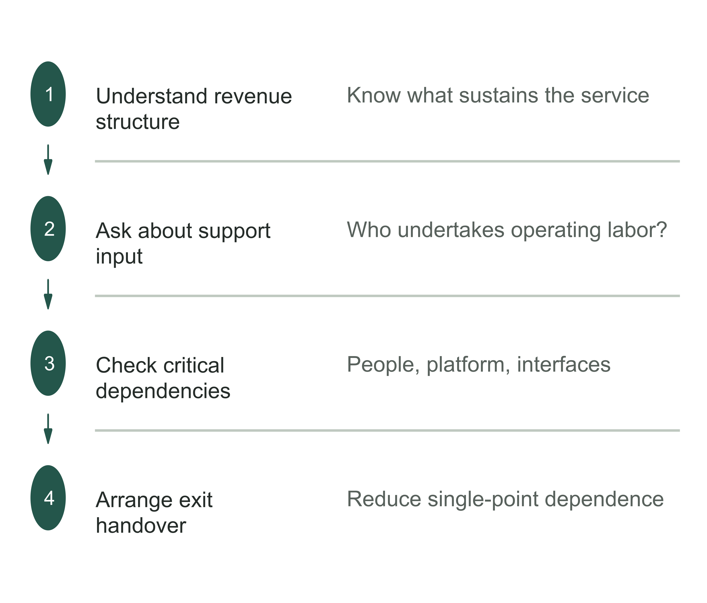

Figure 15-14 | How buyers check long-term service capability. The author's analytical tool: economic checks inform procurement decisions and do not replace a financial audit.

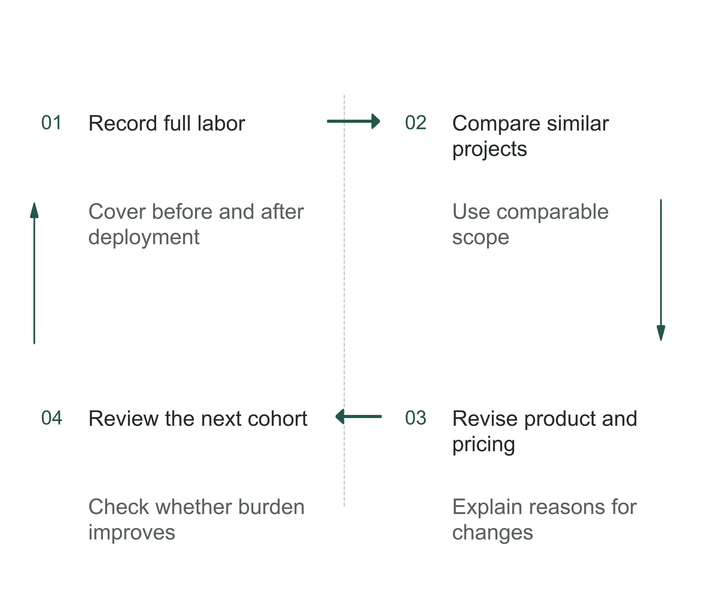

Figure 15-15 | Revise service commitments as actual costs change. The author's analytical tool: sales scale alone does not establish that service is replicable.

The end-of-chapter worksheet checks one category of service at a time: what work revenue promises, how long comparable projects have operated and what they cost, how much shared development remains, and when more staff must be added. Then check why clients renew and what the buyer still undertakes. If the provider's product profit data is unavailable, state which conditions remain unverified. With internal records, decide whether to maintain, expand, shrink, defer, or exit, and specify which cost or personnel changes require reconsideration.

Chapter 14's reuse records establish the conditions under which others can use a capability. This chapter's economic accounts then check whether revenue covers the cost of those capabilities and continuing work. The next expansion need not await the disappearance of every uncertainty, but it should explain the revenue source, who undertakes the scarcest labor, and which changes would invalidate the judgment. In a Chinese enterprise, sales, implementation, and maintenance may also belong to different organizations. The next chapter follows this service chain to check who actually holds each responsibility.

## Notes and sources

[1] DXC Investor Day 2026 Transcript, June 11, 2026, PDF pp. 15, 59–60, and 68–69. Official transcript. Commercial paths are management statements; four or five people is an example. This does not establish realized sales, gross margin, or renewal outcomes. [Official transcript](https://s27.q4cdn.com/120381974/files/doc_downloads/Investor-Day-2026-Transcript.pdf).

[2] Uvik, “Forward Deployed Engineering,” official service description, checked September 17, 2026. Covers team management, billing and contract arrangements, office locations, and time zones. This is a provider's public service description, not a signed contract or client outcome record. [Official service description](https://uvik.net/services/forward-deployed-engineering/).

[3] Optywise, FDE service description and company introduction, checked September 17, 2026. Used to check managed engineering pods, the six-week cycle, the Pune address, and North American market positioning. Six weeks is a service commitment; actual duration, profit, and client acceptance records were not obtained. [FDE service description](https://optywise.com/hire-forward-deployed-engineer); [company introduction](https://optywise.com/about).

[4] Turing, “Enterprise AI,” official service description, checked September 17, 2026. Describes the combined positioning of FDEs and Turing Intelligence Platform. The page does not disclose separate platform and service charges or profit. Promotional outcome figures are not used to establish clients' business outcomes. [Official service description](https://www.turing.com/enterprise-ai).

[5] DXC, Form 10-Q for the quarter ended June 30, 2026, Note 16, printed pp. 23–25, and MD&A p. 31. SEC original. Used to check the segment profit definition, reconciliation, and gap in product disclosure. Company or segment figures are not used to infer product profit. [SEC original](https://www.sec.gov/Archives/edgar/data/1688568/000168856826000069/dxc-20260630.htm).

The project cohort, staffing, and renewal models are independent teaching assumptions. They do not form a continuous set of company results with each other or with the preceding chapter. See the relevant figures and tables for currency units, observation periods, and exclusions. A management analysis balance is not financial net profit; the models do not prescribe particular accounting treatments or predict providers' actual gross margins. Worksheets were designed by the author.
