# Chapter 16 AI delivery in Chinese enterprises: clarifying each party's responsibilities

Part Five examines how Chinese enterprises organize AI projects. We will look for clues in public procurement documents and job requirements, then use teaching scenarios to work through specific decisions. What procurement documents require, what teams actually do, and what the enterprise ultimately receives are three things that must be verified separately.

When a security test report arrives, who can declare the project complete?

The procurement document for Wuzhou's social insurance RPA digital employee service separates the answer into different provisions: the system requires a third-party security test report; after the acceptance plan and system acceptance work are completed, the procuring entity must also confirm acceptance. A separate functional requirements table specifies that business administrators configure the authorized scope and that the municipal-level organization controls the distribution of workflows.[2] The tester, the party confirming procurement acceptance, and the person authorizing day-to-day business operations each have different work to do.

The award notice from May 2025 identifies the procuring entity as the Wuzhou Social Insurance Administration Center (梧州市社会保险事业管理中心) and the successful supplier as Zhuhai Jinzhiwei Information Technology Co., Ltd. (珠海金智维信息科技有限公司), with a procurement agency listed separately.[1] Remembering only the software's name misses these relationships; finding the contact named in the contract may still leave us unsure who approves a specific business action.

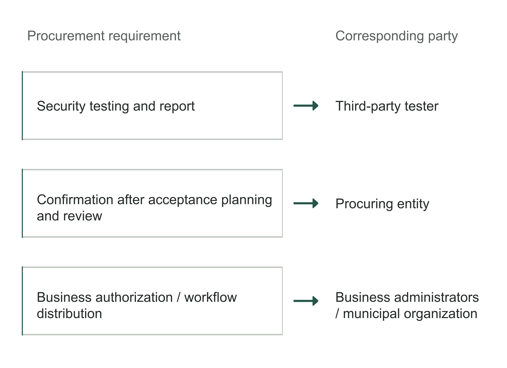

Figure 16-1 | Identify the different confirming parties from procurement provisions. Based on the Wuzhou procurement document[2], with summaries of the requirements on the left and the corresponding parties on the right. Each confirmation serves a different purpose; one report cannot replace them all. The diagram shows the procurement design and does not establish that it was actually carried out.

Chapter 3 used this project to distinguish software licenses from roles; this chapter will not count licenses again. Here we trace how a piece of work passes through several parties and whether, after each handover, the receiving party has both the materials it needs and the authority to continue. This RPA project provides an observable procurement design. It does not use the forward deployed engineer (FDE) job title, nor does it establish any particular level of large model quality. We can learn from its method of analyzing responsibility; generative capabilities must still be validated separately for our own tasks.

## Identify the parties that contract, provide the product, and use it

A Chinese enterprise looking for an AI delivery team may first approach a software vendor, a reseller, a systems integrator, or an existing IT supplier. A name on the cover of a proposal provides a starting point. We still need to establish which entity makes the actual commitments, who sends people to implement them, and who can modify the systems on which the work depends.

A procurement notice for a software agent platform makes this distinction clear. In November 2025, the software procurement for a unified AI model and software agent research and development platform at the First Research Institute of the Ministry of Public Security listed Zhongguancun Science City City Brain Co., Ltd. (中关村科学城城市大脑股份有限公司) as the winning supplier, while the main award information identified the product brand as Baidu AI Cloud.[3] The notice establishes that the supplier and product brand are listed separately. It does not say whether engineers from the product vendor would work on site, or disclose how the two companies divide application development and ongoing support.

Buying a branded product therefore does not automatically mean buying all the engineering services for this project from that brand's team. The product vendor can explain product capabilities, while the successful supplier must organize delivery under the applicable agreement. If a repair must be handled by the product vendor, the enterprise should also verify the route into that vendor's support, the scope of service, and who follows up. Publicity saying that the parties cooperate does not establish which people have been committed to this project.

A procurement agency is another kind of entity. These notices list the procurement agency separately from the successful supplier. The agency contact in the notice is a point of contact for procurement matters; this does not establish responsibility for application development, operations and maintenance, or business confirmation. A sales channel and a procurement agency may both be casually called an “agent,” but they must appear separately in the responsibility map.

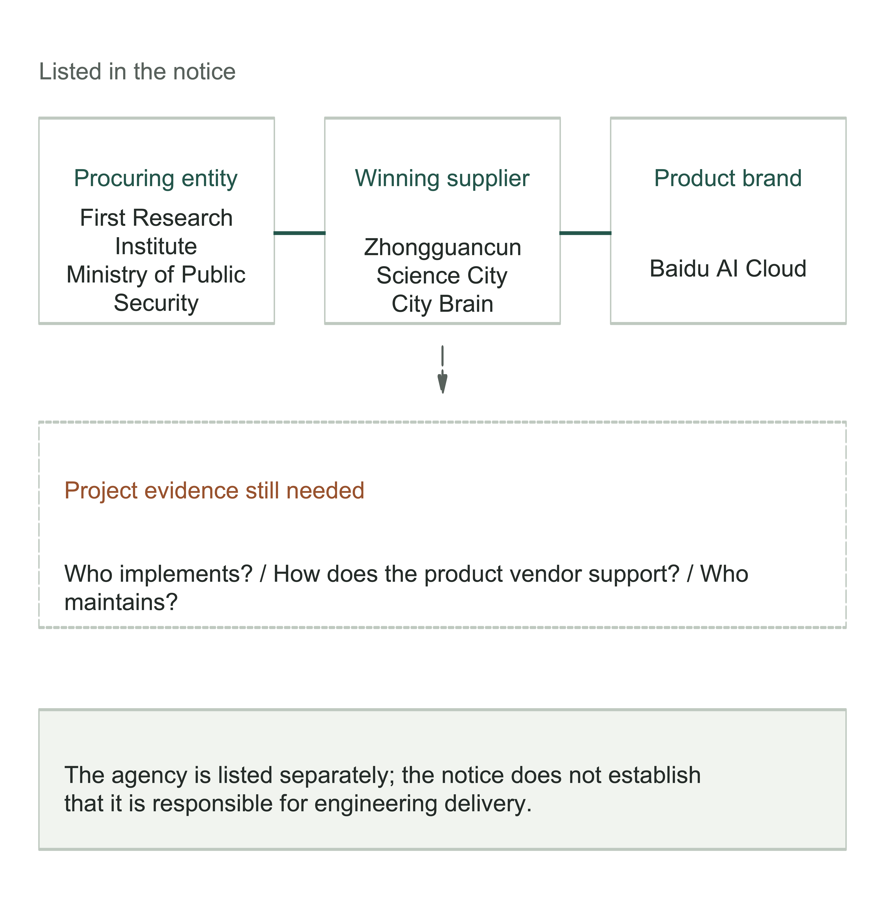

Figure 16-2 | The parties in a notice do not reveal the complete delivery relationship. The upper relationships come from the platform procurement notice[3]; the lower section shows project evidence still needed. Dashed lines indicate support arrangements that remain to be verified, rather than an established subcontract. The procurement agency is shown separately from the product service chain.

Now turn back to the enterprise itself. Headquarters may procure centrally while factories or stores use the system; IT manages accounts and interfaces while business departments decide whether outputs can enter their work. Central purchasing can reduce duplicate procurement and platform maintenance, but rules, equipment, and ways of receiving the work may differ across units. A headquarters project passing technical checks does not establish that every operating unit is ready to run it.

Enterprises can combine roles according to their size. One person can hold several responsibilities, and a small business may complete the work through its owner, key business staff, and an external provider. What needs to be separated is the decisions: who makes the procurement commitment on the company's behalf, who confirms the business method, who approves system access, and who receives the final work. People can combine roles, but the grounds for each decision must remain clear.

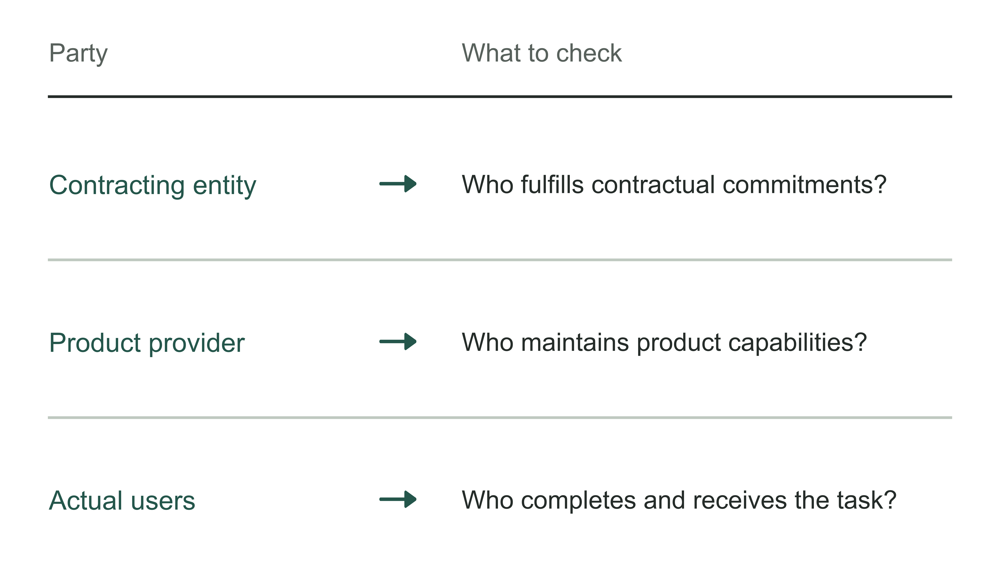

Figure 16-3 | What each of three types of party must answer. The author's analytical tool: confirm each party's responsibilities individually, rather than merely recording company names.

## Use a handover to test whether responsibilities are complete

Job titles help with recruiting and communication, but seldom explain on their own how a task will be completed. Baidu's description for an “AI Computing and Large-Model Product Solutions Engineer” includes customer requirements, solution design and implementation, project execution, and turning requirements into standard product features. Its qualifications separately list practical skills in the Python programming language and the PyTorch machine learning framework, among others.[4] Another description, for a “Solutions Architect for Hong Kong, Macao, Hainan, and Guangxi,” centers on recommending standard products, demonstrations, simple proofs of concept (POCs—small trials to assess whether a solution is feasible), sales collaboration, and coordination with internal technical and delivery teams.[5]

The two documents show that customer-facing technical work can cover different stages. The first role's engineering requirements do not prove that one person handles every part of every project. The second does not explicitly identify who is responsible for the production system, or show that the person lacks engineering ability. Their value to a business owner is to shift the next conversation from “Are you an FDE?” to “Who completes this part of the work, and who checks it?”

Table 16-1 | Turn job descriptions into project checks. The first two rows summarize official descriptions; the final row is the author's recommendation.

| What to check | What the material establishes | What this project still needs to verify |
|---|---|---|
| Product solutions engineer[4] | Design and implementation, project execution, product feedback, and practical skill requirements | Who modifies the actual system, and who handles production incidents |
| Regional solutions architect[5] | Presales for standard products, simple POCs, and coordination with delivery teams | When the team joins, and which materials it receives |
| Internal enterprise handover | Fill in according to this enterprise's authority and division of work | Who confirms the rules, access, and business outcomes |

Everyone need not have the same capabilities. Presales staff add value by accurately screening requirements and explaining product boundaries. The danger arises when a project has moved beyond their responsibilities and the next team has not taken over. The end of a demonstration, contract signing, and account activation can all be handover points; at each one, we need to know what materials travel with the work.

The following is an independent teaching design, not a real customer case. A manufacturing enterprise wants AI to help check equipment inspection records for missing items and generate a list of materials to obtain for the maintenance planner. It will not yet issue maintenance instructions automatically. The enterprise's equipment management staff confirm business rules; the delivery team recognizes records, connects to the register, and implements the checks; the planner receives the list and handles exceptions.

If the delivery team receives only “improve inspection efficiency,” the planner must explain again which omissions matter, where to obtain information, and when an item should not be flagged as missing. If the enterprise has already supplied sample records, applicable rules, and unresolved questions, the team must still report what it can implement and which dependencies remain unmet, with confirmation from the receiving party. Sending an attachment must be followed by confirmation that the recipient can continue the work using its contents.

In one configuration, the enterprise has its own application team and external parties provide only the platform and specialized support. In another, an external team implements the application while the enterprise retains business confirmation and technical access responsibilities. Both can work. The first requires continuing internal investment in development and maintenance capability; the second requires the enterprise to explain requirements, check deliverables, and manage dependencies across suppliers. A budget that buys external labor cannot also assume that internal coordination takes no effort.

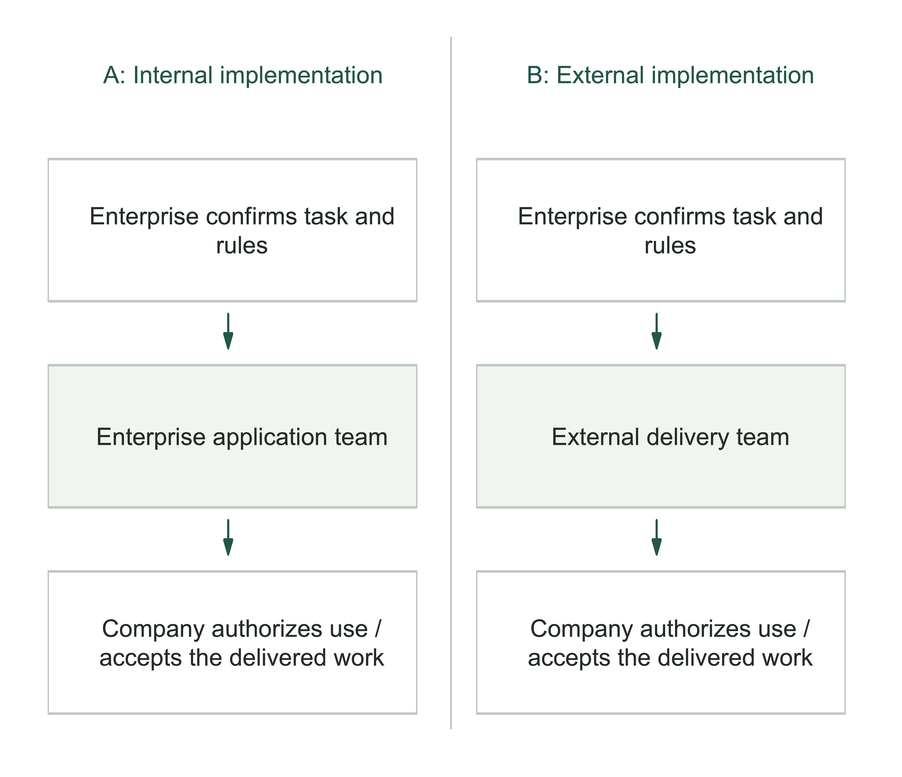

Figure 16-4 | Two configurations retain the same handover responsibilities. The author's teaching design; the configurations are not a ranking of organizational quality. Implementation can move between parties, but business rule confirmation, access approval, and receipt of the work must still be assigned. Every line requires an explanation of the materials handed over and who confirms receipt.

This chapter records “handover responsibilities” for a transfer of work: what the preceding party provides, the grounds on which the next party accepts or returns it, and who decides if there is a dispute. A contact list tells us whom to reach; this record also explains what we need that person to do. When a supplier says it has delivered but the internal team says the result is unusable, the record helps identify whether business rules, technical conditions, or validation materials are missing, or whether the parties still disagree on scope.

Disputed or unclear matters also need someone assigned to resolve them within a specified period. A planner can explain why a record is questionable but may not have authority to change the inspection policy. An engineer can propose an alternative implementation but may not have authority to expand the procurement scope. The coordinator sends the issue to the person with decision authority and records the next action; coordinating does not grant all business and investment decision rights.

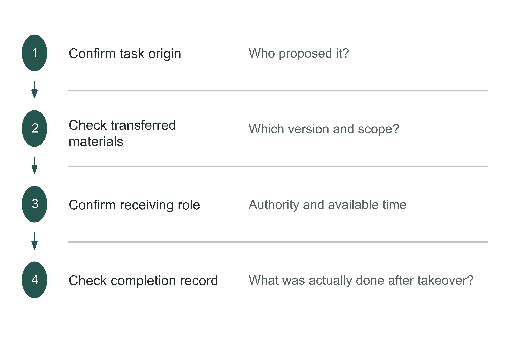

Figure 16-5 | Follow one handover to find missing responsibilities. The author's analytical tool; organization names cannot replace evidence of a complete handover.

## Deployment conditions redistribute the work

The Wuzhou document specifies compatibility requirements for operating systems, processor architectures, and databases. Security requirements separately cover domestic cryptographic technologies, permissions, and third-party testing. It also requires remote assistance capability and restricts providing project information or data to third parties without the procuring entity's permission.[2] These are requirements for that project and cannot be generalized into a single deployment method for every Chinese enterprise.

For a delivery team, “supports deployment in a customer-controlled environment” or “supports Xinchuang”—the project's specified domestic IT compatibility conditions—is only the start of the conversation. The project plan needs specific environments and actions: which version will be tested with which database, who prepares accounts and installation windows, how patches enter, and whether support staff can see diagnostic materials. A compatibility list must also be backed by test records covering the actual combination of interfaces, file formats, and permissions used here.

It is easiest to overlook who checks several systems working together. The product vendor may have validated only compatibility between its standard product and the operating system; the integration team must also test the specific interfaces to the customer's systems, while enterprise IT approves access and schedules changes. Every party's own tests can pass while the complete task still fails. The implementation plan should name a person to organize the parties in validating all these conditions together within the actual task.

Return to the inspection records teaching example. Suppose the enterprise requires original records to remain in a designated environment and prohibits remote support from directly receiving screenshots containing equipment locations and employee information. This does not make troubleshooting impossible for the supplier, but it changes how diagnostic materials are prepared. The enterprise first creates an approved error summary or de-identified sample; the delivery party investigates within its authorization and submits a specific request if more information is truly needed.

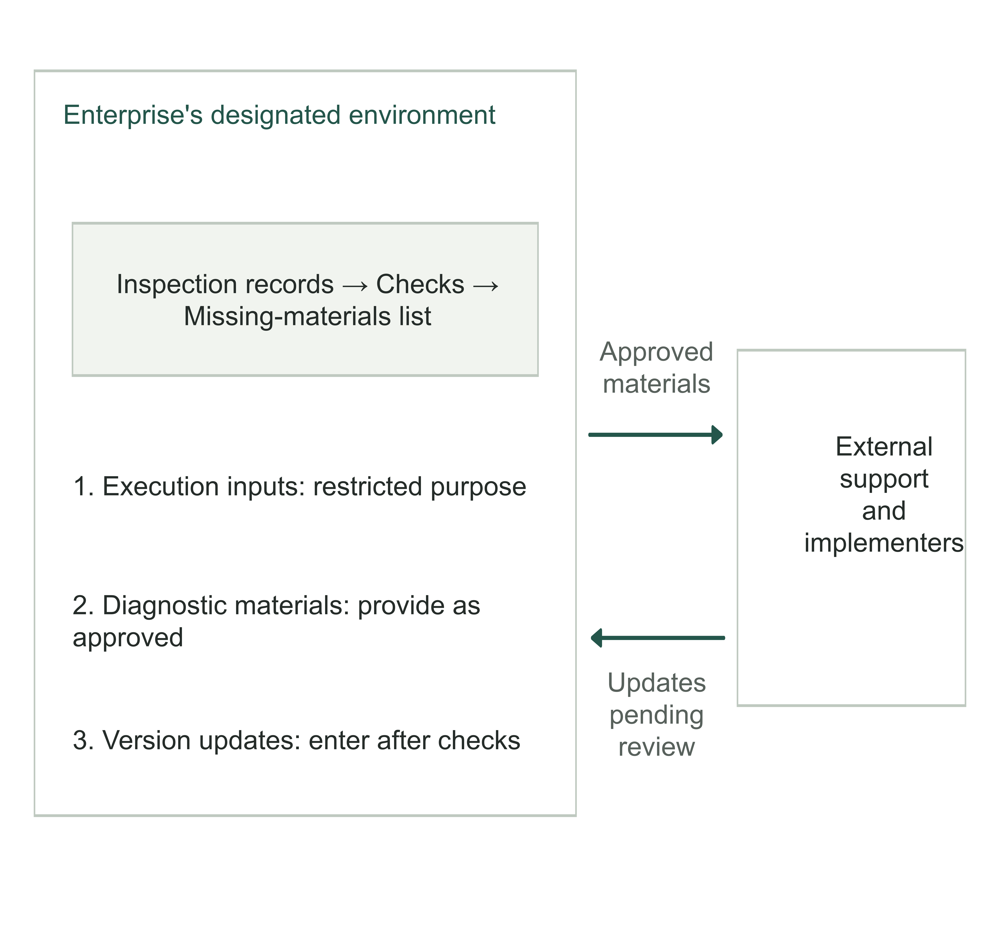

Figure 16-6 | Deployment boundaries must cover three information flows. The author's teaching design. Execution inputs, operational support materials, and version updates are different flows; identify the recipient and approval for each. The diagram prescribes no universally compliant deployment and does not indicate that all information may leave the designated environment.

Checking only where model inference occurs misses logs, screenshots, backups, and support sessions. Checking only outbound data misses how software updates and remote operations enter. For every route, ask what content actually travels, who can read or change it, on what grounds this is permitted, and what records must be retained. This is a check of project conditions; the responsible parties must still establish the specific applicable laws, industry requirements, and enterprise policies individually.

If delivery personnel are located in different countries, their locations must also appear in these arrangements. “Remote work” does not mean that access is allowed from any country. One FDE role on Turing's platform requires US citizenship, location in the Washington metropolitan area, and attendance at an office or customer site two to three days each week.[6] These are conditions for one role, but they are enough to remind us to verify before quoting which staff locations the customer accepts, which materials those people may see, and which work must be done on site.

Continuing the inspection teaching example, if a customer-side lead coordinates and an engineering team in another country implements the functionality, first test the handover with one small task. The customer-side lead obtains approved samples and rule descriptions; the remote team builds from them and returns a version and test records; the enterprise confirms business results and approves release under its existing responsibilities. Then simulate an incident to check who takes over first when the teams' working hours differ and which diagnostic materials may be provided. If diagnosis must wait until the remote team starts work, include the waiting time and temporary manual processing in the support arrangements. Establishing ordinary remote meetings does not prove that production support is ready.

Deployment conditions also add work for the customer. The delivery party cannot activate enterprise accounts; IT must arrange them. Another company maintains the business system, so someone with authority must coordinate interface changes. On-site equipment cannot stop at any time, so test windows must fit production schedules. Writing all of this as “customer cooperation” makes every unmet condition appear to have an owner until the planned date exposes the gaps.

Table 16-2 | Turn deployment conditions into specific work. The author's teaching design.

| Condition | What the sending party provides | What the receiving party confirms | Next action if unmet |
|---|---|---|---|
| Read-only access to the register | IT provides an approved account and interface scope | Implementer verifies that required fields can be retrieved | Record missing fields and ask the business to decide scope |
| Troubleshooting involving sensitive information | Enterprise provides approved materials | Support confirms they are sufficient for diagnosis | Specify what is still missing and request more |
| On-site version update | Implementer provides change and validation materials | IT and business confirm within their respective responsibilities | Confirm the scope that remains applicable and reschedule |
| Interface across suppliers | System maintainer provides change and compatibility information | Delivery party completes integrated validation | Coordinator convenes the relevant leads to decide scope adjustments |

Clear constraints can also reduce costs. A supplier that knows in advance that only read-only interfaces are allowed need not first build automated write operations that will later be denied approval. Support staff who know which diagnostic materials they can receive can plan troubleshooting more easily. Conversely, if procurement assumes that access to the materials is already authorized, only for implementation to reveal that providing them is not authorized, disputes over time and cost will emerge together.

An unavailable interface or missing materials should be recorded as an unmet condition, not assumed to appear automatically on the planned date. The team can first validate work that does not depend on it, narrow the scope, or change the sequence. Changes to commitments require confirmation from someone authorized to decide. Engineers must not expand access on their own to meet a deadline and then ask the enterprise to sign off afterward.

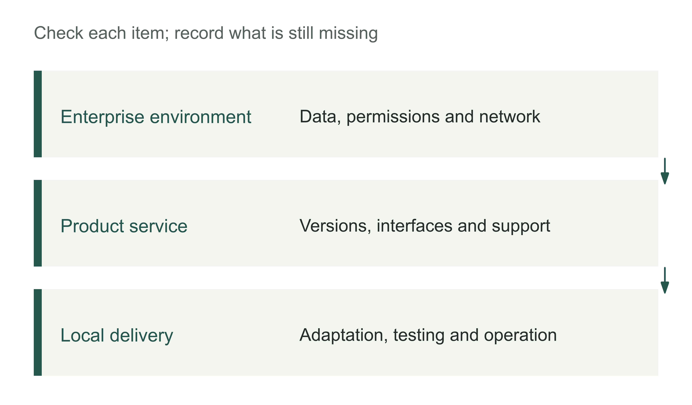

Figure 16-7 | How deployment conditions redistribute work. The author's analytical tool; work is allocated according to actual conditions, rather than inferred from brand names.

Table 16-3 | Recheck handover responsibilities when deployment conditions change. The author's checking tool.

| Change | What must be reconfirmed |
|---|---|
| Data access scope changes | Preparation of materials, permission approval, and logging responsibilities |
| Product version upgrade | Compatibility validation, recovery route, and maintenance window |
| Local delivery personnel change | Materials handover, takeover drill, and existing tasks |

## Each acceptance conclusion needs its own evidence

The Wuzhou procurement document calls for initial acceptance, followed by trial operation and final acceptance. Problems found in testing or trial operation must be resolved; technical materials, a delivery list, and training for operations and maintenance staff are also delivery requirements.[2] Our concern here is not only these steps but which conclusions require evidence from different parties.

A security tester can issue a report within its test scope; that report cannot confirm on behalf of business staff that a processing rule is correct. Business users finding a list useful cannot replace IT's confirmation of access permissions and operational recovery conditions. When the procuring entity organizes final confirmation, it should be able to see how these different conclusions relate to the current commitment, rather than simply add up the reports.

In the inspection teaching example, suppose field extraction tests have passed but the list still mixes two categories of records: records genuinely missing required items, and equipment outside the scope of this inspection. Adjusting the recognition model again may not solve the problem; the business lead must confirm the applicable scope and how it is represented. The test exposes the issue, but the subsequent decision must return to the person responsible for the rules.

Conversely, if the business rules are clear but mismatched interface versions prevent the system from retrieving records, asking the business department to repeat its “agreement to use” cannot replace a repair. Separating defects, unfinished dependencies, and new requirements helps find the correct resolution path. It does not absolve any party in advance; final responsibility still depends on the actual agreement and facts.

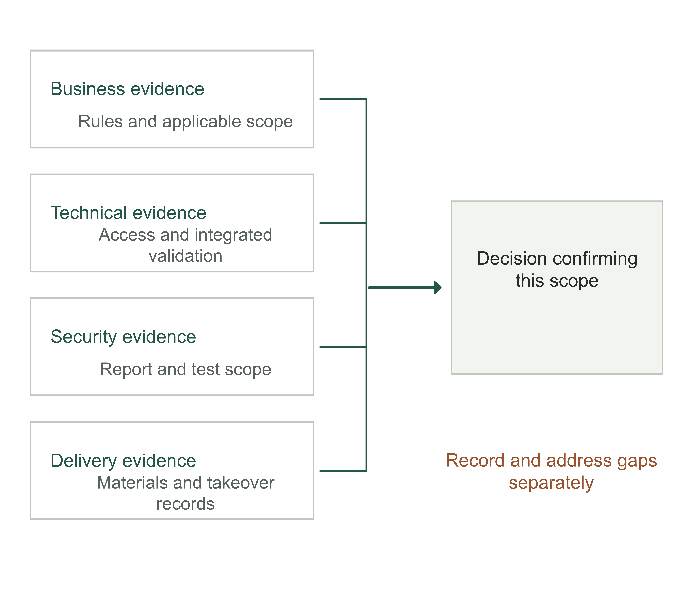

Figure 16-8 | What evidence acceptance requires. The author's analytical framework, informed by the Wuzhou procurement requirements.[2] Business, technical, security, and delivery evidence are produced separately and jointly support confirmation of the current delivery scope. When a required category is missing, record the gap and its treatment; a conclusion from another category cannot offset it.

Someone inside the enterprise should maintain an unresolved issues record: which deliverable is affected, what evidence exists, who makes the next decision, and when it will be reviewed. For disputed items, the parties can first establish the facts together and then discuss a response. If the actual interface has not been provided, for example, they can first confirm the missing fields and affected tasks. Whether to add the interface, switch to manual input, or reduce scope requires a further decision based on commitments and resources.

This record also prevents different teams' “completed” statements from referring to different things. The platform party says the account is active, the implementer says the program has been submitted, and the user is still waiting for business rule confirmation. All three statements may be true while the whole task remains unfinished. The coordinator must check the same task, version, and scope of use to establish who has yet to receive the work and why they cannot accept it.

Acceptance should not erase limitations already found. If validation passed only for certain equipment types and record formats, record that scope. Another factory that has not been validated can remain outside the release. Procurement acceptance, business use, and later expansion then each have their own grounds, and the enterprise will not mistake one limited pass for readiness across all units.

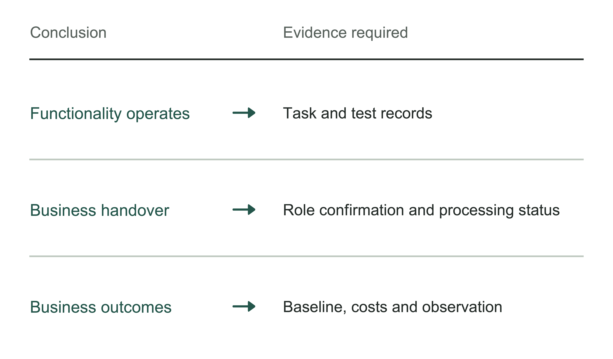

Figure 16-9 | Match each acceptance conclusion to its evidence. The author's analytical tool; signatures from different parties do not automatically establish the same conclusion.

## After payment, who handles the next change?

The Wuzhou procurement document specifies no advance payment, full payment after the project passes acceptance, and payment through the fiscal disbursement procedure. The platform maintenance period runs for three years from successful acceptance.[2] These provisions link acceptance, payment, and maintenance, but do not make them the same event. Nor do the notice and procurement requirements prove that money was paid or that three years of service were effectively delivered.

The supplier needs continuing staffing for post-acceptance support. The buyer's payment of the contract amount likewise does not mean it can remove the internal business staff responsible for receiving the results. When a rule changes, external engineers still need to know who confirmed it, when it takes effect, and which tasks it affects. The party responsible for system implementation and the party responsible for the grounds for business decisions may remain separate throughout.

The contract text attached to the procurement document also requires the project lead and team to match the response document, written consent from Party A for staff additions or replacements, and guarantees of attendance for important activities and time on duty.[2] This is a written arrangement intended to constrain personnel continuity; it does not establish that actual staff never changed. The enterprise must further check whether unresolved issues, versions, support channels, and permissions transfer together when people change.

Agreeing on a single intake point can reduce users' repeated guesses about whom to contact. But that point must route issues to a party capable of handling them and retain their status throughout. It does not mean the same team personally resolves every issue, or that the intake party can make commitments for the product vendor or the enterprise's business lead.

Support involving several suppliers should be checked before it is first needed: whether the application party has the right to obtain necessary product support, whether the original system maintainer provides interface change notices, whether the enterprise has assigned a business confirmer, and what evidence recovery requires. If the current service covers only existing interfaces, fees and windows for new interfaces need separate arrangements. A verbal sales assurance that “we can coordinate everything” does not explain who fills a gap when one party has no service obligation.

In the inspection teaching example, suppose the original register supplier changes an equipment status field, while another provider maintains the inspection assistance program. The former knows why the field changed, the latter controls the checking logic, and the equipment management staff know which equipment should never have entered this round of work. A change made by any one party alone can miss another part of the conditions.

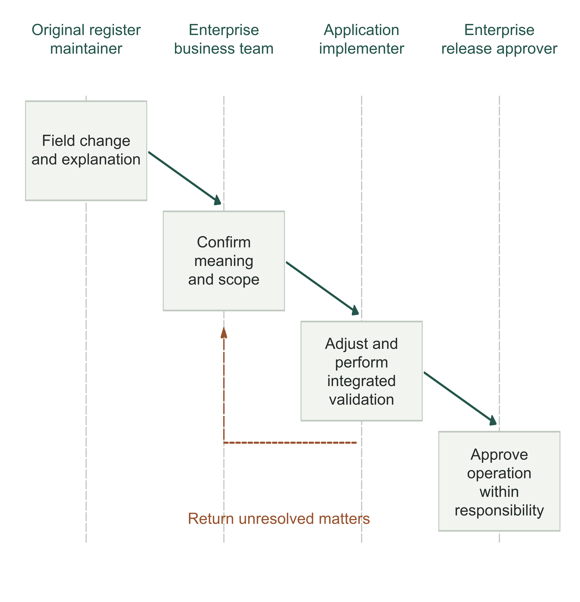

Figure 16-10 | Complete a change across several parties. The author's teaching design. The register change is first documented; the enterprise confirms its business meaning and scope; the application implementer adjusts and validates the system; the enterprise then approves operation under its assigned responsibilities. The return path retains unresolved issues. It does not depict an event known to have occurred at a real customer.

Materials left with the enterprise also need checking. Wuzhou's attached contract text contains ownership provisions for reports, materials, documents, and service deliverables.[2] This does not directly establish that all code for the underlying commercial software was given to the procuring entity, or prove that another team can take over. Chapters 14 and 15 respectively discuss validation after transfer to others and the burden of replacement. On this chapter's responsibility map, identify who keeps and updates these materials and the conditions for their use.

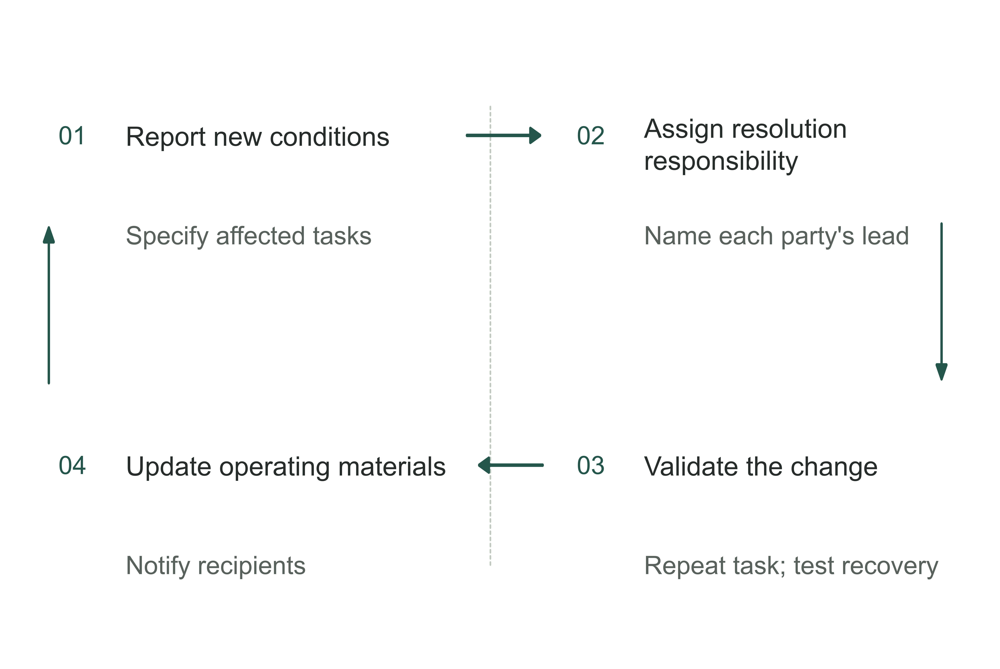

Figure 16-11 | Who handles changes after payment? The author's analytical tool; regularly reconfirm each party's responsibilities during operation.

## How a business owner can check the chain

The business owner need not chair every technical meeting but should be able to find the complete grounds for a piece of work from requirements through receipt. Start by sampling the most recent handover: what the receiving party obtained, which conditions remain unmet, and who made the next decision. If the answer consists only of separate completion reports from several teams, ask the coordinator to align them to the same task, version, and scope of use.

The chapter worksheet records an actual delivery across eight handovers: requirements confirmation, information authorization, development and integration, validation, business handover, procurement and payment, operations and maintenance, and feedback from experience. For each, record the receiving party and the grounds for acceptance. The procurement and payment row also separates acceptance confirmation from actual payment status; contractual payment conditions cannot substitute for a payment that has occurred. Where there is no separate department, enter the person actually holding the combined role. A blank with an assigned action to fill it is more useful than assuming a title means someone is responsible.

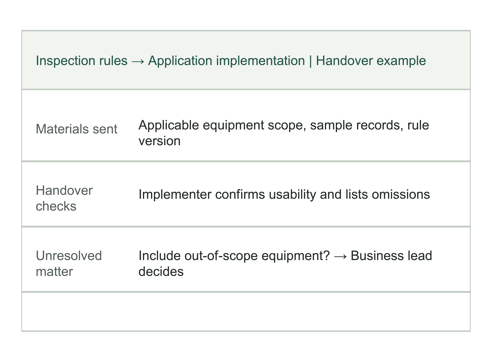

Figure 16-12 | What a handover record adds to a contact list. The author's completed example, continuing the inspection teaching design. Job titles alone are insufficient: the record must specify the materials transferred, the grounds for confirming receipt, and who decides unresolved matters. The table traces actual work; it does not assess professional qualifications.

This also provides grounds for choosing a delivery organization. If the enterprise already has an engineering team and stable platform operations, external help can concentrate on specialist capabilities. If it relies on an integrator, focus on whether the integrator can coordinate the product vendor, original system maintainer, and business staff. If it is buying only a standard tool, confirm that the current task can be completed within existing capabilities and authorization. The choice should follow task dependencies, rather than be predetermined by “in-house is advanced” or “outsourcing is easier.”

Channels can bring knowledge of customer sites, integration capability, and support coverage, while also adding handovers to coordinate. Judge an intermediary service by which previously unowned work it actually takes on and whether it makes verifiable commitments for that work. One arrangement in public procurement is an analyzable sample, insufficient to establish the best route for all Chinese enterprises.

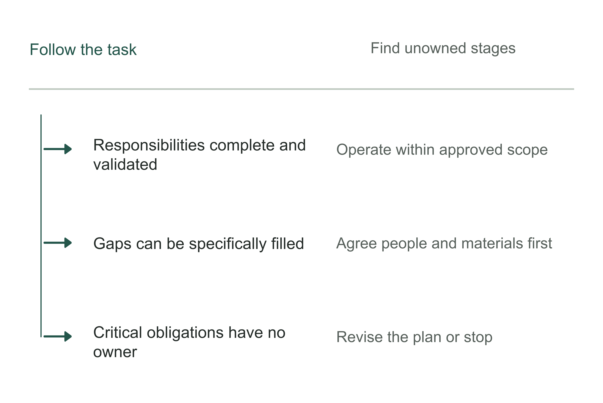

Figure 16-13 | Decide after checking the responsibility chain. The author's analytical tool; the chain ends in actual takeover, rather than a contact list.

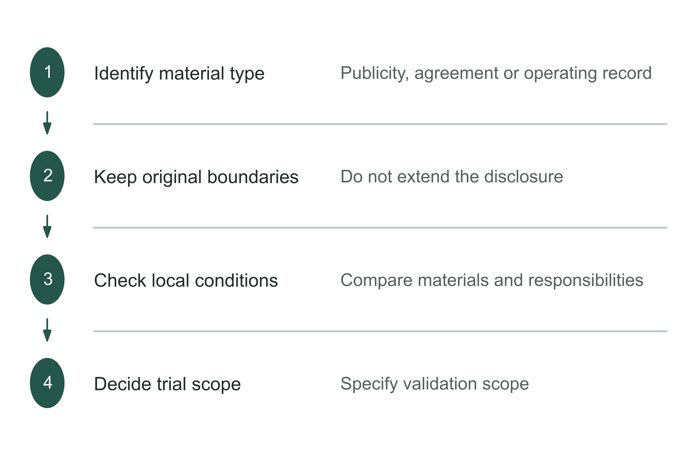

Figure 16-14 | Use Chinese practice materials to inform this enterprise's decisions. The author's analytical tool; external cases offer clues, while local conditions still require verification.

Table 16-4 | Task replay sheet for a three-party meeting. The author's checking tool.

| Point in the replay | Who should answer |
|---|---|
| What the task is and what counts as complete | Actual business lead |
| Functionality and version limitations | Product or technical maintainer |
| Adaptation and handover history | Actual delivery lead |
| Exceptions and subsequent work | Personnel authorized to run the system |

Whatever organizational arrangement is chosen, someone must establish the task, implement functionality within authorization, check the results, and handle later changes. Titles may stay the same and people may come from different organizations; what must be clear is who performs each step, what they provide, and who confirms it.

Once external teams' responsibilities are clear, the enterprise faces an internal question: does past experience still apply? Who can revise it, and how should later recipients use it? A supplier can maintain the system, but the enterprise must keep and check the business rules and evidence underlying that experience. The next chapter discusses how to record individual experience so that others can understand, test, and update it.

## Notes and sources

[1] China Government Procurement Network, award notice for the procurement of Wuzhou's social insurance RPA digital employee service, May 20, 2025. The procuring entity, successful supplier, and procurement agency are identified separately; an award or service term is not treated as actual performance. [Official notice](https://www.ccgp.gov.cn/cggg/dfgg/cjgg/202505/t20250520_24621872.htm).

[2] Wuzhou Social Insurance Administration Center, competitive consultation document for the procurement of the social insurance RPA digital employee service, May 2025, project number WZZC2025-C3-990088-GXSL. Locations: Chapter 2, sections 1.1 and 1.6, and commercial provisions II–V, IX, and XI; Chapter 6, Article 2. The latter chapter is a contract template, not an obtained signed contract. The main text cites provisions because page numbers change when the document is reformatted. [Official DOC attachment](https://oss-gxhlw.unicloudgov.com/guangxi-gov-open-doc/1023FP/undefined/450406/10007282919/20255/d3a6b151-9124-4e3a-b81d-c02860bb0557.doc).

[3] China Government Procurement Network, award notice for an institute's software procurement of a unified AI model and software agent research and development platform, November 27, 2025. Locations: sections III, IV, and IX. This supports only the parties and brand listed in the notice; no subcontracting relationship or product vendor staffing is inferred. [Official notice](https://www.ccgp.gov.cn/cggg/zygg/zbgg/202511/t20251127_25777050.htm).

[4] Baidu, AI Computing and Large-Model Product Solutions Engineer, J58750. Job responsibilities and qualifications; page dated July 21, 2026. [Official job posting](https://talent.baidu.com/jobs/detail/SOCIAL/8152efe0-e609-4eda-95fc-cc23a32f1074).

[5] Baidu, Solutions Architect for Hong Kong, Macao, Hainan, and Guangxi, J103970. Job responsibilities and qualifications. The page reviewed here is dated September 4, 2026, a change from the older archive; this is not used to infer that the role is newly created. [Official job posting](https://talent.baidu.com/jobs/detail/SOCIAL/5b98e726-e3ac-4aa4-ac04-d350fce31c97).

[6] Turing, Forward Deployed Engineer, official job posting, checked September 17, 2026. The Citizenship, Location, and work arrangement provisions specify US citizenship, the Washington metropolitan area, and attendance two to three days per week. These describe only this role's conditions; no general requirements for other roles or US projects are inferred. [Official job posting](https://work.turing.com/r/Wrq8XwixRE).

The Wuzhou case is based on official notices and the procurement document. A signed contract, acceptance reports, payment records, and actual maintenance records have not been obtained. Job descriptions do not establish what people actually did or the size of the market.

The inspection scenario, configuration comparison, Figures 16-4, 16-6, 16-8, 16-10, and 16-12, and the worksheet are all the author's designs, rather than real customer experiences. The deployment checklist organizes work; it does not constitute a complete determination of the regulations applicable to any enterprise.
