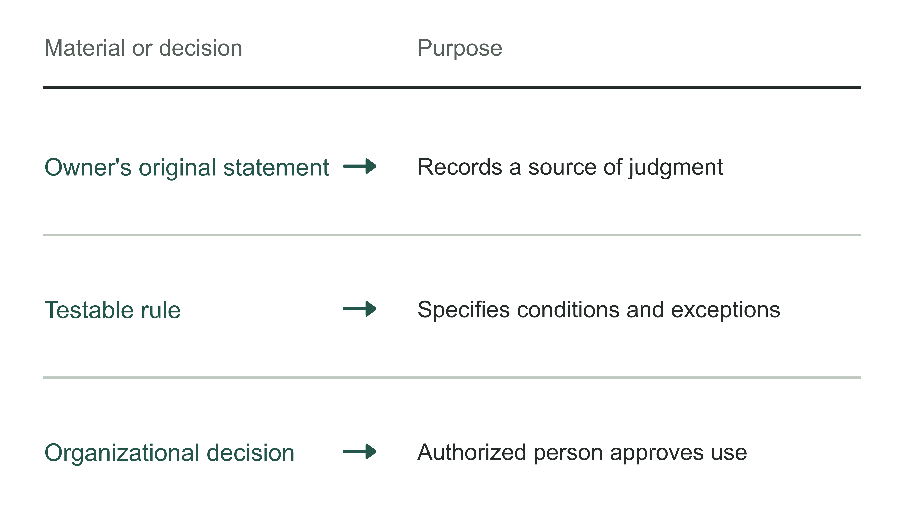
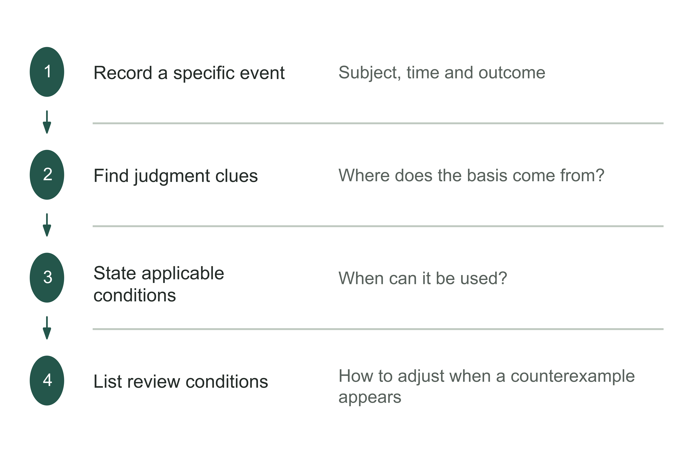
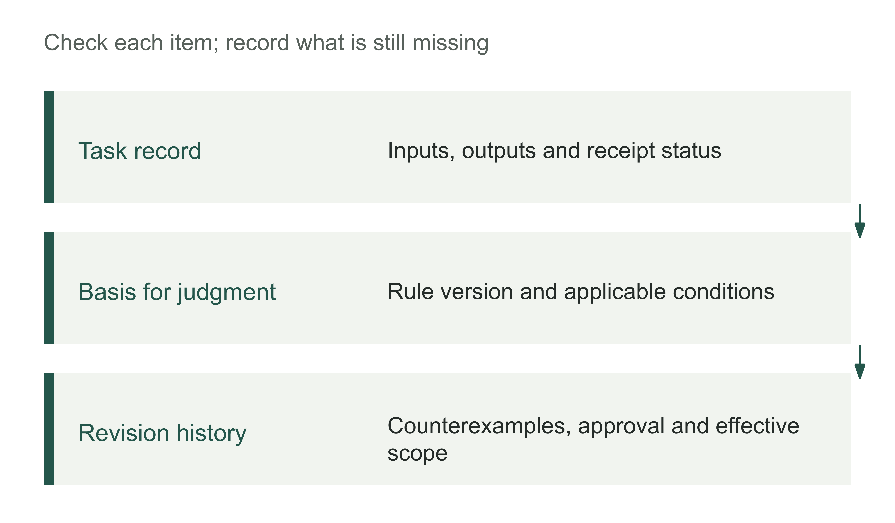
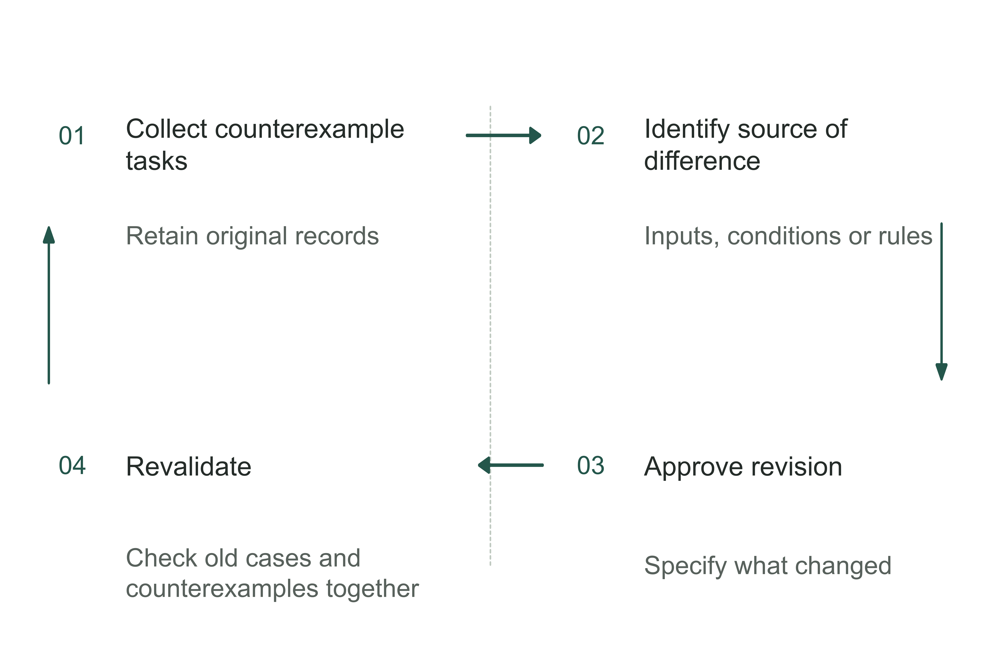
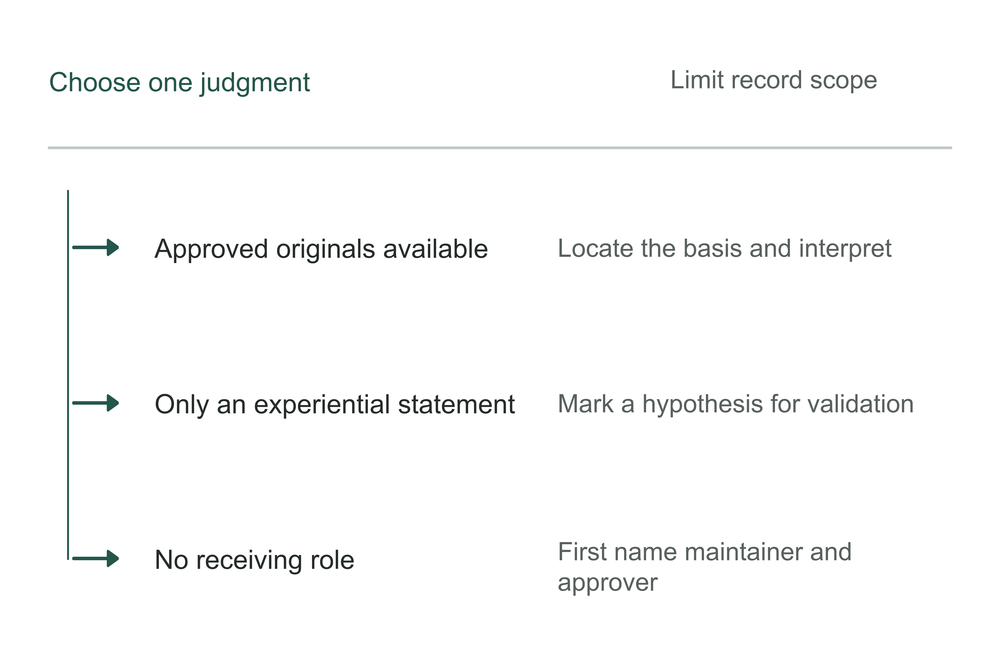

# Chapter 17 From a business owner's experience to an AI digital role: turning practice into organizational capability

Once responsibilities for receiving work across procurement, business teams, IT, and suppliers are clear, the enterprise still has to answer: on what basis does the recipient judge whether the work is correct? This involves where experience comes from, who confirms it, and who revises it when conditions change.

A business owner may have offered a useful observation: “For this kind of customer, we can be flexible before month-end.” Experienced staff may know that this applies only to a particular customer type, period, and payment risk. If the statement goes straight into an AI digital role, the system may interpret it as authorization without any scope limit. It may relax conditions on the owner's behalf for the next order, or treat an outdated exception rule as current policy.

What checks must an observation based on experience pass before it becomes a rule everyone follows? First establish the circumstances at the time, then examine counterexamples, and finally obtain approval from someone authorized to decide, specifying the applicable scope. The digital role can work only under an approved version. If materials are insufficient or rules conflict, it refers the matter to the responsible person. When conditions change, the rule must be checked again and, where necessary, revised or withdrawn.

## Do not turn something the owner once said into a rule

Imagine a manufacturing enterprise whose finance team uses a digital role to help check whether an order qualifies for month-end settlement. In the past, the owner verbally agreed to a one-off payment extension when a customer experienced a temporary cash-flow difficulty. Several months later, an experienced employee encounters a new customer and repeats the statement to the system: “The owner said we can be flexible with major customers.”

But the current rule in the finance system is narrower: an exception process is available only after a credit assessment, an established performance history, and confirmation on the order by the finance lead. The new customer has no performance history, and “major customer” is undefined. If the digital role answers “an extension is allowed,” it turns an individual's recollection into an unauthorized business action. If it answers only “the owner agreed in the past,” it mistakes the source of the statement for grounds to apply it now.

Exception handling for this order should first be paused. Retain the order and conflict record for confirmation by an authorized decision-maker. The system can still list missing credit materials, identify the current rule version, and prepare an explanation of the effects of the payment terms. The exception scope can expand only after approval.

At least four states must remain distinct, rather than being blended into one “knowledge-base answer”:

Table 17-1 | Four states of experience within an organization. The author's framework.

| State | What it establishes | What the digital role can do | What it does not authorize |
|---|---|---|---|
| Individual clue | Someone remembers a past way of handling a situation | Record the source, task, and questions to verify | Execute it as current policy |
| Candidate experience | Conditions, evidence, exceptions, and possible consequences have been added; approval is pending | Flag applicable conditions and arrange review | Automatically change orders or rules |
| Current rule | An authorized role has approved a specific version and scope | Execute, explain, and keep records within that scope | Extend it to customers or new versions outside the scope |
| Invalid or disputed item | Changed conditions, a counterexample, or withdrawn approval have left insufficient grounds | Pause the relevant action, refer it to the responsible person, and record effects | Continue using the old answer when its basis is unclear |

Chapter 9 distinguished the uses of information; here we also distinguish the status of experience. A document can be correctly retrieved while still awaiting confirmation or already being invalid. The role uses that status to decide whether the current action may continue.

Figure 17-1 | The place of experience materials in forming rules. The author's analytical tool; preserve the three levels separately rather than treating them as equivalent.

Table 17-2 | What to retain before turning an original observation into a rule. The author's checking tool.

| Item to retain | How to record it |
|---|---|
| Original material | Location, date, and authorized scope of use |
| Event conditions | Subject, inputs, participants, and outcome |
| Nature of the material | Label original statements, editorial interpretations, and approved rules separately |

## Break a judgment down into experience that can be checked

“The owner usually agrees” is not a transferable basis for business decisions. To turn it into candidate experience, answer at least six questions: What task was being handled? Which conditions made the judgment valid? Which rule, fact, or risk information supported it? Which situations were excluded? Who could approve exceptions? When would it need to be checked again?

The original spoken statement can become an annotated draft rule:

Table 17-3 | Turn spoken experience into a draft rule

| Original statement or addition | Draft rule | Why change it? |
|---|---|---|
| “We can be flexible with major customers.” | “A customer who has completed a credit assessment, has no late payments in the past two settlement cycles, and whose order amount is below this approval level's limit may apply once for month-end settlement. New customers, overdue customers, and orders with unconfirmed advance payments are excluded.” | Replace a vague category with checkable conditions and exclusions |
| “The owner agreed before.” | “This exception originated with order A-017 in [month] 2026. The owner confirmed it at the time, and the finance lead recorded the reason. This record is candidate experience only and does not automatically override the current rule.” | Separate recollection from authorization status |
| “The system can decide whether to relax the conditions.” | “The system only checks materials, matches conditions, and generates an application. It may generate payment terms awaiting execution only after the finance lead confirms.” | Separate recommendation, approval, and execution |
| “We will always do it this way.” | “This version applies to Category B customers at the East China factory, on a trial basis until [month/day] 2026. Review it upon a late payment, a rule change, or two returns.” | Specify scope, term, and invalidation triggers |

The rewritten draft separates responsibilities: the owner's past decision is a traceable clue; the finance lead confirms the applicable scope and approves exception applications; the digital role checks materials, flags omissions, and records the basis. Only after an authorized person confirms the draft does it become an executable rule.

Experience materials should also retain three kinds of counterexample: a different outcome under the same conditions, changed conditions, and an original judgment that relied on unrecorded information. These help establish the applicable scope; isolated successful outcomes do not support unconditional reuse.

This draft payment exception rule is the author's teaching design, illustrating the rewrite from spoken experience to a candidate rule. It does not represent an actual customer's policy. The use and evidentiary limits of the author's materials are explained at the end of the chapter.

Figure 17-2 | Rewrite a judgment as a checkable rule. The author's analytical tool; the rule is an expression to be tested, while original materials must still be retained.

Table 17-4 | Counterexample checklist for a candidate rule. The author's checking tool.

| Question | Entry for this task |
|---|---|
| Which conditions must all hold at the same time? | Specify them and attach the evidence |
| Which fact would require a different judgment? | List counterexamples and the original tasks |
| Who receives the matter when the basis is insufficient? | Name the authorized recipient |

## What work products a digital role should leave

If a role's only output is “yes” or “no,” the organization will soon lose the basis for its judgments. A digital role with real responsibilities must provide at least four things: the current task's processing result, the rules or facts supporting it, unresolved disputes, and what the next recipient needs to do.

For the payment exception just discussed, the role should create the following record after receiving an order: the customer category, the rule version used, whether credit materials are complete, whether historical cases match current conditions, and whether an exception is triggered. If automatic processing is unavailable, record the missing materials, who approves, and when to review. It can generate an application or leave the order pending confirmation, but cannot disguise “pending confirmation” as “approved.”

The role's responsibilities must also specify when its work products are used, to whom they are given, who may modify them, and which tasks a modification affects. Table 17-5 connects these conditions to the records retained at each stage.

Table 17-5 | What the enterprise must prepare for a digital role to complete work. The author's framework.

| Stage of the role's work | Work product that must remain | Required organizational condition | Response if missing |
|---|---|---|---|
| Receive the task | Task subject, customer category, input version | Defined recipient and task scope | Keep out of automatic processing; complete the task card |
| Check the basis | Rule version, factual source, matching conditions | Information has a defined purpose and applicable dates | Mark the basis as insufficient; refer for human checking |
| Generate a recommendation | Recommendation, exception reason, expected effect | Permitted actions and output scope are approved | Save a draft only; make no write to business systems |
| Handle a dispute | Conflicting positions, missing facts, escalation recipient | Named decision-maker with time allocated | Enter the unresolved issues queue |
| Complete a handover | Result, approval record, confirmation of receipt | Business recipient has time and a backup | Leave pending; do not declare completion |
| Feed back and revise | Counterexamples, affected scope, review date | Rule maintainer and withdrawal route | Pause the affected version and review again |

“Handle a dispute” is the stage most easily removed. Enterprises often see it as a failure of system intelligence, yet a dispute is important information when experience is unsettled, rules conflict, or conditions change. A role that accurately identifies “the current materials do not support this action” has already prevented an unsupported expansion of authority.

All these responsibilities consume staff time. Orders referred to people need review; rule revisions require confirmation of their effects; withdrawn versions may leave remedial work. If the finance lead has only one hour a week but there are one hundred exception applications, narrow the scope or add review capacity. Otherwise, unresolved matters will keep accumulating.

A backup taking over needs the current rule version, unresolved issues, actions already taken, and matters still blocked. An external delivery party can build the process, while the enterprise retains responsibility for rules, approval, and receipt. This is the memory component of a handover of responsibilities: transfer the program together with its applicable basis and limitations.

Figure 17-3 | Three layers of work products left by a digital role. The author's analytical tool; people must be able to use the records, trace their sources, and correct them.

## Make counterexamples change the rule when needed

A common perfunctory response is to file a counterexample in the case library and call it handled, without reviewing the rule or adjusting the method. Cases accumulate while the role still answers under the old rule. Alternatively, the team excludes counterexamples from the denominator to preserve apparent accuracy. Both obscure signals for review and leave the team unable to judge whether the old rule still applies.

For payment exceptions, the role should respond differently to the following three events:

1. **Changed conditions.** The company changes its credit rating rules from three levels to four. Even if the model, interfaces, and prompts are unchanged, the original candidate rule should not automatically remain applicable. First identify affected customers and orders; then ask the finance lead to confirm a mapping or pause processing.
2. **A counterexample under the same conditions.** Two orders both meet the old conditions; one settles normally while the other becomes seriously overdue. The role cannot retain only the successful sample. Check for other differences, narrow scope if necessary, and refer the risk decision to the approver.
3. **Repeated exceptions.** Business users repeatedly return outputs despite complete materials, or the role frequently asks people to supply the same field. The cause may be the wording of the rule, input fields, or receiving process rather than staff “refusing to cooperate.” First quantify the affected scope; then decide whether to revise the rule, add a field, change the role's output, or withdraw automatic recommendations.

All three events require the enterprise to check again: does the original experience still apply to the current task? The model may not be wrong, and the rule may not need changing, but the old conclusion cannot be reused without review. Records must distinguish the old rule's applicable period, approval and effective dates of the new rule, and the version governing unfinished tasks. Otherwise, the system may reassess old orders under a new rule without being able to explain why results changed.

Figure 17-4 | Dispute resolution path. The author's teaching design.

Routine decisions go to the authorized business approver; matters of scope, risk, or budget beyond that authority are escalated. The role prepares materials and retains the decision record. A historical approval applies only to the scope confirmed at the time.

Withdrawal should also be a normal organizational action. If a rule holds only at a particular factory, for a customer category, or with an interface version, the enterprise can preserve its history while stopping automatic use on new tasks. Closing a rule is not deleting it. Historical orders still need explanation under the version effective at the time; affected unresolved tasks need a recipient; the cost and duration of the alternative process must be recorded. Chapter 13 distinguished repair, pause, and exit; here we apply the same distinction to experience itself.

Figure 17-5 | How counterexamples actually change rules. The author's analytical tool, applicable when review confirms the need for revision. A counterexample first leads to a handling decision; update the version and revalidate only if revision is needed. Retaining the original rule also requires a recorded reason.

Continue the payment exception example by completing the review record. R1, R2, customers, dates, amounts, and records below are all the author's teaching assumptions. The limits illustrate the judgment and are not credit recommendations. R1 is approved and permits the role only to check materials and generate applications. Customers must satisfy existing credit conditions, have no late payments in the past two cycles, and have a single order below renminbi (RMB) 50,000. Finance still approves each order individually. The customer's credit record separately sets a total limit of RMB 100,000, but R1 omits cumulative utilization from its checks.

On September 10, order T17-204 applies for RMB 40,000 of month-end settlement. The individual order is below the limit, but two other unsettled orders already use RMB 40,000 and RMB 35,000. Approving this order would bring total utilization to RMB 115,000. Under R1, the role reports that “the single-order condition is satisfied.” Before approval, the business recipient identifies the omitted cumulative constraint and returns the application. Retain the original input, R1 check result, and reason for return together; this difficult order must not be removed from the record.

Finance's review concludes that the approved R1 omits an existing credit constraint. A model operating under that version will still miss cumulative utilization. First pause affected new exception applications while continuing other checks of materials. The rule maintainer adds the cumulative utilization field and its source, then submits the revised draft to the finance lead for approval.

Table 17-6 | Version ledger for rule review and revision. Completed teaching example.

| Record | Decision and basis | Subsequent handling |
|---|---|---|
| R1 and T17-204 | RMB 40,000 < RMB 50,000, but RMB 40,000 + RMB 35,000 + RMB 40,000 = RMB 115,000, above the RMB 100,000 total limit | Retain R1 and the return record; first refer affected applications to people |
| Another “overdue” report | Bank receipt evidence establishes timely payment; only the internal posting was late | Retain the no-overdue-payment condition, correct the fact, and record the reason; feedback does not automatically change a rule |
| R2 approval | Finance lead approves on September 12; effective at 00:00 on September 13, limited to the original factory and customer category | Add “cumulative utilization plus this order must not exceed the approved total”; refer to people if a field is missing |
| Orders in transition | Review exception applications submitted but not executed under R2; old approvals do not automatically carry forward | Notify recipients; retain original grounds for executed historical orders and assess risk separately |
| New task T17-205 | With the same RMB 75,000 of other utilization, this order is RMB 20,000, totaling RMB 95,000 | This condition is satisfied; all other conditions and individual finance approval are still required |
| Replay the counterexample | Replaying T17-204 under R2, RMB 115,000 triggers the limit restriction | Stop generating an ordinary application eligible for onward approval; record the reason for human referral |

R2's “other utilization” includes unsettled amounts and approved commitments not yet executed. Deduplicate by order number, exclude the order being calculated, then add that order once at the end. This avoids omitting commitments awaiting execution or counting one order twice. Missing or expired credit records, or an unconfirmed definition of the total, must not turn blank values into zero. Concurrent applications must also use the same credit-limit management mechanism to check and register utilization at approval, and verify commitments and currently effective conditions at execution. This prevents two applications from each seeing an old balance and consuming the same capacity twice. Without reliable registration and controls, finance must handle intake centrally; a passed check when an application is generated is insufficient to proceed with execution.

A decision to retain the original rule also needs a record: feedback identifier, verified bank receipt, corrected fields, and approver. This preserves evidence that the feedback was handled, rather than ending the discussion with “no rule change.” Revision requires replaying the originally successful task, the triggering counterexample, and a new task. Seeing only a new task pass cannot confirm that the old defect has disappeared.

The example also separates the parties' work: the model helps extract original statements, locate conflicts, and organize applications; deterministic limit calculations and status checks go to programs; the organization decides which conditions are valid. Approval of a new rule does not authorize the model to expand credit or rewrite payment terms. Readers can use Worksheet 17-2 to preserve this review decision: record corrected facts and reasons when retaining a rule; enter a new version, effective date, and transition arrangements when revising it. Both decisions need a recipient. Then use Worksheet 17-1 to check whether a new recipient knows the current version and unfinished tasks.

## Organizational business memory can begin within a minimal scope

An enterprise need not organize every chat record, policy, and employee's experience before starting a digital role. A company-wide knowledge effort may consume a long time without helping the business solve a problem, while recording only one original remark from the owner is insufficient for others to act on it. A more prudent starting point is one type of judgment that has low risk, enough frequency to observe, relatively stable conditions, and real exceptions.

A minimal scope includes at least one complete task; an actual approver; a business recipient and backup; a version of a candidate rule with a stated scope; deliberately retained counterexamples; an escalation path; and a rule revision or withdrawal drill. At acceptance, select one specific dispute and check whether the system can find the basis, refer it to someone with decision authority, and hand the decision over for execution. Counting how many questions it can answer is insufficient.

Table 17-7 | A business owner starts a minimal organizational business memory task

| Confirm first | Specific entry | If you cannot fill it in |
|---|---|---|
| Task scope | Order category, unit, inputs, and final state | Narrow the subject; do not start company-wide |
| Experience source | Actual past handling, participants, basis, and exceptions | Register a clue only; do not use it as a rule |
| Current rule | Current version, approver, effective date | Keep human confirmation; prohibit automatic actions |
| Dispute path | Cases requiring escalation, recipient, and response time | Design the queue and backup before expanding |
| Counterexample set | Include changed conditions, differences under the same conditions, or returns | Delay release; missing samples do not establish stability |
| Review trigger | Rule change, repeated exceptions, expanded scope, or expiration | Give the candidate rule a temporary term |
| Handover evidence | Recipient can explain the basis and handle one exception | Retain external support; do not declare takeover complete |

The owner confirms scope, names approvers, and allocates time and people to disputes. Business leads maintain rules within their authority, the digital role works under those rules, and the technical team maintains the system. Check the completion of these responsibilities separately before deciding whether to keep investing.

The author's payment exception exercise can run within this minimal scope. Start with checks of materials and application generation, without automatically changing payment terms. Retain an order that meets the conditions but is returned, and observe whether the role identifies the conflict. Then change the credit rule version and check whether affected tasks are paused. Finally, the finance lead approves a limited revision and the recipient checks it using a new order. The drill can establish whether the process is checkable; it cannot establish cash benefits for the enterprise or replace measurement of long-term adoption and outcomes.

Figure 17-6 | Where to start building organizational business memory when materials are limited. The author's analytical tool; even a limited scope must retain authority, supporting grounds, and responsibility for updates.

## Help later recipients understand, use, and correct the experience

When experience is left for others, preserve its context, approval, and invalidation conditions together. A recipient facing a new task can then judge which grounds still hold and which need reconfirmation.

Table 17-8 | Can an experience record be handed over for others to use? The author's checking tool.

| Check | What the recipient should be able to do |
|---|---|
| Find the basis | Trace the rule back to authorized original materials |
| Judge applicability | Explain whether the current task is in scope |
| Identify a counterexample | Leave a record and find the maintainer |
| Correct the rule | Update through the approval path without overwriting history |

For a digital role to let someone else take over later, it should do at least four things: complete repetitive work within the approved scope, state the rule version used, pause the relevant action and refer disputes to the responsible person, and record counterexamples to support review. Experience preserved this way becomes more than “the owner once said so.” The recipient can establish why the decision was made then, whether it still applies, and whom to ask when a change is needed.

With a revisable basis and defined recipients, the enterprise can place these responsibilities within its first project. Chapter 18 organizes action around time, required conditions, and available people, and explains which conclusions still require observation after 90 days.

## Notes and sources

The payment exceptions, draft rules, figures, tables, and worksheets are all the author's teaching designs. They do not represent actual customer execution records or verified business outcomes.

For the methods of field observation, system design, sustained adoption, and handover across organizations, see Chapters 8, 9, 11, and 16 respectively.
