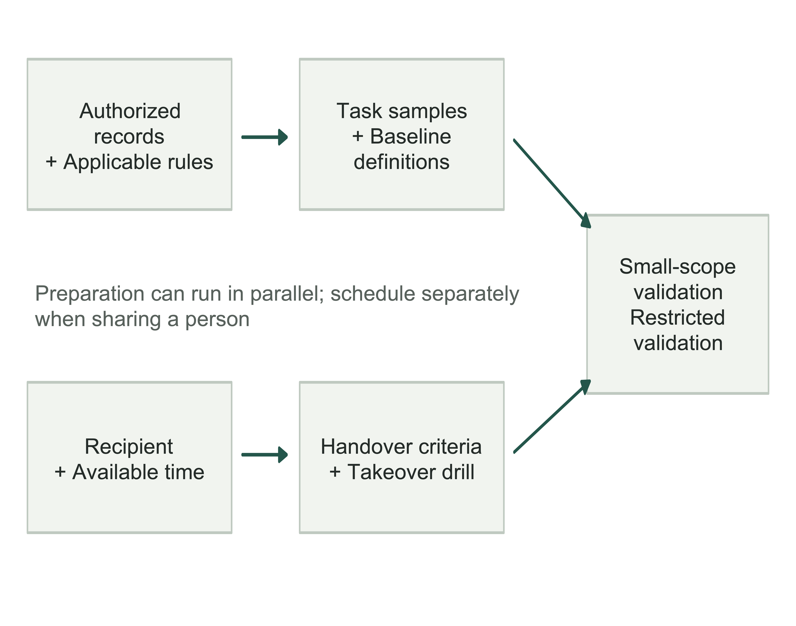
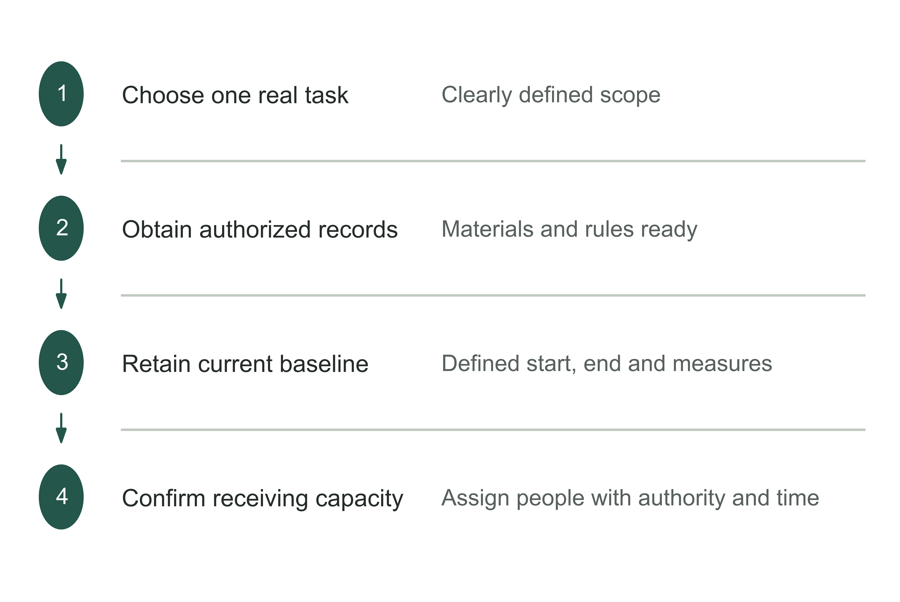
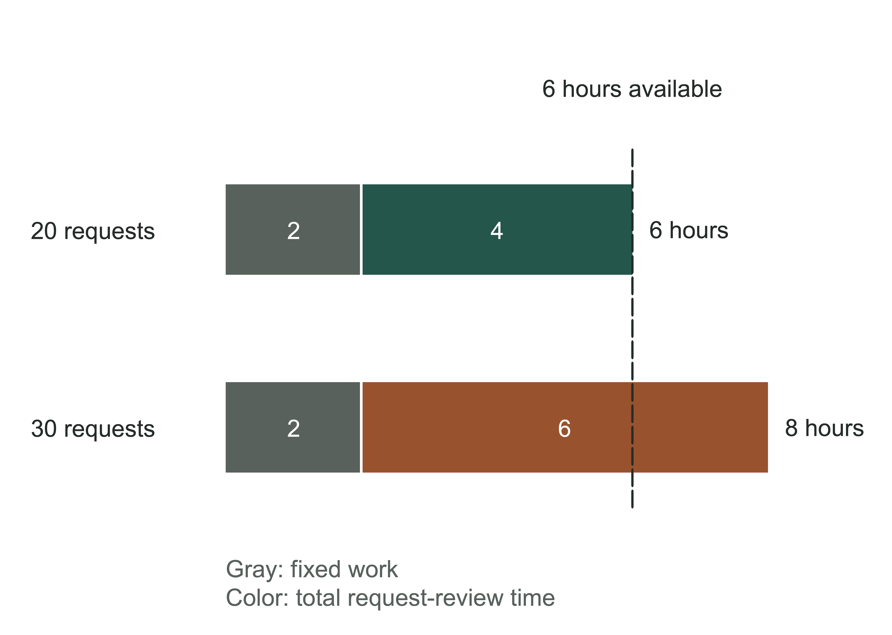
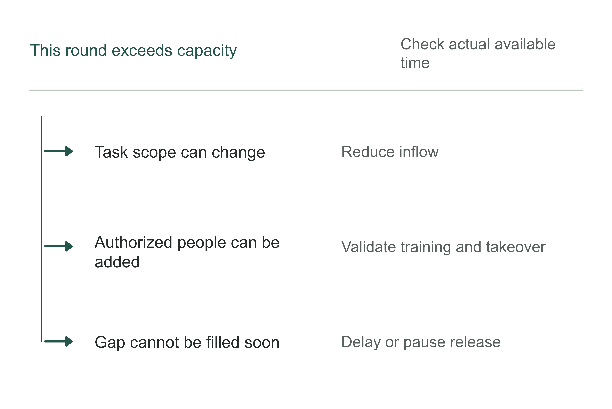
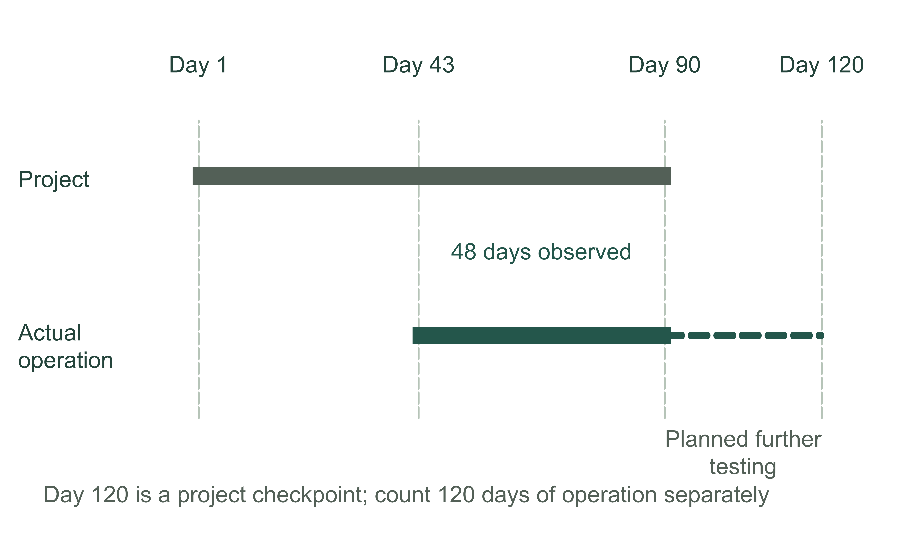
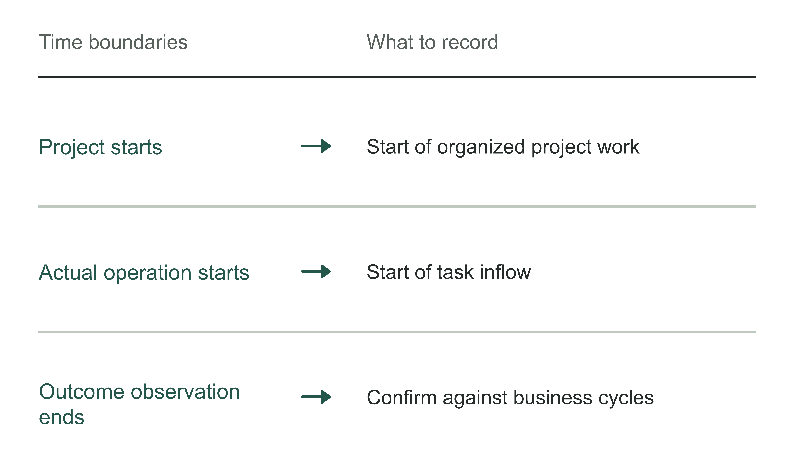
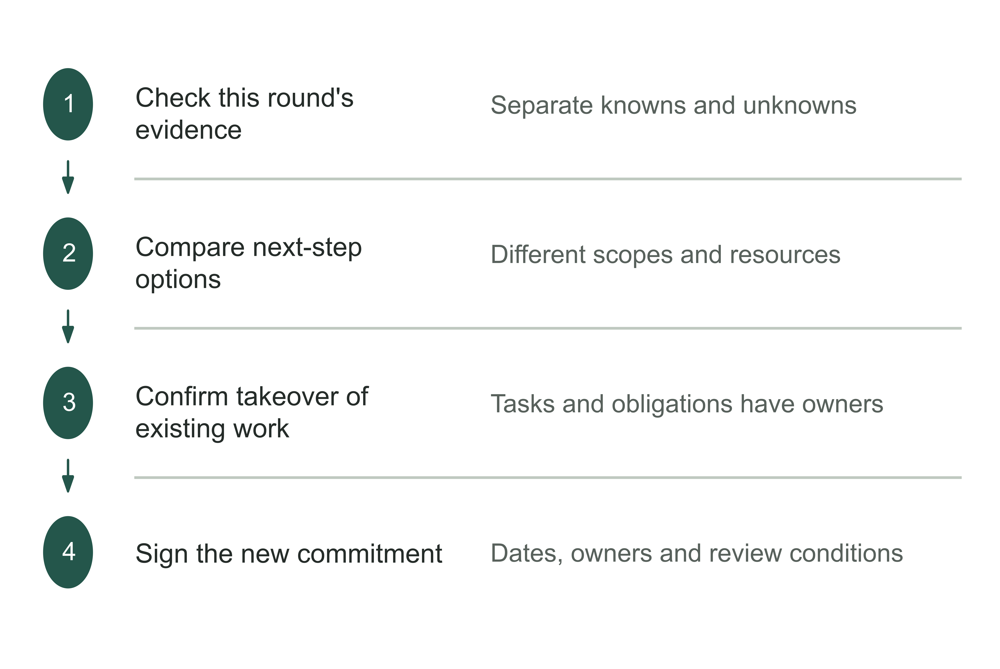
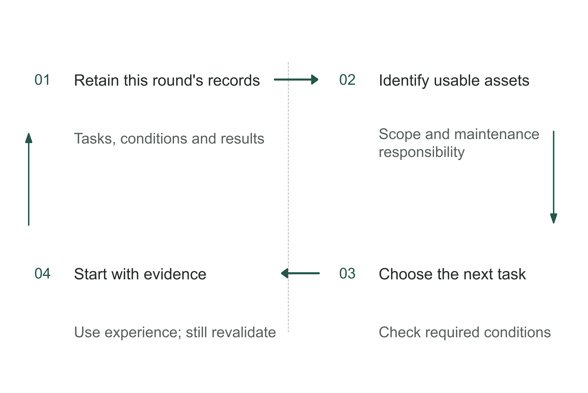

# Chapter 18 A business owner's 90-day action plan: making the first project work

If the first AI project starts tomorrow, what should it deliver on Day 90? A system that can be demonstrated is easy to recognize. A business decision supported by evidence is often overlooked: which work can continue to be assigned to it, which work remains with people, and how much more time and resources are worth investing?

Putting the previous chapter's responsibilities on a schedule reveals prerequisites. Materials must be confirmed before validation; recipients must set aside time before outputs can enter business work. Expansion also depends on enough actual tasks accumulating and the corresponding outcome observation period being completed. At a planned date, check whether conditions are met; do not advance simply because the date has arrived.

This chapter sets 90 days as the first decision window: validate one piece of work within the authorized scope, then use the records to decide whether to continue, adjust, or end it. Finding that the conditions do not hold and ending promptly can also be a responsible first-round result. The window guarantees no on-time launch, profit, or expanded deployment. Conditions not yet established need follow-up arrangements, while infrequent tasks and realized benefits must still be judged over their own observation periods.

First express the endpoint in a checkable sentence: “By Day 90, the designated lead will use this round's records to decide the next stage's permitted task scope, resource ceiling, receiving arrangements, and review conditions.” This gives all five stages a common direction.

Table 18-1 | A branching 90-day calendar: dates trigger checks; evidence determines the next path. The author's proposal.

| Suggested period | Who provides what | Decision and path if conditions are unmet |
|---|---|---|
| Days 1–14 | Business lead provides the problem, baseline, and materials list; approver confirms scope, people, and available time | Approve limited validation; if materials are missing, set a deadline to fill the gaps or choose another problem |
| Days 15–28 | Delivery lead provides a limited-scope design, offline validation, and takeover drill records | Approve the next mode of operation; remain in validation if defects are unresolved |
| Days 29–56 | Operations lead provides actual task states, exceptions, and additional human labor | Maintain, narrow, or progressively release based on evidence; address exceptions immediately |
| Days 57–84 | Business lead checks quality, adoption, costs, and outstanding obligations with technology and finance staff | Form next-stage options; permit only bounded further testing if observation is insufficient |
| Days 85–90 | Decision-maker checks the basis; recipients confirm existing work and subsequent responsibilities | Sign a decision to continue, adjust, or end; retain support if no one has taken over |

The first four periods total 12 weeks, or 84 days; the final 6 days are reserved for checks, handover, and next-stage arrangements. Each unit should schedule people around actual working days, holidays, and business cycles. The table gives no universal industry duration and does not require every activity to wait for the next stage. Preparation whose dependencies are satisfied can proceed in parallel, and stop conditions must be addressed immediately whenever they arise.

## First approve the work needed to obtain evidence

The most valuable commitment on Day 1 is often to let a business lead bring an actual task and produce verifiable inputs and a final state, rather than procure the whole system. Chapter 4's problem card and Chapter 5's investment and baseline worksheets explain how to record these. Now use them to decide: to judge whether this task can enter limited validation, who may do which work in this round, with what maximum resources, and when must they return with results?

Consider an equipment service business. The entire example below is a teaching exercise: dates, hours, and decisions are assumptions and do not represent a real customer. The team selects “checking materials for spare-parts price inquiries”: receive internal inquiry requests, check whether equipment model, required parts, and attachments are complete, and generate an evidence-backed omissions list for business staff to receive. The first round does not quote prices, choose compatible parts for customers, create purchase orders, or send commitments externally.

This scope looks small but has a real final state: the business recipient can use the omissions list to obtain the missing materials or refer an unresolvable request to a designated technician. If the system merely produces a string of “possibly missing information” and nobody knows what to obtain or from whom, the task is incomplete. The owner confirms which work to do and how to validate it, rather than “let AI take over the spare-parts business.”

During Days 1–14, establish the dependency chain first. Where are the request records authorized for use? Who confirms valid model designations? Who judges whether an omissions list is usable? Does the recipient have time to participate this month? Until these questions are resolved, engineers can prototype a structure or debug with explicitly synthetic materials. Smooth operation on synthetic data cannot count as a pass in actual business work.

Figure 18-1 | Evidence dependency diagram. Only after two preparation paths converge can the complete task be validated. Arrows show dependencies, rather than estimated durations. The author's proposal.

A common obstacle is that old requests retain only the final result, without the attachments or records of people obtaining missing materials at the time. The team cannot reconstruct the original process and therefore cannot produce a reliable baseline. First approve a recording task: within the authorized scope, the business lead collects upcoming requests, records inputs, additional materials, processing labor, and handover status, and records outcomes and costs in the agreed way. The information lead simultaneously confirms whether these records may be used for this validation. Automated production actions remain disabled.

Filling gaps also needs a ceiling. For example, this exercise schedules review on Day 14. If legally usable records remain unavailable or the business still cannot name a recipient, the decision-maker chooses another problem, ends this round, or sets a new deadline and resource ceiling for materials whose gaps have a clearly identified remedy. Do not merely postpone the date while interface development continues to consume resources. A new problem requires fresh checks of the problem and baseline; time spent on the original project is not evidence for the new one.

Some preparation can indeed proceed in parallel. While the information lead organizes usable records, the delivery lead can confirm the internal read-only environment and existing interfaces, and the business lead can assign a recipient and backup. They do not have the same prerequisite inputs. But if all three paths need confirmation from the same technical supervisor, their schedules must be staggered. Parallel arrows do not create that person's time.

Figure 18-2 | Produce verifiable inputs in the first window. The author's analytical tool; inputs and receiving conditions jointly support later validation.

Table 18-2 | Gaps before starting and the next path. The author's checking tool.

| Gap | Work to do first | If still unmet |
|---|---|---|
| Materials are not authorized | Confirm access and scope of use | Narrow the task or choose another problem |
| Baseline cannot be replayed | Retain a set of complete records | Add observation first |
| Insufficient people to receive work | Check available people and time | Limit inflow or postpone |

## Schedule around the people actually available

Before entering Days 15–28, the problem scope, minimally usable inputs, and responsibility for receiving work should be established. The delivery lead uses them to submit a limited-scope design and validation plan. The business lead confirms the work represented by validation materials, technical staff confirm action boundaries, and the authorized decision-maker judges whether the next mode of operation may begin. The worksheets in Chapters 9 and 10 cover the technical checks; here we ask when these pieces of work can be handed over to each other.

If offline validation fails, remain offline and correct the problems. After passing, the team can begin with isolated shadow operation; if evidence and approval commensurate with the consequences already exist, it may enter a very small scope of actual use. Choosing shadow or actual operation depends on what is unknown. Shadow operation can show how real inputs change, but judging whether recipients actually use results ultimately requires observation in authorized real tasks. Shadow outputs do not enter business decisions and therefore cannot establish actual adoption on their own.

In scheduling, assign review labor to named people. Suppose the technical supervisor in this exercise can give the project 6 hours a week. Fixed coordination and preparation for exceptions take 2 hours. Each request entering the first round of actual operation is expected to need 12 minutes of review, and every request will be reviewed. The remaining 4 hours yield a planning ceiling of 20 requests. This number comes from assumed hours and can only plan the initial volume; it must be revised against actual labor during operation.

Figure 18-3 | Compare the time required for review. The same reviewer's 6 hours cannot support 30 requests. Fixed work takes 2 hours, and reviewing 20 requests takes 4 hours. Reviewing 30 takes 6 hours, for a total of 8 hours. All figures are teaching assumptions.

If the plan admits 30 requests a week, demand exceeds available time by 2 hours. The team has several choices: start with a limit of 20, while the remaining requests follow the original manual process; assign another person with the necessary judgment to specific work and validate their takeover; or defer this part of the pilot until the supervisor's time is freed. Reduced review requirements must follow new quality evidence and approval; they cannot be used simply to make the calendar look on schedule.

This also explains why “keep the original manual process” still has a cost. That process must handle requests outside the pilot, and the reviewing supervisor may come from the same team. The business lead must check both schedules together and cannot delete nonpilot labor from the staffing hours sheet. If an unexpected exception consumes reserved time, reduce new inflow accordingly. Twenty requests is a ceiling under these assumptions, rather than a quota to fulfill.

The Day 28 decision must therefore carry resource conditions: “Which requests may enter, under which system version, who receives them, what is the maximum inflow, and when is it reduced or stopped?” Writing only “technical tests passed; launch as planned” omits the staffing constraint most likely to undermine the next period. The lead can delegate specific reviews but must confirm that the delegate has time and knows what to escalate.

Figure 18-4 | When tasks exceed review capacity. The author's analytical tool; a calendar commitment cannot replace actual processing capacity.

Table 18-3 | When staff hours need recalculation. The author's checking tool.

| Actual change | What to recalculate |
|---|---|
| Review per request slows | Labor per request and admissible task volume |
| Fixed work increases | Remaining available time |
| Key person is absent | Task scope that can be received |
| Exception rate changes | Takeover labor and scheduling |

## What still needs checking after operation begins

During Days 29–56, the operations lead records the state of each task, the business lead confirms handover, and the delivery team resolves problems. Each week, use the same record to check unfinished tasks, changes to original conditions, and adjustments needed next week. Give unresolved issues an owner and deadline. Handle major exceptions immediately without waiting for the weekly meeting. The worksheets in Chapters 11 and 12 remain usable, checking actual use and business outcomes separately. Keep the baseline's subjects and measurement definitions where possible. If they change, explain why and which data remain comparable.

The first round of checking inquiry materials can reveal new difficulties even without automated external actions: an accurate omissions list may leave business staff unsure which attachment to use; the technical supervisor may repeatedly have to explain the same equipment model; or one category of requests may be frequently returned. Distinguish output quality, difficulties receiving the work, and an inapplicable scope, and refer them respectively to design, operational arrangements, or business decisions. Labeling every return as “staff need training” sends the next round of corrections to the wrong place.

Quality exceptions cannot wait until Day 56. If the system confuses two equipment models, first stop new automatic recommendations in the affected scope. Check the omissions lists already produced and where they went; business staff handle requests already in the process. If it is not yet clear whether only one model is affected, the pause must cover that uncertainty. Do not first announce containment within the smallest scope.

Table 18-4 | Three deviations, three next steps. The author's proposal.

| Finding | Who does what now | Basis needed for the next commitment |
|---|---|---|
| Materials remain insufficient; validation cannot represent real tasks | Business and information leads add records by a deadline; delivery party stops release work dependent on those records | Usable inputs and discernible scope; otherwise choose another problem or end this round |
| Quality exception or unclear affected scope | Operations lead limits actions; business takes over existing tasks; delivery party investigates effects and repairs | Treatment of affected tasks, repair and control revalidation; designated person approves resumption |
| Few actual tasks; outcome cycle is unfinished | Business lead keeps the original scope and records observed and unobserved portions | New observation opportunities, endpoint, capacity, and stop conditions; narrow the conclusion if insufficient |

Continuing after a repair does not require resetting the entire calendar to Day 1, but validation and observation for the affected version must be reassessed. A change only to the omissions list's explanatory format may need only additional handover evidence. If equipment model-matching logic changes, the old version's accuracy cannot be pooled unconditionally with the new version's. Chapter 14 provides a method for judging whether validation can be reused. Here the judgment enters the schedule: which evidence is retained, which must be obtained again, and therefore which decisions can be made on which date.

During Days 57–84, begin preparing next-stage options rather than looking for data in the last week. The business lead checks how many of the same cohort of tasks were actually received and why others remain unresolved. Finance checks new spending and what happened to labor. Technical and service parties explain maintenance, support, and changes not yet experienced. If time savings have not yet made spending avoidable, report the increase in available time. If the goal was quality or service improvement, explain how much continuing cost the enterprise is willing to bear for that value.

Project duration is also easily mistaken for observation duration. The project starts on Day 1, but actual tasks may only begin entering on Day 43. By Day 90, only the 48 calendar days from Day 43 through Day 90 have elapsed. A project running for three months has not necessarily been observed for three months. Even a longer wait may produce too few relevant events in an infrequent task to support the planned conclusion.

Figure 18-5 | Observation timeline. The project calendar and actual observation start at different times. In the teaching example, actual operation starts on Day 43; the first-round decision is checked on Day 90 and reviewed again on Day 120. Whether evidence is sufficient still depends on actual tasks and outcome cycles.

For inquiries concentrated monthly or work whose results emerge quarterly, historical replay can add difficult situations, and drills can check stopping and takeover routes. They cannot replace actual users' adoption in the new process or establish later business outcomes in advance. Waiting still incurs operations, support, and opportunity costs. The decision-maker needs to know precisely which evidence extending observation would add and whether it could change the next-stage choice.

Chapter 11 suggested reviews at 30, 60, and 120 days. This chapter's 90 days do not remove subsequent observation responsibilities. Every project should state the starting point for each date. In Figure 18-5, Day 120 is another checkpoint on the project calendar. Starting at Day 43 gives only 78 calendar days of actual operation; it is not “120 days observed.” If the goal is 120 full days of actual operation, set the corresponding endpoint separately and check that business cycles have also been covered.

“Extend to Day 120 and see” is still too vague. State which tasks will be checked then, who obtains evidence, whether the current operating scope changes, and what happens if evidence remains insufficient. Postponing again solely because the deadline arrives turns a bounded pilot into a long-term service that no one has reapproved. The decision-maker can also decline further spending on evidence that is difficult to obtain and unlikely to change the choice, keeping the manual method or ending that scope.

Figure 18-6 | Report project time and outcome observation time. The author's analytical tool; the three dates serve different purposes and cannot be replaced by the same day count.

Table 18-5 | Unknowns to preserve when the operating window ends. The author's checking tool.

| Unknown | Subsequent observation arrangements |
|---|---|
| Insufficient task count | Bound further test scope and resources; do not expand the conclusion |
| Business outcomes not yet realized | Continue checks over the actual outcome cycle |
| Additional human burden unclear | Add task and hours records, then recalculate |

## In the final six days, write down the next commitment

Days 85–90 are for checking records and making this round's decision. The decision-maker first confirms that the report has not expanded the task scope or version, then brings together operating records, definitions for adoption and outcomes, and unresolved issues. Continuing operation is separate from approving additional scope. Usability at one site does not establish that a second has the materials, people, and authorization; one team's ability to complete the current task does not establish that external support may be withdrawn.

Takeover must also occur before or during these six days; “documents sent” is no substitute. Designated recipients confirm unfinished tasks, exceptions, versions, and support arrangements. Chapter 16's handover responsibilities worksheet and Chapter 17's organizational business memory worksheet respectively check “who takes over” and “on what basis they work.” If a recipient has not completed necessary validation, retain bounded support or return to the original manual path and record a new handover date. Stopping new development does not stop the handling of existing work.

Below is an abbreviated teaching decision record. It is not a company's success announcement. The premise that “records support” a conclusion is also an exercise assumption, used to test whether the decision exceeds the evidence available.

Table 18-6 | How to write the Day 90 decision. All entries are the author's teaching assumptions.

| Decision item | Record for this round |
|---|---|
| Existing basis | Ordinary requests at Site A under v0.3 have authorized records of actual tasks and handovers; recipients can handle exceptions as prescribed. Retain links to original records and the task denominator |
| Current conclusion | Supports only internal omissions-list assistance for ordinary requests at Site A; excludes prices, compatible-part selection, external sending, and procurement actions |
| Next commitment | Maintain original scope until project Day 120; technical supervisor still reserves 6 hours weekly, with volume limited by actual review labor; cash spending stays within the separately attached approved remaining budget |
| Not yet approved | Expansion to Site B: inputs and recipients are unvalidated. Do not claim payback, long-term adoption, or independent replication is established |
| Continued observation | Business lead checks infrequent requests and their handover; finance checks complete labor and spending; delivery party records support burden and version changes |
| Early review | If equipment model rules change, the unresolved queue exceeds the agreed processing ceiling, or an important quality exception occurs, an authorized lead limits scope and convenes review |
| Handling at the endpoint | On Day 120 compare maintaining, narrowing, and ending; missing decisive evidence must not lead to automatic expansion. Business supervisor and backup receive existing work; support exit requires separate confirmation |

In actual use, fill in record links, task denominator, approved remaining budget, named people, and queue limits. Without these, the table is still an example and cannot serve as a release authorization. Complete evidence can stay in existing worksheets and task records. The decision sheet retains only indexes sufficient for recipients to trace it and reasons for tradeoffs that cannot be found elsewhere.

The next commitment on Day 90 may serve two purposes: obtain more evidence to resolve a critical uncertainty, or maintain a service on the basis of its existing value. The first specifies what evidence is missing and why obtaining it is worthwhile; the second specifies value and continuing cost. One decision can include both, but reasons and time limits must be listed separately.

If the results support expansion, first list the new scope's dependencies and resources. Then use Chapter 14's method to validate use by a new team or in a new setting, rather than treat this round's conclusion as permission for a new site. If results do not support continuing, use Chapter 13's exit arrangements to hand over existing work, materials that can be retained, and conditions that can no longer be reused. An evidence-based ending can prevent further consumption but cannot be presented as achievement of the original business goal.

Figure 18-7 | What work to hand over in the final six days. The author's analytical tool; a completed decision does not mean all outcomes have been realized.

Table 18-7 | Three options for the next commitment. The author's checking tool.

| Option | What must also be specified |
|---|---|
| Continue | Permitted scope, resource ceiling, recipient, and review conditions |
| Adjust | What changed, and which further validation and authorization are required |
| End | Takeover of existing tasks, materials, costs, and outstanding obligations |

## What the owner must decide after the first project

An end-of-project presentation can easily return the owner to the original position: looking at impressive numbers and asking whether more projects can be launched. What needs to continue is the way decisions are made. Before adding resources next time, identify the applicable scope of existing evidence, the next unknown condition, and the people who will take it on. When conditions change, have both the authority and the habit of withdrawing old commitments.

This moves resource questions from one project to choices among projects. Suppose Site A still needs the technical supervisor's support, Site B seeks expansion, and a separate maintenance knowledge effort needs the same person. Three individually reasonable plans may be impossible to execute together. The owner or authorized business leader must compare the purposes of the next pieces of work and decide where to assign people first, rather than let several leads each secure the same hours.

Table 18-8 | Which work gets priority with the limited people available next? The author's decision tool.

| Alternative use | Decision this work can change | What to confirm before approval |
|---|---|---|
| Maintain Site A and add observation | Whether the current service remains worth maintaining, and whether the infrequent scope can be assessed | Actual operating burden, next observation opportunity, and handling at the endpoint |
| Validate Site B | Whether the system remains usable with different inputs and recipients | Local materials and people are ready, and someone still supports the original scope |
| Correct a shared dependency | Whether several tasks are blocked by the same rule or field problem | Affected tasks actually share the dependency, with a maintainer and validation method for the correction |
| End a scope to release people | Whether remaining value is insufficient to justify subsequent labor | Someone has taken over existing tasks and subsequent obligations; the time released is actually usable |

The first selection relied mainly on expectations. Now operating burden, counterexamples, handover records, and maintenance facts can change the ranking. An expansion may be displacing the person who should resolve a shared information problem; a task that has not yet saved cash may be worth keeping for its quality value. Record what is sacrificed and what is retained in every choice.

The owner need not lead every version revision or approve every omissions list. The owner defines who can decide scope, resources, and risk, assigns staff to receive and review the work, and requires timely reporting when key conditions change. Routine work continues under authorization, important exceptions are handled immediately, and periodic reviews check whether assumptions that have not yet caused problems still hold.

Figure 18-8 | Connect the first project to the next choice. The author's analytical tool; subsequent projects reuse validated materials rather than copy untested conclusions.

Return to the question at the start of this book: models are already powerful, so why do enterprises still lack results? Generating an answer is not completing a task, nor does it establish that the task merits continuing investment. Human FDEs can help the enterprise clarify tasks, implement functionality, and validate results; software can perform authorized actions within that work. The enterprise must still decide what to do, what counts as complete, and whether to continue when conditions change.

Take the decision sheet at the end of this chapter and write down one piece of work you can actually approve tomorrow. It may be a launch, obtaining authorized samples, freeing a recipient's time, or stopping a scope whose basis is no longer adequate. Specify who provides what, the maximum resources to invest, the evidence that would lead you to continue, and the changes that would make you withdraw the commitment. When the next recipient can act on it, the first project has a real starting point.

## Which worksheets to use in the first round

The 41 worksheet tables at the back of the book are selected by task; they need not all be completed at once. For a first project, follow six steps to ten main sheets, connecting their records with the same task identifier:

1. Select the problem and investment: Worksheet 04-1, “First AI Project Selection and Interview Sheet,” and Worksheet 05-1, “Investment, Baseline, and Continuation Conditions.” Begin with the problem, evidence gaps, and resource ceiling.
2. Assign responsibility and takeover: Worksheet 06-1, “Responsibility and Takeover for One Task.” Confirm who approves, executes, and receives.
3. Observe the actual process: Worksheet 08-1, “Workplace observation and workflow replay sheet.” Retain inputs, operations, waiting, and final state.
4. Govern the system and entry: Worksheets 09-1, “Material governance record,” 09-2, “Action governance record,” and 10-1, “Admission record.” Match usable information, permitted actions, and release evidence.
5. Check adoption and outcomes: Worksheets 11-1, “Current-period record,” and 12-1, “Business outcome verification.” Observe actual use separately from resources, cash, and business outcomes.
6. Decide the next stage: Worksheet 18-1, “Next-stage decision sheet.” Cite existing evidence and specify the scope to continue, adjust, or end, with responsible people and review dates.

Add contractual terms when buying external services. Use the relevant chapter's worksheets when exceptions arise, exit is considered, work is replicated into a new setting, or experience rules change. Main sheets can be incorporated into existing enterprise records as long as key evidence, responsibilities, and versions remain traceable. Do not create a separate process detached from the work merely to fill in forms.

## Notes and sources

The 90-day calendar, dependency diagram, spare-parts inquiry checking exercise, hours calculation, observation periods, and decision records are all the author's proposals. They do not represent measured enterprise results or industry-mandated durations; this chapter's figures and tables contain no external outcome data.

Capacity calculation: 6 − 2 = 4 hours; 4 × 60 ÷ 12 = 20 requests; 30 × 12 ÷ 60 + 2 = 8 hours. Dates include both endpoints: Days 1–84 are 12 weeks, Days 85–90 are 6 days, Days 43–90 are 48 days, and Days 43–120 are 78 days.

Methods and worksheets build on Chapters 4–17: problem, investment, responsibility, and contract in Chapters 4–7; design and validation in Chapters 8–10; adoption, outcomes, and exceptions in Chapters 11–13; reuse, business income and costs, handover responsibilities, and organizational business memory in Chapters 14–17. Ninety days is a project decision window and does not change any worksheet's applicable boundaries. Actual long-term outcomes, product-level profit, specific procurement performance, and permission to use the author's cases still require separate verification.
